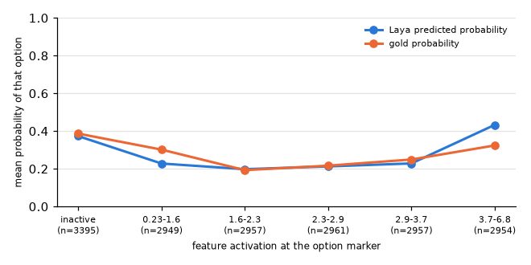

# Feature 7558

Critérios em que aparece: changed_base_vs_ft

**Interpretação (preencher):** 

---

## Maiores ativações

**tr_customer_service_000173 / category** (choice, customer_service) | ativação 6.781 em `marcador` | opções ['account', 'billing', 'delivery', 'refund', 'technical'] | Laya: **refund** [0.018, 0.065, 0.01, 0.845, 0.062] | gabarito: **refund**

```
[CLS]choice question: What is this customer conversation primarily about?[SEP]
▸ [MASK] account: Login, plan changes, profile or access management.
▸ [MASK] billing: A charge, invoice, subscription or payment problem.
▸ [MASK] delivery: Shipping, fulfilment or delivery of a physical item.
▸ ⟦[MASK]⟧ refund: The customer is explicitly asking for money back.
▸ [MASK] technical: The product or service is not working as expected.

[SEP]

{"account": {"lifetime_value_usd": 985, "prior_tickets_90d": 0, "seats": 1, "tenure_months": 11, "tier": "free"}, "orders": [{"amount_usd": 19, "date": "2026-01-24", "id": "A-47026", "status": "pending"}], "thread": [{"role": "customer", "text": "It has been two weeks since I requested my $19 refund and I still haven't seen anything. I've been a loyal customer for 11 months, but if you guys can't handle basic billing, I’m taking my business elsewhere."}, {"role": "agent", "text": "I apologize for the delay you've experienced. Could you please provide the case number from your initial refund request so I can look into the status of that transaction for you?"}, {"role": "customer", "text": "I don't have a case number because nobody ever sent me one, which is exactly why I'm so frustrated."}]}[SEP]
```

**tr_customer_service_000259 / category** (choice, customer_service) | ativação 6.664 em `marcador` | opções ['account', 'billing', 'delivery', 'refund', 'technical'] | Laya: **refund** [0.026, 0.041, 0.012, 0.891, 0.031] | gabarito: **refund**

```
[CLS]choice question: What is this customer conversation primarily about?[SEP]
▸ [MASK] account: Login, plan changes, profile or access management.
▸ [MASK] billing: A charge, invoice, subscription or payment problem.
▸ [MASK] delivery: Shipping, fulfilment or delivery of a physical item.
▸ ⟦[MASK]⟧ refund: The customer is explicitly asking for money back.
▸ [MASK] technical: The product or service is not working as expected.

[SEP]

{"account": {"lifetime_value_usd": 2451, "prior_tickets_90d": 3, "seats": 1, "tenure_months": 26, "tier": "standard"}, "thread": [{"role": "customer", "text": "I was promised a refund for the double charge last month and I still haven’t seen any money back—what's the status?"}, {"role": "agent", "text": "I understand your frustration. Could you provide the transaction ID or the date of the charge so I can look it up?"}, {"role": "customer", "text": "The charge was on March 12th, reference #TXN‑20230312‑07. I need to know what’s happening with my refund right now."}]}[SEP]
```

**tr_customer_service_000158 / urgency** (score, customer_service) | ativação 6.371 em `marcador` | opções ['0', '1', '2', '3'] | Laya: **1** [0.083, 0.797, 0.073, 0.047] | gabarito: **1**

```
[CLS]score question: How time-sensitive is this conversation?[SEP]
▸ [MASK] level 0: No time pressure; can wait indefinitely.
▸ ⟦[MASK]⟧ level 1: Routine; handle within the normal queue.
▸ [MASK] level 2: Elevated; should be handled within the same week.
▸ [MASK] level 3: Critical; requires action within the same day.

[SEP]

{"account": {"lifetime_value_usd": 134, "prior_tickets_90d": 5, "seats": 5, "tenure_months": 3, "tier": "enterprise"}, "orders": [{"amount_usd": 49, "date": "2026-02-16", "id": "A-54178", "status": "settled"}, {"amount_usd": 49, "date": "2026-02-18", "id": "A-29578", "status": "settled"}, {"amount_usd": 49, "date": "2026-01-24", "id": "A-46676", "status": "refunded"}], "thread": [{"role": "customer", "text": "The bulk‑upload feature stopped accepting CSV files; it returns a generic error as soon as I click Submit."}]}[SEP]
```

**tr_customer_service_000014 / category** (choice, customer_service) | ativação 6.336 em `marcador` | opções ['account', 'billing', 'delivery', 'refund', 'technical'] | Laya: **refund** [0.011, 0.008, 0.006, 0.961, 0.014] | gabarito: **refund**

```
[CLS]choice question: What is this customer conversation primarily about?[SEP]
▸ [MASK] account: Login, plan changes, profile or access management.
▸ [MASK] billing: A charge, invoice, subscription or payment problem.
▸ [MASK] delivery: Shipping, fulfilment or delivery of a physical item.
▸ ⟦[MASK]⟧ refund: The customer is explicitly asking for money back.
▸ [MASK] technical: The product or service is not working as expected.

[SEP]

{"account": {"lifetime_value_usd": 563, "prior_tickets_90d": 0, "seats": 1, "tenure_months": 8, "tier": "free"}, "thread": [{"role": "customer", "text": "I requested a refund two weeks ago and haven’t heard anything; I’ve been on the free plan for eight months, so I’m just waiting now."}, {"role": "agent", "text": "I’m sorry for the delay. Could you provide the refund request reference number or the email it was sent from?"}, {"role": "customer", "text": "It was sent from my account@myemail.com, reference #R5678. Please let me know what the next steps are."}]}[SEP]
```

**tr_customer_service_000006 / churn_risk** (score, customer_service) | ativação 6.254 em `marcador` | opções ['0', '1', '2', '3'] | Laya: **2** [0.063, 0.403, 0.474, 0.06] | gabarito: **1**

```
[CLS]score question: How likely is this customer to stop doing business with us because of this interaction?[SEP]
▸ [MASK] level 0: No sign of dissatisfaction.
▸ ⟦[MASK]⟧ level 1: Mild frustration, but the relationship is intact.
▸ [MASK] level 2: Clearly unhappy; repeat problems or explicit complaints.
▸ [MASK] level 3: Imminent: threatening to cancel, dispute or leave.

[SEP]

{"account": {"lifetime_value_usd": 1556, "prior_tickets_90d": 0, "seats": 1, "tenure_months": 49, "tier": "standard"}, "orders": [{"amount_usd": 49, "date": "2026-01-27", "id": "A-87881", "status": "pending"}, {"amount_usd": 49, "date": "2026-01-07", "id": "A-73934", "status": "settled"}, {"amount_usd": 49, "date": "2026-03-13", "id": "A-93118", "status": "pending"}], "thread": [{"role": "customer", "text": "I've been a member for years and suddenly everything is taking forever to load, but I haven't changed my internet or anything, so I'm not sure what's going on."}, {"role": "agent", "text": "That sounds frustrating. To help me narrow this down, is the slowness happening across the whole site or just when you try to save your work?"}, {"role": "customer", "text": "It's everywhere, even the main dashboard is crawling, and I just don't know why it's behaving this way all of a sudden."}]}[SEP]
```

## Ativações medianas (faixa 40-60%, mediana 1.219)

**tr_security_incidents_000083 / urgency** (score, security_incidents) | ativação 1.377 em `opção` | opções ['0', '1', '2', '3'] | Laya: **1** [0.129, 0.599, 0.134, 0.138] | gabarito: **3**

```
[CLS]score question: How quickly must a responder act on this alert?[SEP]
▸ [MASK] level 0⟦:⟧ No time pressure; can wait indefinitely.
▸ [MASK] level 1: Routine; handle within the normal queue.
▸ [MASK] level 2: Elevated; should be handled within the same week.
▸ [MASK] level 3: Critical; requires action within the same day.

[SEP]

{"alert": {"description": "a long-unused account became active", "evidence": "At 2026-09-14 22:05:00 UTC, the privileged CI runner account \"ci-runner-07\"—inactive for 312 days—initiated a Git fetch from IP 192.0.2.77, which is not part of the trusted network. No change window was active, MFA was enabled for the account, and its credentials were last refreshed 14 days prior.", "rule": "dormant_account_use"}, "context": {"asset_criticality": "medium", "change_window_active": false, "source_on_allowlist": false}, "history": {"credential_rotation_days_ago": 14, "distinct_countries_30d": 2, "logins_30d": 356, "prior_alerts_90d": 0}, "principal": {"mfa_enrolled": true, "name": "ci-support-380", "privileges": ["deploy:production", "secrets:read"], "type": "ci_runner"}}[SEP]
```

**tr_invoice_processing_000115 / urgency** (score, invoice_processing) | ativação 1.469 em `opção` | opções ['0', '1', '2', '3'] | Laya: **1** [0.229, 0.529, 0.144, 0.098] | gabarito: **3**

```
[CLS]score question: How time-sensitive is processing this invoice?[SEP]
▸ [MASK] level 0: No time pressure; can wait indefinitely.
▸ [MASK] level 1: Routine; handle within the normal queue.
▸ [MASK] level 2: Elevated; should be handled within the same week⟦.⟧
▸ [MASK] level 3: Critical; requires action within the same day.

[SEP]

{"delivery": {"condition": "accepted", "date": "2026-03-01", "received_qty": 250}, "invoice": {"currency": "USD", "id": "INV-2026-2237", "lines": [{"qty": 250, "sku": "SKU-253", "total_usd": 43517.5, "unit_usd": 174.07}], "total_usd": 43517.5, "vendor": "Acme Fabrication"}, "payment": {"days_until_due": -21, "discount_expires_in_days": 6, "early_payment_discount_pct": 2.0, "status": "overdue", "terms": "net 15"}, "purchase_order": {"freight_terms": "freight prepaid by vendor, not separately billable", "id": "PO-2032", "lines": [{"qty": 250, "unit_usd": 169.0}], "total_usd": 42250.0}, "vendor_history": {"disputes_12m": 1, "invoices_12m": 42, "prior_invoice_ids": ["INV-2026-7782", "INV-2026-3580", "INV-2026-5842"]}}[SEP]
```

**tr_agent_trace_observability_000083 / urgency** (score, agent_trace_observability) | ativação 1.493 em `opção` | opções ['0', '1', '2', '3'] | Laya: **1** [0.194, 0.675, 0.054, 0.076] | gabarito: **1**

```
[CLS]score question: How quickly does this trace need attention?[SEP]
▸ [MASK] level 0⟦:⟧ No time pressure; can wait indefinitely.
▸ [MASK] level 1: Routine; handle within the normal queue.
▸ [MASK] level 2: Elevated; should be handled within the same week.
▸ [MASK] level 3: Critical; requires action within the same day.

[SEP]

{"agent": {"autonomy": "unsupervised", "model": "internal-agent-v1"}, "constraints": ["Do not force-push to any branch"], "task": "Migrate the user table to the new schema without downtime.", "trace_summary": {"constraint_violations": 0, "duration_s": 427.2, "irreversible_actions": 0, "steps": 10, "tool_errors": 1}}[SEP]
```

**tr_customer_service_000041 / action** (choice, customer_service) | ativação 1.465 em `opção` | opções ['answer_directly', 'close_no_action', 'escalate_to_human', 'execute_refund', 'request_information'] | Laya: **close_no_action** [0.216, 0.293, 0.15, 0.19, 0.15] | gabarito: **escalate_to_human**

```
[CLS]choice question: What should the assistant do next with this conversation?[SEP]
▸ [MASK] answer_directly: The assistant can resolve this itself with information it already has.
▸ [MASK] close_no_action: No further action is warranted; the matter is settled.
▸ [MASK] escalate_to_human: Hand off to a human agent with the appropriate authority.
▸ [MASK] execute_refund: Issue the refund⟦ or⟧ credit the customer is owed.
▸ [MASK] request_information: More detail is needed from the customer before anything can be done.

[SEP]

{"account": {"lifetime_value_usd": 446, "prior_tickets_90d": 1, "seats": 1, "tenure_months": 5, "tier": "free"}, "orders": [{"amount_usd": 999, "date": "2026-01-24", "id": "A-86387", "status": "pending"}, {"amount_usd": 999, "date": "2026-03-10", "id": "A-88077", "status": "settled"}, {"amount_usd": 999, "date": "2026-01-19", "id": "A-21190", "status": "settled"}], "thread": [{"role": "customer", "text": "I thought my order was supposed to arrive last week, but nothing’s here yet. I need it for the event on Friday and I’m completely confused."}, {"role": "agent", "text": "I understand how frustrating that can be. Could you share the order number so I can look into the shipping status?"}, {"role": "customer", "text": "It’s #A12345. The tracking just says ‘in transit’ and I’ve got no idea where it is."}, {"role": "agent", "text": "Thanks for that. Do you know which carrier was selected for the shipment? That will help me pinpoint the delay."}, {"role": "customer", "text": "It was supposed to be UPS, but I’m not sure if they even have it. I really need it before Friday, can anything be done?"}]}[SEP]
```

**tr_customer_service_000218 / churn_risk** (score, customer_service) | ativação 1.536 em `opção` | opções ['0', '1', '2', '3'] | Laya: **2** [0.054, 0.112, 0.655, 0.179] | gabarito: **2**

```
[CLS]score question: How likely is this customer to stop doing business with us because of this interaction?[SEP]
▸ [MASK] level 0: No sign of dissatisfaction.
▸ [MASK] level 1: Mild frustration, but the relationship is intact.
▸ [MASK] level 2: Clearly unhappy; repeat problems or explicit complaints.
▸ [MASK] level⟦ 3⟧: Imminent: threatening to cancel, dispute or leave.

[SEP]

{"account": {"lifetime_value_usd": 1493, "prior_tickets_90d": 0, "seats": 1, "tenure_months": 26, "tier": "enterprise"}, "orders": [{"amount_usd": 87, "date": "2026-02-14", "id": "A-33952", "status": "settled"}, {"amount_usd": 87, "date": "2026-02-17", "id": "A-46877", "status": "pending"}], "thread": [{"role": "customer", "text": "I just looked at my statement and you've charged me twice for the same subscription! This is completely unacceptable for an enterprise account."}, {"role": "agent", "text": "I understand your concern regarding the duplicate billing. To help me investigate, could you clarify if both charges show the same transaction ID or different ones?"}, {"role": "customer", "text": "They are both for $87 and they hit my account on the same day. Fix this immediately, I don't have time to play detective for your billing errors."}, {"role": "agent", "text": "I see the two entries for $87 you're referring to. Are there any other unexpected line items on your recent invoice that I should be aware of?"}, {"role": "customer", "text": "No, just these two. It's ridiculous that a company of your size can't manage basic accounting. I want my money back now."}, {"role": "agent", "text": "I am currently reviewing the ledger for the past 26 months of your service. Could you confirm the date the charges first appeared on your bank statement?"}, {"role": "customer", "text": "It was the 14th. Just look at the records, it's clear as day that I've been overcharged and I shouldn't have to keep explaining this to you."}]}[SEP]
```

## Estatísticas (conjunto de descoberta, dev e teste)

**pred / error**

| split | decisões | ativas | ativas e Laya errou | taxa | lift | q (BH) | OR (CMH) | q (CMH) |
|---|---|---|---|---|---|---|---|---|
| discovery | 5100 | 3927 | 2616 | 0.666 | 1.05 | 1.56e-14 | 0.99 | 0.964 |
| dev | 900 | 673 | 448 | 0.666 | 1.01 | 0.653 | 0.71 | 0.784 |
| test | 2000 | 1532 | 1027 | 0.670 | 1.05 | 3e-07 | 0.99 | 0.83 |

**corr / error**

| split | decisões | ativas | ativas e Laya errou | taxa | lift | q (BH) | OR (CMH) | q (CMH) |
|---|---|---|---|---|---|---|---|---|
| discovery | 5100 | 3747 | 2436 | 0.650 | 1.02 | 0.0011 | 1.06 | 0.911 |
| dev | 900 | 657 | 432 | 0.658 | 1.00 | 1 | 0.18 | 0.725 |
| test | 2000 | 1488 | 983 | 0.661 | 1.04 | 0.000448 | 0.58 | 0.745 |

**state / error**

| split | decisões | ativas | ativas e Laya errou | taxa | lift | q (BH) | OR (CMH) | q (CMH) |
|---|---|---|---|---|---|---|---|---|
| discovery | 5100 | 4429 | 2827 | 0.638 | 1.00 | 0.75 | 1.16 | 0.255 |
| dev | 900 | 783 | 512 | 0.654 | 1.00 | 1 | 0.81 | 0.647 |
| test | 2000 | 1713 | 1094 | 0.639 | 1.00 | 1 | 0.88 | 0.598 |

Confusão mais sobre-representada (pred): `urgency|1>3` (n=292, lift 1.30, p=5.31e-35). Formato `pergunta|índice previsto>índice correto`.

Confusão mais sobre-representada (corr): `urgency|1>3` (n=292, lift 1.36, p=3.44e-41). Formato `pergunta|índice previsto>índice correto`.

Confusão mais sobre-representada (state): `duplicate|1>0` (n=214, lift 1.14, p=1.79e-11). Formato `pergunta|índice previsto>índice correto`.



