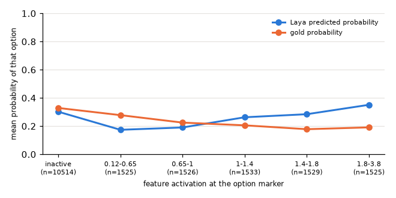

# Feature 8309

Critérios em que aparece: changed_base_vs_ft

**Interpretação (preencher):** 

---

## Maiores ativações

**tr_security_incidents_000250 / severity** (score, security_incidents) | ativação 6.117 em `estado` | opções ['0', '1', '2', '3', '4'] | Laya: **2** [0.066, 0.332, 0.354, 0.194, 0.053] | gabarito: **3**

```
[CLS]score question: How severe is the potential impact if this alert is real?[SEP]
▸ [MASK] level 0: Negligible: no access to anything sensitive.
▸ [MASK] level 1: Low: limited access, easily reversed.
▸ [MASK] level 2: Moderate: access to internal systems or non-public data.
▸ [MASK] level 3: High: access to production, secrets or customer data.
▸ [MASK] level 4: Critical: active compromise of crown-jewel systems.

[SEP]

{"alert": {"description": "two successful logins from distant locations too close together", "evidence": "A contractor account logged in from New York at 08:00 UTC and subsequently from London at 08:45 UTC. The user credentials associated with⟦ this⟧ unprivileged account were last rotated one year ago, though both access events originated from allowlisted IP addresses.", "rule": "impossible_travel"}, "context": {"asset_criticality": "crown_jewel", "change_window_active": false, "source_on_allowlist": true}, "history": {"credential_rotation_days_ago": 365, "distinct_countries_30d": 3, "logins_30d": 698, "prior_alerts_90d": 0}, "principal": {"mfa_enrolled": true, "name": "svc-analytics-492", "privileges": ["repo:read"], "type": "contractor"}}[SEP]
```

**tr_security_incidents_000250 / urgency** (score, security_incidents) | ativação 5.477 em `estado` | opções ['0', '1', '2', '3'] | Laya: **1** [0.134, 0.728, 0.098, 0.04] | gabarito: **2**

```
[CLS]score question: How quickly must a responder act on this alert?[SEP]
▸ [MASK] level 0: No time pressure; can wait indefinitely.
▸ [MASK] level 1: Routine; handle within the normal queue.
▸ [MASK] level 2: Elevated; should be handled within the same week.
▸ [MASK] level 3: Critical; requires action within the same day.

[SEP]

{"alert": {"description": "two successful logins from distant locations too close together", "evidence": "A contractor account logged in from New York at 08:00 UTC and subsequently from London at 08:45 UTC. The user credentials associated with⟦ this⟧ unprivileged account were last rotated one year ago, though both access events originated from allowlisted IP addresses.", "rule": "impossible_travel"}, "context": {"asset_criticality": "crown_jewel", "change_window_active": false, "source_on_allowlist": true}, "history": {"credential_rotation_days_ago": 365, "distinct_countries_30d": 3, "logins_30d": 698, "prior_alerts_90d": 0}, "principal": {"mfa_enrolled": true, "name": "svc-analytics-492", "privileges": ["repo:read"], "type": "contractor"}}[SEP]
```

**tr_customer_service_000215 / urgency** (score, customer_service) | ativação 5.285 em `opção` | opções ['0', '1', '2', '3'] | Laya: **1** [0.106, 0.361, 0.256, 0.278] | gabarito: **1**

```
[CLS]score question: How time-sensitive is this conversation?[SEP]
▸ [MASK] level 0: No time pressure; can wait indefinitely.
▸ [MASK] level⟦ 1⟧: Routine; handle within the normal queue.
▸ [MASK] level 2: Elevated; should be handled within the same week.
▸ [MASK] level 3: Critical; requires action within the same day.

[SEP]

{"account": {"lifetime_value_usd": 182, "prior_tickets_90d": 1, "seats": 1, "tenure_months": 8, "tier": "free"}, "thread": [{"role": "customer", "text": "Managing seats on the free tier is a nightmare—every time I try to add or remove a user, the UI freezes and I lose my changes."}, {"role": "agent", "text": "That definitely isn’t the experience we want you to have. Could you let me know exactly where in the seat management page the freeze occurs?"}, {"role": "customer", "text": "It happens when I hit ‘Add new seat’ and also when I click the trash can icon to delete a user. The screen just spins and never updates."}, {"role": "agent", "text": "Thanks for the specifics. Are you seeing any error messages in the browser console, or does it just stay on the loading spinner?"}, {"role": "customer", "text": "No error pop‑ups, just the endless spinner. I’ve been on the free plan for eight months and this is the only time I’ve run into such a problem."}]}[SEP]
```

**tr_security_incidents_000011 / credential_compromise** (noul, security_incidents) | ativação 5.223 em `estado` | opções ['false', 'true'] | Laya: **true** [0.447, 0.553] | gabarito: **false**

```
[CLS]noul question: The evidence indicates a credential or account has been compromised.[SEP]
▸ [MASK] false: no, the statement does not hold
▸ [MASK] true: yes, the statement holds

[SEP]

{"alert": {"description": "audit logging was turned off on a host", "evidence": "Audit logging was disabled on a host by⟦ an⟧ unprivileged employee account authenticated via MFA. The action originated from an allowlisted IP address and was performed without a corresponding entry in the scheduled change window.", "rule": "disabled_logging"}, "context": {"asset_criticality": "medium", "change_window_active": false, "source_on_allowlist": true}, "history": {"credential_rotation_days_ago": 14, "distinct_countries_30d": 4, "logins_30d": 1338, "prior_alerts_90d": 1}, "principal": {"mfa_enrolled": true, "name": "svc-billing-846", "privileges": ["repo:read"], "type": "employee"}}[SEP]
```

**tr_customer_service_000017 / category** (choice, customer_service) | ativação 5.160 em `estado` | opções ['account', 'billing', 'delivery', 'refund', 'technical'] | Laya: **billing** [0.053, 0.649, 0.021, 0.197, 0.08] | gabarito: **billing**

```
[CLS]choice question: What is this customer conversation primarily about?[SEP]
▸ [MASK] account: Login, plan changes, profile or access management.
▸ [MASK] billing: A charge, invoice, subscription or payment problem.
▸ [MASK] delivery: Shipping, fulfilment or delivery of a physical item.
▸ [MASK] refund: The customer is explicitly asking for money back.
▸ [MASK] technical: The product or service is not working as expected.

[SEP]

{"account": {"lifetime_value_usd": 228, "prior_tickets_90d": 3, "seats": 1, "tenure_months": 11, "tier": "premium"}, "orders": [{"amount_usd": 29, "date": "2026-03-25", "id": "A-17351", "status": "settled"}, {"amount_usd": 29, "date": "2026-02-18", "id": "A-55118", "status": "settled"}], "thread": [{"role": "customer", "text": "My payment for the $29 subscription failed this morning. I have a presentation tomorrow morning at 9:00 AM that requires this access, so I need this cleared up immediately."}, {"role": "agent", "text": "I see the status of your account. Before we look into the billing error⟦,⟧ could you confirm if the payment method on file has expired or if you have recently updated your banking information?"}, {"role": "customer", "text": "The card is current and active. I have had three previous tickets regarding billing glitches that were supposedly addressed, yet here I am again with the same issue."}, {"role": "agent", "text": "I acknowledge your frustration regarding the previous tickets. To investigate this specific failure, could you provide the transaction reference ID shown in your payment history?"}, {"role": "customer", "text": "I am looking at my bank portal now, but I don't see a reference ID generated for this attempt. How are we going to fix this before my deadline tomorrow?"}]}[SEP]
```

## Ativações medianas (faixa 40-60%, mediana 0.880)

**tr_security_incidents_000090 / true_positive** (noul, security_incidents) | ativação 0.777 em `estado` | opções ['false', 'true'] | Laya: **false** [0.693, 0.307] | gabarito: **true**

```
[CLS]noul question: This alert reflects genuinely malicious or unauthorised activity.[SEP]
▸ [MASK] false: Benign activity, a misconfiguration, or a known false positive.
▸ [MASK] true: The underlying behaviour is malicious or unauthorised.

[SEP]

{"alert": {"description": "two successful logins from distant locations too close together", "evidence": "At 2026-09-14 03:12:04 UTC⟦ a⟧ successful authentication for the CI_Runner service was logged from IP 203.0.113.45 (Paris, FR). A second successful login for the same principal occurred 6 minutes later from IP 198.51.100.22 (Tokyo, JP), and the system flagged the source as not present in the allowlist. The change‑window flag was active and the associated credentials were last rotated on 2026-08-15.", "rule": "impossible_travel"}, "context": {"asset_criticality": "high", "change_window_active": true, "source_on_allowlist": false}, "history": {"credential_rotation_days_ago": 30, "distinct_countries_30d": 1, "logins_30d": 587, "prior_alerts_90d": 0}, "principal": {"mfa_enrolled": true, "name": "adm-billing-542", "privileges": ["deploy:production", "secrets:read"], "type": "ci_runner"}}[SEP]
```

**tr_customer_service_000234 / needs_human** (noul, customer_service) | ativação 0.979 em `estado` | opções ['false', 'true'] | Laya: **true** [0.234, 0.766] | gabarito: **true**

```
[CLS]noul question: This conversation requires a human agent rather than automated handling.[SEP]
▸ [MASK] false: Automation can carry this to resolution.
▸ [MASK] true: A human must take over: judgement, authority or empathy is required.

[SEP]

{"account": {"lifetime_value_usd": 1458, "prior_tickets_90d": 0, "seats": 3, "tenure_months": 33, "tier": "premium"}, "thread": [{"role": "customer", "text": "I’ve been paying for this premium plan for 33 months without a single hitch, but now I’m completely locked out and I have a hard deadline in two hours. Why⟦ is⟧ the login screen just spinning?"}, {"role": "agent", "text": "I’m sorry to hear you're experiencing this frustration right now. Could you please confirm the exact error message or code you are seeing when the page hangs?"}, {"role": "customer", "text": "There is no code! It’s just a blank page after I enter my credentials. I have a massive report due for my firm by noon and I can’t get in to export the data. This is ridiculous."}, {"role": "agent", "text": "I understand the urgency of this report. To help me narrow down the cause, are you accessing the portal through a browser or our desktop application?"}, {"role": "customer", "text": "I’m using Chrome on my desktop. I’ve already cleared my cache and tried an incognito window, so don't even suggest that. Fix this now."}]}[SEP]
```

**tr_customer_service_000261 / urgency** (score, customer_service) | ativação 0.783 em `estado` | opções ['0', '1', '2', '3'] | Laya: **1** [0.165, 0.444, 0.1, 0.29] | gabarito: **3**

```
[CLS]score question: How time-sensitive is this conversation?[SEP]
▸ [MASK] level 0: No time pressure; can wait indefinitely.
▸ [MASK] level 1: Routine; handle within the normal queue.
▸ [MASK] level 2: Elevated; should be handled within the same week.
▸ [MASK] level 3: Critical; requires action within the same day.

[SEP]

{"account": {"lifetime_value_usd": 244, "prior_tickets_90d": 1, "seats": 40, "tenure_months": 5, "tier": "premium"}, "orders": [{"amount_usd": 57, "date": "2026-02-23", "id": "A-35156", "status": "refunded"}, {"amount_usd": 57, "date": "2026-01-11", "id": "A-26925⟦",⟧ "status": "pending"}, {"amount_usd": 57, "date": "2026-01-04", "id": "A-63187", "status": "failed"}], "thread": [{"role": "customer", "text": "I’ve been paying for the $57 Premium plan for five months now, and the reporting feature is still completely broken. I opened a ticket about this weeks ago and was told it’d be fixed, but nothing has changed. If this isn't working by my presentation tomorrow morning, I’m canceling my subscription and moving to a competitor."}, {"role": "agent", "text": "I understand how critical that reporting feature is for your upcoming presentation. To help me look into this further, could you please clarify if you're seeing a specific error message or if the data simply isn't loading when you attempt to run the report?"}, {"role": "customer", "text": "It just hangs on a white screen every single time. I don't have time for more 'clarifications'—I need someone to actually look at why my account is failing before I lose my client."}]}[SEP]
```

**tr_security_incidents_000099 / credential_compromise** (noul, security_incidents) | ativação 0.902 em `estado` | opções ['false', 'true'] | Laya: **false** [0.753, 0.247] | gabarito: **false**

```
[CLS]noul question: The evidence indicates a credential or account has been compromised.[SEP]
▸ [MASK] false: no, the statement does not hold
▸ [MASK] true: yes, the statement holds

[SEP]

{"alert":⟦ {"⟧description": "a security group was opened to the public internet", "evidence": "At 2026-09-15 03:42 UTC, security group SG-9f2b3c was altered to include an inbound rule allowing 0.0.0.0/0 on TCP port 443. The change was performed by user alice@example.com (admin, MFA enabled) from IP 203.0.113.45, which is not listed in the known asset inventory. The credentials used for this action were last rotated on 2026-09-12.", "rule": "config_drift"}, "context": {"asset_criticality": "low", "change_window_active": false, "source_on_allowlist": false}, "history": {"credential_rotation_days_ago": 3, "distinct_countries_30d": 4, "logins_30d": 1790, "prior_alerts_90d": 8}, "principal": {"mfa_enrolled": true, "name": "ci-support-886", "privileges": ["repo:read"], "type": "admin"}}[SEP]
```

**tr_customer_service_000095 / action** (choice, customer_service) | ativação 0.899 em `marcador` | opções ['answer_directly', 'close_no_action', 'escalate_to_human', 'execute_refund', 'request_information'] | Laya: **escalate_to_human** [0.147, 0.236, 0.449, 0.047, 0.121] | gabarito: **escalate_to_human**

```
[CLS]choice question: What should the assistant do next with this conversation?[SEP]
▸ [MASK] answer_directly: The assistant can resolve this itself with information it already has.
▸ ⟦[MASK]⟧ close_no_action: No further action is warranted; the matter is settled.
▸ [MASK] escalate_to_human: Hand off to a human agent with the appropriate authority.
▸ [MASK] execute_refund: Issue the refund or credit the customer is owed.
▸ [MASK] request_information: More detail is needed from the customer before anything can be done.

[SEP]

{"account": {"lifetime_value_usd": 2044, "prior_tickets_90d": 1, "seats": 12, "tenure_months": 60, "tier": "premium"}, "thread": [{"role": "customer", "text": "I am beyond frustrated. I’ve been a loyal premium customer for five years, and the item I just received is already damaged. This is unacceptable, especially since my previous ticket about the shipping quality is still just sitting there ignored."}, {"role": "agent", "text": "I truly apologize for the frustration caused by the state of your delivery. To better assist you, could you please provide a few photos of the damage so I can document the issue?"}, {"role": "customer", "text": "I shouldn't have to jump through hoops to prove this arrived broken when your company has a history of these failures. My time is being wasted."}]}[SEP]
```

## Estatísticas (conjunto de descoberta, dev e teste)

**pred / error**

| split | decisões | ativas | ativas e Laya errou | taxa | lift | q (BH) | OR (CMH) | q (CMH) |
|---|---|---|---|---|---|---|---|---|
| discovery | 5100 | 2206 | 1520 | 0.689 | 1.08 | 6.58e-11 | 1.98 | 0.00191 |
| dev | 900 | 404 | 277 | 0.686 | 1.04 | 0.328 | 0.86 | 0.882 |
| test | 2000 | 888 | 650 | 0.732 | 1.15 | 6.36e-14 | 1.38 | 0.417 |

**corr / error**

| split | decisões | ativas | ativas e Laya errou | taxa | lift | q (BH) | OR (CMH) | q (CMH) |
|---|---|---|---|---|---|---|---|---|
| discovery | 5100 | 1593 | 907 | 0.569 | 0.89 | 9.56e-11 | 3.80 | 4.89e-09 |
| dev | 900 | 286 | 159 | 0.556 | 0.85 | 6.51e-05 | 4.07 | 0.0151 |
| test | 2000 | 632 | 394 | 0.623 | 0.98 | 0.474 | 4.55 | 4.53e-07 |

**state / error**

| split | decisões | ativas | ativas e Laya errou | taxa | lift | q (BH) | OR (CMH) | q (CMH) |
|---|---|---|---|---|---|---|---|---|
| discovery | 5100 | 4869 | 3086 | 0.634 | 1.00 | 0.348 | 0.88 | 0.596 |
| dev | 900 | 865 | 566 | 0.654 | 1.00 | 1 | 0.74 | 0.734 |
| test | 2000 | 1900 | 1197 | 0.630 | 0.99 | 0.158 | 0.56 | 0.0898 |

Confusão mais sobre-representada (pred): `disposition|0>2` (n=239, lift 2.31, p=0). Formato `pergunta|índice previsto>índice correto`.

Confusão mais sobre-representada (corr): `action|0>1` (n=119, lift 3.20, p=0). Formato `pergunta|índice previsto>índice correto`.

Confusão mais sobre-representada (state): `duplicate|1>0` (n=214, lift 1.04, p=0.00247). Formato `pergunta|índice previsto>índice correto`.



