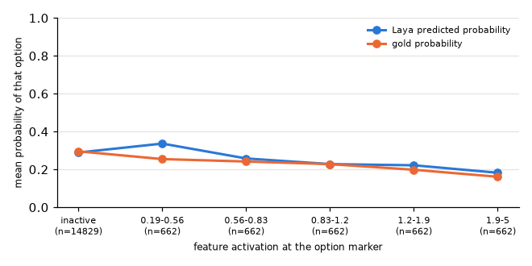

# Feature 8737

Critérios em que aparece: changed_base_vs_ft

**Interpretação (preencher):** 

---

## Maiores ativações

**tr_customer_service_000263 / category** (choice, customer_service) | ativação 6.086 em `opção` | opções ['account', 'billing', 'delivery', 'refund', 'technical'] | Laya: **technical** [0.149, 0.127, 0.108, 0.245, 0.372] | gabarito: **delivery**

```
[CLS]choice question: What is this customer conversation primarily about?[SEP]
▸ [MASK] account⟦:⟧ Login, plan changes, profile or access management.
▸ [MASK] billing: A charge, invoice, subscription or payment problem.
▸ [MASK] delivery: Shipping, fulfilment or delivery of a physical item.
▸ [MASK] refund: The customer is explicitly asking for money back.
▸ [MASK] technical: The product or service is not working as expected.

[SEP]

{"account": {"lifetime_value_usd": 270, "prior_tickets_90d": 5, "seats": 1, "tenure_months": 3, "tier": "enterprise"}, "orders": [{"amount_usd": 9, "date": "2026-02-14", "id": "A-24658", "status": "settled"}, {"amount_usd": 9, "date": "2026-01-01", "id": "A-74253", "status": "settled"}], "thread": [{"role": "customer", "text": "This is the sixth time in three months I’ve received the wrong shipment, despite being on an Enterprise agreement. I’ve had five tickets about this already that were supposedly resolved, but the error keeps recurring and I absolutely need the correct hardware for our site launch on Friday."}]}[SEP]
```

**tr_customer_service_000095 / category** (choice, customer_service) | ativação 5.871 em `opção` | opções ['account', 'billing', 'delivery', 'refund', 'technical'] | Laya: **delivery** [0.039, 0.042, 0.419, 0.387, 0.112] | gabarito: **delivery**

```
[CLS]choice question: What is this customer conversation primarily about?[SEP]
▸ [MASK] account⟦:⟧ Login, plan changes, profile or access management.
▸ [MASK] billing: A charge, invoice, subscription or payment problem.
▸ [MASK] delivery: Shipping, fulfilment or delivery of a physical item.
▸ [MASK] refund: The customer is explicitly asking for money back.
▸ [MASK] technical: The product or service is not working as expected.

[SEP]

{"account": {"lifetime_value_usd": 2044, "prior_tickets_90d": 1, "seats": 12, "tenure_months": 60, "tier": "premium"}, "thread": [{"role": "customer", "text": "I am beyond frustrated. I’ve been a loyal premium customer for five years, and the item I just received is already damaged. This is unacceptable, especially since my previous ticket about the shipping quality is still just sitting there ignored."}, {"role": "agent", "text": "I truly apologize for the frustration caused by the state of your delivery. To better assist you, could you please provide a few photos of the damage so I can document the issue?"}, {"role": "customer", "text": "I shouldn't have to jump through hoops to prove this arrived broken when your company has a history of these failures. My time is being wasted."}]}[SEP]
```

**tr_customer_service_000263 / category** (choice, customer_service) | ativação 5.852 em `opção` | opções ['account', 'billing', 'delivery', 'refund', 'technical'] | Laya: **technical** [0.149, 0.127, 0.108, 0.245, 0.372] | gabarito: **delivery**

```
[CLS]choice question: What is this customer conversation primarily about?[SEP]
▸ [MASK] account: Login⟦,⟧ plan changes, profile or access management.
▸ [MASK] billing: A charge, invoice, subscription or payment problem.
▸ [MASK] delivery: Shipping, fulfilment or delivery of a physical item.
▸ [MASK] refund: The customer is explicitly asking for money back.
▸ [MASK] technical: The product or service is not working as expected.

[SEP]

{"account": {"lifetime_value_usd": 270, "prior_tickets_90d": 5, "seats": 1, "tenure_months": 3, "tier": "enterprise"}, "orders": [{"amount_usd": 9, "date": "2026-02-14", "id": "A-24658", "status": "settled"}, {"amount_usd": 9, "date": "2026-01-01", "id": "A-74253", "status": "settled"}], "thread": [{"role": "customer", "text": "This is the sixth time in three months I’ve received the wrong shipment, despite being on an Enterprise agreement. I’ve had five tickets about this already that were supposedly resolved, but the error keeps recurring and I absolutely need the correct hardware for our site launch on Friday."}]}[SEP]
```

**tr_customer_service_000093 / category** (choice, customer_service) | ativação 5.762 em `opção` | opções ['account', 'billing', 'delivery', 'refund', 'technical'] | Laya: **technical** [0.28, 0.128, 0.074, 0.212, 0.307] | gabarito: **technical**

```
[CLS]choice question: What is this customer conversation primarily about?[SEP]
▸ [MASK] account⟦:⟧ Login, plan changes, profile or access management.
▸ [MASK] billing: A charge, invoice, subscription or payment problem.
▸ [MASK] delivery: Shipping, fulfilment or delivery of a physical item.
▸ [MASK] refund: The customer is explicitly asking for money back.
▸ [MASK] technical: The product or service is not working as expected.

[SEP]

{"account": {"lifetime_value_usd": 2245, "prior_tickets_90d": 1, "seats": 1, "tenure_months": 26, "tier": "premium"}, "thread": [{"role": "customer", "text": "After 26 months of being a premium member, I’m sick of these quality issues. I dropped my device once and the casing shattered instantly. This is the same recurring garbage I complained about last time, and if this isn't handled properly, I'm taking my business elsewhere for good."}]}[SEP]
```

**tr_customer_service_000094 / category** (choice, customer_service) | ativação 5.707 em `pergunta` | opções ['account', 'billing', 'delivery', 'refund', 'technical'] | Laya: **billing** [0.077, 0.459, 0.035, 0.204, 0.224] | gabarito: **billing**

```
[CLS]choice question: What is this customer conversation primarily about⟦?⟧[SEP]
▸ [MASK] account: Login, plan changes, profile or access management.
▸ [MASK] billing: A charge, invoice, subscription or payment problem.
▸ [MASK] delivery: Shipping, fulfilment or delivery of a physical item.
▸ [MASK] refund: The customer is explicitly asking for money back.
▸ [MASK] technical: The product or service is not working as expected.

[SEP]

{"account": {"lifetime_value_usd": 979, "prior_tickets_90d": 1, "seats": 1, "tenure_months": 11, "tier": "premium"}, "thread": [{"role": "customer", "text": "I’m looking at my billing statement and I don't understand why the premium plan charges are still hitting my card when I thought I processed a downgrade last week. Can you explain what’s going on?"}, {"role": "agent", "text": "I understand your concern regarding the recent charges. To help me investigate this for you, could you provide the reference number or date from the request you submitted?"}, {"role": "customer", "text": "I don't have a reference number, but it was just a few days ago. Why is this so difficult to track down when I've been with you for 11 months?"}, {"role": "agent", "text": "Thank you for that information. I see you have an open ticket regarding your account status; could you clarify if you received a confirmation email after attempting the downgrade?"}, {"role": "customer", "text": "I might have deleted it, but the site said it was done. It feels like I'm running in circles here with no real answers."}]}[SEP]
```

## Ativações medianas (faixa 40-60%, mediana 0.996)

**tr_customer_service_000297 / urgency** (score, customer_service) | ativação 0.958 em `pergunta` | opções ['0', '1', '2', '3'] | Laya: **1** [0.134, 0.615, 0.173, 0.078] | gabarito: **2**

```
[CLS]score question: How time-sensitive is this conversation⟦?⟧[SEP]
▸ [MASK] level 0: No time pressure; can wait indefinitely.
▸ [MASK] level 1: Routine; handle within the normal queue.
▸ [MASK] level 2: Elevated; should be handled within the same week.
▸ [MASK] level 3: Critical; requires action within the same day.

[SEP]

{"account": {"lifetime_value_usd": 581, "prior_tickets_90d": 2, "seats": 40, "tenure_months": 11, "tier": "enterprise"}, "orders": [{"amount_usd": 299, "date": "2026-03-03", "id": "A-90996", "status": "settled"}], "thread": [{"role": "customer", "text": "I just opened the box and the hardware is cracked, but I'm not sure if this happened during shipping or if it was like this already? I have a hard deadline this Friday and really need this working."}, {"role": "agent", "text": "I'm sorry to hear about the damage. To help me look into this, could you please provide your order number and upload a few photos of the packaging?"}, {"role": "customer", "text": "I think I sent photos in my last two tickets, but I can't remember if they actually saw them. Where do I upload them again?"}]}[SEP]
```

**tr_customer_service_000012 / needs_human** (noul, customer_service) | ativação 1.043 em `estado` | opções ['false', 'true'] | Laya: **true** [0.335, 0.665] | gabarito: **false**

```
[CLS]noul question: This conversation requires a human agent rather than automated handling.[SEP]
▸ [MASK] false: Automation can carry this to resolution.
▸ [MASK] true: A human must take over: judgement, authority or empathy is required.

[SEP]

{"account": {"lifetime_value_usd":⟦ 9⟧16, "prior_tickets_90d": 0, "seats": 1, "tenure_months": 11, "tier": "free"}, "orders": [{"amount_usd": 299, "date": "2026-02-20", "id": "A-54343", "status": "settled"}, {"amount_usd": 299, "date": "2026-03-22", "id": "A-86923", "status": "pending"}, {"amount_usd": 299, "date": "2026-03-03", "id": "A-84166", "status": "failed"}], "thread": [{"role": "customer", "text": "I just opened the box and the device is cracked. I've been with the free plan for almost a year now, paying the $299 when I upgraded, and this is disappointing."}, {"role": "agent", "text": "I'm sorry to hear the item arrived damaged. Could you let me know the model number and whether you have a photo of the damage?"}, {"role": "customer", "text": "Sure, it's model X200 and I can snap a picture, but I need to know what you can do about it before I send anything back."}]}[SEP]
```

**tr_customer_service_000218 / category** (choice, customer_service) | ativação 0.948 em `estado` | opções ['account', 'billing', 'delivery', 'refund', 'technical'] | Laya: **billing** [0.044, 0.563, 0.011, 0.333, 0.048] | gabarito: **billing**

```
[CLS]choice question: What is this customer conversation primarily about?[SEP]
▸ [MASK] account: Login, plan changes, profile or access management.
▸ [MASK] billing: A charge, invoice, subscription or payment problem.
▸ [MASK] delivery: Shipping, fulfilment or delivery of a physical item.
▸ [MASK] refund: The customer is explicitly asking for money back.
▸ [MASK] technical: The product or service is not working as expected.

[SEP]

{"account": {"lifetime_value_usd": 1493, "prior_tickets_90d": 0, "seats": 1, "tenure_months": 26, "tier": "enterprise"}, "orders⟦":⟧ [{"amount_usd": 87, "date": "2026-02-14", "id": "A-33952", "status": "settled"}, {"amount_usd": 87, "date": "2026-02-17", "id": "A-46877", "status": "pending"}], "thread": [{"role": "customer", "text": "I just looked at my statement and you've charged me twice for the same subscription! This is completely unacceptable for an enterprise account."}, {"role": "agent", "text": "I understand your concern regarding the duplicate billing. To help me investigate, could you clarify if both charges show the same transaction ID or different ones?"}, {"role": "customer", "text": "They are both for $87 and they hit my account on the same day. Fix this immediately, I don't have time to play detective for your billing errors."}, {"role": "agent", "text": "I see the two entries for $87 you're referring to. Are there any other unexpected line items on your recent invoice that I should be aware of?"}, {"role": "customer", "text": "No, just these two. It's ridiculous that a company of your size can't manage basic accounting. I want my money back now."}, {"role": "agent", "text": "I am currently reviewing the ledger for the past 26 months of your service. Could you confirm the date the charges first appeared on your bank statement?"}, {"role": "customer", "text": "It was the 14th. Just look at the records, it's clear as day that I've been overcharged and I shouldn't have to keep explaining this to you."}]}[SEP]
```

**tr_customer_service_000036 / needs_human** (noul, customer_service) | ativação 0.959 em `estado` | opções ['false', 'true'] | Laya: **true** [0.47, 0.53] | gabarito: **false**

```
[CLS]noul question: This conversation requires a human agent rather than automated handling.[SEP]
▸ [MASK] false: Automation can carry this to resolution.
▸ [MASK] true: A human must take over: judgement, authority or empathy is required.

[SEP]

{"account": {"lifetime_value_usd": 1490, "prior_tickets_90d": 0, "seats": 1, "tenure_months": 41, "tier": "free"}, "orders": [{"amount_usd": 19, "date": "2026-01-27", "id": "A-60115", "status": "refunded"}], "thread": [{"role": "customer", "text": "Hi there. I've been using the free plan for 41 months now without any issues, but I'm currently unable to log into my account. I have a hard deadline for a project in two hours and I'm really worried about missing it."}, {"role":⟦ "⟧agent", "text": "I understand the urgency of your situation. Could you please let me know if you are receiving a specific error message when you attempt to sign in?"}, {"role": "customer", "text": "It just says 'invalid credentials' even though I've already reset my password twice. I really need to get in before my presentation."}, {"role": "agent", "text": "Thank you for that information. To help me look into this further, could you provide the email address associated with your account?"}, {"role": "customer", "text": "Sure, it is user.test@example.com. Please let me know what we can do quickly, as I am running out of time."}]}[SEP]
```

**tr_customer_service_000119 / action** (choice, customer_service) | ativação 0.899 em `estado` | opções ['answer_directly', 'close_no_action', 'escalate_to_human', 'execute_refund', 'request_information'] | Laya: **close_no_action** [0.226, 0.428, 0.159, 0.061, 0.127] | gabarito: **escalate_to_human**

```
[CLS]choice question: What should the assistant do next with this conversation?[SEP]
▸ [MASK] answer_directly: The assistant can resolve this itself with information it already has.
▸ [MASK] close_no_action: No further action is warranted; the matter is settled.
▸ [MASK] escalate_to_human: Hand off to a human agent with the appropriate authority.
▸ [MASK] execute_refund: Issue the refund or credit the customer is owed.
▸ [MASK] request_information: More detail is needed from the customer before anything can be done.

[SEP]

{"account": {"lifetime_value_usd": 613, "prior_tickets_90d": 1, "seats": 1, "tenure_months": 11, "tier": "standard"}, "orders": [{"amount_usd": 299, "date": "2026-01-13", "id": "A-16098", "status": "failed"}], "thread": [{"role": "customer", "text": "I just received my delivery and it's completely wrong. I paid $299 for the standard plan upgrade equipment, but what arrived in⟦ the⟧ box is the basic version. I’m seriously considering canceling my subscription over this."}, {"role": "agent", "text": "I am very sorry to hear that the incorrect item was delivered. Could you please provide your order number and a photo of the item you received so I can review this?"}, {"role": "customer", "text": "I’ve attached the photo to this ticket. This is the second time I've had issues like this, and frankly, my patience is wearing thin."}]}[SEP]
```

## Estatísticas (conjunto de descoberta, dev e teste)

**pred / error**

| split | decisões | ativas | ativas e Laya errou | taxa | lift | q (BH) | OR (CMH) | q (CMH) |
|---|---|---|---|---|---|---|---|---|
| discovery | 5100 | 921 | 674 | 0.732 | 1.15 | 1.17e-10 | 1.77 | 1.75e-06 |
| dev | 900 | 138 | 92 | 0.667 | 1.02 | 0.996 | 1.24 | 0.698 |
| test | 2000 | 368 | 267 | 0.726 | 1.14 | 0.000353 | 1.44 | 0.179 |

**corr / error**

| split | decisões | ativas | ativas e Laya errou | taxa | lift | q (BH) | OR (CMH) | q (CMH) |
|---|---|---|---|---|---|---|---|---|
| discovery | 5100 | 697 | 450 | 0.646 | 1.01 | 0.645 | 1.03 | 0.891 |
| dev | 900 | 97 | 51 | 0.526 | 0.80 | 0.0114 | 0.73 | 0.686 |
| test | 2000 | 266 | 165 | 0.620 | 0.97 | 0.633 | 0.91 | 0.829 |

**state / error**

| split | decisões | ativas | ativas e Laya errou | taxa | lift | q (BH) | OR (CMH) | q (CMH) |
|---|---|---|---|---|---|---|---|---|
| discovery | 5100 | 1566 | 944 | 0.603 | 0.95 | 0.0209 | 0.96 | 0.746 |
| dev | 900 | 240 | 156 | 0.650 | 0.99 | 1 | 1.04 | 0.939 |
| test | 2000 | 612 | 375 | 0.613 | 0.96 | 0.604 | 0.90 | 0.636 |

Confusão mais sobre-representada (pred): `action|1>2` (n=78, lift 3.46, p=8.23e-29). Formato `pergunta|índice previsto>índice correto`.

Confusão mais sobre-representada (corr): `action|1>2` (n=69, lift 4.04, p=1.07e-28). Formato `pergunta|índice previsto>índice correto`.

Confusão mais sobre-representada (state): `action|1>2` (n=86, lift 2.24, p=7.96e-19). Formato `pergunta|índice previsto>índice correto`.



