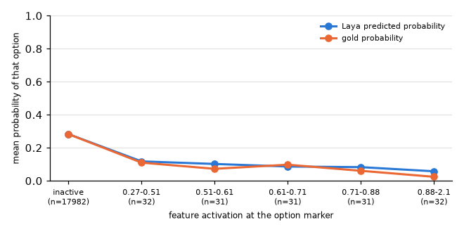

# Feature 9168

Critérios em que aparece: changed_base_vs_ft

**Interpretação (preencher):** 

---

## Maiores ativações

**tr_customer_service_000244 / urgency** (score, customer_service) | ativação 7.805 em `estado` | opções ['0', '1', '2', '3'] | Laya: **1** [0.053, 0.617, 0.175, 0.155] | gabarito: **2**

```
[CLS]score question: How time-sensitive is this conversation?[SEP]
▸ [MASK] level 0: No time pressure; can wait indefinitely.
▸ [MASK] level 1: Routine; handle within the normal queue.
▸ [MASK] level 2: Elevated; should be handled within the same week.
▸ [MASK] level 3: Critical; requires action within the same day.

[SEP]

{"account": {"lifetime_value_usd": 91, "prior_tickets_90d": 0, "seats": 1, "tenure_months": 1, "tier": "standard"}, "thread": [{"role": "customer", "text": "Hi there! I just opened my package and noticed that I received⟦ the⟧ standard kit instead of the deluxe version I had ordered. I hate to be a pain, but I'm actually on a very tight schedule and need the specific components from the deluxe kit for a project deadline on Tuesday. Could you help me figure out how to get the right items sent out?"}]}[SEP]
```

**tr_customer_service_000244 / churn_risk** (score, customer_service) | ativação 7.742 em `estado` | opções ['0', '1', '2', '3'] | Laya: **1** [0.102, 0.785, 0.068, 0.045] | gabarito: **1**

```
[CLS]score question: How likely is this customer to stop doing business with us because of this interaction?[SEP]
▸ [MASK] level 0: No sign of dissatisfaction.
▸ [MASK] level 1: Mild frustration, but the relationship is intact.
▸ [MASK] level 2: Clearly unhappy; repeat problems or explicit complaints.
▸ [MASK] level 3: Imminent: threatening to cancel, dispute or leave.

[SEP]

{"account": {"lifetime_value_usd": 91, "prior_tickets_90d": 0, "seats": 1, "tenure_months": 1, "tier": "standard"}, "thread": [{"role": "customer", "text": "Hi there! I just opened my package and noticed that I received⟦ the⟧ standard kit instead of the deluxe version I had ordered. I hate to be a pain, but I'm actually on a very tight schedule and need the specific components from the deluxe kit for a project deadline on Tuesday. Could you help me figure out how to get the right items sent out?"}]}[SEP]
```

**tr_customer_service_000244 / action** (choice, customer_service) | ativação 6.812 em `estado` | opções ['answer_directly', 'close_no_action', 'escalate_to_human', 'execute_refund', 'request_information'] | Laya: **close_no_action** [0.194, 0.413, 0.085, 0.173, 0.135] | gabarito: **request_information**

```
[CLS]choice question: What should the assistant do next with this conversation?[SEP]
▸ [MASK] answer_directly: The assistant can resolve this itself with information it already has.
▸ [MASK] close_no_action: No further action is warranted; the matter is settled.
▸ [MASK] escalate_to_human: Hand off to a human agent with the appropriate authority.
▸ [MASK] execute_refund: Issue the refund or credit the customer is owed.
▸ [MASK] request_information: More detail is needed from the customer before anything can be done.

[SEP]

{"account": {"lifetime_value_usd": 91, "prior_tickets_90d": 0, "seats": 1, "tenure_months": 1, "tier": "standard"}, "thread": [{"role": "customer", "text": "Hi there! I just opened my package and noticed that I received⟦ the⟧ standard kit instead of the deluxe version I had ordered. I hate to be a pain, but I'm actually on a very tight schedule and need the specific components from the deluxe kit for a project deadline on Tuesday. Could you help me figure out how to get the right items sent out?"}]}[SEP]
```

**tr_customer_service_000244 / category** (choice, customer_service) | ativação 6.367 em `estado` | opções ['account', 'billing', 'delivery', 'refund', 'technical'] | Laya: **delivery** [0.063, 0.069, 0.537, 0.259, 0.073] | gabarito: **delivery**

```
[CLS]choice question: What is this customer conversation primarily about?[SEP]
▸ [MASK] account: Login, plan changes, profile or access management.
▸ [MASK] billing: A charge, invoice, subscription or payment problem.
▸ [MASK] delivery: Shipping, fulfilment or delivery of a physical item.
▸ [MASK] refund: The customer is explicitly asking for money back.
▸ [MASK] technical: The product or service is not working as expected.

[SEP]

{"account": {"lifetime_value_usd": 91, "prior_tickets_90d": 0, "seats": 1, "tenure_months": 1, "tier": "standard"}, "thread": [{"role": "customer", "text": "Hi there! I just opened my package and noticed that I received⟦ the⟧ standard kit instead of the deluxe version I had ordered. I hate to be a pain, but I'm actually on a very tight schedule and need the specific components from the deluxe kit for a project deadline on Tuesday. Could you help me figure out how to get the right items sent out?"}]}[SEP]
```

**tr_customer_service_000289 / action** (choice, customer_service) | ativação 6.281 em `estado` | opções ['answer_directly', 'close_no_action', 'escalate_to_human', 'execute_refund', 'request_information'] | Laya: **close_no_action** [0.202, 0.333, 0.058, 0.083, 0.324] | gabarito: **request_information**

```
[CLS]choice question: What should the assistant do next with this conversation?[SEP]
▸ [MASK] answer_directly: The assistant can resolve this itself with information it already has.
▸ [MASK] close_no_action: No further action is warranted; the matter is settled.
▸ [MASK] escalate_to_human: Hand off to a human agent with the appropriate authority.
▸ [MASK] execute_refund: Issue the refund or credit the customer is owed.
▸ [MASK] request_information: More detail is needed from the customer before anything can be done.

[SEP]

{"account": {"lifetime_value_usd": 1589, "prior_tickets_90d": 0, "seats": 12, "tenure_months": 19, "tier": "premium"}, "thread": [{"role": "customer", "text": "The recurring payment for my premium subscription failed this morning. The card on file is active and has sufficient funds."}, {"role": "agent", "text": "I can certainly look into that for you. Could you please confirm the last four digits of the card you are currently using for this subscription?"}, {"role": "customer", "text": "The card ends in 1004. I have already verified with my bank that there are no blocks or restrictions on this account."}, {"role": "agent", "text": "Thank you for checking that. Are you seeing a specific error code in your billing dashboard, or did you only receive a generic failure notification via email?"}, {"role": "customer", "text": "The dashboard⟦ only⟧ indicates that the transaction was declined without providing a specific code. I need to know why the system is rejecting it."}]}[SEP]
```

## Ativações medianas (faixa 40-60%, mediana 0.946)

**tr_security_incidents_000261 / credential_compromise** (noul, security_incidents) | ativação 1.038 em `estado` | opções ['false', 'true'] | Laya: **true** [0.421, 0.579] | gabarito: **true**

```
[CLS]noul question: The evidence indicates a credential or account has been compromised.[SEP]
▸ [MASK] false: no, the statement does not hold
▸ [MASK] true: yes, the statement holds

[SEP]

{"alert": {"description": "an unrecognised binary executed on a server", "evidence": "At 02:14 UTC on 2026-09-15, a process named \"c:\\temp\\svchost.exe\" was launched on server APP01 by contractor user jdoe (ID C12345).⟦ The⟧ binary’s SHA‑256 hash (a1b2c3d4e5…) does not appear in the approved software inventory. MFA authentication succeeded and no maintenance window was active.", "rule": "suspicious_process"}, "context": {"asset_criticality": "medium", "change_window_active": false, "source_on_allowlist": true}, "history": {"credential_rotation_days_ago": 700, "distinct_countries_30d": 1, "logins_30d": 1197, "prior_alerts_90d": 0}, "principal": {"mfa_enrolled": true, "name": "svc-billing-358", "privileges": ["repo:read"], "type": "contractor"}}[SEP]
```

**tr_agent_trace_observability_000210 / urgency** (score, agent_trace_observability) | ativação 0.903 em `opção` | opções ['0', '1', '2', '3'] | Laya: **1** [0.032, 0.832, 0.075, 0.062] | gabarito: **3**

```
[CLS]score question: How quickly does this trace need attention?[SEP]
▸ [MASK] level 0: No time pressure;⟦ can⟧ wait indefinitely.
▸ [MASK] level 1: Routine; handle within the normal queue.
▸ [MASK] level 2: Elevated; should be handled within the same week.
▸ [MASK] level 3: Critical; requires action within the same day.

[SEP]

{"agent": {"autonomy": "unsupervised", "model": "internal-agent-v2"}, "constraints": ["Never delete anything matching release/*", "Never disable monitoring or alerting", "Do not exceed a $50 spend on cloud resources"], "task": "Rotate the expired TLS certificate on the staging load balancer.", "trace_summary": {"constraint_violations": 1, "duration_s": 669.4, "irreversible_actions": 1, "steps": 11, "tool_errors": 3}}[SEP]
```

**tr_customer_service_000166 / needs_human** (noul, customer_service) | ativação 1.010 em `opção` | opções ['false', 'true'] | Laya: **true** [0.478, 0.522] | gabarito: **true**

```
[CLS]noul question: This conversation requires a human agent rather than automated handling.[SEP]
▸ [MASK] false: Automation⟦ can⟧ carry this to resolution.
▸ [MASK] true: A human must take over: judgement, authority or empathy is required.

[SEP]

{"account": {"lifetime_value_usd": 102, "prior_tickets_90d": 1, "seats": 1, "tenure_months": 2, "tier": "standard"}, "orders": [{"amount_usd": 9, "date": "2026-03-23", "id": "A-71466", "status": "settled"}, {"amount_usd": 9, "date": "2026-01-21", "id": "A-62774", "status": "settled"}], "thread": [{"role": "customer", "text": "I am furious. I downgraded my plan weeks ago to avoid that extra $9 fee, yet here it is on my bill again. I already dealt with this exact issue once before, and I am sick of wasting my time."}, {"role": "agent", "text": "I am very sorry to hear that the charge has appeared again despite your previous interaction. Could you please confirm the date on which you requested the downgrade?"}, {"role": "customer", "text": "I don't have the date right in front of me, but I have the transcript from the last time I complained about this. Are you going to tell me you can't see that in your system?"}]}[SEP]
```

**tr_customer_service_000125 / urgency** (score, customer_service) | ativação 0.938 em `opção` | opções ['0', '1', '2', '3'] | Laya: **1** [0.184, 0.448, 0.092, 0.275] | gabarito: **2**

```
[CLS]score question: How time-sensitive is this conversation?[SEP]
▸ [MASK] level 0: No time pressure;⟦ can⟧ wait indefinitely.
▸ [MASK] level 1: Routine; handle within the normal queue.
▸ [MASK] level 2: Elevated; should be handled within the same week.
▸ [MASK] level 3: Critical; requires action within the same day.

[SEP]

{"account": {"lifetime_value_usd": 187, "prior_tickets_90d": 0, "seats": 1, "tenure_months": 3, "tier": "standard"}, "orders": [{"amount_usd": 897, "date": "2026-03-04", "id": "A-34118", "status": "failed"}, {"amount_usd": 897, "date": "2026-03-17", "id": "A-55686", "status": "pending"}], "thread": [{"role": "customer", "text": "Good morning, could you please send me a copy of my latest invoice? I need it for an audit that is due on October 2nd."}, {"role": "agent", "text": "Certainly, I can help with that. Could you let me know which invoice you’re referring to—perhaps the month or invoice number?"}, {"role": "customer", "text": "It’s the invoice for June 2024, the one for $897. I’d need it as soon as possible to meet the audit deadline."}]}[SEP]
```

**tr_customer_service_000215 / category** (choice, customer_service) | ativação 0.985 em `estado` | opções ['account', 'billing', 'delivery', 'refund', 'technical'] | Laya: **account** [0.344, 0.093, 0.059, 0.209, 0.295] | gabarito: **technical**

```
[CLS]choice question: What is this customer conversation primarily about?[SEP]
▸ [MASK] account: Login, plan changes, profile or access management.
▸ [MASK] billing: A charge, invoice, subscription or payment problem.
▸ [MASK] delivery: Shipping, fulfilment or delivery of a physical item.
▸ [MASK] refund: The customer is explicitly asking for money back.
▸ [MASK] technical: The product or service is not working as expected.

[SEP]

{"account": {"lifetime_value_usd": 182, "prior_tickets_90d": 1, "seats": 1, "tenure_months": 8, "tier": "free"}, "thread": [{"role": "customer", "text": "Managing seats on the free tier is a nightmare—every time I try to add or remove a user, the UI freezes and I lose my changes."}, {"role": "agent", "text": "⟦That⟧ definitely isn’t the experience we want you to have. Could you let me know exactly where in the seat management page the freeze occurs?"}, {"role": "customer", "text": "It happens when I hit ‘Add new seat’ and also when I click the trash can icon to delete a user. The screen just spins and never updates."}, {"role": "agent", "text": "Thanks for the specifics. Are you seeing any error messages in the browser console, or does it just stay on the loading spinner?"}, {"role": "customer", "text": "No error pop‑ups, just the endless spinner. I’ve been on the free plan for eight months and this is the only time I’ve run into such a problem."}]}[SEP]
```

## Estatísticas (conjunto de descoberta, dev e teste)

**pred / error**

| split | decisões | ativas | ativas e Laya errou | taxa | lift | q (BH) | OR (CMH) | q (CMH) |
|---|---|---|---|---|---|---|---|---|
| discovery | 5100 | 0 | 0 | nan | nan | nan | nan | nan |
| dev | 900 | 0 | 0 | nan | nan | nan | nan | nan |
| test | 2000 | 2 | 2 | 1.000 | 1.57 | nan | nan | nan |

**corr / error**

| split | decisões | ativas | ativas e Laya errou | taxa | lift | q (BH) | OR (CMH) | q (CMH) |
|---|---|---|---|---|---|---|---|---|
| discovery | 5100 | 3 | 3 | 1.000 | 1.57 | nan | nan | nan |
| dev | 900 | 0 | 0 | nan | nan | nan | nan | nan |
| test | 2000 | 0 | 0 | nan | nan | nan | nan | nan |

**state / error**

| split | decisões | ativas | ativas e Laya errou | taxa | lift | q (BH) | OR (CMH) | q (CMH) |
|---|---|---|---|---|---|---|---|---|
| discovery | 5100 | 1534 | 956 | 0.623 | 0.98 | 0.512 | 1.08 | 0.474 |
| dev | 900 | 243 | 160 | 0.658 | 1.00 | 1 | 1.11 | 0.79 |
| test | 2000 | 596 | 383 | 0.643 | 1.01 | 1 | 1.22 | 0.258 |

Confusão mais sobre-representada (corr): `action|0>3` (n=2, lift 1133.33, p=nan). Formato `pergunta|índice previsto>índice correto`.

Confusão mais sobre-representada (state): `action|1>2` (n=68, lift 1.81, p=8.56e-09). Formato `pergunta|índice previsto>índice correto`.



