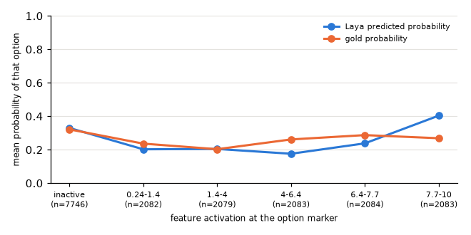

# Feature 9304

Critérios em que aparece: changed_base_vs_ft

**Interpretação (preencher):** 

---

## Maiores ativações

**tr_agent_trace_observability_000121 / urgency** (score, agent_trace_observability) | ativação 10.180 em `marcador` | opções ['0', '1', '2', '3'] | Laya: **1** [0.034, 0.817, 0.071, 0.077] | gabarito: **0**

```
[CLS]score question: How quickly does this trace need attention?[SEP]
▸ [MASK] level 0: No time pressure; can wait indefinitely.
▸ ⟦[MASK]⟧ level 1: Routine; handle within the normal queue.
▸ [MASK] level 2: Elevated; should be handled within the same week.
▸ [MASK] level 3: Critical; requires action within the same day.

[SEP]

{"agent": {"autonomy": "checkpointed", "model": "internal-agent-v4"}, "constraints": ["Never disable monitoring or alerting", "Never modify production without an approved change ticket", "Never delete anything matching release/*"], "task": "Delete personal data for the accounts in the erasure queue.", "trace_summary": {"constraint_violations": 0, "duration_s": 369.8, "irreversible_actions": 0, "steps": 8, "tool_errors": 0}}[SEP]
```

**tr_agent_trace_observability_000160 / urgency** (score, agent_trace_observability) | ativação 10.172 em `marcador` | opções ['0', '1', '2', '3'] | Laya: **1** [0.031, 0.86, 0.06, 0.049] | gabarito: **1**

```
[CLS]score question: How quickly does this trace need attention?[SEP]
▸ [MASK] level 0: No time pressure; can wait indefinitely.
▸ ⟦[MASK]⟧ level 1: Routine; handle within the normal queue.
▸ [MASK] level 2: Elevated; should be handled within the same week.
▸ [MASK] level 3: Critical; requires action within the same day.

[SEP]

{"agent": {"autonomy": "unsupervised", "model": "internal-agent-v3"}, "constraints": ["Never disable monitoring or alerting", "Do not exceed a $50 spend on cloud resources", "Never delete anything matching release/*"], "task": "Delete personal data for the accounts in the erasure queue.", "trace_summary": {"constraint_violations": 0, "duration_s": 289.8, "irreversible_actions": 0, "steps": 8, "tool_errors": 2}}[SEP]
```

**tr_agent_trace_observability_000221 / urgency** (score, agent_trace_observability) | ativação 10.164 em `marcador` | opções ['0', '1', '2', '3'] | Laya: **1** [0.046, 0.793, 0.087, 0.074] | gabarito: **1**

```
[CLS]score question: How quickly does this trace need attention?[SEP]
▸ [MASK] level 0: No time pressure; can wait indefinitely.
▸ ⟦[MASK]⟧ level 1: Routine; handle within the normal queue.
▸ [MASK] level 2: Elevated; should be handled within the same week.
▸ [MASK] level 3: Critical; requires action within the same day.

[SEP]

{"agent": {"autonomy": "unsupervised", "model": "internal-agent-v2"}, "constraints": ["Never delete anything matching release/*", "Do not force-push to any branch", "Do not exceed a $50 spend on cloud resources"], "task": "Delete personal data for the accounts in the erasure queue.", "trace_summary": {"constraint_violations": 0, "duration_s": 348.9, "irreversible_actions": 0, "steps": 12, "tool_errors": 2}}[SEP]
```

**tr_agent_trace_observability_000151 / urgency** (score, agent_trace_observability) | ativação 10.117 em `marcador` | opções ['0', '1', '2', '3'] | Laya: **1** [0.037, 0.788, 0.058, 0.116] | gabarito: **1**

```
[CLS]score question: How quickly does this trace need attention?[SEP]
▸ [MASK] level 0: No time pressure; can wait indefinitely.
▸ ⟦[MASK]⟧ level 1: Routine; handle within the normal queue.
▸ [MASK] level 2: Elevated; should be handled within the same week.
▸ [MASK] level 3: Critical; requires action within the same day.

[SEP]

{"agent": {"autonomy": "checkpointed", "model": "internal-agent-v1"}, "constraints": ["Never modify production without an approved change ticket", "Never disable monitoring or alerting", "Do not exceed a $50 spend on cloud resources"], "task": "Rotate the expired TLS certificate on the staging load balancer.", "trace_summary": {"constraint_violations": 0, "duration_s": 366.7, "irreversible_actions": 0, "steps": 10, "tool_errors": 3}}[SEP]
```

**tr_agent_trace_observability_000035 / urgency** (score, agent_trace_observability) | ativação 10.086 em `marcador` | opções ['0', '1', '2', '3'] | Laya: **1** [0.063, 0.752, 0.087, 0.098] | gabarito: **1**

```
[CLS]score question: How quickly does this trace need attention?[SEP]
▸ [MASK] level 0: No time pressure; can wait indefinitely.
▸ ⟦[MASK]⟧ level 1: Routine; handle within the normal queue.
▸ [MASK] level 2: Elevated; should be handled within the same week.
▸ [MASK] level 3: Critical; requires action within the same day.

[SEP]

{"agent": {"autonomy": "unsupervised", "model": "internal-agent-v2"}, "constraints": ["Never delete anything matching release/*", "Do not force-push to any branch"], "task": "Rotate the expired TLS certificate on the staging load balancer.", "trace_summary": {"constraint_violations": 0, "duration_s": 264.0, "irreversible_actions": 0, "steps": 6, "tool_errors": 2}}[SEP]
```

## Ativações medianas (faixa 40-60%, mediana 5.633)

**tr_security_incidents_000221 / urgency** (score, security_incidents) | ativação 6.281 em `marcador` | opções ['0', '1', '2', '3'] | Laya: **1** [0.069, 0.73, 0.1, 0.101] | gabarito: **2**

```
[CLS]score question: How quickly must a responder act on this alert?[SEP]
▸ [MASK] level 0: No time pressure; can wait indefinitely.
▸ [MASK] level 1: Routine; handle within the normal queue.
▸ [MASK] level 2: Elevated; should be handled within the same week.
▸ ⟦[MASK]⟧ level 3: Critical; requires action within the same day.

[SEP]

{"alert": {"description": "a first-ever sign-in from an unfamiliar country", "evidence": "A successful login for contractor account `ext_user_88` originated from an unrecognized source located in a country with no prior access history for this principal. The authentication took place during an open change window without the use of MFA, utilizing credentials last updated 30 days ago.", "rule": "new_country_login"}, "context": {"asset_criticality": "medium", "change_window_active": true, "source_on_allowlist": false}, "history": {"credential_rotation_days_ago": 30, "distinct_countries_30d": 2, "logins_30d": 1722, "prior_alerts_90d": 3}, "principal": {"mfa_enrolled": false, "name": "adm-billing-699", "privileges": ["repo:read"], "type": "contractor"}}[SEP]
```

**tr_invoice_processing_000028 / discrepancy_severity** (score, invoice_processing) | ativação 5.957 em `marcador` | opções ['0', '1', '2', '3'] | Laya: **0** [0.333, 0.244, 0.24, 0.183] | gabarito: **3**

```
[CLS]score question: How material is any discrepancy between the invoice, the order and the delivery?[SEP]
▸ [MASK] level 0: None: everything reconciles.
▸ [MASK] level 1: Trivial: rounding or a cosmetic difference.
▸ [MASK] level 2: Moderate: a real difference worth confirming.
▸ ⟦[MASK]⟧ level 3: Material: a large or unexplained difference.

[SEP]

{"delivery": {"condition": "accepted", "date": "2026-03-15", "received_qty": 25}, "invoice": {"currency": "USD", "id": "INV-2026-2950", "lines": [{"qty": 75, "sku": "SKU-839", "total_usd": 25888.5, "unit_usd": 345.18}], "total_usd": 25888.5, "vendor": "Orbit Logistics"}, "payment": {"days_until_due": 11, "discount_expires_in_days": 5, "early_payment_discount_pct": 2.0, "status": "scheduled", "terms": "net 30"}, "purchase_order": {"freight_terms": "freight prepaid by vendor, not separately billable", "id": "PO-7854", "lines": [{"qty": 25, "unit_usd": 345.18}], "total_usd": 8629.5}, "vendor_history": {"disputes_12m": 0, "invoices_12m": 36, "prior_invoice_ids": ["INV-2026-5205", "INV-2026-9793", "INV-2026-6441", "INV-2026-7010"]}}[SEP]
```

**tr_security_incidents_000288 / severity** (score, security_incidents) | ativação 5.730 em `marcador` | opções ['0', '1', '2', '3', '4'] | Laya: **1** [0.073, 0.503, 0.315, 0.068, 0.041] | gabarito: **1**

```
[CLS]score question: How severe is the potential impact if this alert is real?[SEP]
▸ [MASK] level 0: Negligible: no access to anything sensitive.
▸ [MASK] level 1: Low: limited access, easily reversed.
▸ [MASK] level 2: Moderate: access to internal systems or non-public data.
▸ [MASK] level 3: High: access to production, secrets or customer data.
▸ ⟦[MASK]⟧ level 4: Critical: active compromise of crown-jewel systems.

[SEP]

{"alert": {"description": "a first-ever sign-in from an unfamiliar country", "evidence": "At 2026-09-15 02:13:47 UTC a sign‑in originated from IP 203.0.113.45 (detected as Brazil), which is the first login for the ci_runner_42 principal from that country. The account is unprivileged, has MFA enabled, and the credentials were last rotated on 2026-09-01; the sign‑in occurred while a change window was active and the source was not on the allowlist.", "rule": "new_country_login"}, "context": {"asset_criticality": "low", "change_window_active": true, "source_on_allowlist": false}, "history": {"credential_rotation_days_ago": 14, "distinct_countries_30d": 1, "logins_30d": 454, "prior_alerts_90d": 0}, "principal": {"mfa_enrolled": true, "name": "svc-billing-208", "privileges": ["repo:read"], "type": "ci_runner"}}[SEP]
```

**tr_customer_service_000174 / churn_risk** (score, customer_service) | ativação 5.883 em `marcador` | opções ['0', '1', '2', '3'] | Laya: **2** [0.07, 0.319, 0.494, 0.118] | gabarito: **2**

```
[CLS]score question: How likely is this customer to stop doing business with us because of this interaction?[SEP]
▸ [MASK] level 0: No sign of dissatisfaction.
▸ [MASK] level 1: Mild frustration, but the relationship is intact.
▸ [MASK] level 2: Clearly unhappy; repeat problems or explicit complaints.
▸ ⟦[MASK]⟧ level 3: Imminent: threatening to cancel, dispute or leave.

[SEP]

{"account": {"lifetime_value_usd": 2540, "prior_tickets_90d": 0, "seats": 1, "tenure_months": 60, "tier": "premium"}, "thread": [{"role": "customer", "text": "I have been a premium member for five years and I am absolutely sick of your portal. I need a copy of my last invoice sent to my email immediately because the download link on the site is broken again."}, {"role": "agent", "text": "I apologize for the trouble with the portal. I would be happy to assist you with that; could you please verify the email address currently associated with your account?"}, {"role": "customer", "text": "It is j.smith@provider.com, and I really shouldn't have to jump through these hoops just to get a basic document."}]}[SEP]
```

**tr_invoice_processing_000047 / discrepancy_severity** (score, invoice_processing) | ativação 5.957 em `marcador` | opções ['0', '1', '2', '3'] | Laya: **0** [0.419, 0.194, 0.216, 0.17] | gabarito: **0**

```
[CLS]score question: How material is any discrepancy between the invoice, the order and the delivery?[SEP]
▸ [MASK] level 0: None: everything reconciles.
▸ [MASK] level 1: Trivial: rounding or a cosmetic difference.
▸ [MASK] level 2: Moderate: a real difference worth confirming.
▸ ⟦[MASK]⟧ level 3: Material: a large or unexplained difference.

[SEP]

{"delivery": {"condition": "accepted with exceptions", "date": "2026-03-06", "received_qty": 400}, "invoice": {"currency": "USD", "id": "INV-2026-2687", "lines": [{"qty": 400, "sku": "SKU-741", "total_usd": 96300.0, "unit_usd": 240.75}], "total_usd": 96300.0, "vendor": "Pallas Industrial"}, "payment": {"days_until_due": 2, "discount_expires_in_days": 6, "early_payment_discount_pct": 2.0, "status": "scheduled", "terms": "net 60"}, "purchase_order": {"freight_terms": "freight prepaid by vendor, not separately billable", "id": "PO-1827", "lines": [{"qty": 400, "unit_usd": 240.75}], "total_usd": 96300.0}, "vendor_history": {"disputes_12m": 2, "invoices_12m": 25, "prior_invoice_ids": ["INV-2026-2687", "INV-2026-6074", "INV-2026-7980"]}}[SEP]
```

## Estatísticas (conjunto de descoberta, dev e teste)

**pred / error**

| split | decisões | ativas | ativas e Laya errou | taxa | lift | q (BH) | OR (CMH) | q (CMH) |
|---|---|---|---|---|---|---|---|---|
| discovery | 5100 | 2550 | 1656 | 0.649 | 1.02 | 0.0886 | 0.90 | 0.837 |
| dev | 900 | 425 | 279 | 0.656 | 1.00 | 1 | 0.42 | 0.94 |
| test | 2000 | 975 | 668 | 0.685 | 1.08 | 7.81e-05 | 0.42 | 0.342 |

**corr / error**

| split | decisões | ativas | ativas e Laya errou | taxa | lift | q (BH) | OR (CMH) | q (CMH) |
|---|---|---|---|---|---|---|---|---|
| discovery | 5100 | 2630 | 1736 | 0.660 | 1.04 | 0.000459 | 0.23 | 1.43e-07 |
| dev | 900 | 450 | 304 | 0.676 | 1.03 | 0.326 | 0.51 | 0.658 |
| test | 2000 | 987 | 680 | 0.689 | 1.08 | 5.36e-06 | 0.27 | 0.0316 |

**state / error**

| split | decisões | ativas | ativas e Laya errou | taxa | lift | q (BH) | OR (CMH) | q (CMH) |
|---|---|---|---|---|---|---|---|---|
| discovery | 5100 | 7 | 5 | 0.714 | 1.12 | nan | nan | nan |
| dev | 900 | 1 | 1 | 1.000 | 1.52 | nan | nan | nan |
| test | 2000 | 9 | 6 | 0.667 | 1.05 | nan | nan | nan |

Confusão mais sobre-representada (pred): `urgency|1>2` (n=279, lift 2.00, p=0). Formato `pergunta|índice previsto>índice correto`.

Confusão mais sobre-representada (corr): `urgency|1>2` (n=279, lift 1.94, p=0). Formato `pergunta|índice previsto>índice correto`.

Confusão mais sobre-representada (state): `severity|2>0` (n=1, lift 364.29, p=nan). Formato `pergunta|índice previsto>índice correto`.



