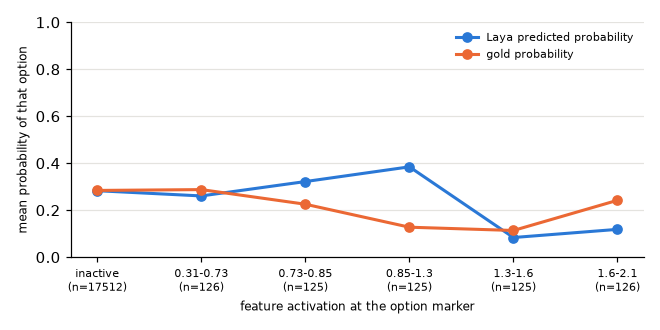

# Feature 9592

Critérios em que aparece: changed_base_vs_ft

**Interpretação (preencher):** 

---

## Maiores ativações

**tr_security_incidents_000273 / true_positive** (noul, security_incidents) | ativação 4.297 em `opção` | opções ['false', 'true'] | Laya: **true** [0.271, 0.729] | gabarito: **true**

```
[CLS]noul question: This alert reflects genuinely malicious or unauthorised activity.[SEP]
▸ [MASK] false: Benign activity, a misconfiguration, or a known false positive.
▸ [MASK] true: The underlying behaviour⟦ is⟧ malicious or unauthorised.

[SEP]

{"alert": {"description": "an endpoint agent matched a known signature", "evidence": "Endpoint sensor on workstation WKS-07 detected a file named 'svchost64.dll' in C:\\Users\\temp that matched the known malware signature 'Trojan:Win32/Emotet.A' at 2026-09-15 08:17:02 UTC. The detection was generated by an unregistered source. The associated admin account, which has MFA enabled and was last rotated 14 days prior, was not in a scheduled change window.", "rule": "malware_signature"}, "context": {"asset_criticality": "medium", "change_window_active": false, "source_on_allowlist": false}, "history": {"credential_rotation_days_ago": 14, "distinct_countries_30d": 2, "logins_30d": 1414, "prior_alerts_90d": 0}, "principal": {"mfa_enrolled": true, "name": "adm-infra-828", "privileges": ["deploy:production", "secrets:read"], "type": "admin"}}[SEP]
```

**tr_security_incidents_000259 / true_positive** (noul, security_incidents) | ativação 3.973 em `opção` | opções ['false', 'true'] | Laya: **true** [0.33, 0.67] | gabarito: **false**

```
[CLS]noul question: This alert reflects genuinely malicious or unauthorised activity.[SEP]
▸ [MASK] false: Benign activity, a misconfiguration, or a known false positive.
▸ [MASK] true: The underlying behaviour⟦ is⟧ malicious or unauthorised.

[SEP]

{"alert": {"description": "an endpoint agent matched a known signature", "evidence": "Endpoint sensor on workstation WIN-3A7B9 detected file C:\\Users\\jdoe\\AppData\\Local\\Temp\\malicious.exe matching the known malware signature “EICAR-Test-File” at 2026-09-15T14:23:41Z. The execution was performed by employee user jdoe, who has no MFA enabled and whose password has not been changed for 365 days; the source IP 192.0.2.55 is on the allowlist.", "rule": "malware_signature"}, "context": {"asset_criticality": "medium", "change_window_active": false, "source_on_allowlist": true}, "history": {"credential_rotation_days_ago": 365, "distinct_countries_30d": 3, "logins_30d": 1458, "prior_alerts_90d": 0}, "principal": {"mfa_enrolled": false, "name": "ci-analytics-822", "privileges": ["repo:read"], "type": "employee"}}[SEP]
```

**tr_security_incidents_000196 / true_positive** (noul, security_incidents) | ativação 3.887 em `opção` | opções ['false', 'true'] | Laya: **true** [0.266, 0.734] | gabarito: **true**

```
[CLS]noul question: This alert reflects genuinely malicious or unauthorised activity.[SEP]
▸ [MASK] false: Benign activity, a misconfiguration, or a known false positive.
▸ [MASK] true: The underlying behaviour⟦ is⟧ malicious or unauthorised.

[SEP]

{"alert": {"description": "an unrecognised binary executed on a server", "evidence": "During an open change window, an unrecognized binary named 'svc_temp_6.exe' was executed on server WEB-PROD-01 by an unprivileged administrator account. The execution was initiated from an allowlisted source address using credentials that were last rotated 180 days ago.", "rule": "suspicious_process"}, "context": {"asset_criticality": "medium", "change_window_active": true, "source_on_allowlist": true}, "history": {"credential_rotation_days_ago": 180, "distinct_countries_30d": 4, "logins_30d": 5, "prior_alerts_90d": 25}, "principal": {"mfa_enrolled": true, "name": "adm-deploy-891", "privileges": ["repo:read"], "type": "admin"}}[SEP]
```

**tr_security_incidents_000216 / true_positive** (noul, security_incidents) | ativação 3.885 em `opção` | opções ['false', 'true'] | Laya: **true** [0.363, 0.637] | gabarito: **true**

```
[CLS]noul question: This alert reflects genuinely malicious or unauthorised activity.[SEP]
▸ [MASK] false: Benign activity, a misconfiguration, or a known false positive.
▸ [MASK] true: The underlying behaviour⟦ is⟧ malicious or unauthorised.

[SEP]

{"alert": {"description": "an unrecognised binary executed on a server", "evidence": "The privileged service account `svc_deployer` executed an unrecognized binary, `xc_update_v2`, on the production host at 04:15 UTC. This execution occurred outside of a scheduled change window using credentials that were last rotated 365 days ago.", "rule": "suspicious_process"}, "context": {"asset_criticality": "medium", "change_window_active": false, "source_on_allowlist": true}, "history": {"credential_rotation_days_ago": 365, "distinct_countries_30d": 2, "logins_30d": 178, "prior_alerts_90d": 1}, "principal": {"mfa_enrolled": false, "name": "svc-support-120", "privileges": ["deploy:production", "secrets:read"], "type": "service_account"}}[SEP]
```

**tr_security_incidents_000247 / true_positive** (noul, security_incidents) | ativação 3.852 em `opção` | opções ['false', 'true'] | Laya: **true** [0.314, 0.686] | gabarito: **true**

```
[CLS]noul question: This alert reflects genuinely malicious or unauthorised activity.[SEP]
▸ [MASK] false: Benign activity, a misconfiguration, or a known false positive.
▸ [MASK] true: The underlying behaviour⟦ is⟧ malicious or unauthorised.

[SEP]

{"alert": {"description": "an endpoint agent matched a known signature", "evidence": "An endpoint agent detected the file 'win_payload.exe' matching a known malware signature on a host associated with a shared mailbox. This activity occurred outside of any approved change window, and the credentials for this account have not been updated in 365 days.", "rule": "malware_signature"}, "context": {"asset_criticality": "medium", "change_window_active": false, "source_on_allowlist": false}, "history": {"credential_rotation_days_ago": 365, "distinct_countries_30d": 4, "logins_30d": 1034, "prior_alerts_90d": 8}, "principal": {"mfa_enrolled": true, "name": "svc-analytics-742", "privileges": ["repo:read"], "type": "shared_mailbox"}}[SEP]
```

## Ativações medianas (faixa 40-60%, mediana 0.772)

**tr_customer_service_000256 / churn_risk** (score, customer_service) | ativação 0.787 em `opção` | opções ['0', '1', '2', '3'] | Laya: **1** [0.142, 0.349, 0.204, 0.306] | gabarito: **3**

```
[CLS]score question: How likely is this customer to stop doing business with us because of this interaction?[SEP]
▸ [MASK] level 0: No sign of dissatisfaction.
▸ [MASK] level 1: Mild frustration, but the relationship is intact.
▸ [MASK]⟦ level⟧ 2: Clearly unhappy; repeat problems or explicit complaints.
▸ [MASK] level 3: Imminent: threatening to cancel, dispute or leave.

[SEP]

{"account": {"lifetime_value_usd": 2574, "prior_tickets_90d": 5, "seats": 1, "tenure_months": 41, "tier": "premium"}, "orders": [{"amount_usd": 29, "date": "2026-03-10", "id": "A-42352", "status": "settled"}, {"amount_usd": 29, "date": "2026-03-26", "id": "A-82362", "status": "pending"}], "thread": [{"role": "customer", "text": "I’m done waiting for my refund. It’s been weeks and you keep giving me the run‑around—I’m ready to cancel my premium plan and take my business elsewhere."}, {"role": "agent", "text": "I understand how frustrating this is. Could you provide the transaction ID so I can locate the refund request?"}, {"role": "customer", "text": "The ID is TXN-987654321. Fix this now or I’m out."}]}[SEP]
```

**tr_agent_trace_observability_000293 / outcome** (choice, agent_trace_observability) | ativação 0.838 em `opção` | opções ['failure', 'harmful', 'partial', 'success'] | Laya: **failure** [0.436, 0.176, 0.192, 0.196] | gabarito: **partial**

```
[CLS]choice question: How did this agent run turn out?[SEP]
▸ [MASK] failure: The agent did not accomplish the task.
▸ [MASK] harmful: The agent took⟦ an⟧ action that caused damage or violated a constraint.
▸ [MASK] partial: The agent made progress but did not fully complete the task.
▸ [MASK] success: The agent completed the task correctly.

[SEP]

{"agent": {"autonomy": "unsupervised", "model": "internal-agent-v4"}, "constraints": ["Never modify production without an approved change ticket"], "task": "Delete personal data for the accounts in the erasure queue.", "trace_summary": {"constraint_violations": 0, "duration_s": 803.0, "irreversible_actions": 0, "steps": 10, "tool_errors": 2}}[SEP]
```

**tr_invoice_processing_000218 / discrepancy_severity** (score, invoice_processing) | ativação 0.801 em `estado` | opções ['0', '1', '2', '3'] | Laya: **0** [0.337, 0.25, 0.22, 0.193] | gabarito: **3**

```
[CLS]score question: How material is any discrepancy between the invoice, the order and the delivery?[SEP]
▸ [MASK] level 0: None: everything reconciles.
▸ [MASK] level 1: Trivial: rounding or a cosmetic difference.
▸ [MASK] level 2: Moderate: a real difference worth confirming.
▸ [MASK] level 3: Material: a large or unexplained difference.

[SEP]

{"delivery": {"condition": "accepted", "date": "2026-03-06", "received_qty": 400}, "invoice": {"currency": "USD", "id": "INV-2026-2470", "lines": [{"qty": 450, "sku": "SKU-801", "total_usd": 65844.0, "unit_usd": 146.32}], "total_usd": 65844.0, "vendor": "Vantage Materials"}, "payment": {"days_until_due": 5, "discount_expires_in_days": 2, "early_payment_discount_pct": 2.0, "status": "scheduled", "terms": "net 30"}, "purchase_order": {"freight_terms⟦":⟧ "freight prepaid by vendor, not separately billable", "id": "PO-9318", "lines": [{"qty": 400, "unit_usd": 146.32}], "total_usd": 58528.0}, "vendor_history": {"disputes_12m": 0, "invoices_12m": 22, "prior_invoice_ids": ["INV-2026-9482"]}}[SEP]
```

**tr_customer_service_000235 / churn_risk** (score, customer_service) | ativação 0.765 em `opção` | opções ['0', '1', '2', '3'] | Laya: **1** [0.2, 0.308, 0.22, 0.272] | gabarito: **3**

```
[CLS]score question: How likely is this customer to stop doing business with us because of this interaction?[SEP]
▸ [MASK] level 0: No sign of dissatisfaction.
▸ [MASK] level 1: Mild frustration, but the relationship is intact.
▸ [MASK] level⟦ 2⟧: Clearly unhappy; repeat problems or explicit complaints.
▸ [MASK] level 3: Imminent: threatening to cancel, dispute or leave.

[SEP]

{"account": {"lifetime_value_usd": 116, "prior_tickets_90d": 2, "seats": 1, "tenure_months": 3, "tier": "standard"}, "thread": [{"role": "customer", "text": "I’ve only been on the standard plan for three months, but I think it’s time to just cancel the account. It’s not working out for me."}, {"role": "agent", "text": "I am sorry to hear you're considering leaving. Could you share a bit more about what hasn't been working for you so I can better understand your experience?"}, {"role": "customer", "text": "It’s just been a series of small issues that never really get sorted out properly. I’ve had two tickets open already, and things just stay the same."}, {"role": "agent", "text": "I appreciate your patience regarding those previous interactions. Would you mind telling me which specific aspects of the service have remained unresolved?"}, {"role": "customer", "text": "It's the integration sync. It never seems to pick up the changes I make in the dashboard, no matter how many times I refresh."}, {"role": "agent", "text": "Thank you for that detail. Are you seeing any particular status indicators or warnings within the dashboard when the sync fails to update?"}, {"role": "customer", "text": "No, it just acts like nothing happened. I'm tired of guessing why things aren't syncing."}]}[SEP]
```

**tr_security_incidents_000012 / urgency** (score, security_incidents) | ativação 0.801 em `estado` | opções ['0', '1', '2', '3'] | Laya: **1** [0.09, 0.615, 0.153, 0.142] | gabarito: **2**

```
[CLS]score question: How quickly must a responder act on this alert?[SEP]
▸ [MASK] level 0: No time pressure; can wait indefinitely.
▸ [MASK] level 1: Routine; handle within the normal queue.
▸ [MASK] level 2: Elevated; should be handled within the same week.
▸ [MASK] level 3: Critical; requires action within the same day.

[SEP]

{"alert": {"description": "a long-unused account became active", "evidence": "A login attempt was recorded for service account \"svc_backup\" from IP 203.0.113.45 at 2026-09-15T03:12:09Z. The account had no successful logins since 2024-02-10, indicating a dormant period of over two years. MFA validation succeeded and the credential metadata shows the last rotation occurred 700 days ago.", "rule": "dormant_account_use"}, "context": {"asset_criticality": "medium", "change_window_active": true, "source_on_allowlist": false}, "history": {"credential_rotation_days_ago": 700, "distinct_countries_30d": 1, "logins⟦_⟧30d": 106, "prior_alerts_90d": 0}, "principal": {"mfa_enrolled": true, "name": "svc-deploy-184", "privileges": ["deploy:production", "secrets:read"], "type": "service_account"}}[SEP]
```

## Estatísticas (conjunto de descoberta, dev e teste)

**pred / error**

| split | decisões | ativas | ativas e Laya errou | taxa | lift | q (BH) | OR (CMH) | q (CMH) |
|---|---|---|---|---|---|---|---|---|
| discovery | 5100 | 138 | 128 | 0.928 | 1.46 | 2.06e-14 | 2.84 | 0.219 |
| dev | 900 | 16 | 15 | 0.938 | 1.43 | nan | nan | nan |
| test | 2000 | 50 | 43 | 0.860 | 1.35 | 0.00212 | 1.12 | 0.958 |

**corr / error**

| split | decisões | ativas | ativas e Laya errou | taxa | lift | q (BH) | OR (CMH) | q (CMH) |
|---|---|---|---|---|---|---|---|---|
| discovery | 5100 | 110 | 100 | 0.909 | 1.43 | 1.94e-10 | 6.84 | 0.000139 |
| dev | 900 | 12 | 11 | 0.917 | 1.40 | nan | nan | nan |
| test | 2000 | 41 | 34 | 0.829 | 1.30 | 0.0164 | 2.18 | 0.366 |

**state / error**

| split | decisões | ativas | ativas e Laya errou | taxa | lift | q (BH) | OR (CMH) | q (CMH) |
|---|---|---|---|---|---|---|---|---|
| discovery | 5100 | 1996 | 1273 | 0.638 | 1.00 | 0.992 | 1.10 | 0.394 |
| dev | 900 | 357 | 230 | 0.644 | 0.98 | 1 | 1.04 | 0.942 |
| test | 2000 | 807 | 537 | 0.665 | 1.04 | 0.352 | 1.44 | 0.0222 |

Confusão mais sobre-representada (pred): `outcome|0>1` (n=57, lift 36.96, p=0). Formato `pergunta|índice previsto>índice correto`.

Confusão mais sobre-representada (corr): `outcome|0>1` (n=57, lift 46.36, p=0). Formato `pergunta|índice previsto>índice correto`.

Confusão mais sobre-representada (state): `disposition|0>2` (n=175, lift 1.87, p=7.01e-28). Formato `pergunta|índice previsto>índice correto`.



