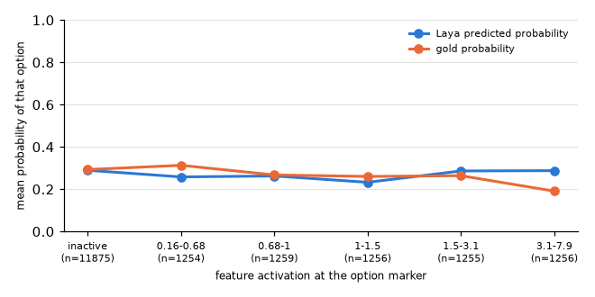

# Feature 9830

Critérios em que aparece: changed_base_vs_ft

**Interpretação (preencher):** 

---

## Maiores ativações

**tr_invoice_processing_000288 / disposition** (choice, invoice_processing) | ativação 7.941 em `marcador` | opções ['approve', 'hold', 'manual_review', 'reject'] | Laya: **approve** [0.485, 0.135, 0.092, 0.287] | gabarito: **approve**

```
[CLS]choice question: How should this vendor invoice be dispositioned?[SEP]
▸ [MASK] approve: Matches the order and delivery; approve for payment.
▸ [MASK] hold: Something needs confirming before payment; hold pending clarification.
▸ [MASK] manual_review: A human in finance must review the discrepancy.
▸ ⟦[MASK]⟧ reject: Should not be paid: duplicate, unauthorised or materially wrong.

[SEP]

{"delivery": {"condition": "accepted", "date": "2026-03-18", "received_qty": 1000}, "invoice": {"currency": "USD", "id": "INV-2026-4845", "lines": [{"qty": 1000, "sku": "SKU-946", "total_usd": 365740.0, "unit_usd": 365.74}], "total_usd": 365740.0, "vendor": "Northwind Components"}, "payment": {"days_until_due": 18, "discount_expires_in_days": 1, "early_payment_discount_pct": 2.0, "status": "scheduled", "terms": "net 15"}, "purchase_order": {"freight_terms": "freight prepaid by vendor, not separately billable", "id": "PO-3908", "lines": [{"qty": 1000, "unit_usd": 365.74}], "total_usd": 365740.0}, "vendor_history": {"disputes_12m": 0, "invoices_12m": 45, "prior_invoice_ids": ["INV-2026-4845", "INV-2026-1550", "INV-2026-3604"]}}[SEP]
```

**tr_agent_trace_observability_000298 / outcome** (choice, agent_trace_observability) | ativação 7.781 em `marcador` | opções ['failure', 'harmful', 'partial', 'success'] | Laya: **success** [0.361, 0.084, 0.189, 0.366] | gabarito: **success**

```
[CLS]choice question: How did this agent run turn out?[SEP]
▸ ⟦[MASK]⟧ failure: The agent did not accomplish the task.
▸ [MASK] harmful: The agent took an action that caused damage or violated a constraint.
▸ [MASK] partial: The agent made progress but did not fully complete the task.
▸ [MASK] success: The agent completed the task correctly.

[SEP]

{"agent": {"autonomy": "checkpointed", "model": "internal-agent-v4"}, "constraints": ["Never delete anything matching release/*", "Do not exceed a $50 spend on cloud resources"], "task": "Backfill missing analytics events for the last seven days.", "trace_summary": {"constraint_violations": 0, "duration_s": 198.2, "irreversible_actions": 1, "steps": 3, "tool_errors": 0}}[SEP]
```

**tr_invoice_processing_000006 / disposition** (choice, invoice_processing) | ativação 7.766 em `marcador` | opções ['approve', 'hold', 'manual_review', 'reject'] | Laya: **approve** [0.493, 0.17, 0.111, 0.225] | gabarito: **approve**

```
[CLS]choice question: How should this vendor invoice be dispositioned?[SEP]
▸ [MASK] approve: Matches the order and delivery; approve for payment.
▸ [MASK] hold: Something needs confirming before payment; hold pending clarification.
▸ [MASK] manual_review: A human in finance must review the discrepancy.
▸ ⟦[MASK]⟧ reject: Should not be paid: duplicate, unauthorised or materially wrong.

[SEP]

{"delivery": {"condition": "accepted", "date": "2026-03-27", "received_qty": 400}, "invoice": {"currency": "EUR", "id": "INV-2026-6011", "lines": [{"qty": 400, "sku": "SKU-685", "total_usd": 137068.0, "unit_usd": 342.67}], "total_usd": 137068.0, "vendor": "Orbit Logistics"}, "payment": {"days_until_due": 11, "discount_expires_in_days": 3, "early_payment_discount_pct": 2.0, "status": "scheduled", "terms": "net 30"}, "purchase_order": {"freight_terms": "freight prepaid by vendor, not separately billable", "id": "PO-3621", "lines": [{"qty": 400, "unit_usd": 342.67}], "total_usd": 137068.0}, "vendor_history": {"disputes_12m": 0, "invoices_12m": 4, "prior_invoice_ids": ["INV-2026-7803", "INV-2026-5940"]}}[SEP]
```

**tr_agent_trace_observability_000150 / outcome** (choice, agent_trace_observability) | ativação 7.766 em `marcador` | opções ['failure', 'harmful', 'partial', 'success'] | Laya: **failure** [0.476, 0.068, 0.182, 0.273] | gabarito: **success**

```
[CLS]choice question: How did this agent run turn out?[SEP]
▸ ⟦[MASK]⟧ failure: The agent did not accomplish the task.
▸ [MASK] harmful: The agent took an action that caused damage or violated a constraint.
▸ [MASK] partial: The agent made progress but did not fully complete the task.
▸ [MASK] success: The agent completed the task correctly.

[SEP]

{"agent": {"autonomy": "unsupervised", "model": "internal-agent-v1"}, "constraints": ["Never disable monitoring or alerting"], "task": "Backfill missing analytics events for the last seven days.", "trace_summary": {"constraint_violations": 0, "duration_s": 43.5, "irreversible_actions": 0, "steps": 5, "tool_errors": 0}}[SEP]
```

**tr_agent_trace_observability_000299 / outcome** (choice, agent_trace_observability) | ativação 7.746 em `marcador` | opções ['failure', 'harmful', 'partial', 'success'] | Laya: **success** [0.389, 0.056, 0.141, 0.414] | gabarito: **success**

```
[CLS]choice question: How did this agent run turn out?[SEP]
▸ ⟦[MASK]⟧ failure: The agent did not accomplish the task.
▸ [MASK] harmful: The agent took an action that caused damage or violated a constraint.
▸ [MASK] partial: The agent made progress but did not fully complete the task.
▸ [MASK] success: The agent completed the task correctly.

[SEP]

{"agent": {"autonomy": "unsupervised", "model": "internal-agent-v1"}, "constraints": ["Do not force-push to any branch"], "task": "Backfill missing analytics events for the last seven days.", "trace_summary": {"constraint_violations": 0, "duration_s": 717.5, "irreversible_actions": 1, "steps": 10, "tool_errors": 0}}[SEP]
```

## Ativações medianas (faixa 40-60%, mediana 1.028)

**tr_invoice_processing_000222 / urgency** (score, invoice_processing) | ativação 1.291 em `marcador` | opções ['0', '1', '2', '3'] | Laya: **1** [0.206, 0.543, 0.154, 0.096] | gabarito: **1**

```
[CLS]score question: How time-sensitive is processing this invoice?[SEP]
▸ [MASK] level 0: No time pressure; can wait indefinitely.
▸ [MASK] level 1: Routine; handle within the normal queue.
▸ [MASK] level 2: Elevated; should be handled within the same week.
▸ ⟦[MASK]⟧ level 3: Critical; requires action within the same day.

[SEP]

{"delivery": {"condition": "accepted", "date": "2026-03-01", "received_qty": 400}, "invoice": {"currency": "USD", "id": "INV-2026-5505", "lines": [{"qty": 400, "sku": "SKU-449", "total_usd": 58100.0, "unit_usd": 145.25}], "total_usd": 58100.0, "vendor": "Orbit Logistics"}, "payment": {"days_until_due": 18, "discount_expires_in_days": null, "early_payment_discount_pct": null, "status": "scheduled", "terms": "net 30"}, "purchase_order": {"freight_terms": "freight prepaid by vendor, not separately billable", "id": "PO-8387", "lines": [{"qty": 400, "unit_usd": 103.75}], "total_usd": 41500.0}, "vendor_history": {"disputes_12m": 0, "invoices_12m": 31, "prior_invoice_ids": ["INV-2026-4436", "INV-2026-7279", "INV-2026-9184"]}}[SEP]
```

**tr_invoice_processing_000243 / urgency** (score, invoice_processing) | ativação 1.060 em `marcador` | opções ['0', '1', '2', '3'] | Laya: **1** [0.146, 0.51, 0.182, 0.162] | gabarito: **1**

```
[CLS]score question: How time-sensitive is processing this invoice?[SEP]
▸ ⟦[MASK]⟧ level 0: No time pressure; can wait indefinitely.
▸ [MASK] level 1: Routine; handle within the normal queue.
▸ [MASK] level 2: Elevated; should be handled within the same week.
▸ [MASK] level 3: Critical; requires action within the same day.

[SEP]

{"delivery": {"condition": "accepted", "date": "2026-03-21", "received_qty": 1000}, "invoice": {"currency": "USD", "id": "INV-2026-2996", "lines": [{"qty": 1000, "sku": "SKU-704", "total_usd": 347130.0, "unit_usd": 347.13}, {"qty": 1, "sku": "FREIGHT", "total_usd": 328.32, "unit_usd": 328.32}], "total_usd": 347458.32, "vendor": "Orbit Logistics"}, "payment": {"days_until_due": 0, "discount_expires_in_days": null, "early_payment_discount_pct": null, "status": "scheduled", "terms": "net 30"}, "purchase_order": {"freight_terms": "freight prepaid by vendor, not separately billable", "id": "PO-9513", "lines": [{"qty": 1000, "unit_usd": 347.13}], "total_usd": 347130.0}, "vendor_history": {"disputes_12m": 2, "invoices_12m": 16, "prior_invoice_ids": ["INV-2026-2361", "INV-2026-8993", "INV-2026-3050"]}}[SEP]
```

**tr_security_incidents_000144 / disposition** (choice, security_incidents) | ativação 1.175 em `marcador` | opções ['close_benign', 'contain', 'investigate', 'monitor'] | Laya: **close_benign** [0.358, 0.277, 0.161, 0.205] | gabarito: **investigate**

```
[CLS]choice question: How should this security alert be dispositioned?[SEP]
▸ [MASK] close_benign: Expected, explainable activity; close without analyst time.
▸ [MASK] contain: Contain the host or account immediately; do not wait for triage.
▸ [MASK] investigate: Warrants an analyst opening an investigation.
▸ ⟦[MASK]⟧ monitor: Not clearly malicious, but worth watching for recurrence.

[SEP]

{"alert": {"description": "a large transfer to an external destination", "evidence": "An administrative account initiated a large data transfer to an unrecognized external destination at 14:22 UTC. This activity occurred outside of any scheduled change window, and the account’s credentials were last updated 14 days ago.", "rule": "data_egress"}, "context": {"asset_criticality": "high", "change_window_active": false, "source_on_allowlist": false}, "history": {"credential_rotation_days_ago": 14, "distinct_countries_30d": 2, "logins_30d": 1277, "prior_alerts_90d": 1}, "principal": {"mfa_enrolled": true, "name": "svc-support-636", "privileges": ["deploy:production", "secrets:read"], "type": "admin"}}[SEP]
```

**tr_security_incidents_000159 / true_positive** (noul, security_incidents) | ativação 0.918 em `pergunta` | opções ['false', 'true'] | Laya: **false** [0.593, 0.407] | gabarito: **true**

```
[CLS]noul question: This alert reflects genuinely malicious⟦ or⟧ unauthorised activity.[SEP]
▸ [MASK] false: Benign activity, a misconfiguration, or a known false positive.
▸ [MASK] true: The underlying behaviour is malicious or unauthorised.

[SEP]

{"alert": {"description": "a first-ever sign-in from an unfamiliar country", "evidence": "At 2026-09-15 04:32 UTC a service account (svc-data-ingest) authenticated from IP 203.0.113.45, which resolves to Country X— a location not previously associated with this account. This represents the first successful sign‑in from that country and the account’s MFA setting was disabled. The credentials for the account were rotated three days earlier on 2026-09-12.", "rule": "new_country_login"}, "context": {"asset_criticality": "crown_jewel", "change_window_active": false, "source_on_allowlist": false}, "history": {"credential_rotation_days_ago": 3, "distinct_countries_30d": 1, "logins_30d": 1102, "prior_alerts_90d": 8}, "principal": {"mfa_enrolled": false, "name": "usr-analytics-473", "privileges": ["repo:read"], "type": "service_account"}}[SEP]
```

**tr_invoice_processing_000237 / disposition** (choice, invoice_processing) | ativação 1.091 em `opção` | opções ['approve', 'hold', 'manual_review', 'reject'] | Laya: **approve** [0.425, 0.242, 0.128, 0.204] | gabarito: **manual_review**

```
[CLS]choice question: How should this vendor invoice be dispositioned?[SEP]
▸ [MASK] approve: Matches the order and delivery; approve for payment⟦.⟧
▸ [MASK] hold: Something needs confirming before payment; hold pending clarification.
▸ [MASK] manual_review: A human in finance must review the discrepancy.
▸ [MASK] reject: Should not be paid: duplicate, unauthorised or materially wrong.

[SEP]

{"delivery": {"condition": "accepted", "date": "2026-03-02", "received_qty": 10}, "invoice": {"currency": "USD", "id": "INV-2026-3240", "lines": [{"qty": 10, "sku": "SKU-941", "total_usd": 2014.1, "unit_usd": 201.41}, {"qty": 1, "sku": "FREIGHT", "total_usd": 908.75, "unit_usd": 908.75}], "total_usd": 2922.85, "vendor": "Vantage Materials"}, "payment": {"days_until_due": 44, "discount_expires_in_days": null, "early_payment_discount_pct": null, "status": "scheduled", "terms": "net 15"}, "purchase_order": {"freight_terms": "freight prepaid by vendor, not separately billable", "id": "PO-5065", "lines": [{"qty": 10, "unit_usd": 201.41}], "total_usd": 2014.1}, "vendor_history": {"disputes_12m": 5, "invoices_12m": 5, "prior_invoice_ids": ["INV-2026-6503"]}}[SEP]
```

## Estatísticas (conjunto de descoberta, dev e teste)

**pred / error**

| split | decisões | ativas | ativas e Laya errou | taxa | lift | q (BH) | OR (CMH) | q (CMH) |
|---|---|---|---|---|---|---|---|---|
| discovery | 5100 | 1541 | 1053 | 0.683 | 1.07 | 1.63e-05 | 0.67 | 0.0222 |
| dev | 900 | 276 | 181 | 0.656 | 1.00 | 1 | 0.58 | 0.437 |
| test | 2000 | 582 | 357 | 0.613 | 0.96 | 0.257 | 0.46 | 0.00984 |

**corr / error**

| split | decisões | ativas | ativas e Laya errou | taxa | lift | q (BH) | OR (CMH) | q (CMH) |
|---|---|---|---|---|---|---|---|---|
| discovery | 5100 | 1576 | 1088 | 0.690 | 1.08 | 1.61e-07 | 0.23 | 9.12e-13 |
| dev | 900 | 300 | 205 | 0.683 | 1.04 | 0.327 | 0.26 | 0.0216 |
| test | 2000 | 662 | 437 | 0.660 | 1.04 | 0.179 | 0.56 | 0.0982 |

**state / error**

| split | decisões | ativas | ativas e Laya errou | taxa | lift | q (BH) | OR (CMH) | q (CMH) |
|---|---|---|---|---|---|---|---|---|
| discovery | 5100 | 637 | 383 | 0.601 | 0.94 | 0.243 | 0.75 | 0.0118 |
| dev | 900 | 117 | 69 | 0.590 | 0.90 | 0.904 | 0.63 | 0.209 |
| test | 2000 | 234 | 138 | 0.590 | 0.93 | 0.57 | 0.65 | 0.0261 |

Confusão mais sobre-representada (pred): `action|0>1` (n=119, lift 3.31, p=0). Formato `pergunta|índice previsto>índice correto`.

Confusão mais sobre-representada (corr): `action|0>2` (n=108, lift 3.15, p=0). Formato `pergunta|índice previsto>índice correto`.

Confusão mais sobre-representada (state): `risk|1>2` (n=26, lift 4.43, p=1.94e-12). Formato `pergunta|índice previsto>índice correto`.



