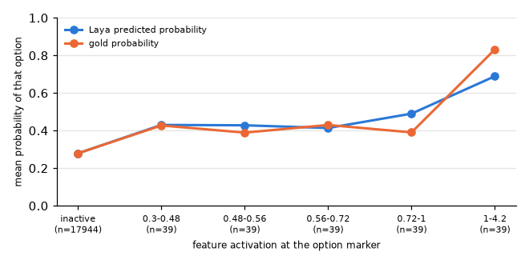

# Feature 10220

Critérios em que aparece: changed_base_vs_ft

**Interpretação (preencher):** 

---

## Maiores ativações

**tr_invoice_processing_000199 / urgency** (score, invoice_processing) | ativação 7.695 em `estado` | opções ['0', '1', '2', '3'] | Laya: **1** [0.21, 0.481, 0.178, 0.13] | gabarito: **2**

```
[CLS]score question: How time-sensitive is processing this invoice?[SEP]
▸ [MASK] level 0: No time pressure; can wait indefinitely.
▸ [MASK] level 1: Routine; handle within the normal queue.
▸ [MASK] level 2: Elevated; should be handled within the same week.
▸ [MASK] level 3: Critical; requires action within the same day.

[SEP]

{"delivery": {"condition": "accepted", "date": "2026-03-09", "received_qty": 1000}, "invoice": {"currency": "USD", "id": "INV-2026-1122", "lines": [{"qty": 1000, "sku": "SKU-843", "total_usd": 114150.0, "unit_usd": 114.15}], "total_usd": 114150.0, "vendor": "Orbit Logistics"}, "payment": {"days_until_due": 44, "discount_expires_in_days": 1, "early_payment_discount_pct": 2.0, "status": "scheduled", "terms": "net 30"}, "purchase_order": {"freight_terms": "freight prepaid by vendor, not separately billable", "id": "PO-5232", "lines": [{"qty": 1000, "unit_usd": 114.15}], "total_usd": 114150.0}, "vendor_history": {"disputes_12m": 5, "invoices_12m": 48, "prior_invoice_ids": ["INV-2026-112⟦2⟧", "INV-2026-2468", "INV-2026-5673", "INV-2026-6777"]}}[SEP]
```

**tr_invoice_processing_000021 / disposition** (choice, invoice_processing) | ativação 7.668 em `estado` | opções ['approve', 'hold', 'manual_review', 'reject'] | Laya: **approve** [0.631, 0.14, 0.08, 0.149] | gabarito: **approve**

```
[CLS]choice question: How should this vendor invoice be dispositioned?[SEP]
▸ [MASK] approve: Matches the order and delivery; approve for payment.
▸ [MASK] hold: Something needs confirming before payment; hold pending clarification.
▸ [MASK] manual_review: A human in finance must review the discrepancy.
▸ [MASK] reject: Should not be paid: duplicate, unauthorised or materially wrong.

[SEP]

{"delivery": {"condition": "accepted", "date": "2026-03-07", "received_qty": 100}, "invoice": {"currency": "USD", "id": "INV-2026-1810", "lines": [{"qty": 100, "sku": "SKU-868", "total_usd": 40841.0, "unit_usd": 408.41}], "total_usd": 40841.0, "vendor": "Vantage Materials"}, "payment": {"days_until_due": 0, "discount_expires_in_days": null, "early_payment_discount_pct": null, "status": "scheduled", "terms": "net 45"}, "purchase_order": {"freight_terms": "freight prepaid by vendor, not separately billable", "id": "PO-3491", "lines": [{"qty": 100, "unit_usd": 408.41}], "total_usd": 40841.0}, "vendor_history": {"disputes_12m": 0, "invoices_12m": 57, "prior_invoice_ids": ["INV-2026-18⟦10⟧", "INV-2026-7846", "INV-2026-5769", "INV-2026-7710"]}}[SEP]
```

**tr_invoice_processing_000021 / disposition** (choice, invoice_processing) | ativação 7.574 em `estado` | opções ['approve', 'hold', 'manual_review', 'reject'] | Laya: **approve** [0.631, 0.14, 0.08, 0.149] | gabarito: **approve**

```
[CLS]choice question: How should this vendor invoice be dispositioned?[SEP]
▸ [MASK] approve: Matches the order and delivery; approve for payment.
▸ [MASK] hold: Something needs confirming before payment; hold pending clarification.
▸ [MASK] manual_review: A human in finance must review the discrepancy.
▸ [MASK] reject: Should not be paid: duplicate, unauthorised or materially wrong.

[SEP]

{"delivery": {"condition": "accepted", "date": "2026-03-07", "received_qty": 100}, "invoice": {"currency": "USD", "id": "INV-2026-1810", "lines": [{"qty": 100, "sku": "SKU-868", "total_usd": 40841.0, "unit_usd": 408.41}], "total_usd": 40841.0, "vendor": "Vantage Materials"}, "payment": {"days_until_due": 0, "discount_expires_in_days": null, "early_payment_discount_pct": null, "status": "scheduled", "terms": "net 45"}, "purchase_order": {"freight_terms": "freight prepaid by vendor, not separately billable", "id": "PO-3491", "lines": [{"qty": 100, "unit_usd": 408.41}], "total_usd": 40841.0}, "vendor_history": {"disputes_12m": 0, "invoices_12m": 57, "prior_invoice_ids": ["⟦IN⟧V-2026-1810", "INV-2026-7846", "INV-2026-5769", "INV-2026-7710"]}}[SEP]
```

**tr_invoice_processing_000021 / discrepancy_severity** (score, invoice_processing) | ativação 7.418 em `estado` | opções ['0', '1', '2', '3'] | Laya: **0** [0.396, 0.21, 0.234, 0.16] | gabarito: **0**

```
[CLS]score question: How material is any discrepancy between the invoice, the order and the delivery?[SEP]
▸ [MASK] level 0: None: everything reconciles.
▸ [MASK] level 1: Trivial: rounding or a cosmetic difference.
▸ [MASK] level 2: Moderate: a real difference worth confirming.
▸ [MASK] level 3: Material: a large or unexplained difference.

[SEP]

{"delivery": {"condition": "accepted", "date": "2026-03-07", "received_qty": 100}, "invoice": {"currency": "USD", "id": "INV-2026-1810", "lines": [{"qty": 100, "sku": "SKU-868", "total_usd": 40841.0, "unit_usd": 408.41}], "total_usd": 40841.0, "vendor": "Vantage Materials"}, "payment": {"days_until_due": 0, "discount_expires_in_days": null, "early_payment_discount_pct": null, "status": "scheduled", "terms": "net 45"}, "purchase_order": {"freight_terms": "freight prepaid by vendor, not separately billable", "id": "PO-3491", "lines": [{"qty": 100, "unit_usd": 408.41}], "total_usd": 40841.0}, "vendor_history": {"disputes_12m": 0, "invoices_12m": 57, "prior_invoice_ids": ["INV-2026-18⟦10⟧", "INV-2026-7846", "INV-2026-5769", "INV-2026-7710"]}}[SEP]
```

**tr_invoice_processing_000021 / disposition** (choice, invoice_processing) | ativação 7.180 em `estado` | opções ['approve', 'hold', 'manual_review', 'reject'] | Laya: **approve** [0.631, 0.14, 0.08, 0.149] | gabarito: **approve**

```
[CLS]choice question: How should this vendor invoice be dispositioned?[SEP]
▸ [MASK] approve: Matches the order and delivery; approve for payment.
▸ [MASK] hold: Something needs confirming before payment; hold pending clarification.
▸ [MASK] manual_review: A human in finance must review the discrepancy.
▸ [MASK] reject: Should not be paid: duplicate, unauthorised or materially wrong.

[SEP]

{"delivery": {"condition": "accepted", "date": "2026-03-07", "received_qty": 100}, "invoice": {"currency": "USD", "id": "INV-2026-1810", "lines": [{"qty": 100, "sku": "SKU-868", "total_usd": 40841.0, "unit_usd": 408.41}], "total_usd": 40841.0, "vendor": "Vantage Materials"}, "payment": {"days_until_due": 0, "discount_expires_in_days": null, "early_payment_discount_pct": null, "status": "scheduled", "terms": "net 45"}, "purchase_order": {"freight_terms": "freight prepaid by vendor, not separately billable", "id": "PO-3491", "lines": [{"qty": 100, "unit_usd": 408.41}], "total_usd": 40841.0}, "vendor_history": {"disputes_12m": 0, "invoices_12m": 57, "prior_invoice_ids": ["INV-⟦20⟧26-1810", "INV-2026-7846", "INV-2026-5769", "INV-2026-7710"]}}[SEP]
```

## Ativações medianas (faixa 40-60%, mediana 0.884)

**tr_security_incidents_000239 / disposition** (choice, security_incidents) | ativação 0.895 em `estado` | opções ['close_benign', 'contain', 'investigate', 'monitor'] | Laya: **close_benign** [0.358, 0.217, 0.131, 0.295] | gabarito: **close_benign**

```
[CLS]choice question: How should this security alert be dispositioned?[SEP]
▸ [MASK] close_benign: Expected, explainable activity; close without analyst time.
▸ [MASK] contain: Contain the host or account immediately; do not wait for triage.
▸ [MASK] investigate: Warrants an analyst opening an investigation.
▸ [MASK] monitor: Not clearly malicious, but worth watching for recurrence.

[SEP]

{"alert":⟦ {"⟧description": "a first-ever sign-in from an unfamiliar country", "evidence": "An admin account performed a login from allowlisted IP 192.0.2.55 (Tokyo) at 2026-09-14T14:02:33Z, with MFA succeeding. This marks the first sign‑in from Japan for this admin identity, and the password was last changed on 2024-09-14 (700 days ago).", "rule": "new_country_login"}, "context": {"asset_criticality": "crown_jewel", "change_window_active": false, "source_on_allowlist": true}, "history": {"credential_rotation_days_ago": 700, "distinct_countries_30d": 2, "logins_30d": 1033, "prior_alerts_90d": 1}, "principal": {"mfa_enrolled": true, "name": "svc-support-154", "privileges": ["repo:read"], "type": "admin"}}[SEP]
```

**tr_security_incidents_000271 / disposition** (choice, security_incidents) | ativação 0.996 em `opção` | opções ['close_benign', 'contain', 'investigate', 'monitor'] | Laya: **close_benign** [0.362, 0.195, 0.118, 0.326] | gabarito: **investigate**

```
[CLS]choice question: How should this security alert be dispositioned?[SEP]
▸ [MASK] close_benign: Expected, explainable activity; close without analyst time.
▸ [MASK] contain: Contain the host or⟦ account⟧ immediately; do not wait for triage.
▸ [MASK] investigate: Warrants an analyst opening an investigation.
▸ [MASK] monitor: Not clearly malicious, but worth watching for recurrence.

[SEP]

{"alert": {"description": "a large transfer to an external destination", "evidence": "At 2026-09-16 02:15:44 UTC, a data transfer of 2.3 GB was observed from the internal server srv-data01 to external IP 203.0.113.45 over TCP port 443. The transfer was initiated by a service_account lacking MFA, whose password was refreshed 14 days earlier.", "rule": "data_egress"}, "context": {"asset_criticality": "low", "change_window_active": false, "source_on_allowlist": false}, "history": {"credential_rotation_days_ago": 14, "distinct_countries_30d": 2, "logins_30d": 1659, "prior_alerts_90d": 1}, "principal": {"mfa_enrolled": false, "name": "usr-billing-416", "privileges": ["repo:read"], "type": "service_account"}}[SEP]
```

**tr_security_incidents_000026 / disposition** (choice, security_incidents) | ativação 0.793 em `estado` | opções ['close_benign', 'contain', 'investigate', 'monitor'] | Laya: **monitor** [0.282, 0.258, 0.113, 0.347] | gabarito: **monitor**

```
[CLS]choice question: How should this security alert be dispositioned?[SEP]
▸ [MASK] close_benign: Expected, explainable activity; close without analyst time.
▸ [MASK] contain: Contain the host or account immediately; do not wait for triage.
▸ [MASK] investigate: Warrants an analyst opening an investigation.
▸ [MASK] monitor: Not clearly malicious, but worth watching for recurrence.

[SEP]

{"alert": {"description": "a first-ever sign-in from an unfamiliar country", "evidence": "The CI runner account initiated a sign-⟦in⟧ session from a country that has no prior history of authentication for this principal. This event was observed from an allowlisted source, following a credential rotation period of 700 days.", "rule": "new_country_login"}, "context": {"asset_criticality": "low", "change_window_active": false, "source_on_allowlist": true}, "history": {"credential_rotation_days_ago": 700, "distinct_countries_30d": 2, "logins_30d": 385, "prior_alerts_90d": 1}, "principal": {"mfa_enrolled": true, "name": "usr-infra-839", "privileges": ["repo:read"], "type": "ci_runner"}}[SEP]
```

**tr_security_incidents_000197 / urgency** (score, security_incidents) | ativação 0.891 em `estado` | opções ['0', '1', '2', '3'] | Laya: **1** [0.071, 0.461, 0.238, 0.229] | gabarito: **3**

```
[CLS]score question: How quickly must a responder act on this alert?[SEP]
▸ [MASK] level 0: No time pressure; can wait indefinitely.
▸ [MASK] level 1: Routine; handle within the normal queue.
▸ [MASK] level 2: Elevated; should be handled within the same week.
▸ [MASK] level 3: Critical; requires action within the same day.

[SEP]

{"alert": {"description": "an unusual volume of files read in a short window", "evidence": "A privileged administrator session, authenticated via⟦ M⟧FA and credentials last rotated 700 days ago, performed 8,420 file read operations within a ten-minute window. These requests originated from an unrecognized IP address while a maintenance change window was active.", "rule": "mass_download"}, "context": {"asset_criticality": "high", "change_window_active": true, "source_on_allowlist": false}, "history": {"credential_rotation_days_ago": 700, "distinct_countries_30d": 3, "logins_30d": 288, "prior_alerts_90d": 1}, "principal": {"mfa_enrolled": true, "name": "ci-infra-142", "privileges": ["deploy:production", "secrets:read"], "type": "admin"}}[SEP]
```

**tr_security_incidents_000272 / urgency** (score, security_incidents) | ativação 0.873 em `opção` | opções ['0', '1', '2', '3'] | Laya: **1** [0.094, 0.402, 0.338, 0.166] | gabarito: **3**

```
[CLS]score question: How quickly must a responder act on this alert?[SEP]
▸ [MASK] level 0: No time pressure; can wait indefinitely.
▸ [MASK] level 1: Routine; handle within the normal queue.
▸ [MASK] level 2: Elevated; should be handled within the same week.
▸ [MASK] level 3: Critical; requires action within the⟦ same⟧ day.

[SEP]

{"alert": {"description": "an account granted itself or received elevated permissions", "evidence": "The CI runner named gitlab-runner-12 added its own token to the local Administrators group on host build-agent-07 at 2026-09-15 23:58:12 UTC, using the net.exe command. This privilege change occurred while a change window was active, and the runner’s credentials had not been rotated for 700 days.", "rule": "privilege_escalation"}, "context": {"asset_criticality": "medium", "change_window_active": true, "source_on_allowlist": false}, "history": {"credential_rotation_days_ago": 700, "distinct_countries_30d": 2, "logins_30d": 501, "prior_alerts_90d": 0}, "principal": {"mfa_enrolled": true, "name": "svc-support-708", "privileges": ["repo:read"], "type": "ci_runner"}}[SEP]
```

## Estatísticas (conjunto de descoberta, dev e teste)

**pred / error**

| split | decisões | ativas | ativas e Laya errou | taxa | lift | q (BH) | OR (CMH) | q (CMH) |
|---|---|---|---|---|---|---|---|---|
| discovery | 5100 | 57 | 12 | 0.211 | 0.33 | 6.65e-10 | 0.18 | 7.27e-06 |
| dev | 900 | 10 | 2 | 0.200 | 0.30 | nan | nan | nan |
| test | 2000 | 21 | 6 | 0.286 | 0.45 | 0.00531 | 1.03 | 0.98 |

**corr / error**

| split | decisões | ativas | ativas e Laya errou | taxa | lift | q (BH) | OR (CMH) | q (CMH) |
|---|---|---|---|---|---|---|---|---|
| discovery | 5100 | 87 | 42 | 0.483 | 0.76 | 0.00621 | 0.48 | 0.0154 |
| dev | 900 | 16 | 8 | 0.500 | 0.76 | nan | nan | nan |
| test | 2000 | 34 | 19 | 0.559 | 0.88 | 0.488 | 0.32 | 0.0382 |

**state / error**

| split | decisões | ativas | ativas e Laya errou | taxa | lift | q (BH) | OR (CMH) | q (CMH) |
|---|---|---|---|---|---|---|---|---|
| discovery | 5100 | 4721 | 2968 | 0.629 | 0.99 | 0.00315 | 0.72 | 0.0434 |
| dev | 900 | 833 | 548 | 0.658 | 1.00 | 1 | 1.13 | 0.851 |
| test | 2000 | 1878 | 1186 | 0.632 | 0.99 | 0.424 | 0.64 | 0.154 |

Confusão mais sobre-representada (pred): `urgency|2>3` (n=2, lift 22.37, p=0.00329). Formato `pergunta|índice previsto>índice correto`.

Confusão mais sobre-representada (corr): `needs_human|1>0` (n=38, lift 34.81, p=0). Formato `pergunta|índice previsto>índice correto`.

Confusão mais sobre-representada (state): `duplicate|1>0` (n=211, lift 1.06, p=0.000814). Formato `pergunta|índice previsto>índice correto`.



