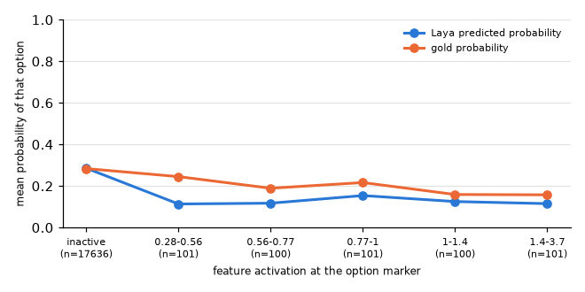

# Feature 11850

Critérios em que aparece: changed_base_vs_ft

**Interpretação (preencher):** 

---

## Maiores ativações

**tr_customer_service_000286 / needs_human** (noul, customer_service) | ativação 7.566 em `opção` | opções ['false', 'true'] | Laya: **false** [0.502, 0.498] | gabarito: **true**

```
[CLS]noul question: This conversation requires a human agent rather than automated handling.[SEP]
▸ [MASK] false:⟦ Autom⟧ation can carry this to resolution.
▸ [MASK] true: A human must take over: judgement, authority or empathy is required.

[SEP]

{"account": {"lifetime_value_usd": 2881, "prior_tickets_90d": 1, "seats": 1, "tenure_months": 49, "tier": "premium"}, "orders": [{"amount_usd": 9, "date": "2026-01-14", "id": "A-85515", "status": "failed"}], "thread": [{"role": "customer", "text": "My package was supposed to arrive yesterday and it still isn’t here—this is a hard deadline for me and I need it today!"}]}[SEP]
```

**tr_customer_service_000099 / needs_human** (noul, customer_service) | ativação 7.199 em `opção` | opções ['false', 'true'] | Laya: **false** [0.517, 0.483] | gabarito: **false**

```
[CLS]noul question: This conversation requires a human agent rather than automated handling.[SEP]
▸ [MASK] false:⟦ Autom⟧ation can carry this to resolution.
▸ [MASK] true: A human must take over: judgement, authority or empathy is required.

[SEP]

{"account": {"lifetime_value_usd": 210, "prior_tickets_90d": 0, "seats": 1, "tenure_months": 5, "tier": "standard"}, "thread": [{"role": "customer", "text": "I need to downgrade my account immediately. My budget is finalized at the end of the day today, so this needs to be handled right now."}, {"role": "agent", "text": "I understand that you have a time-sensitive deadline. To ensure I'm looking at the correct account, could you please verify the full name on the billing profile?"}, {"role": "customer", "text": "The name is Marcus Thorne. Please, I really don't have time to go back and forth on this today."}, {"role": "agent", "text": "Thank you, Marcus. I have your account pulled up. Could you please clarify if you are looking to move to the base tier or if you'd like to remove specific add-ons?"}, {"role": "customer", "text": "I just want the base tier, and I need this confirmed before the business day closes. Can you tell me if that's going to happen?"}]}[SEP]
```

**tr_customer_service_000146 / category** (choice, customer_service) | ativação 6.883 em `estado` | opções ['account', 'billing', 'delivery', 'refund', 'technical'] | Laya: **billing** [0.097, 0.544, 0.045, 0.255, 0.059] | gabarito: **billing**

```
[CLS]choice question: What is this customer conversation primarily about?[SEP]
▸ [MASK] account: Login, plan changes, profile or access management.
▸ [MASK] billing: A charge, invoice, subscription or payment problem.
▸ [MASK] delivery: Shipping, fulfilment or delivery of a physical item.
▸ [MASK] refund: The customer is explicitly asking for money back.
▸ [MASK] technical: The product or service is not working as expected.

[SEP]

{"account": {"lifetime_value_usd": 114, "prior_tickets_90d": 0, "seats": 12, "tenure_months": 2, "tier": "premium"}, "thread": [{"role": "customer", "text": "Good afternoon, could you please send me a copy of my most recent invoice? I’m on the Premium plan and have only been a customer for two months, so I need it for my records."}, {"role": "agent", "text": "Certainly, I can help with that. Which invoice are you looking for—the one from⟦ May⟧ or the one from June 2026?"}, {"role": "customer", "text": "I need the June 2026 invoice, please."}]}[SEP]
```

**tr_customer_service_000226 / needs_human** (noul, customer_service) | ativação 6.754 em `opção` | opções ['false', 'true'] | Laya: **false** [0.562, 0.438] | gabarito: **true**

```
[CLS]noul question: This conversation requires a human agent rather than automated handling.[SEP]
▸ [MASK] false:⟦ Autom⟧ation can carry this to resolution.
▸ [MASK] true: A human must take over: judgement, authority or empathy is required.

[SEP]

{"account": {"lifetime_value_usd": 2324, "prior_tickets_90d": 1, "seats": 1, "tenure_months": 26, "tier": "free"}, "orders": [{"amount_usd": 99, "date": "2026-01-19", "id": "A-44962", "status": "pending"}], "thread": [{"role": "customer", "text": "I have been using this free service for over two years, but the current lag makes it impossible to work, and I have a hard deadline in two hours that I am going to miss because of this $99 billable project!"}]}[SEP]
```

**tr_customer_service_000146 / action** (choice, customer_service) | ativação 6.578 em `estado` | opções ['answer_directly', 'close_no_action', 'escalate_to_human', 'execute_refund', 'request_information'] | Laya: **close_no_action** [0.267, 0.295, 0.147, 0.126, 0.166] | gabarito: **answer_directly**

```
[CLS]choice question: What should the assistant do next with this conversation?[SEP]
▸ [MASK] answer_directly: The assistant can resolve this itself with information it already has.
▸ [MASK] close_no_action: No further action is warranted; the matter is settled.
▸ [MASK] escalate_to_human: Hand off to a human agent with the appropriate authority.
▸ [MASK] execute_refund: Issue the refund or credit the customer is owed.
▸ [MASK] request_information: More detail is needed from the customer before anything can be done.

[SEP]

{"account": {"lifetime_value_usd": 114, "prior_tickets_90d": 0, "seats": 12, "tenure_months": 2, "tier": "premium"}, "thread": [{"role": "customer", "text": "Good afternoon, could you please send me a copy of my most recent invoice? I’m on the Premium plan and have only been a customer for two months, so I need it for my records."}, {"role": "agent", "text": "Certainly, I can help with that. Which invoice are you looking for—the one from⟦ May⟧ or the one from June 2026?"}, {"role": "customer", "text": "I need the June 2026 invoice, please."}]}[SEP]
```

## Ativações medianas (faixa 40-60%, mediana 0.969)

**tr_customer_service_000048 / category** (choice, customer_service) | ativação 0.939 em `estado` | opções ['account', 'billing', 'delivery', 'refund', 'technical'] | Laya: **account** [0.357, 0.09, 0.032, 0.269, 0.252] | gabarito: **account**

```
[CLS]choice question: What is this customer conversation primarily about?[SEP]
▸ [MASK] account: Login, plan changes, profile or access management.
▸ [MASK] billing: A charge, invoice, subscription or payment problem.
▸ [MASK] delivery: Shipping, fulfilment or delivery of a physical item.
▸ [MASK] refund: The customer is explicitly asking for money back.
▸ [MASK] technical: The product or service is not working as expected.

[SEP]

{"account": {"lifetime_value_usd": 881, "prior_tickets_90d": 0,⟦ "⟧seats": 1, "tenure_months": 14, "tier": "free"}, "thread": [{"role": "customer", "text": "I’ve been with you for 14 months on the free plan, but I need to move to a lower tier immediately. I have a firm deadline at 5 PM today to get this sorted, please help."}, {"role": "agent", "text": "I see you're looking to modify your plan subscription. To better assist you with your request, could you clarify which specific features you are looking to scale back?"}, {"role": "customer", "text": "There isn't time for a deep dive. I just need the downgrade processed before my deadline expires this afternoon."}]}[SEP]
```

**tr_customer_service_000263 / needs_human** (noul, customer_service) | ativação 0.870 em `estado` | opções ['false', 'true'] | Laya: **true** [0.42, 0.58] | gabarito: **true**

```
[CLS]noul question: This conversation requires a human agent rather than automated handling.[SEP]
▸ [MASK] false: Automation can carry this to resolution.
▸ [MASK] true: A human must take over: judgement, authority or empathy is required.

[SEP]

{"account": {"lifetime_value_usd": 270, "prior_tickets_90d": 5, "seats": 1, "tenure_months": 3, "tier": "enterprise"}, "orders": [{"amount_usd": 9, "date": "2026-02-14", "id": "A-24658", "status": "settled"}, {"amount_usd": 9, "date": "2026-01-01", "id": "A-74253", "status": "settled"}], "thread": [{"role": "customer", "text": "This is the sixth time in three months I’ve received the wrong shipment, despite being on an Enterprise agreement. I’ve had five tickets about this already that were supposedly resolved, but the⟦ error⟧ keeps recurring and I absolutely need the correct hardware for our site launch on Friday."}]}[SEP]
```

**tr_security_incidents_000205 / severity** (score, security_incidents) | ativação 1.050 em `opção` | opções ['0', '1', '2', '3', '4'] | Laya: **1** [0.134, 0.396, 0.391, 0.054, 0.024] | gabarito: **2**

```
[CLS]score question: How severe is the potential impact if this alert is real?[SEP]
▸ [MASK] level 0: Negligible: no access to anything sensitive.
▸ [MASK] level 1: Low: limited access, easily reversed.
▸ [MASK] level 2: Moderate: access to internal systems or non-public data.
▸ [MASK] level 3: High: access to⟦ production⟧, secrets or customer data.
▸ [MASK] level 4: Critical: active compromise of crown-jewel systems.

[SEP]

{"alert": {"description": "audit logging was turned off on a host", "evidence": "On 2026-09-14 22:07:53 UTC audit logging was disabled on host WIN‑SRV-12 (hostname: win-srv-12.corp.example.com) by an employee account with unprivileged rights. The action originated from an unrecognised source IP 198.51.100.22, MFA was confirmed, and the user’s credentials were last updated on 2026-06-16. No maintenance window was associated with this change.", "rule": "disabled_logging"}, "context": {"asset_criticality": "medium", "change_window_active": false, "source_on_allowlist": false}, "history": {"credential_rotation_days_ago": 90, "distinct_countries_30d": 4, "logins_30d": 1587, "prior_alerts_90d": 0}, "principal": {"mfa_enrolled": true, "name": "ci-infra-804", "privileges": ["repo:read"], "type": "employee"}}[SEP]
```

**tr_security_incidents_000264 / urgency** (score, security_incidents) | ativação 1.044 em `opção` | opções ['0', '1', '2', '3'] | Laya: **1** [0.094, 0.689, 0.088, 0.129] | gabarito: **1**

```
[CLS]score question: How quickly must a responder act on this alert?[SEP]
▸ [MASK] level 0: No time pressure; can wait indefinitely.
▸ [MASK] level 1: Routine; handle within the normal queue.
▸ [MASK] level 2: Elevated;⟦ should⟧ be handled within the same week.
▸ [MASK] level 3: Critical; requires action within the same day.

[SEP]

{"alert": {"description": "a first-ever sign-in from an unfamiliar country", "evidence": "At 22:14 UTC, the unprivileged principal 'ci_runner' authenticated from an IP address in a country not previously associated with this account. The login occurred without multi-factor authentication using credentials rotated 14 days ago, and no change window was active at the time.", "rule": "new_country_login"}, "context": {"asset_criticality": "low", "change_window_active": false, "source_on_allowlist": false}, "history": {"credential_rotation_days_ago": 14, "distinct_countries_30d": 3, "logins_30d": 458, "prior_alerts_90d": 0}, "principal": {"mfa_enrolled": false, "name": "svc-billing-637", "privileges": ["repo:read"], "type": "ci_runner"}}[SEP]
```

**tr_customer_service_000180 / urgency** (score, customer_service) | ativação 0.973 em `estado` | opções ['0', '1', '2', '3'] | Laya: **1** [0.188, 0.406, 0.118, 0.288] | gabarito: **3**

```
[CLS]score question: How time-sensitive is this conversation?[SEP]
▸ [MASK] level 0: No time pressure; can wait indefinitely.
▸ [MASK] level 1: Routine; handle within the normal queue.
▸ [MASK] level 2: Elevated; should be handled within the same week.
▸ [MASK] level 3: Critical; requires action within the same day.

[SEP]

{"account": {"lifetime_value_usd": 1386, "prior_tickets_90d": 0, "seats": 5, "tenure_months": 33, "tier": "premium"}, "orders": [{"amount_usd": 29, "date": "2026-01-04", "id": "A-58867", "status": "settled"}], "thread": [{"role": "customer", "text": "I need you to fix our seat management right now – we can't add any new users and the dashboard keeps throwing a 500 error. If this isn’t sorted out immediately I’m pulling us off the platform."}, {"role": "agent", "text": "I’m sorry you’re seeing that, and I understand the urgency. Could you tell me which team or project you’re trying to add seats to?"}, {"role": "customer", "text": "It’s the Sales Ops group – the “Add Seats” button just spins forever after I enter the email addresses, and none of the new accounts appear."}, {"role": "agent", "⟦text⟧": "Thanks for the detail. Are you getting any specific error message besides the spinner, maybe in the console or an email notification?"}, {"role": "customer", "text": "No email, just the endless loading. I’ve tried clearing cache, different browsers, everything. I need this resolved today or we’re out."}]}[SEP]
```

## Estatísticas (conjunto de descoberta, dev e teste)

**pred / error**

| split | decisões | ativas | ativas e Laya errou | taxa | lift | q (BH) | OR (CMH) | q (CMH) |
|---|---|---|---|---|---|---|---|---|
| discovery | 5100 | 35 | 17 | 0.486 | 0.76 | 0.145 | 0.60 | 0.499 |
| dev | 900 | 6 | 4 | 0.667 | 1.02 | nan | nan | nan |
| test | 2000 | 19 | 9 | 0.474 | 0.74 | nan | nan | nan |

**corr / error**

| split | decisões | ativas | ativas e Laya errou | taxa | lift | q (BH) | OR (CMH) | q (CMH) |
|---|---|---|---|---|---|---|---|---|
| discovery | 5100 | 105 | 87 | 0.829 | 1.30 | 3.67e-05 | 1.31 | 0.624 |
| dev | 900 | 15 | 13 | 0.867 | 1.32 | nan | nan | nan |
| test | 2000 | 53 | 43 | 0.811 | 1.27 | 0.0126 | 1.03 | 0.972 |

**state / error**

| split | decisões | ativas | ativas e Laya errou | taxa | lift | q (BH) | OR (CMH) | q (CMH) |
|---|---|---|---|---|---|---|---|---|
| discovery | 5100 | 5011 | 3192 | 0.637 | 1.00 | 0.763 | 0.97 | 0.953 |
| dev | 900 | 892 | 585 | 0.656 | 1.00 | 1 | 0.74 | 0.867 |
| test | 2000 | 1969 | 1250 | 0.635 | 1.00 | 0.61 | 0.48 | 0.371 |

Confusão mais sobre-representada (pred): `action|3>2` (n=3, lift 36.43, p=6.25e-05). Formato `pergunta|índice previsto>índice correto`.

Confusão mais sobre-representada (corr): `action|1>2` (n=32, lift 12.43, p=1.01e-27). Formato `pergunta|índice previsto>índice correto`.

Confusão mais sobre-representada (state): `duplicate|1>0` (n=215, lift 1.01, p=0.103). Formato `pergunta|índice previsto>índice correto`.



