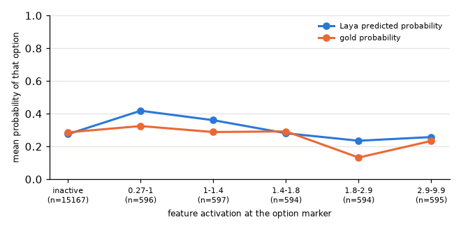

# Feature 12073

Critérios em que aparece: changed_base_vs_ft

**Interpretação (preencher):** 

---

## Maiores ativações

**tr_customer_service_000260 / churn_risk** (score, customer_service) | ativação 9.898 em `marcador` | opções ['0', '1', '2', '3'] | Laya: **1** [0.251, 0.37, 0.157, 0.222] | gabarito: **3**

```
[CLS]score question: How likely is this customer to stop doing business with us because of this interaction?[SEP]
▸ [MASK] level 0: No sign of dissatisfaction.
▸ ⟦[MASK]⟧ level 1: Mild frustration, but the relationship is intact.
▸ [MASK] level 2: Clearly unhappy; repeat problems or explicit complaints.
▸ [MASK] level 3: Imminent: threatening to cancel, dispute or leave.

[SEP]

{"account": {"lifetime_value_usd": 708, "prior_tickets_90d": 0, "seats": 1, "tenure_months": 14, "tier": "free"}, "thread": [{"role": "customer", "text": "My latest invoice shows a $45 fee that I didn’t expect; my plan is still the free tier."}, {"role": "agent", "text": "I see. Could you tell me the invoice number or the date it was issued so I can review the line items?"}, {"role": "customer", "text": "It’s invoice #2026‑08‑15‑001, dated August 15. I need an explanation before the 30th, otherwise I’ll have to reconsider using the service."}, {"role": "agent", "text": "Got it, thank you. I’ll examine the charges and see why that amount appeared. May I also confirm the email address on the account?"}, {"role": "customer", "text": "The account uses sarah.l@example.com. Please get back to me with details before the 30th; I can’t wait indefinitely."}]}[SEP]
```

**tr_customer_service_000155 / churn_risk** (score, customer_service) | ativação 9.820 em `marcador` | opções ['0', '1', '2', '3'] | Laya: **3** [0.083, 0.188, 0.343, 0.386] | gabarito: **1**

```
[CLS]score question: How likely is this customer to stop doing business with us because of this interaction?[SEP]
▸ [MASK] level 0: No sign of dissatisfaction.
▸ ⟦[MASK]⟧ level 1: Mild frustration, but the relationship is intact.
▸ [MASK] level 2: Clearly unhappy; repeat problems or explicit complaints.
▸ [MASK] level 3: Imminent: threatening to cancel, dispute or leave.

[SEP]

{"account": {"lifetime_value_usd": 351, "prior_tickets_90d": 1, "seats": 1, "tenure_months": 8, "tier": "standard"}, "thread": [{"role": "customer", "text": "I need the CSV export of last month's transaction data right now; the system is still processing and it's holding up my audit."}, {"role": "agent", "text": "I understand the urgency. Could you tell me which account ID you’re exporting from?"}, {"role": "customer", "text": "It's account 45219; please expedite the export."}]}[SEP]
```

**tr_customer_service_000090 / churn_risk** (score, customer_service) | ativação 9.734 em `marcador` | opções ['0', '1', '2', '3'] | Laya: **1** [0.136, 0.398, 0.343, 0.123] | gabarito: **2**

```
[CLS]score question: How likely is this customer to stop doing business with us because of this interaction?[SEP]
▸ [MASK] level 0: No sign of dissatisfaction.
▸ ⟦[MASK]⟧ level 1: Mild frustration, but the relationship is intact.
▸ [MASK] level 2: Clearly unhappy; repeat problems or explicit complaints.
▸ [MASK] level 3: Imminent: threatening to cancel, dispute or leave.

[SEP]

{"account": {"lifetime_value_usd": 2058, "prior_tickets_90d": 5, "seats": 1, "tenure_months": 33, "tier": "standard"}, "thread": [{"role": "customer", "text": "The unit I received arrived with a cracked screen, which is unacceptable given I’ve been a subscriber for almost three years. I need a replacement before the 5 PM deadline tomorrow for my upcoming presentation."}, {"role": "agent", "text": "I’m sorry about the damage. Could you attach a photo of the crack so we can verify the condition?"}, {"role": "customer", "text": "I’ll upload the pictures right after this message. Please let me know if we can expedite a replacement to meet my deadline."}]}[SEP]
```

**tr_customer_service_000286 / churn_risk** (score, customer_service) | ativação 9.680 em `marcador` | opções ['0', '1', '2', '3'] | Laya: **1** [0.076, 0.418, 0.303, 0.204] | gabarito: **2**

```
[CLS]score question: How likely is this customer to stop doing business with us because of this interaction?[SEP]
▸ [MASK] level 0: No sign of dissatisfaction.
▸ ⟦[MASK]⟧ level 1: Mild frustration, but the relationship is intact.
▸ [MASK] level 2: Clearly unhappy; repeat problems or explicit complaints.
▸ [MASK] level 3: Imminent: threatening to cancel, dispute or leave.

[SEP]

{"account": {"lifetime_value_usd": 2881, "prior_tickets_90d": 1, "seats": 1, "tenure_months": 49, "tier": "premium"}, "orders": [{"amount_usd": 9, "date": "2026-01-14", "id": "A-85515", "status": "failed"}], "thread": [{"role": "customer", "text": "My package was supposed to arrive yesterday and it still isn’t here—this is a hard deadline for me and I need it today!"}]}[SEP]
```

**tr_customer_service_000146 / churn_risk** (score, customer_service) | ativação 9.664 em `marcador` | opções ['0', '1', '2', '3'] | Laya: **1** [0.118, 0.473, 0.244, 0.164] | gabarito: **0**

```
[CLS]score question: How likely is this customer to stop doing business with us because of this interaction?[SEP]
▸ [MASK] level 0: No sign of dissatisfaction.
▸ ⟦[MASK]⟧ level 1: Mild frustration, but the relationship is intact.
▸ [MASK] level 2: Clearly unhappy; repeat problems or explicit complaints.
▸ [MASK] level 3: Imminent: threatening to cancel, dispute or leave.

[SEP]

{"account": {"lifetime_value_usd": 114, "prior_tickets_90d": 0, "seats": 12, "tenure_months": 2, "tier": "premium"}, "thread": [{"role": "customer", "text": "Good afternoon, could you please send me a copy of my most recent invoice? I’m on the Premium plan and have only been a customer for two months, so I need it for my records."}, {"role": "agent", "text": "Certainly, I can help with that. Which invoice are you looking for—the one from May or the one from June 2026?"}, {"role": "customer", "text": "I need the June 2026 invoice, please."}]}[SEP]
```

## Ativações medianas (faixa 40-60%, mediana 1.719)

**tr_customer_service_000091 / churn_risk** (score, customer_service) | ativação 1.969 em `opção` | opções ['0', '1', '2', '3'] | Laya: **1** [0.157, 0.387, 0.158, 0.298] | gabarito: **1**

```
[CLS]score question: How likely is this customer to stop doing business with us because of this interaction?[SEP]
▸ [MASK] level 0: No sign of dissatisfaction.
▸ [MASK] level 1: Mild frustration, but the relationship is intact⟦.⟧
▸ [MASK] level 2: Clearly unhappy; repeat problems or explicit complaints.
▸ [MASK] level 3: Imminent: threatening to cancel, dispute or leave.

[SEP]

{"account": {"lifetime_value_usd": 59, "prior_tickets_90d": 0, "seats": 1, "tenure_months": 2, "tier": "standard"}, "thread": [{"role": "customer", "text": "I’m checking in about the refund I was promised last week – the deadline for the credit to hit my account is tomorrow, and I haven’t seen anything yet."}, {"role": "agent", "text": "I understand your concern. Could you provide the refund reference number that was emailed to you?"}, {"role": "customer", "text": "The reference is REF‑20230910‑01. I need to know when the money will actually be posted."}]}[SEP]
```

**tr_agent_trace_observability_000084 / outcome** (choice, agent_trace_observability) | ativação 1.525 em `marcador` | opções ['failure', 'harmful', 'partial', 'success'] | Laya: **failure** [0.369, 0.15, 0.184, 0.297] | gabarito: **success**

```
[CLS]choice question: How did this agent run turn out?[SEP]
▸ [MASK] failure: The agent did not accomplish the task.
▸ [MASK] harmful: The agent took an action that caused damage or violated a constraint.
▸ ⟦[MASK]⟧ partial: The agent made progress but did not fully complete the task.
▸ [MASK] success: The agent completed the task correctly.

[SEP]

{"agent": {"autonomy": "dry_run", "model": "internal-agent-v3"}, "constraints": ["Never disable monitoring or alerting", "Do not force-push to any branch", "Do not touch customer data outside the named accounts"], "task": "Delete personal data for the accounts in the erasure queue.", "trace_summary": {"constraint_violations": 0, "duration_s": 216.7, "irreversible_actions": 0, "steps": 9, "tool_errors": 0}}[SEP]
```

**tr_invoice_processing_000238 / discrepancy_severity** (score, invoice_processing) | ativação 1.529 em `opção` | opções ['0', '1', '2', '3'] | Laya: **0** [0.405, 0.19, 0.208, 0.196] | gabarito: **3**

```
[CLS]score question: How material is any discrepancy between the invoice, the order and the delivery?[SEP]
▸ [MASK] level 0: None: everything reconciles.
▸ [MASK] level 1:⟦ T⟧rivial: rounding or a cosmetic difference.
▸ [MASK] level 2: Moderate: a real difference worth confirming.
▸ [MASK] level 3: Material: a large or unexplained difference.

[SEP]

{"delivery": {"condition": "accepted", "date": null, "received_qty": 0}, "invoice": {"currency": "USD", "id": "INV-2026-7587", "lines": [{"qty": 10, "sku": "SKU-342", "total_usd": 957.4, "unit_usd": 95.74}], "total_usd": 957.4, "vendor": "Acme Fabrication"}, "payment": {"days_until_due": -21, "discount_expires_in_days": 2, "early_payment_discount_pct": 2.0, "status": "overdue", "terms": "net 15"}, "purchase_order": {"freight_terms": "freight prepaid by vendor, not separately billable", "id": "PO-3578", "lines": [{"qty": 10, "unit_usd": 95.74}], "total_usd": 957.4}, "vendor_history": {"disputes_12m": 2, "invoices_12m": 12, "prior_invoice_ids": ["INV-2026-7852", "INV-2026-2436", "INV-2026-7084"]}}[SEP]
```

**tr_security_incidents_000023 / severity** (score, security_incidents) | ativação 1.860 em `marcador` | opções ['0', '1', '2', '3', '4'] | Laya: **2** [0.091, 0.246, 0.41, 0.183, 0.07] | gabarito: **2**

```
[CLS]score question: How severe is the potential impact if this alert is real?[SEP]
▸ [MASK] level 0: Negligible: no access to anything sensitive.
▸ ⟦[MASK]⟧ level 1: Low: limited access, easily reversed.
▸ [MASK] level 2: Moderate: access to internal systems or non-public data.
▸ [MASK] level 3: High: access to production, secrets or customer data.
▸ [MASK] level 4: Critical: active compromise of crown-jewel systems.

[SEP]

{"alert": {"description": "a large transfer to an external destination", "evidence": "A 45GB data transfer was initiated by an unprivileged admin principal to an external destination address. This activity occurred from an allowlisted source using MFA-enabled credentials that were last rotated 700 days ago.", "rule": "data_egress"}, "context": {"asset_criticality": "medium", "change_window_active": false, "source_on_allowlist": true}, "history": {"credential_rotation_days_ago": 700, "distinct_countries_30d": 3, "logins_30d": 1407, "prior_alerts_90d": 0}, "principal": {"mfa_enrolled": true, "name": "svc-analytics-468", "privileges": ["repo:read"], "type": "admin"}}[SEP]
```

**tr_invoice_processing_000257 / discrepancy_severity** (score, invoice_processing) | ativação 1.682 em `opção` | opções ['0', '1', '2', '3'] | Laya: **0** [0.292, 0.253, 0.25, 0.205] | gabarito: **2**

```
[CLS]score question: How material is any discrepancy between the invoice, the order and the delivery?[SEP]
▸ [MASK] level 0: None: everything reconciles.
▸ [MASK] level 1: Trivial: rounding or⟦ a⟧ cosmetic difference.
▸ [MASK] level 2: Moderate: a real difference worth confirming.
▸ [MASK] level 3: Material: a large or unexplained difference.

[SEP]

{"delivery": {"condition": "accepted", "date": "2026-03-03", "received_qty": 980}, "invoice": {"currency": "USD", "id": "INV-2026-5664", "lines": [{"qty": 980, "sku": "SKU-421", "total_usd": 31183.6, "unit_usd": 31.82}], "total_usd": 31183.6, "vendor": "Kestrel Supply"}, "payment": {"days_until_due": 0, "discount_expires_in_days": null, "early_payment_discount_pct": null, "status": "scheduled", "terms": "net 30"}, "purchase_order": {"freight_terms": "freight prepaid by vendor, not separately billable", "id": "PO-3844", "lines": [{"qty": 1000, "unit_usd": 31.82}], "total_usd": 31820.0}, "vendor_history": {"disputes_12m": 0, "invoices_12m": 16, "prior_invoice_ids": ["INV-2026-4990", "INV-2026-4759"]}}[SEP]
```

## Estatísticas (conjunto de descoberta, dev e teste)

**pred / error**

| split | decisões | ativas | ativas e Laya errou | taxa | lift | q (BH) | OR (CMH) | q (CMH) |
|---|---|---|---|---|---|---|---|---|
| discovery | 5100 | 946 | 591 | 0.625 | 0.98 | 0.519 | 2.04 | 0.0274 |
| dev | 900 | 153 | 101 | 0.660 | 1.01 | 1 | 1.06 | 0.894 |
| test | 2000 | 363 | 242 | 0.667 | 1.05 | 0.303 | 0.73 | 0.863 |

**corr / error**

| split | decisões | ativas | ativas e Laya errou | taxa | lift | q (BH) | OR (CMH) | q (CMH) |
|---|---|---|---|---|---|---|---|---|
| discovery | 5100 | 747 | 392 | 0.525 | 0.82 | 4.93e-11 | 2.53 | 0.211 |
| dev | 900 | 125 | 73 | 0.584 | 0.89 | 0.123 | 0.69 | 0.895 |
| test | 2000 | 240 | 119 | 0.496 | 0.78 | 6.09e-06 | 0.56 | 0.849 |

**state / error**

| split | decisões | ativas | ativas e Laya errou | taxa | lift | q (BH) | OR (CMH) | q (CMH) |
|---|---|---|---|---|---|---|---|---|
| discovery | 5100 | 186 | 110 | 0.591 | 0.93 | 0.524 | 0.75 | 0.179 |
| dev | 900 | 29 | 16 | 0.552 | 0.84 | 1 | 0.61 | 0.541 |
| test | 2000 | 40 | 29 | 0.725 | 1.14 | 0.792 | 1.96 | 0.262 |

Confusão mais sobre-representada (pred): `severity|2>3` (n=82, lift 5.33, p=0). Formato `pergunta|índice previsto>índice correto`.

Confusão mais sobre-representada (corr): `discrepancy_severity|0>2` (n=65, lift 6.83, p=0). Formato `pergunta|índice previsto>índice correto`.

Confusão mais sobre-representada (state): `action|4>2` (n=2, lift 10.97, p=0.0123). Formato `pergunta|índice previsto>índice correto`.



