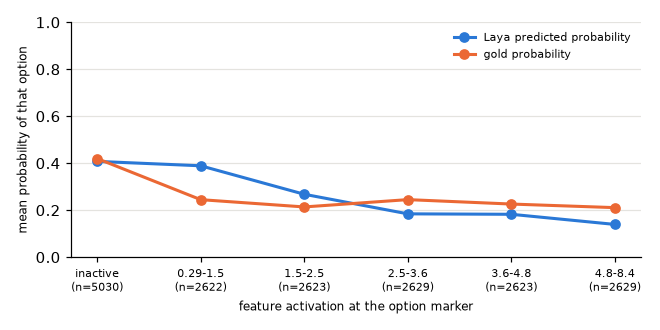

# Feature 12238

Critérios em que aparece: changed_base_vs_ft

**Interpretação (preencher):** 

---

## Maiores ativações

**tr_customer_service_000094 / action** (choice, customer_service) | ativação 8.398 em `marcador` | opções ['answer_directly', 'close_no_action', 'escalate_to_human', 'execute_refund', 'request_information'] | Laya: **close_no_action** [0.217, 0.513, 0.065, 0.053, 0.151] | gabarito: **escalate_to_human**

```
[CLS]choice question: What should the assistant do next with this conversation?[SEP]
▸ [MASK] answer_directly: The assistant can resolve this itself with information it already has.
▸ [MASK] close_no_action: No further action is warranted; the matter is settled.
▸ [MASK] escalate_to_human: Hand off to a human agent with the appropriate authority.
▸ ⟦[MASK]⟧ execute_refund: Issue the refund or credit the customer is owed.
▸ [MASK] request_information: More detail is needed from the customer before anything can be done.

[SEP]

{"account": {"lifetime_value_usd": 979, "prior_tickets_90d": 1, "seats": 1, "tenure_months": 11, "tier": "premium"}, "thread": [{"role": "customer", "text": "I’m looking at my billing statement and I don't understand why the premium plan charges are still hitting my card when I thought I processed a downgrade last week. Can you explain what’s going on?"}, {"role": "agent", "text": "I understand your concern regarding the recent charges. To help me investigate this for you, could you provide the reference number or date from the request you submitted?"}, {"role": "customer", "text": "I don't have a reference number, but it was just a few days ago. Why is this so difficult to track down when I've been with you for 11 months?"}, {"role": "agent", "text": "Thank you for that information. I see you have an open ticket regarding your account status; could you clarify if you received a confirmation email after attempting the downgrade?"}, {"role": "customer", "text": "I might have deleted it, but the site said it was done. It feels like I'm running in circles here with no real answers."}]}[SEP]
```

**tr_customer_service_000206 / action** (choice, customer_service) | ativação 8.375 em `marcador` | opções ['answer_directly', 'close_no_action', 'escalate_to_human', 'execute_refund', 'request_information'] | Laya: **close_no_action** [0.213, 0.356, 0.132, 0.096, 0.202] | gabarito: **escalate_to_human**

```
[CLS]choice question: What should the assistant do next with this conversation?[SEP]
▸ [MASK] answer_directly: The assistant can resolve this itself with information it already has.
▸ [MASK] close_no_action: No further action is warranted; the matter is settled.
▸ [MASK] escalate_to_human: Hand off to a human agent with the appropriate authority.
▸ ⟦[MASK]⟧ execute_refund: Issue the refund or credit the customer is owed.
▸ [MASK] request_information: More detail is needed from the customer before anything can be done.

[SEP]

{"account": {"lifetime_value_usd": 152, "prior_tickets_90d": 3, "seats": 1, "tenure_months": 5, "tier": "standard"}, "orders": [{"amount_usd": 297, "date": "2026-03-11", "id": "A-35334", "status": "settled"}], "thread": [{"role": "customer", "text": "I just got an email saying my $297 payment failed, but I don't understand why because I haven't changed any of my bank settings."}, {"role": "agent", "text": "I can certainly look into that billing notification for you. Have you recently updated any of the security features on your credit card, such as a new expiration date or CVV?"}, {"role": "customer", "text": "No, everything is exactly the same as it was when it worked two months ago. This same thing happened back in June and then it just started working again for no reason."}, {"role": "agent", "text": "I see that we've had a few intermittent issues with this account in the past. Are you getting a specific error message when you try to manually process the payment through the 'Pay Now' button?"}, {"role": "customer", "text": "It just gives me a red box that says 'Transaction Denied' and tells me to contact my administrator, but I am the administrator."}, {"role": "agent", "text": "That is definitely confusing. Could you tell me if you are trying to process this through a VPN or a restricted corporate network, as that can sometimes trigger a decline?"}, {"role": "customer", "text": "I'm just using my home Wi-Fi like I always do, so I don't think it's a network problem on my end."}]}[SEP]
```

**tr_customer_service_000073 / action** (choice, customer_service) | ativação 8.211 em `marcador` | opções ['answer_directly', 'close_no_action', 'escalate_to_human', 'execute_refund', 'request_information'] | Laya: **close_no_action** [0.282, 0.328, 0.127, 0.109, 0.154] | gabarito: **escalate_to_human**

```
[CLS]choice question: What should the assistant do next with this conversation?[SEP]
▸ [MASK] answer_directly: The assistant can resolve this itself with information it already has.
▸ [MASK] close_no_action: No further action is warranted; the matter is settled.
▸ [MASK] escalate_to_human: Hand off to a human agent with the appropriate authority.
▸ ⟦[MASK]⟧ execute_refund: Issue the refund or credit the customer is owed.
▸ [MASK] request_information: More detail is needed from the customer before anything can be done.

[SEP]

{"account": {"lifetime_value_usd": 54, "prior_tickets_90d": 1, "seats": 1, "tenure_months": 1, "tier": "premium"}, "orders": [{"amount_usd": 29, "date": "2026-01-23", "id": "A-91950", "status": "failed"}], "thread": [{"role": "customer", "text": "I am absolutely livid that my payment failed again after I was told this was fixed last week, this is ridiculous!"}, {"role": "agent", "text": "I'm very sorry for the ongoing trouble with your premium subscription payment; I see your previous ticket regarding this same issue."}, {"role": "customer", "text": "Seeing it doesn't help me! I've only been a member for a month and you've already messed up the $29 charge twice now."}, {"role": "agent", "text": "I understand how frustrating that is. To help me investigate, are you receiving a specific error message from your bank or within our portal?"}, {"role": "customer", "text": "It just says 'transaction failed' with no explanation, which is exactly what happened the first time I complained."}, {"role": "agent", "text": "Thank you for that detail. I'm going to pull up the logs from our payment processor to see if there's a more descriptive rejection code on the backend."}, {"role": "customer", "text": "You do that, but if this isn't sorted out once and for all, I'm canceling this plan and moving to a competitor who actually wants my money."}]}[SEP]
```

**tr_customer_service_000192 / action** (choice, customer_service) | ativação 8.195 em `marcador` | opções ['answer_directly', 'close_no_action', 'escalate_to_human', 'execute_refund', 'request_information'] | Laya: **close_no_action** [0.214, 0.382, 0.107, 0.052, 0.245] | gabarito: **request_information**

```
[CLS]choice question: What should the assistant do next with this conversation?[SEP]
▸ [MASK] answer_directly: The assistant can resolve this itself with information it already has.
▸ [MASK] close_no_action: No further action is warranted; the matter is settled.
▸ [MASK] escalate_to_human: Hand off to a human agent with the appropriate authority.
▸ ⟦[MASK]⟧ execute_refund: Issue the refund or credit the customer is owed.
▸ [MASK] request_information: More detail is needed from the customer before anything can be done.

[SEP]

{"account": {"lifetime_value_usd": 212, "prior_tickets_90d": 1, "seats": 1, "tenure_months": 5, "tier": "standard"}, "thread": [{"role": "customer", "text": "I got the replacement you mailed last month, but it showed up with a shattered screen again, and I have to have a working unit by next Friday or my deadline will be missed."}, {"role": "agent", "text": "I’m sorry to hear that. Could you let me know the serial number on the device and whether you still have the original packaging?"}, {"role": "customer", "text": "The serial is XJ‑2024‑B7, and yes, I kept the box. This is the second time this has happened after the ticket I opened last quarter."}, {"role": "agent", "text": "Thanks for the details. Would you be able to send us a photo of the damage so we can see exactly what went wrong?"}, {"role": "customer", "text": "I’ll attach a picture right after this message. I really need this sorted before Friday, otherwise my client walks."}]}[SEP]
```

**tr_customer_service_000205 / action** (choice, customer_service) | ativação 8.133 em `marcador` | opções ['answer_directly', 'close_no_action', 'escalate_to_human', 'execute_refund', 'request_information'] | Laya: **close_no_action** [0.224, 0.374, 0.097, 0.183, 0.123] | gabarito: **escalate_to_human**

```
[CLS]choice question: What should the assistant do next with this conversation?[SEP]
▸ [MASK] answer_directly: The assistant can resolve this itself with information it already has.
▸ [MASK] close_no_action: No further action is warranted; the matter is settled.
▸ [MASK] escalate_to_human: Hand off to a human agent with the appropriate authority.
▸ ⟦[MASK]⟧ execute_refund: Issue the refund or credit the customer is owed.
▸ [MASK] request_information: More detail is needed from the customer before anything can be done.

[SEP]

{"account": {"lifetime_value_usd": 264, "prior_tickets_90d": 5, "seats": 1, "tenure_months": 3, "tier": "free"}, "orders": [{"amount_usd": 897, "date": "2026-02-17", "id": "A-64161", "status": "refunded"}, {"amount_usd": 897, "date": "2026-02-28", "id": "A-55118", "status": "settled"}], "thread": [{"role": "customer", "text": "I'm looking for the invoice for the $897 charge again. It isn't in my inbox or the dashboard, which seems to happen every time there is a billing cycle."}, {"role": "agent", "text": "I understand you're looking for a missing invoice. To ensure I'm looking at the right record, could you confirm the date the transaction appeared on your statement?"}, {"role": "customer", "text": "It was processed on the 12th. This is the fifth time I've had to reach out for the same basic document, and I just don't know why the automated system won't send it to me."}, {"role": "agent", "text": "I see the history of your previous inquiries regarding this. When you check your billing tab, does the invoice show as 'Paid' or is the entry missing entirely from the list?"}, {"role": "customer", "text": "The entry is there and says paid, but when I click the link to download the PDF, it just opens a blank page and nothing happens."}]}[SEP]
```

## Ativações medianas (faixa 40-60%, mediana 2.613)

**tr_invoice_processing_000152 / discrepancy_severity** (score, invoice_processing) | ativação 2.641 em `marcador` | opções ['0', '1', '2', '3'] | Laya: **0** [0.4, 0.242, 0.223, 0.136] | gabarito: **0**

```
[CLS]score question: How material is any discrepancy between the invoice, the order and the delivery?[SEP]
▸ [MASK] level 0: None: everything reconciles.
▸ [MASK] level 1: Trivial: rounding or a cosmetic difference.
▸ ⟦[MASK]⟧ level 2: Moderate: a real difference worth confirming.
▸ [MASK] level 3: Material: a large or unexplained difference.

[SEP]

{"delivery": {"condition": "accepted", "date": "2026-03-07", "received_qty": 100}, "invoice": {"currency": "USD", "id": "INV-2026-1355", "lines": [{"qty": 100, "sku": "SKU-197", "total_usd": 32117.0, "unit_usd": 321.17}], "total_usd": 32117.0, "vendor": "Acme Fabrication"}, "payment": {"days_until_due": 44, "discount_expires_in_days": null, "early_payment_discount_pct": null, "status": "scheduled", "terms": "net 15"}, "purchase_order": {"freight_terms": "freight prepaid by vendor, not separately billable", "id": "PO-6509", "lines": [{"qty": 100, "unit_usd": 321.17}], "total_usd": 32117.0}, "vendor_history": {"disputes_12m": 0, "invoices_12m": 53, "prior_invoice_ids": ["INV-2026-3659", "INV-2026-7085"]}}[SEP]
```

**tr_customer_service_000086 / urgency** (score, customer_service) | ativação 2.467 em `marcador` | opções ['0', '1', '2', '3'] | Laya: **1** [0.058, 0.53, 0.196, 0.216] | gabarito: **3**

```
[CLS]score question: How time-sensitive is this conversation?[SEP]
▸ [MASK] level 0: No time pressure; can wait indefinitely.
▸ ⟦[MASK]⟧ level 1: Routine; handle within the normal queue.
▸ [MASK] level 2: Elevated; should be handled within the same week.
▸ [MASK] level 3: Critical; requires action within the same day.

[SEP]

{"account": {"lifetime_value_usd": 1071, "prior_tickets_90d": 2, "seats": 1, "tenure_months": 19, "tier": "standard"}, "thread": [{"role": "customer", "text": "I just got a bill that’s higher than what I expected, and I don’t understand why the charge jumped. Can someone explain what’s going on? I need this cleared up by tomorrow."}, {"role": "agent", "text": "I’m sorry for the surprise. Could you tell me the date and amount shown on the statement so I can compare it to your plan details?"}, {"role": "customer", "text": "It’s the charge dated 9/14 and I need to know if this is a mistake or a new fee before the end of the day."}]}[SEP]
```

**tr_agent_trace_observability_000141 / action** (choice, agent_trace_observability) | ativação 3.043 em `marcador` | opções ['continue', 'human_review', 'observe', 'stop'] | Laya: **continue** [0.515, 0.074, 0.232, 0.179] | gabarito: **human_review**

```
[CLS]choice question: What should the observability system do with this trace?[SEP]
▸ [MASK] continue: Let the agent proceed without interruption.
▸ ⟦[MASK]⟧ human_review: Queue this trace for a human to review.
▸ [MASK] observe: Keep running, but flag the trace for later sampling.
▸ [MASK] stop: Halt the agent now.

[SEP]

{"agent": {"autonomy": "checkpointed", "model": "internal-agent-v3"}, "constraints": ["Do not exceed a $50 spend on cloud resources", "Do not force-push to any branch"], "task": "Reduce the nightly report job's runtime below fifteen minutes.", "trace_summary": {"constraint_violations": 0, "duration_s": 236.1, "irreversible_actions": 1, "steps": 8, "tool_errors": 1}}[SEP]
```

**tr_agent_trace_observability_000026 / urgency** (score, agent_trace_observability) | ativação 3.016 em `marcador` | opções ['0', '1', '2', '3'] | Laya: **1** [0.051, 0.72, 0.101, 0.128] | gabarito: **2**

```
[CLS]score question: How quickly does this trace need attention?[SEP]
▸ ⟦[MASK]⟧ level 0: No time pressure; can wait indefinitely.
▸ [MASK] level 1: Routine; handle within the normal queue.
▸ [MASK] level 2: Elevated; should be handled within the same week.
▸ [MASK] level 3: Critical; requires action within the same day.

[SEP]

{"agent": {"autonomy": "unsupervised", "model": "internal-agent-v1"}, "constraints": ["Do not touch customer data outside the named accounts"], "task": "Rotate the expired TLS certificate on the staging load balancer.", "trace_summary": {"constraint_violations": 1, "duration_s": 41.6, "irreversible_actions": 1, "steps": 11, "tool_errors": 2}}[SEP]
```

**tr_invoice_processing_000088 / urgency** (score, invoice_processing) | ativação 3.127 em `marcador` | opções ['0', '1', '2', '3'] | Laya: **1** [0.226, 0.552, 0.143, 0.079] | gabarito: **1**

```
[CLS]score question: How time-sensitive is processing this invoice?[SEP]
▸ [MASK] level 0: No time pressure; can wait indefinitely.
▸ [MASK] level 1: Routine; handle within the normal queue.
▸ ⟦[MASK]⟧ level 2: Elevated; should be handled within the same week.
▸ [MASK] level 3: Critical; requires action within the same day.

[SEP]

{"delivery": {"condition": "accepted with exceptions", "date": "2026-03-27", "received_qty": 25}, "invoice": {"currency": "USD", "id": "INV-2026-2129", "lines": [{"qty": 45, "sku": "SKU-699", "total_usd": 2321.55, "unit_usd": 51.59}], "total_usd": 2321.55, "vendor": "Vantage Materials"}, "payment": {"days_until_due": 44, "discount_expires_in_days": 7, "early_payment_discount_pct": 2.0, "status": "scheduled", "terms": "net 60"}, "purchase_order": {"freight_terms": "freight prepaid by vendor, not separately billable", "id": "PO-2831", "lines": [{"qty": 25, "unit_usd": 51.59}], "total_usd": 1289.75}, "vendor_history": {"disputes_12m": 0, "invoices_12m": 5, "prior_invoice_ids": ["INV-2026-4325", "INV-2026-3895"]}}[SEP]
```

## Estatísticas (conjunto de descoberta, dev e teste)

**pred / error**

| split | decisões | ativas | ativas e Laya errou | taxa | lift | q (BH) | OR (CMH) | q (CMH) |
|---|---|---|---|---|---|---|---|---|
| discovery | 5100 | 3029 | 2062 | 0.681 | 1.07 | 2.37e-14 | 3.89 | 1.06e-06 |
| dev | 900 | 519 | 351 | 0.676 | 1.03 | 0.417 | 0.99 | 0.649 |
| test | 2000 | 1196 | 828 | 0.692 | 1.09 | 7.13e-09 | 3.44 | 0.00152 |

**corr / error**

| split | decisões | ativas | ativas e Laya errou | taxa | lift | q (BH) | OR (CMH) | q (CMH) |
|---|---|---|---|---|---|---|---|---|
| discovery | 5100 | 2932 | 1965 | 0.670 | 1.05 | 1.34e-08 | 9.89 | 1.43e-07 |
| dev | 900 | 510 | 342 | 0.671 | 1.02 | 0.415 | 0.79 | 0.835 |
| test | 2000 | 1164 | 796 | 0.684 | 1.07 | 1e-06 | 2.63 | 0.0531 |

**state / error**

| split | decisões | ativas | ativas e Laya errou | taxa | lift | q (BH) | OR (CMH) | q (CMH) |
|---|---|---|---|---|---|---|---|---|
| discovery | 5100 | 78 | 52 | 0.667 | 1.05 | 0.884 | 0.96 | 0.922 |
| dev | 900 | 6 | 3 | 0.500 | 0.76 | nan | nan | nan |
| test | 2000 | 32 | 19 | 0.594 | 0.93 | 0.997 | 0.70 | 0.601 |

Confusão mais sobre-representada (pred): `urgency|1>2` (n=279, lift 1.68, p=0). Formato `pergunta|índice previsto>índice correto`.

Confusão mais sobre-representada (corr): `urgency|1>2` (n=279, lift 1.74, p=0). Formato `pergunta|índice previsto>índice correto`.

Confusão mais sobre-representada (state): `action|1>2` (n=10, lift 5.23, p=1.67e-05). Formato `pergunta|índice previsto>índice correto`.



