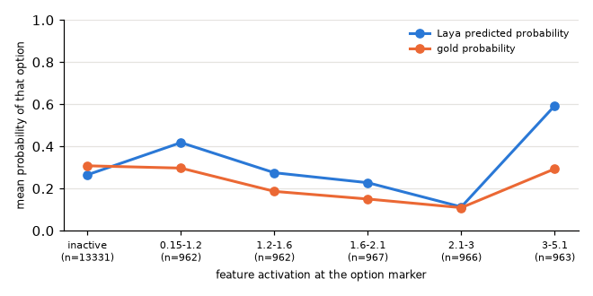

# Feature 13230

Critérios em que aparece: changed_base_vs_ft

**Interpretação (preencher):** 

---

## Maiores ativações

**tr_customer_service_000244 / urgency** (score, customer_service) | ativação 13.039 em `opção` | opções ['0', '1', '2', '3'] | Laya: **1** [0.053, 0.617, 0.175, 0.155] | gabarito: **2**

```
[CLS]score question: How time-sensitive is this conversation?[SEP]
▸ [MASK] level 0: No time pressure; can wait indefinitely.
▸ [MASK] level 1⟦:⟧ Routine; handle within the normal queue.
▸ [MASK] level 2: Elevated; should be handled within the same week.
▸ [MASK] level 3: Critical; requires action within the same day.

[SEP]

{"account": {"lifetime_value_usd": 91, "prior_tickets_90d": 0, "seats": 1, "tenure_months": 1, "tier": "standard"}, "thread": [{"role": "customer", "text": "Hi there! I just opened my package and noticed that I received the standard kit instead of the deluxe version I had ordered. I hate to be a pain, but I'm actually on a very tight schedule and need the specific components from the deluxe kit for a project deadline on Tuesday. Could you help me figure out how to get the right items sent out?"}]}[SEP]
```

**tr_customer_service_000153 / urgency** (score, customer_service) | ativação 13.016 em `opção` | opções ['0', '1', '2', '3'] | Laya: **1** [0.047, 0.785, 0.088, 0.08] | gabarito: **1**

```
[CLS]score question: How time-sensitive is this conversation?[SEP]
▸ [MASK] level 0: No time pressure; can wait indefinitely.
▸ [MASK] level 1⟦:⟧ Routine; handle within the normal queue.
▸ [MASK] level 2: Elevated; should be handled within the same week.
▸ [MASK] level 3: Critical; requires action within the same day.

[SEP]

{"account": {"lifetime_value_usd": 232, "prior_tickets_90d": 3, "seats": 1, "tenure_months": 8, "tier": "standard"}, "thread": [{"role": "customer", "text": "We've added three new team members and need to assign them seats in the admin portal. The current seat count shows six, but we should have nine."}, {"role": "agent", "text": "I see, thanks for the details. Could you confirm the email addresses of the new users?"}, {"role": "customer", "text": "Sure, they're alice@example.com, bob@example.com, and carol@example.com."}]}[SEP]
```

**tr_customer_service_000298 / urgency** (score, customer_service) | ativação 13.008 em `opção` | opções ['0', '1', '2', '3'] | Laya: **1** [0.033, 0.758, 0.156, 0.052] | gabarito: **1**

```
[CLS]score question: How time-sensitive is this conversation?[SEP]
▸ [MASK] level 0: No time pressure; can wait indefinitely.
▸ [MASK] level 1⟦:⟧ Routine; handle within the normal queue.
▸ [MASK] level 2: Elevated; should be handled within the same week.
▸ [MASK] level 3: Critical; requires action within the same day.

[SEP]

{"account": {"lifetime_value_usd": 58, "prior_tickets_90d": 0, "seats": 1, "tenure_months": 1, "tier": "enterprise"}, "thread": [{"role": "customer", "text": "The item arrived but it looks broken? I don't understand why it's shaped like this."}, {"role": "agent", "text": "I apologize for the confusion. Could you describe which specific part of the item appears to be damaged?"}, {"role": "customer", "text": "It's the main plastic casing, it's just kind of smashed in."}]}[SEP]
```

**tr_customer_service_000166 / urgency** (score, customer_service) | ativação 12.938 em `opção` | opções ['0', '1', '2', '3'] | Laya: **1** [0.113, 0.477, 0.179, 0.231] | gabarito: **2**

```
[CLS]score question: How time-sensitive is this conversation?[SEP]
▸ [MASK] level 0: No time pressure; can wait indefinitely.
▸ [MASK] level 1⟦:⟧ Routine; handle within the normal queue.
▸ [MASK] level 2: Elevated; should be handled within the same week.
▸ [MASK] level 3: Critical; requires action within the same day.

[SEP]

{"account": {"lifetime_value_usd": 102, "prior_tickets_90d": 1, "seats": 1, "tenure_months": 2, "tier": "standard"}, "orders": [{"amount_usd": 9, "date": "2026-03-23", "id": "A-71466", "status": "settled"}, {"amount_usd": 9, "date": "2026-01-21", "id": "A-62774", "status": "settled"}], "thread": [{"role": "customer", "text": "I am furious. I downgraded my plan weeks ago to avoid that extra $9 fee, yet here it is on my bill again. I already dealt with this exact issue once before, and I am sick of wasting my time."}, {"role": "agent", "text": "I am very sorry to hear that the charge has appeared again despite your previous interaction. Could you please confirm the date on which you requested the downgrade?"}, {"role": "customer", "text": "I don't have the date right in front of me, but I have the transcript from the last time I complained about this. Are you going to tell me you can't see that in your system?"}]}[SEP]
```

**tr_customer_service_000099 / urgency** (score, customer_service) | ativação 12.844 em `opção` | opções ['0', '1', '2', '3'] | Laya: **1** [0.106, 0.456, 0.167, 0.272] | gabarito: **3**

```
[CLS]score question: How time-sensitive is this conversation?[SEP]
▸ [MASK] level 0: No time pressure; can wait indefinitely.
▸ [MASK] level 1⟦:⟧ Routine; handle within the normal queue.
▸ [MASK] level 2: Elevated; should be handled within the same week.
▸ [MASK] level 3: Critical; requires action within the same day.

[SEP]

{"account": {"lifetime_value_usd": 210, "prior_tickets_90d": 0, "seats": 1, "tenure_months": 5, "tier": "standard"}, "thread": [{"role": "customer", "text": "I need to downgrade my account immediately. My budget is finalized at the end of the day today, so this needs to be handled right now."}, {"role": "agent", "text": "I understand that you have a time-sensitive deadline. To ensure I'm looking at the correct account, could you please verify the full name on the billing profile?"}, {"role": "customer", "text": "The name is Marcus Thorne. Please, I really don't have time to go back and forth on this today."}, {"role": "agent", "text": "Thank you, Marcus. I have your account pulled up. Could you please clarify if you are looking to move to the base tier or if you'd like to remove specific add-ons?"}, {"role": "customer", "text": "I just want the base tier, and I need this confirmed before the business day closes. Can you tell me if that's going to happen?"}]}[SEP]
```

## Ativações medianas (faixa 40-60%, mediana 2.880)

**tr_security_incidents_000188 / urgency** (score, security_incidents) | ativação 2.506 em `marcador` | opções ['0', '1', '2', '3'] | Laya: **1** [0.106, 0.635, 0.123, 0.136] | gabarito: **2**

```
[CLS]score question: How quickly must a responder act on this alert?[SEP]
▸ ⟦[MASK]⟧ level 0: No time pressure; can wait indefinitely.
▸ [MASK] level 1: Routine; handle within the normal queue.
▸ [MASK] level 2: Elevated; should be handled within the same week.
▸ [MASK] level 3: Critical; requires action within the same day.

[SEP]

{"alert": {"description": "a long-unused account became active", "evidence": "Employee account \"blee\" that had no successful logon events since 2025-12-01 logged in from an unknown external address 203.0.113.88 at 2026-09-16 14:03:19 UTC. This activity marks the first use of the account in over 180 days, with its password last changed 14 days ago.", "rule": "dormant_account_use"}, "context": {"asset_criticality": "medium", "change_window_active": false, "source_on_allowlist": false}, "history": {"credential_rotation_days_ago": 14, "distinct_countries_30d": 2, "logins_30d": 49, "prior_alerts_90d": 0}, "principal": {"mfa_enrolled": true, "name": "usr-deploy-427", "privileges": ["repo:read"], "type": "employee"}}[SEP]
```

**tr_security_incidents_000036 / urgency** (score, security_incidents) | ativação 2.766 em `opção` | opções ['0', '1', '2', '3'] | Laya: **1** [0.076, 0.735, 0.122, 0.067] | gabarito: **1**

```
[CLS]score question: How quickly must a responder act on this alert?[SEP]
▸ [MASK] level 0: No time pressure; can wait indefinitely⟦.⟧
▸ [MASK] level 1: Routine; handle within the normal queue.
▸ [MASK] level 2: Elevated; should be handled within the same week.
▸ [MASK] level 3: Critical; requires action within the same day.

[SEP]

{"alert": {"description": "a long-unused account became active", "evidence": "At 2026-09-15 08:43:12 UTC, the employee account \"asmith\" generated a successful interactive login from source IP 198.51.100.22, the first recorded sign‑in in the past 412 days. The login was performed with MFA enabled and originated from a device that is listed on the allowlist.", "rule": "dormant_account_use"}, "context": {"asset_criticality": "crown_jewel", "change_window_active": false, "source_on_allowlist": true}, "history": {"credential_rotation_days_ago": 412, "distinct_countries_30d": 3, "logins_30d": 1445, "prior_alerts_90d": 1}, "principal": {"mfa_enrolled": true, "name": "usr-infra-849", "privileges": ["repo:read"], "type": "employee"}}[SEP]
```

**tr_agent_trace_observability_000096 / risk** (score, agent_trace_observability) | ativação 2.623 em `opção` | opções ['0', '1', '2', '3'] | Laya: **1** [0.272, 0.575, 0.11, 0.043] | gabarito: **0**

```
[CLS]score question: How risky was the agent's behaviour in this trace?[SEP]
▸ [MASK] level 0: Benign⟦:⟧ read-only or clearly safe actions.
▸ [MASK] level 1: Low: routine writes within scope.
▸ [MASK] level 2: Moderate: irreversible or out-of-scope actions.
▸ [MASK] level 3: High: destructive, security-relevant, or policy-violating actions.

[SEP]

{"agent": {"autonomy": "dry_run", "model": "internal-agent-v1"}, "constraints": ["Do not exceed a $50 spend on cloud resources"], "task": "Reconcile the billing ledger against the payment provider.", "trace_summary": {"constraint_violations": 0, "duration_s": 848.5, "irreversible_actions": 0, "steps": 8, "tool_errors": 0}}[SEP]
```

**tr_invoice_processing_000149 / urgency** (score, invoice_processing) | ativação 3.256 em `marcador` | opções ['0', '1', '2', '3'] | Laya: **1** [0.222, 0.488, 0.181, 0.108] | gabarito: **1**

```
[CLS]score question: How time-sensitive is processing this invoice?[SEP]
▸ [MASK] level 0: No time pressure; can wait indefinitely.
▸ ⟦[MASK]⟧ level 1: Routine; handle within the normal queue.
▸ [MASK] level 2: Elevated; should be handled within the same week.
▸ [MASK] level 3: Critical; requires action within the same day.

[SEP]

{"delivery": {"condition": "accepted", "date": "2026-03-14", "received_qty": 50}, "invoice": {"currency": "USD", "id": "INV-2026-2574", "lines": [{"qty": 50, "sku": "SKU-822", "total_usd": 4408.0, "unit_usd": 88.16}], "total_usd": 4408.0, "vendor": "Orbit Logistics"}, "payment": {"days_until_due": 18, "discount_expires_in_days": 7, "early_payment_discount_pct": 2.0, "status": "scheduled", "terms": "net 15"}, "purchase_order": {"freight_terms": "freight prepaid by vendor, not separately billable", "id": "PO-5874", "lines": [{"qty": 50, "unit_usd": 88.16}], "total_usd": 4408.0}, "vendor_history": {"disputes_12m": 0, "invoices_12m": 23, "prior_invoice_ids": ["INV-2026-1898", "INV-2026-1599", "INV-2026-7232"]}}[SEP]
```

**tr_customer_service_000107 / churn_risk** (score, customer_service) | ativação 2.971 em `opção` | opções ['0', '1', '2', '3'] | Laya: **2** [0.05, 0.363, 0.518, 0.07] | gabarito: **2**

```
[CLS]score question: How likely is this customer to stop doing business with us because of this interaction?[SEP]
▸ [MASK] level 0: No sign of dissatisfaction.
▸ [MASK] level 1: Mild frustration, but the relationship is intact.
▸ [MASK] level 2: Clearly unhappy; repeat problems or explicit complaints.
▸ [MASK] level 3⟦:⟧ Imminent: threatening to cancel, dispute or leave.

[SEP]

{"account": {"lifetime_value_usd": 224, "prior_tickets_90d": 0, "seats": 1, "tenure_months": 8, "tier": "premium"}, "thread": [{"role": "customer", "text": "I received the item yesterday and it was damaged. After eight months on the premium plan, this is the last thing I need!"}]}[SEP]
```

## Estatísticas (conjunto de descoberta, dev e teste)

**pred / error**

| split | decisões | ativas | ativas e Laya errou | taxa | lift | q (BH) | OR (CMH) | q (CMH) |
|---|---|---|---|---|---|---|---|---|
| discovery | 5100 | 2108 | 1403 | 0.666 | 1.05 | 0.000756 | 1.87 | 0.000609 |
| dev | 900 | 383 | 257 | 0.671 | 1.02 | 0.774 | 1.62 | 0.29 |
| test | 2000 | 825 | 599 | 0.726 | 1.14 | 6.42e-11 | 2.40 | 0.00152 |

**corr / error**

| split | decisões | ativas | ativas e Laya errou | taxa | lift | q (BH) | OR (CMH) | q (CMH) |
|---|---|---|---|---|---|---|---|---|
| discovery | 5100 | 947 | 242 | 0.256 | 0.40 | 2.13e-153 | 3.08 | 0.0196 |
| dev | 900 | 170 | 44 | 0.259 | 0.39 | 5.28e-30 | 0.54 | 0.963 |
| test | 2000 | 338 | 112 | 0.331 | 0.52 | 2.58e-34 | 1.16 | 0.581 |

**state / error**

| split | decisões | ativas | ativas e Laya errou | taxa | lift | q (BH) | OR (CMH) | q (CMH) |
|---|---|---|---|---|---|---|---|---|
| discovery | 5100 | 671 | 381 | 0.568 | 0.89 | 0.00442 | 0.81 | 0.0881 |
| dev | 900 | 124 | 81 | 0.653 | 0.99 | 1 | 1.08 | 0.878 |
| test | 2000 | 229 | 135 | 0.590 | 0.93 | 0.575 | 0.88 | 0.658 |

Confusão mais sobre-representada (pred): `urgency|1>2` (n=279, lift 2.42, p=0). Formato `pergunta|índice previsto>índice correto`.

Confusão mais sobre-representada (corr): `urgency|1>0` (n=65, lift 5.39, p=0). Formato `pergunta|índice previsto>índice correto`.

Confusão mais sobre-representada (state): `matches_order|1>0` (n=36, lift 2.49, p=7.02e-08). Formato `pergunta|índice previsto>índice correto`.



