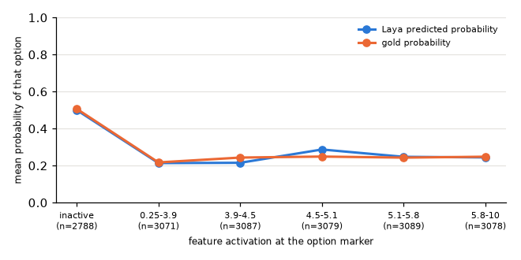

# Feature 13827

Critérios em que aparece: changed_base_vs_ft

**Interpretação (preencher):** 

---

## Maiores ativações

**tr_customer_service_000197 / category** (choice, customer_service) | ativação 10.109 em `marcador` | opções ['account', 'billing', 'delivery', 'refund', 'technical'] | Laya: **delivery** [0.003, 0.003, 0.983, 0.004, 0.007] | gabarito: **delivery**

```
[CLS]choice question: What is this customer conversation primarily about?[SEP]
▸ [MASK] account: Login, plan changes, profile or access management.
▸ [MASK] billing: A charge, invoice, subscription or payment problem.
▸ ⟦[MASK]⟧ delivery: Shipping, fulfilment or delivery of a physical item.
▸ [MASK] refund: The customer is explicitly asking for money back.
▸ [MASK] technical: The product or service is not working as expected.

[SEP]

{"account": {"lifetime_value_usd": 1409, "prior_tickets_90d": 2, "seats": 1, "tenure_months": 49, "tier": "free"}, "thread": [{"role": "customer", "text": "I’ve been with you for over four years now, but I’m really lost as to why my delivery hasn't arrived yet. I've reached out twice before and was told it was on the way, but nothing ever shows up. It’s making it very hard to justify staying if this keeps happening."}]}[SEP]
```

**tr_customer_service_000079 / category** (choice, customer_service) | ativação 9.320 em `marcador` | opções ['account', 'billing', 'delivery', 'refund', 'technical'] | Laya: **refund** [0.019, 0.018, 0.01, 0.928, 0.024] | gabarito: **refund**

```
[CLS]choice question: What is this customer conversation primarily about?[SEP]
▸ [MASK] account: Login, plan changes, profile or access management.
▸ [MASK] billing: A charge, invoice, subscription or payment problem.
▸ [MASK] delivery: Shipping, fulfilment or delivery of a physical item.
▸ ⟦[MASK]⟧ refund: The customer is explicitly asking for money back.
▸ [MASK] technical: The product or service is not working as expected.

[SEP]

{"account": {"lifetime_value_usd": 621, "prior_tickets_90d": 0, "seats": 1, "tenure_months": 8, "tier": "standard"}, "thread": [{"role": "customer", "text": "I am checking on the status of a refund that was initiated last week. It has not appeared in my account yet."}, {"role": "agent", "text": "I can certainly look into that for you. Could you please provide the case number or the transaction ID associated with the refund?"}, {"role": "customer", "text": "The reference number is REF-88372-X. It was processed on the 12th according to your email."}, {"role": "agent", "text": "Thanks for providing that ID. I am currently pulling up the transaction details; could you verify the email address associated with your account?"}, {"role": "customer", "text": "It is j.smith@provider.com. Please let me know what you find."}]}[SEP]
```

**tr_customer_service_000286 / category** (choice, customer_service) | ativação 9.305 em `marcador` | opções ['account', 'billing', 'delivery', 'refund', 'technical'] | Laya: **delivery** [0.07, 0.14, 0.65, 0.082, 0.058] | gabarito: **delivery**

```
[CLS]choice question: What is this customer conversation primarily about?[SEP]
▸ [MASK] account: Login, plan changes, profile or access management.
▸ [MASK] billing: A charge, invoice, subscription or payment problem.
▸ ⟦[MASK]⟧ delivery: Shipping, fulfilment or delivery of a physical item.
▸ [MASK] refund: The customer is explicitly asking for money back.
▸ [MASK] technical: The product or service is not working as expected.

[SEP]

{"account": {"lifetime_value_usd": 2881, "prior_tickets_90d": 1, "seats": 1, "tenure_months": 49, "tier": "premium"}, "orders": [{"amount_usd": 9, "date": "2026-01-14", "id": "A-85515", "status": "failed"}], "thread": [{"role": "customer", "text": "My package was supposed to arrive yesterday and it still isn’t here—this is a hard deadline for me and I need it today!"}]}[SEP]
```

**tr_customer_service_000216 / category** (choice, customer_service) | ativação 9.141 em `marcador` | opções ['account', 'billing', 'delivery', 'refund', 'technical'] | Laya: **delivery** [0.175, 0.188, 0.402, 0.118, 0.116] | gabarito: **delivery**

```
[CLS]choice question: What is this customer conversation primarily about?[SEP]
▸ [MASK] account: Login, plan changes, profile or access management.
▸ [MASK] billing: A charge, invoice, subscription or payment problem.
▸ ⟦[MASK]⟧ delivery: Shipping, fulfilment or delivery of a physical item.
▸ [MASK] refund: The customer is explicitly asking for money back.
▸ [MASK] technical: The product or service is not working as expected.

[SEP]

{"account": {"lifetime_value_usd": 90, "prior_tickets_90d": 0, "seats": 1, "tenure_months": 2, "tier": "free"}, "thread": [{"role": "customer", "text": "Hello there, I am checking on the status of my order. It’s for a birthday party this weekend, so I’m a bit worried it hasn't arrived yet."}, {"role": "agent", "text": "I would be happy to look into that for you. Could you please provide the order number so I can check the current shipping status in our system?"}, {"role": "customer", "text": "Of course, the order number is #44921. I really need these supplies by Friday at the latest for the event to go smoothly, so any help is appreciated."}]}[SEP]
```

**tr_customer_service_000247 / category** (choice, customer_service) | ativação 8.891 em `marcador` | opções ['account', 'billing', 'delivery', 'refund', 'technical'] | Laya: **delivery** [0.089, 0.208, 0.459, 0.168, 0.076] | gabarito: **delivery**

```
[CLS]choice question: What is this customer conversation primarily about?[SEP]
▸ [MASK] account: Login, plan changes, profile or access management.
▸ [MASK] billing: A charge, invoice, subscription or payment problem.
▸ ⟦[MASK]⟧ delivery: Shipping, fulfilment or delivery of a physical item.
▸ [MASK] refund: The customer is explicitly asking for money back.
▸ [MASK] technical: The product or service is not working as expected.

[SEP]

{"account": {"lifetime_value_usd": 2665, "prior_tickets_90d": 2, "seats": 1, "tenure_months": 49, "tier": "enterprise"}, "orders": [{"amount_usd": 299, "date": "2026-03-24", "id": "A-46595", "status": "failed"}, {"amount_usd": 299, "date": "2026-02-03", "id": "A-35425", "status": "pending"}], "thread": [{"role": "customer", "text": "I'm looking at the delivery that arrived for our office this morning and I'm a bit lost because these appear to be Model X components, but our enterprise contract is specifically for the Series 4 kits."}, {"role": "agent", "text": "I'm sorry for the confusion regarding the items in your shipment. Would you mind providing the batch number listed on the packing slip inside the box?"}, {"role": "customer", "text": "The slip actually lists the Series 4 parts, which is even more confusing since the physical items in the box are definitely the blue Model X ones, so I'm not really sure how to proceed with this."}]}[SEP]
```

## Ativações medianas (faixa 40-60%, mediana 1.266)

**tr_invoice_processing_000092 / disposition** (choice, invoice_processing) | ativação 1.523 em `estado` | opções ['approve', 'hold', 'manual_review', 'reject'] | Laya: **approve** [0.408, 0.246, 0.132, 0.214] | gabarito: **approve**

```
[CLS]choice question: How should this vendor invoice be dispositioned?[SEP]
▸ [MASK] approve: Matches the order and delivery; approve for payment.
▸ [MASK] hold: Something needs confirming before payment; hold pending clarification.
▸ [MASK] manual_review: A human in finance must review the discrepancy.
▸ [MASK] reject: Should not be paid: duplicate, unauthorised or materially wrong.

[SEP]

{"delivery": {"condition": "accepted with exceptions", "date": "2026-03-12", "received_qty": 400}, "invoice": {"currency": "USD", "id": "INV-2026-1498", "lines": [{"qty": 400, "sku": "SKU-530", "total_usd": 130404.0, "unit_usd": 326.01}], "total_usd": 130404.0, "vendor": "Kestrel Supply"}, "payment": {"days_until_due": -3, "discount_expires_in_days": null, "early_payment_discount_pct": null, "status": "overdue", "terms": "net 45"}, "purchase_order": {"freight_terms": "freight prepaid by vendor, not separately billable", "id": "PO-9335", "lines": [{"qty": 400, "unit_usd": 326.01}], "total_usd": 130404.0}, "vendor_history": {"disputes_12m": 0, "invoices_12m": 35, "prior_invoice_ids": ["INV-2026-6617", "INV-2026-4776",⟦ "⟧INV-2026-9752", "INV-2026-1479"]}}[SEP]
```

**tr_security_incidents_000272 / severity** (score, security_incidents) | ativação 2.406 em `opção` | opções ['0', '1', '2', '3', '4'] | Laya: **2** [0.057, 0.327, 0.42, 0.139, 0.057] | gabarito: **3**

```
[CLS]score question: How severe is the potential impact if this alert is real?[SEP]
▸ [MASK] level 0: Negligible: no access to anything sensitive.
▸ [MASK] level 1: Low: limited access, easily reversed.
▸ [MASK] level 2: Moderate: access to internal systems or non-public data.
▸ [MASK] level 3: High: access to production, secrets or customer data.
▸ [MASK] level⟦ 4⟧: Critical: active compromise of crown-jewel systems.

[SEP]

{"alert": {"description": "an account granted itself or received elevated permissions", "evidence": "The CI runner named gitlab-runner-12 added its own token to the local Administrators group on host build-agent-07 at 2026-09-15 23:58:12 UTC, using the net.exe command. This privilege change occurred while a change window was active, and the runner’s credentials had not been rotated for 700 days.", "rule": "privilege_escalation"}, "context": {"asset_criticality": "medium", "change_window_active": true, "source_on_allowlist": false}, "history": {"credential_rotation_days_ago": 700, "distinct_countries_30d": 2, "logins_30d": 501, "prior_alerts_90d": 0}, "principal": {"mfa_enrolled": true, "name": "svc-support-708", "privileges": ["repo:read"], "type": "ci_runner"}}[SEP]
```

**tr_customer_service_000222 / category** (choice, customer_service) | ativação 2.260 em `opção` | opções ['account', 'billing', 'delivery', 'refund', 'technical'] | Laya: **refund** [0.226, 0.047, 0.023, 0.638, 0.066] | gabarito: **account**

```
[CLS]choice question: What is this customer conversation primarily about?[SEP]
▸ [MASK] account: Login, plan changes, profile or access management.
▸ [MASK] billing: A charge, invoice, subscription or payment problem.
▸ [MASK] delivery: Shipping, fulfilment or delivery of a physical item⟦.⟧
▸ [MASK] refund: The customer is explicitly asking for money back.
▸ [MASK] technical: The product or service is not working as expected.

[SEP]

{"account": {"lifetime_value_usd": 3359, "prior_tickets_90d": 1, "seats": 12, "tenure_months": 41, "tier": "enterprise"}, "thread": [{"role": "customer", "text": "I am writing to request an immediate downgrade of my enterprise plan. Given that my previous request for service improvements was ignored, I am finding it difficult to justify continuing our partnership and may be forced to take my business elsewhere if this is not addressed promptly."}]}[SEP]
```

**tr_security_incidents_000206 / severity** (score, security_incidents) | ativação 1.165 em `opção` | opções ['0', '1', '2', '3', '4'] | Laya: **2** [0.03, 0.184, 0.433, 0.305, 0.047] | gabarito: **2**

```
[CLS]score question: How severe is the potential impact if this alert is real?[SEP]
▸ [MASK] level 0⟦:⟧ Negligible: no access to anything sensitive.
▸ [MASK] level 1: Low: limited access, easily reversed.
▸ [MASK] level 2: Moderate: access to internal systems or non-public data.
▸ [MASK] level 3: High: access to production, secrets or customer data.
▸ [MASK] level 4: Critical: active compromise of crown-jewel systems.

[SEP]

{"alert": {"description": "a large transfer to an external destination", "evidence": "A data transfer of 4.8 TB was observed at 2026-09-16 08:15:02 UTC from the internal server DB‑APP-01 to external IP 52.23.45.67, which is on the allow‑list for outbound connections. The operation was initiated by an admin account (privileged) that successfully completed MFA and whose password was rotated on 2026-09-13. No change window was specified for this activity.", "rule": "data_egress"}, "context": {"asset_criticality": "low", "change_window_active": false, "source_on_allowlist": true}, "history": {"credential_rotation_days_ago": 3, "distinct_countries_30d": 1, "logins_30d": 722, "prior_alerts_90d": 0}, "principal": {"mfa_enrolled": true, "name": "svc-support-965", "privileges": ["deploy:production", "secrets:read"], "type": "admin"}}[SEP]
```

**tr_agent_trace_observability_000187 / outcome** (choice, agent_trace_observability) | ativação 2.809 em `marcador` | opções ['failure', 'harmful', 'partial', 'success'] | Laya: **failure** [0.428, 0.094, 0.191, 0.287] | gabarito: **partial**

```
[CLS]choice question: How did this agent run turn out?[SEP]
▸ [MASK] failure: The agent did not accomplish the task.
▸ [MASK] harmful: The agent took an action that caused damage or violated a constraint.
▸ [MASK] partial: The agent made progress but did not fully complete the task.
▸ ⟦[MASK]⟧ success: The agent completed the task correctly.

[SEP]

{"agent": {"autonomy": "dry_run", "model": "internal-agent-v2"}, "constraints": ["Never delete anything matching release/*"], "task": "Reconcile the billing ledger against the payment provider.", "trace_summary": {"constraint_violations": 0, "duration_s": 716.4, "irreversible_actions": 0, "steps": 4, "tool_errors": 0}}[SEP]
```

## Estatísticas (conjunto de descoberta, dev e teste)

**pred / error**

| split | decisões | ativas | ativas e Laya errou | taxa | lift | q (BH) | OR (CMH) | q (CMH) |
|---|---|---|---|---|---|---|---|---|
| discovery | 5100 | 3657 | 2504 | 0.685 | 1.08 | 4.53e-28 | 1.74 | 0.194 |
| dev | 900 | 629 | 425 | 0.676 | 1.03 | 0.253 | 0.32 | 0.954 |
| test | 2000 | 1424 | 985 | 0.692 | 1.09 | 7.83e-14 | 1.12 | 0.537 |

**corr / error**

| split | decisões | ativas | ativas e Laya errou | taxa | lift | q (BH) | OR (CMH) | q (CMH) |
|---|---|---|---|---|---|---|---|---|
| discovery | 5100 | 3679 | 2526 | 0.687 | 1.08 | 1.63e-31 | 0.44 | 0.0749 |
| dev | 900 | 642 | 438 | 0.682 | 1.04 | 0.0231 | 0.21 | 0.684 |
| test | 2000 | 1439 | 1000 | 0.695 | 1.09 | 2.08e-16 | 0.84 | 0.771 |

**state / error**

| split | decisões | ativas | ativas e Laya errou | taxa | lift | q (BH) | OR (CMH) | q (CMH) |
|---|---|---|---|---|---|---|---|---|
| discovery | 5100 | 4368 | 2789 | 0.639 | 1.00 | 0.731 | 0.80 | 0.0477 |
| dev | 900 | 774 | 510 | 0.659 | 1.00 | 1 | 0.86 | 0.758 |
| test | 2000 | 1671 | 1059 | 0.634 | 0.99 | 0.928 | 0.69 | 0.0616 |

Confusão mais sobre-representada (pred): `urgency|1>3` (n=292, lift 1.39, p=2.1e-44). Formato `pergunta|índice previsto>índice correto`.

Confusão mais sobre-representada (corr): `urgency|1>3` (n=292, lift 1.39, p=1.32e-43). Formato `pergunta|índice previsto>índice correto`.

Confusão mais sobre-representada (state): `duplicate|1>0` (n=205, lift 1.11, p=8.15e-06). Formato `pergunta|índice previsto>índice correto`.



