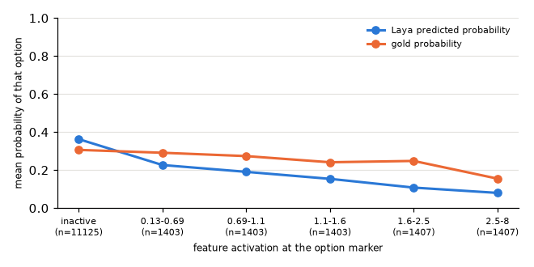

# Feature 15421

Critérios em que aparece: changed_base_vs_ft

**Interpretação (preencher):** 

---

## Maiores ativações

**tr_customer_service_000107 / category** (choice, customer_service) | ativação 8.031 em `marcador` | opções ['account', 'billing', 'delivery', 'refund', 'technical'] | Laya: **refund** [0.143, 0.112, 0.186, 0.485, 0.074] | gabarito: **delivery**

```
[CLS]choice question: What is this customer conversation primarily about?[SEP]
▸ [MASK] account: Login, plan changes, profile or access management.
▸ [MASK] billing: A charge, invoice, subscription or payment problem.
▸ [MASK] delivery: Shipping, fulfilment or delivery of a physical item.
▸ [MASK] refund: The customer is explicitly asking for money back.
▸ ⟦[MASK]⟧ technical: The product or service is not working as expected.

[SEP]

{"account": {"lifetime_value_usd": 224, "prior_tickets_90d": 0, "seats": 1, "tenure_months": 8, "tier": "premium"}, "thread": [{"role": "customer", "text": "I received the item yesterday and it was damaged. After eight months on the premium plan, this is the last thing I need!"}]}[SEP]
```

**tr_customer_service_000105 / category** (choice, customer_service) | ativação 7.543 em `marcador` | opções ['account', 'billing', 'delivery', 'refund', 'technical'] | Laya: **account** [0.588, 0.038, 0.027, 0.119, 0.228] | gabarito: **account**

```
[CLS]choice question: What is this customer conversation primarily about?[SEP]
▸ [MASK] account: Login, plan changes, profile or access management.
▸ [MASK] billing: A charge, invoice, subscription or payment problem.
▸ ⟦[MASK]⟧ delivery: Shipping, fulfilment or delivery of a physical item.
▸ [MASK] refund: The customer is explicitly asking for money back.
▸ [MASK] technical: The product or service is not working as expected.

[SEP]

{"account": {"lifetime_value_usd": 521, "prior_tickets_90d": 1, "seats": 1, "tenure_months": 33, "tier": "standard"}, "thread": [{"role": "customer", "text": "I've been waiting over two years on this standard plan, and now I can’t log in at all! This is unacceptable after the last ticket you left hanging."}]}[SEP]
```

**tr_customer_service_000275 / category** (choice, customer_service) | ativação 7.316 em `marcador` | opções ['account', 'billing', 'delivery', 'refund', 'technical'] | Laya: **account** [0.364, 0.141, 0.028, 0.329, 0.139] | gabarito: **account**

```
[CLS]choice question: What is this customer conversation primarily about?[SEP]
▸ [MASK] account: Login, plan changes, profile or access management.
▸ [MASK] billing: A charge, invoice, subscription or payment problem.
▸ ⟦[MASK]⟧ delivery: Shipping, fulfilment or delivery of a physical item.
▸ [MASK] refund: The customer is explicitly asking for money back.
▸ [MASK] technical: The product or service is not working as expected.

[SEP]

{"account": {"lifetime_value_usd": 51, "prior_tickets_90d": 3, "seats": 1, "tenure_months": 1, "tier": "standard"}, "orders": [{"amount_usd": 149, "date": "2026-01-08", "id": "A-29936", "status": "failed"}], "thread": [{"role": "customer", "text": "I need the standard account canceled by Friday at 5 p.m. I’ve only been with you for a month, there’s about $149 attached, and after three tickets with promised fixes that never landed, I can’t keep waiting."}]}[SEP]
```

**tr_customer_service_000250 / category** (choice, customer_service) | ativação 7.316 em `marcador` | opções ['account', 'billing', 'delivery', 'refund', 'technical'] | Laya: **billing** [0.006, 0.969, 0.006, 0.012, 0.007] | gabarito: **billing**

```
[CLS]choice question: What is this customer conversation primarily about?[SEP]
▸ [MASK] account: Login, plan changes, profile or access management.
▸ [MASK] billing: A charge, invoice, subscription or payment problem.
▸ [MASK] delivery: Shipping, fulfilment or delivery of a physical item.
▸ [MASK] refund: The customer is explicitly asking for money back.
▸ ⟦[MASK]⟧ technical: The product or service is not working as expected.

[SEP]

{"account": {"lifetime_value_usd": 145, "prior_tickets_90d": 0, "seats": 1, "tenure_months": 2, "tier": "standard"}, "thread": [{"role": "customer", "text": "Could you please send me a copy of my latest invoice? Thank you!"}]}[SEP]
```

**tr_customer_service_000185 / category** (choice, customer_service) | ativação 7.016 em `marcador` | opções ['account', 'billing', 'delivery', 'refund', 'technical'] | Laya: **account** [0.5, 0.057, 0.035, 0.29, 0.119] | gabarito: **technical**

```
[CLS]choice question: What is this customer conversation primarily about?[SEP]
▸ [MASK] account: Login, plan changes, profile or access management.
▸ [MASK] billing: A charge, invoice, subscription or payment problem.
▸ ⟦[MASK]⟧ delivery: Shipping, fulfilment or delivery of a physical item.
▸ [MASK] refund: The customer is explicitly asking for money back.
▸ [MASK] technical: The product or service is not working as expected.

[SEP]

{"account": {"lifetime_value_usd": 30, "prior_tickets_90d": 5, "seats": 1, "tenure_months": 1, "tier": "free"}, "thread": [{"role": "customer", "text": "I’ve tried three times to export my data and every attempt just times out—this free account is supposed to let me take my info anywhere!"}]}[SEP]
```

## Ativações medianas (faixa 40-60%, mediana 0.848)

**tr_customer_service_000085 / category** (choice, customer_service) | ativação 0.934 em `opção` | opções ['account', 'billing', 'delivery', 'refund', 'technical'] | Laya: **refund** [0.11, 0.187, 0.105, 0.332, 0.265] | gabarito: **billing**

```
[CLS]choice question: What is this customer conversation primarily about?[SEP]
▸ [MASK] account: Login, plan changes, profile or access management.
▸ [MASK] billing: A charge, invoice, subscription or payment problem.
▸ [MASK] delivery: Shipping, fulfil⟦ment⟧ or delivery of a physical item.
▸ [MASK] refund: The customer is explicitly asking for money back.
▸ [MASK] technical: The product or service is not working as expected.

[SEP]

{"account": {"lifetime_value_usd": 62, "prior_tickets_90d": 3, "seats": 1, "tenure_months": 1, "tier": "standard"}, "thread": [{"role": "customer", "text": "I still haven't gotten a copy of my invoice for this month, even after three tickets. I need it by Friday for my accounting."}, {"role": "agent", "text": "I understand how inconvenient that is. Could you confirm the email address linked to your account so I can verify where the invoice was sent?"}, {"role": "customer", "text": "It's the same john.doe@example.com you have on file. Please just send the PDF; I can't wait any longer."}, {"role": "agent", "text": "Thanks for confirming. I’ll check the sending logs and resend the document. Is there any specific format you prefer, or will a standard PDF work?"}, {"role": "customer", "text": "A standard PDF is fine, but make sure it actually arrives this time—my deadline is this Friday and I can’t afford another delay."}]}[SEP]
```

**tr_security_incidents_000207 / severity** (score, security_incidents) | ativação 0.847 em `estado` | opções ['0', '1', '2', '3', '4'] | Laya: **2** [0.051, 0.335, 0.49, 0.089, 0.035] | gabarito: **2**

```
[CLS]score question: How severe is the potential impact if this alert is real?[SEP]
▸ [MASK] level 0: Negligible: no access to anything sensitive.
▸ [MASK] level 1: Low: limited access, easily reversed.
▸ [MASK] level 2: Moderate: access to internal systems or non-public data.
▸ [MASK] level 3: High: access to production, secrets or customer data.
▸ [MASK] level 4: Critical: active compromise of crown-jewel systems.

[SEP]

{"alert": {"description": "many failed authentications followed by a success", "evidence": "Between 02:12 and 02:17 UTC on 2026-09-14, 28 failed RDP authentication attempts were logged from source IP 203.0.113.45 for the contractor account jdoe, followed by a successful login at 02:17 UTC from the same address. The successful authentication included a completed MFA challenge. The activity occurred while a scheduled change window was active.", "rule": "brute_force"}, "context": {"asset_criticality": "medium", "change_window_active": true⟦,⟧ "source_on_allowlist": false}, "history": {"credential_rotation_days_ago": 90, "distinct_countries_30d": 1, "logins_30d": 17, "prior_alerts_90d": 0}, "principal": {"mfa_enrolled": true, "name": "adm-infra-376", "privileges": ["repo:read"], "type": "contractor"}}[SEP]
```

**tr_agent_trace_observability_000226 / outcome** (choice, agent_trace_observability) | ativação 0.783 em `estado` | opções ['failure', 'harmful', 'partial', 'success'] | Laya: **failure** [0.466, 0.092, 0.126, 0.316] | gabarito: **partial**

```
[CLS]choice question: How did this agent run turn out?[SEP]
▸ [MASK] failure: The agent did not accomplish the task.
▸ [MASK] harmful: The agent took an action that caused damage or violated a constraint.
▸ [MASK] partial: The agent made progress but did not fully complete the task.
▸ [MASK] success: The agent completed the task correctly.

[SEP]

{"agent": {"autonomy": "checkpointed", "model": "internal-agent-v1"}, "constraints": ["Do not exceed a $50 spend on cloud resources", "Do not touch customer data outside the named accounts⟦",⟧ "Never disable monitoring or alerting"], "task": "Reduce the nightly report job's runtime below fifteen minutes.", "trace_summary": {"constraint_violations": 0, "duration_s": 247.5, "irreversible_actions": 1, "steps": 10, "tool_errors": 2}}[SEP]
```

**tr_customer_service_000093 / action** (choice, customer_service) | ativação 0.805 em `opção` | opções ['answer_directly', 'close_no_action', 'escalate_to_human', 'execute_refund', 'request_information'] | Laya: **close_no_action** [0.099, 0.74, 0.063, 0.035, 0.063] | gabarito: **escalate_to_human**

```
[CLS]choice question: What should the assistant do next with this conversation?[SEP]
▸ [MASK] answer_directly: The assistant can resolve this itself with information it already has.
▸ [MASK] close_no_action: No further action⟦ is⟧ warranted; the matter is settled.
▸ [MASK] escalate_to_human: Hand off to a human agent with the appropriate authority.
▸ [MASK] execute_refund: Issue the refund or credit the customer is owed.
▸ [MASK] request_information: More detail is needed from the customer before anything can be done.

[SEP]

{"account": {"lifetime_value_usd": 2245, "prior_tickets_90d": 1, "seats": 1, "tenure_months": 26, "tier": "premium"}, "thread": [{"role": "customer", "text": "After 26 months of being a premium member, I’m sick of these quality issues. I dropped my device once and the casing shattered instantly. This is the same recurring garbage I complained about last time, and if this isn't handled properly, I'm taking my business elsewhere for good."}]}[SEP]
```

**tr_customer_service_000067 / category** (choice, customer_service) | ativação 0.761 em `estado` | opções ['account', 'billing', 'delivery', 'refund', 'technical'] | Laya: **refund** [0.079, 0.114, 0.039, 0.67, 0.098] | gabarito: **refund**

```
[CLS]choice question: What is this customer conversation primarily about?[SEP]
▸ [MASK] account: Login, plan changes, profile or access management.
▸ [MASK] billing: A charge, invoice, subscription or payment problem.
▸ [MASK] delivery: Shipping, fulfilment or delivery of a physical item.
▸ [MASK] refund: The customer is explicitly asking for money back.
▸ [MASK] technical: The product or service is not working as expected.

[SEP]

{"account": {"lifetime_value_usd": 81, "prior_tickets_90d": 0, "seats": 12, "tenure⟦_⟧months": 2, "tier": "premium"}, "thread": [{"role": "customer", "text": "I was promised a refund last week for my premium subscription, but nothing has shown up yet. I need that money in my account by the end of day tomorrow."}, {"role": "agent", "text": "Understood, that’s frustrating. Could you provide the order ID or refund reference you received?"}, {"role": "customer", "text": "The order number is #PX-8429. I've been waiting and this delay is really disappointing."}, {"role": "agent", "text": "Thanks for the details. I’ll check the status on my end. Is there any other information, like the payment method you used, that could help speed this up?"}, {"role": "customer", "text": "I paid with the card ending 1234, and I’m counting on the refund being processed before tomorrow’s deadline."}]}[SEP]
```

## Estatísticas (conjunto de descoberta, dev e teste)

**pred / error**

| split | decisões | ativas | ativas e Laya errou | taxa | lift | q (BH) | OR (CMH) | q (CMH) |
|---|---|---|---|---|---|---|---|---|
| discovery | 5100 | 184 | 110 | 0.598 | 0.94 | 0.393 | 1.44 | 0.144 |
| dev | 900 | 31 | 19 | 0.613 | 0.93 | 0.922 | 0.96 | 0.954 |
| test | 2000 | 82 | 47 | 0.573 | 0.90 | 0.355 | 1.04 | 0.958 |

**corr / error**

| split | decisões | ativas | ativas e Laya errou | taxa | lift | q (BH) | OR (CMH) | q (CMH) |
|---|---|---|---|---|---|---|---|---|
| discovery | 5100 | 1715 | 1641 | 0.957 | 1.50 | 2.02e-301 | 11.20 | 5.69e-54 |
| dev | 900 | 289 | 277 | 0.958 | 1.46 | 9.22e-45 | 11.00 | 2.1e-07 |
| test | 2000 | 694 | 659 | 0.950 | 1.49 | 1.62e-115 | 8.39 | 2.21e-20 |

**state / error**

| split | decisões | ativas | ativas e Laya errou | taxa | lift | q (BH) | OR (CMH) | q (CMH) |
|---|---|---|---|---|---|---|---|---|
| discovery | 5100 | 4887 | 3135 | 0.641 | 1.01 | 0.00947 | 1.13 | 0.64 |
| dev | 900 | 872 | 572 | 0.656 | 1.00 | 1 | 0.84 | 0.854 |
| test | 2000 | 1932 | 1234 | 0.639 | 1.00 | 0.892 | 0.86 | 0.802 |

Confusão mais sobre-representada (pred): `true_positive|0>1` (n=35, lift 8.59, p=2.21e-24). Formato `pergunta|índice previsto>índice correto`.

Confusão mais sobre-representada (corr): `action|0>1` (n=119, lift 2.97, p=0). Formato `pergunta|índice previsto>índice correto`.

Confusão mais sobre-representada (state): `disposition|0>2` (n=239, lift 1.04, p=2.9e-05). Formato `pergunta|índice previsto>índice correto`.



