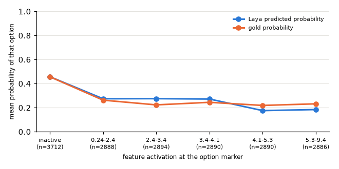

# Feature 15436

Critérios em que aparece: changed_base_vs_ft

**Interpretação (preencher):** 

---

## Maiores ativações

**tr_security_incidents_000085 / disposition** (choice, security_incidents) | ativação 9.406 em `marcador` | opções ['close_benign', 'contain', 'investigate', 'monitor'] | Laya: **close_benign** [0.515, 0.198, 0.104, 0.182] | gabarito: **investigate**

```
[CLS]choice question: How should this security alert be dispositioned?[SEP]
▸ [MASK] close_benign: Expected, explainable activity; close without analyst time.
▸ [MASK] contain: Contain the host or account immediately; do not wait for triage.
▸ ⟦[MASK]⟧ investigate: Warrants an analyst opening an investigation.
▸ [MASK] monitor: Not clearly malicious, but worth watching for recurrence.

[SEP]

{"alert": {"description": "an unrecognised binary executed on a server", "evidence": "A binary file named 'svchost_debug.exe' was executed on server-04 at 03:14 UTC, originating from an unknown external source. The executing user account has not performed a credential rotation in 365 days and was not associated with any active change management requests.", "rule": "suspicious_process"}, "context": {"asset_criticality": "medium", "change_window_active": false, "source_on_allowlist": false}, "history": {"credential_rotation_days_ago": 365, "distinct_countries_30d": 4, "logins_30d": 1334, "prior_alerts_90d": 0}, "principal": {"mfa_enrolled": true, "name": "ci-billing-513", "privileges": ["repo:read"], "type": "employee"}}[SEP]
```

**tr_security_incidents_000227 / disposition** (choice, security_incidents) | ativação 9.312 em `marcador` | opções ['close_benign', 'contain', 'investigate', 'monitor'] | Laya: **close_benign** [0.401, 0.212, 0.086, 0.301] | gabarito: **investigate**

```
[CLS]choice question: How should this security alert be dispositioned?[SEP]
▸ [MASK] close_benign: Expected, explainable activity; close without analyst time.
▸ [MASK] contain: Contain the host or account immediately; do not wait for triage.
▸ ⟦[MASK]⟧ investigate: Warrants an analyst opening an investigation.
▸ [MASK] monitor: Not clearly malicious, but worth watching for recurrence.

[SEP]

{"alert": {"description": "a large transfer to an external destination", "evidence": "A transfer of 4.2 GB of data was initiated to an unrecognized external IP address at 03:40 UTC. This activity was performed by a shared mailbox account that currently has MFA disabled.", "rule": "data_egress"}, "context": {"asset_criticality": "low", "change_window_active": false, "source_on_allowlist": false}, "history": {"credential_rotation_days_ago": 30, "distinct_countries_30d": 4, "logins_30d": 1619, "prior_alerts_90d": 1}, "principal": {"mfa_enrolled": false, "name": "svc-support-910", "privileges": ["repo:read"], "type": "shared_mailbox"}}[SEP]
```

**tr_security_incidents_000023 / disposition** (choice, security_incidents) | ativação 9.305 em `marcador` | opções ['close_benign', 'contain', 'investigate', 'monitor'] | Laya: **close_benign** [0.499, 0.201, 0.098, 0.201] | gabarito: **investigate**

```
[CLS]choice question: How should this security alert be dispositioned?[SEP]
▸ [MASK] close_benign: Expected, explainable activity; close without analyst time.
▸ [MASK] contain: Contain the host or account immediately; do not wait for triage.
▸ ⟦[MASK]⟧ investigate: Warrants an analyst opening an investigation.
▸ [MASK] monitor: Not clearly malicious, but worth watching for recurrence.

[SEP]

{"alert": {"description": "a large transfer to an external destination", "evidence": "A 45GB data transfer was initiated by an unprivileged admin principal to an external destination address. This activity occurred from an allowlisted source using MFA-enabled credentials that were last rotated 700 days ago.", "rule": "data_egress"}, "context": {"asset_criticality": "medium", "change_window_active": false, "source_on_allowlist": true}, "history": {"credential_rotation_days_ago": 700, "distinct_countries_30d": 3, "logins_30d": 1407, "prior_alerts_90d": 0}, "principal": {"mfa_enrolled": true, "name": "svc-analytics-468", "privileges": ["repo:read"], "type": "admin"}}[SEP]
```

**tr_security_incidents_000174 / disposition** (choice, security_incidents) | ativação 9.289 em `marcador` | opções ['close_benign', 'contain', 'investigate', 'monitor'] | Laya: **close_benign** [0.373, 0.346, 0.114, 0.167] | gabarito: **investigate**

```
[CLS]choice question: How should this security alert be dispositioned?[SEP]
▸ [MASK] close_benign: Expected, explainable activity; close without analyst time.
▸ [MASK] contain: Contain the host or account immediately; do not wait for triage.
▸ ⟦[MASK]⟧ investigate: Warrants an analyst opening an investigation.
▸ [MASK] monitor: Not clearly malicious, but worth watching for recurrence.

[SEP]

{"alert": {"description": "a long-unused account became active", "evidence": "The unprivileged contractor account, previously inactive for 180 days, initiated a session from the unrecognized IP 198.51.100.12 at 02:45 UTC. This login utilized credentials rotated 14 days ago and passed MFA verification despite falling outside any active change window.", "rule": "dormant_account_use"}, "context": {"asset_criticality": "crown_jewel", "change_window_active": false, "source_on_allowlist": false}, "history": {"credential_rotation_days_ago": 14, "distinct_countries_30d": 4, "logins_30d": 1934, "prior_alerts_90d": 0}, "principal": {"mfa_enrolled": true, "name": "adm-support-509", "privileges": ["repo:read"], "type": "contractor"}}[SEP]
```

**tr_security_incidents_000154 / disposition** (choice, security_incidents) | ativação 9.258 em `marcador` | opções ['close_benign', 'contain', 'investigate', 'monitor'] | Laya: **close_benign** [0.401, 0.289, 0.085, 0.226] | gabarito: **investigate**

```
[CLS]choice question: How should this security alert be dispositioned?[SEP]
▸ [MASK] close_benign: Expected, explainable activity; close without analyst time.
▸ [MASK] contain: Contain the host or account immediately; do not wait for triage.
▸ ⟦[MASK]⟧ investigate: Warrants an analyst opening an investigation.
▸ [MASK] monitor: Not clearly malicious, but worth watching for recurrence.

[SEP]

{"alert": {"description": "audit logging was turned off on a host", "evidence": "Audit logging services were terminated on host SRV-LRN-09 at 14:22 UTC while a valid change window was active. This action was initiated by a shared mailbox account accessing the system from an unrecognized source address.", "rule": "disabled_logging"}, "context": {"asset_criticality": "low", "change_window_active": true, "source_on_allowlist": false}, "history": {"credential_rotation_days_ago": 3, "distinct_countries_30d": 2, "logins_30d": 1152, "prior_alerts_90d": 0}, "principal": {"mfa_enrolled": true, "name": "ci-analytics-263", "privileges": ["repo:read"], "type": "shared_mailbox"}}[SEP]
```

## Ativações medianas (faixa 40-60%, mediana 3.643)

**tr_invoice_processing_000244 / urgency** (score, invoice_processing) | ativação 3.344 em `marcador` | opções ['0', '1', '2', '3'] | Laya: **1** [0.222, 0.536, 0.159, 0.082] | gabarito: **3**

```
[CLS]score question: How time-sensitive is processing this invoice?[SEP]
▸ [MASK] level 0: No time pressure; can wait indefinitely.
▸ ⟦[MASK]⟧ level 1: Routine; handle within the normal queue.
▸ [MASK] level 2: Elevated; should be handled within the same week.
▸ [MASK] level 3: Critical; requires action within the same day.

[SEP]

{"delivery": {"condition": "accepted", "date": "2026-03-03", "received_qty": 25}, "invoice": {"currency": "USD", "id": "INV-2026-6816", "lines": [{"qty": 25, "sku": "SKU-219", "total_usd": 3414.75, "unit_usd": 136.59}], "total_usd": 3414.75, "vendor": "Vantage Materials"}, "payment": {"days_until_due": -21, "discount_expires_in_days": null, "early_payment_discount_pct": null, "status": "overdue", "terms": "net 60"}, "purchase_order": {"freight_terms": "freight prepaid by vendor, not separately billable", "id": "PO-2088", "lines": [{"qty": 25, "unit_usd": 136.59}], "total_usd": 3414.75}, "vendor_history": {"disputes_12m": 0, "invoices_12m": 51, "prior_invoice_ids": ["INV-2026-6621", "INV-2026-7698"]}}[SEP]
```

**tr_invoice_processing_000284 / urgency** (score, invoice_processing) | ativação 3.393 em `marcador` | opções ['0', '1', '2', '3'] | Laya: **1** [0.207, 0.503, 0.163, 0.127] | gabarito: **1**

```
[CLS]score question: How time-sensitive is processing this invoice?[SEP]
▸ [MASK] level 0: No time pressure; can wait indefinitely.
▸ ⟦[MASK]⟧ level 1: Routine; handle within the normal queue.
▸ [MASK] level 2: Elevated; should be handled within the same week.
▸ [MASK] level 3: Critical; requires action within the same day.

[SEP]

{"delivery": {"condition": "accepted", "date": "2026-03-20", "received_qty": 1000}, "invoice": {"currency": "USD", "id": "INV-2026-7786", "lines": [{"qty": 1000, "sku": "SKU-874", "total_usd": 320730.0, "unit_usd": 320.73}], "total_usd": 320730.0, "vendor": "Kestrel Supply"}, "payment": {"days_until_due": 11, "discount_expires_in_days": null, "early_payment_discount_pct": null, "status": "scheduled", "terms": "net 15"}, "purchase_order": {"freight_terms": "freight prepaid by vendor, not separately billable", "id": "PO-7733", "lines": [{"qty": 1000, "unit_usd": 320.73}], "total_usd": 320730.0}, "vendor_history": {"disputes_12m": 1, "invoices_12m": 31, "prior_invoice_ids": ["INV-2026-3295", "INV-2026-5889", "INV-2026-7594"]}}[SEP]
```

**tr_security_incidents_000055 / urgency** (score, security_incidents) | ativação 3.641 em `marcador` | opções ['0', '1', '2', '3'] | Laya: **1** [0.061, 0.612, 0.235, 0.092] | gabarito: **2**

```
[CLS]score question: How quickly must a responder act on this alert?[SEP]
▸ [MASK] level 0: No time pressure; can wait indefinitely.
▸ [MASK] level 1: Routine; handle within the normal queue.
▸ [MASK] level 2: Elevated; should be handled within the same week.
▸ ⟦[MASK]⟧ level 3: Critical; requires action within the same day.

[SEP]

{"alert": {"description": "a session token was presented from a second address", "evidence": "A session token initially issued to 192.168.1.10 was presented by a privileged ci_runner from 203.0.113.5 during an authorized change window. The principal authenticated via MFA, and the secondary IP address is currently on the allowlist with credentials last rotated 90 days ago.", "rule": "token_reuse"}, "context": {"asset_criticality": "medium", "change_window_active": true, "source_on_allowlist": true}, "history": {"credential_rotation_days_ago": 90, "distinct_countries_30d": 1, "logins_30d": 654, "prior_alerts_90d": 0}, "principal": {"mfa_enrolled": true, "name": "adm-support-732", "privileges": ["deploy:production", "secrets:read"], "type": "ci_runner"}}[SEP]
```

**tr_invoice_processing_000055 / discrepancy_severity** (score, invoice_processing) | ativação 3.943 em `marcador` | opções ['0', '1', '2', '3'] | Laya: **0** [0.344, 0.254, 0.237, 0.165] | gabarito: **0**

```
[CLS]score question: How material is any discrepancy between the invoice, the order and the delivery?[SEP]
▸ [MASK] level 0: None: everything reconciles.
▸ ⟦[MASK]⟧ level 1: Trivial: rounding or a cosmetic difference.
▸ [MASK] level 2: Moderate: a real difference worth confirming.
▸ [MASK] level 3: Material: a large or unexplained difference.

[SEP]

{"delivery": {"condition": "accepted", "date": "2026-03-24", "received_qty": 10}, "invoice": {"currency": "USD", "id": "INV-2026-2278", "lines": [{"qty": 10, "sku": "SKU-174", "total_usd": 2565.3, "unit_usd": 256.53}], "total_usd": 2565.3, "vendor": "Orbit Logistics"}, "payment": {"days_until_due": 44, "discount_expires_in_days": null, "early_payment_discount_pct": null, "status": "scheduled", "terms": "net 15"}, "purchase_order": {"freight_terms": "freight prepaid by vendor, not separately billable", "id": "PO-1729", "lines": [{"qty": 10, "unit_usd": 256.53}], "total_usd": 2565.3}, "vendor_history": {"disputes_12m": 2, "invoices_12m": 35, "prior_invoice_ids": ["INV-2026-2466", "INV-2026-1629", "INV-2026-2511", "INV-2026-3620"]}}[SEP]
```

**tr_invoice_processing_000079 / urgency** (score, invoice_processing) | ativação 3.936 em `marcador` | opções ['0', '1', '2', '3'] | Laya: **1** [0.216, 0.56, 0.133, 0.091] | gabarito: **2**

```
[CLS]score question: How time-sensitive is processing this invoice?[SEP]
▸ [MASK] level 0: No time pressure; can wait indefinitely.
▸ [MASK] level 1: Routine; handle within the normal queue.
▸ ⟦[MASK]⟧ level 2: Elevated; should be handled within the same week.
▸ [MASK] level 3: Critical; requires action within the same day.

[SEP]

{"delivery": {"condition": "accepted", "date": "2026-03-16", "received_qty": 380}, "invoice": {"currency": "USD", "id": "INV-2026-7833", "lines": [{"qty": 380, "sku": "SKU-873", "total_usd": 103420.8, "unit_usd": 272.16}], "total_usd": 103420.8, "vendor": "Pallas Industrial"}, "payment": {"days_until_due": 2, "discount_expires_in_days": null, "early_payment_discount_pct": null, "status": "scheduled", "terms": "net 30"}, "purchase_order": {"freight_terms": "freight prepaid by vendor, not separately billable", "id": "PO-8346", "lines": [{"qty": 400, "unit_usd": 272.16}], "total_usd": 108864.0}, "vendor_history": {"disputes_12m": 0, "invoices_12m": 43, "prior_invoice_ids": ["INV-2026-8967", "INV-2026-2028", "INV-2026-4787", "INV-2026-5782"]}}[SEP]
```

## Estatísticas (conjunto de descoberta, dev e teste)

**pred / error**

| split | decisões | ativas | ativas e Laya errou | taxa | lift | q (BH) | OR (CMH) | q (CMH) |
|---|---|---|---|---|---|---|---|---|
| discovery | 5100 | 3326 | 2278 | 0.685 | 1.08 | 2.61e-21 | 0.77 | 0.302 |
| dev | 900 | 579 | 395 | 0.682 | 1.04 | 0.145 | 0.65 | 0.993 |
| test | 2000 | 1286 | 889 | 0.691 | 1.09 | 3.49e-10 | 0.79 | 0.83 |

**corr / error**

| split | decisões | ativas | ativas e Laya errou | taxa | lift | q (BH) | OR (CMH) | q (CMH) |
|---|---|---|---|---|---|---|---|---|
| discovery | 5100 | 3405 | 2357 | 0.692 | 1.09 | 1.74e-30 | 0.84 | 0.56 |
| dev | 900 | 590 | 406 | 0.688 | 1.05 | 0.0134 | 0.83 | 1 |
| test | 2000 | 1334 | 937 | 0.702 | 1.10 | 1.93e-16 | 1.49 | 0.225 |

**state / error**

| split | decisões | ativas | ativas e Laya errou | taxa | lift | q (BH) | OR (CMH) | q (CMH) |
|---|---|---|---|---|---|---|---|---|
| discovery | 5100 | 9 | 6 | 0.667 | 1.05 | nan | nan | nan |
| dev | 900 | 0 | 0 | nan | nan | nan | nan | nan |
| test | 2000 | 2 | 2 | 1.000 | 1.57 | nan | nan | nan |

Confusão mais sobre-representada (pred): `disposition|0>2` (n=239, lift 1.53, p=0). Formato `pergunta|índice previsto>índice correto`.

Confusão mais sobre-representada (corr): `urgency|1>2` (n=277, lift 1.49, p=0). Formato `pergunta|índice previsto>índice correto`.

Confusão mais sobre-representada (state): `disposition|0>2` (n=2, lift 4.74, p=nan). Formato `pergunta|índice previsto>índice correto`.



