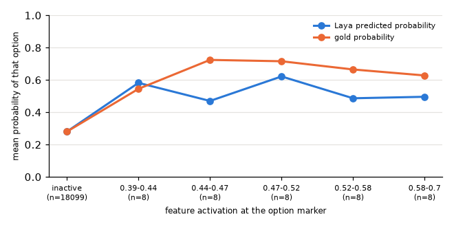

# Feature 72

Critérios em que aparece: corr_probe_right_laya_wrong_stratified

**Interpretação (preencher):** 

---

## Maiores ativações

**tr_customer_service_000254 / action** (choice, customer_service) | ativação 7.531 em `estado` | opções ['answer_directly', 'close_no_action', 'escalate_to_human', 'execute_refund', 'request_information'] | Laya: **close_no_action** [0.271, 0.677, 0.031, 0.01, 0.011] | gabarito: **escalate_to_human**

```
<bos> choice question: What should the assistant do next with this conversation?<eos>
▸ <mask> answer_directly: The assistant can resolve this itself with information it already has.
▸ <mask> close_no_action: No further action is warranted; the matter is settled.
▸ <mask> escalate_to_human: Hand off to a human agent with the appropriate authority.
▸ <mask> execute_refund: Issue the refund or credit the customer is owed.
▸ <mask> request_information: More detail is needed from the customer before anything can be done.

<eos>

 {"account": {"lifetime_value_usd": 3273, "prior_tickets_90d": 0, "seats": 1, "tenure_months": 49, "tier": "free"}, "thread": [{"role": "customer", "text": "The export tool is completely broken and I have a hard deadline⟦ tonight⟧. I’ve been using this free plan for 49 months and never seen it this bad."}, {"role": "agent", "text": "I am sorry to hear you are having trouble with the export tool. Could you please describe what happens exactly when you click the export button?"}, {"role": "customer", "text": "It just hangs indefinitely. I click it, the wheel spins, and nothing ever downloads."}, {"role": "agent", "text": "Thank you for clarifying. Are you seeing any notifications or pop-ups appear in the corner of your browser when the process stalls?"}, {"role": "customer", "text": "No, it’s just dead silence. Nothing happens at all, and I'm losing time."}, {"role": "agent", "text": "I appreciate you checking that. Which browser and version are you currently using to access the site?"}, {"role": "customer", "text": "I'm on Chrome, version 124. Get this moving, please."}]}<eos>
```

**tr_customer_service_000254 / category** (choice, customer_service) | ativação 7.527 em `estado` | opções ['account', 'billing', 'delivery', 'refund', 'technical'] | Laya: **technical** [0.016, 0.001, 0.0, 0.001, 0.982] | gabarito: **technical**

```
<bos> choice question: What is this customer conversation primarily about?<eos>
▸ <mask> account: Login, plan changes, profile or access management.
▸ <mask> billing: A charge, invoice, subscription or payment problem.
▸ <mask> delivery: Shipping, fulfilment or delivery of a physical item.
▸ <mask> refund: The customer is explicitly asking for money back.
▸ <mask> technical: The product or service is not working as expected.

<eos>

 {"account": {"lifetime_value_usd": 3273, "prior_tickets_90d": 0, "seats": 1, "tenure_months": 49, "tier": "free"}, "thread": [{"role": "customer", "text": "The export tool is completely broken and I have a hard deadline⟦ tonight⟧. I’ve been using this free plan for 49 months and never seen it this bad."}, {"role": "agent", "text": "I am sorry to hear you are having trouble with the export tool. Could you please describe what happens exactly when you click the export button?"}, {"role": "customer", "text": "It just hangs indefinitely. I click it, the wheel spins, and nothing ever downloads."}, {"role": "agent", "text": "Thank you for clarifying. Are you seeing any notifications or pop-ups appear in the corner of your browser when the process stalls?"}, {"role": "customer", "text": "No, it’s just dead silence. Nothing happens at all, and I'm losing time."}, {"role": "agent", "text": "I appreciate you checking that. Which browser and version are you currently using to access the site?"}, {"role": "customer", "text": "I'm on Chrome, version 124. Get this moving, please."}]}<eos>
```

**tr_customer_service_000254 / needs_human** (noul, customer_service) | ativação 7.445 em `estado` | opções ['false', 'true'] | Laya: **true** [0.033, 0.967] | gabarito: **true**

```
<bos> noul question: This conversation requires a human agent rather than automated handling.<eos>
▸ <mask> false: Automation can carry this to resolution.
▸ <mask> true: A human must take over: judgement, authority or empathy is required.

<eos>

 {"account": {"lifetime_value_usd": 3273, "prior_tickets_90d": 0, "seats": 1, "tenure_months": 49, "tier": "free"}, "thread": [{"role": "customer", "text": "The export tool is completely broken and I have a hard deadline⟦ tonight⟧. I’ve been using this free plan for 49 months and never seen it this bad."}, {"role": "agent", "text": "I am sorry to hear you are having trouble with the export tool. Could you please describe what happens exactly when you click the export button?"}, {"role": "customer", "text": "It just hangs indefinitely. I click it, the wheel spins, and nothing ever downloads."}, {"role": "agent", "text": "Thank you for clarifying. Are you seeing any notifications or pop-ups appear in the corner of your browser when the process stalls?"}, {"role": "customer", "text": "No, it’s just dead silence. Nothing happens at all, and I'm losing time."}, {"role": "agent", "text": "I appreciate you checking that. Which browser and version are you currently using to access the site?"}, {"role": "customer", "text": "I'm on Chrome, version 124. Get this moving, please."}]}<eos>
```

**tr_customer_service_000254 / urgency** (score, customer_service) | ativação 7.426 em `estado` | opções ['0', '1', '2', '3'] | Laya: **3** [0.202, 0.308, 0.157, 0.333] | gabarito: **3**

```
<bos> score question: How time-sensitive is this conversation?<eos>
▸ <mask> level 0: No time pressure; can wait indefinitely.
▸ <mask> level 1: Routine; handle within the normal queue.
▸ <mask> level 2: Elevated; should be handled within the same week.
▸ <mask> level 3: Critical; requires action within the same day.

<eos>

 {"account": {"lifetime_value_usd": 3273, "prior_tickets_90d": 0, "seats": 1, "tenure_months": 49, "tier": "free"}, "thread": [{"role": "customer", "text": "The export tool is completely broken and I have a hard deadline⟦ tonight⟧. I’ve been using this free plan for 49 months and never seen it this bad."}, {"role": "agent", "text": "I am sorry to hear you are having trouble with the export tool. Could you please describe what happens exactly when you click the export button?"}, {"role": "customer", "text": "It just hangs indefinitely. I click it, the wheel spins, and nothing ever downloads."}, {"role": "agent", "text": "Thank you for clarifying. Are you seeing any notifications or pop-ups appear in the corner of your browser when the process stalls?"}, {"role": "customer", "text": "No, it’s just dead silence. Nothing happens at all, and I'm losing time."}, {"role": "agent", "text": "I appreciate you checking that. Which browser and version are you currently using to access the site?"}, {"role": "customer", "text": "I'm on Chrome, version 124. Get this moving, please."}]}<eos>
```

**tr_customer_service_000254 / churn_risk** (score, customer_service) | ativação 7.332 em `estado` | opções ['0', '1', '2', '3'] | Laya: **2** [0.068, 0.215, 0.584, 0.133] | gabarito: **2**

```
<bos> score question: How likely is this customer to stop doing business with us because of this interaction?<eos>
▸ <mask> level 0: No sign of dissatisfaction.
▸ <mask> level 1: Mild frustration, but the relationship is intact.
▸ <mask> level 2: Clearly unhappy; repeat problems or explicit complaints.
▸ <mask> level 3: Imminent: threatening to cancel, dispute or leave.

<eos>

 {"account": {"lifetime_value_usd": 3273, "prior_tickets_90d": 0, "seats": 1, "tenure_months": 49, "tier": "free"}, "thread": [{"role": "customer", "text": "The export tool is completely broken and I have a hard deadline⟦ tonight⟧. I’ve been using this free plan for 49 months and never seen it this bad."}, {"role": "agent", "text": "I am sorry to hear you are having trouble with the export tool. Could you please describe what happens exactly when you click the export button?"}, {"role": "customer", "text": "It just hangs indefinitely. I click it, the wheel spins, and nothing ever downloads."}, {"role": "agent", "text": "Thank you for clarifying. Are you seeing any notifications or pop-ups appear in the corner of your browser when the process stalls?"}, {"role": "customer", "text": "No, it’s just dead silence. Nothing happens at all, and I'm losing time."}, {"role": "agent", "text": "I appreciate you checking that. Which browser and version are you currently using to access the site?"}, {"role": "customer", "text": "I'm on Chrome, version 124. Get this moving, please."}]}<eos>
```

## Ativações medianas (faixa 40-60%, mediana 2.101)

**tr_security_incidents_000037 / disposition** (choice, security_incidents) | ativação 2.014 em `estado` | opções ['close_benign', 'contain', 'investigate', 'monitor'] | Laya: **monitor** [0.071, 0.052, 0.061, 0.817] | gabarito: **contain**

```
<bos> choice question: How should this security alert be dispositioned?<eos>
▸ <mask> close_benign: Expected, explainable activity; close without analyst time.
▸ <mask> contain: Contain the host or account immediately; do not wait for triage.
▸ <mask> investigate: Warrants an analyst opening an investigation.
▸ <mask> monitor: Not clearly malicious, but worth watching for recurrence.

<eos>

 {"alert": {"description": "a security group was opened to the public internet", "evidence": "On 2026-09-14 22:07:05 UTC, the security group \"Finance_ReadOnly\" was modified to include the built‑in \"Everyone\" principal, effectively exposing the group to the public internet. The change was executed by a shared mailbox identity with MFA enabled, originating from an unrecognised source, and the credentials for that identity were last rotated 412 days ago.", "rule": "config_⟦drift⟧"}, "context": {"asset_criticality": "crown_jewel", "change_window_active": false, "source_on_allowlist": false}, "history": {"credential_rotation_days_ago": 412, "distinct_countries_30d": 4, "logins_30d": 884, "prior_alerts_90d": 8}, "principal": {"mfa_enrolled": true, "name": "adm-analytics-779", "privileges": ["repo:read"], "type": "shared_mailbox"}}<eos>
```

**tr_customer_service_000258 / action** (choice, customer_service) | ativação 2.502 em `estado` | opções ['answer_directly', 'close_no_action', 'escalate_to_human', 'execute_refund', 'request_information'] | Laya: **answer_directly** [0.72, 0.139, 0.052, 0.085, 0.004] | gabarito: **escalate_to_human**

```
<bos> choice question: What should the assistant do next with this conversation?<eos>
▸ <mask> answer_directly: The assistant can resolve this itself with information it already has.
▸ <mask> close_no_action: No further action is warranted; the matter is settled.
▸ <mask> escalate_to_human: Hand off to a human agent with the appropriate authority.
▸ <mask> execute_refund: Issue the refund or credit the customer is owed.
▸ <mask> request_information: More detail is needed from the customer before anything can be done.

<eos>

 {"account": {"lifetime_value_usd": 48, "prior_tickets_90d": 0, "seats": 1, "tenure_months": 1, "tier": "free"}, "thread": [{"role": "customer", "text": "I ordered the deluxe starter kit and you sent me the basic one instead—this is unacceptable, and I need it fixed before Friday or I'm cancelling my subscription."}, {"role": "agent", "text": "I’m sorry to hear you received the wrong kit. Could you share the order number so I can pull up the details?"}, {"role": "customer", "text": "The order number is 8742‑19. I’ve already waited a week, and if I don’t have the correct item by Friday I’m done with your service."}, {"role": "agent", "text": "Thank you for the number. I’ll check the shipment records and see what went wrong. May I also get the email address linked to the account?"}, {"role": "customer", "text": "It’s⟦ john⟧.doe@example.com. I expect you to have a solution in place before the deadline—I’m not willing to wait any longer."}]}<eos>
```

**tr_customer_service_000113 / category** (choice, customer_service) | ativação 2.039 em `estado` | opções ['account', 'billing', 'delivery', 'refund', 'technical'] | Laya: **technical** [0.014, 0.008, 0.002, 0.004, 0.972] | gabarito: **technical**

```
<bos> choice question: What is this customer conversation primarily about?<eos>
▸ <mask> account: Login, plan changes, profile or access management.
▸ <mask> billing: A charge, invoice, subscription or payment problem.
▸ <mask> delivery: Shipping, fulfilment or delivery of a physical item.
▸ <mask> refund: The customer is explicitly asking for money back.
▸ <mask> technical: The product or service is not working as expected.

<eos>

 {"account": {"lifetime_value_usd": 47, "prior_tickets_90d": 0, "seats": 1, "tenure_months": 1, "tier": "standard"}, "orders": [{"amount_usd": 87, "date": "2026-01-11", "id": "A-32698", "status": "settled"}, {"amount_usd": 87, "date": "2026-03-25", "id": "A-92735", "status": "refunded"}], "thread": [{"role": "customer", "text": "Hi there! I've been using the standard plan for about a month now and I really enjoy the interface, but I've noticed the page load times are getting quite slow today. Is there anything I should check on my end?"}, {"role": "agent", "text": "Welcome to the platform! I'd be happy to help you look into those load times. Are you experiencing this slowness on all pages, or is it specifically when you try to generate reports?"}, {"role": "customer", "text": "It seems to be happening everywhere, especially when I try to save my work. I paid $87 for this month and I have a very important hard deadline this⟦ evening⟧, so I'm a bit worried about getting everything finished in time."}, {"role": "agent", "text": "I understand the importance of meeting your deadline. Could you tell me which web browser you are currently using and if you have tried clearing your cache recently?"}, {"role": "customer", "text": "I'm using the latest version of Chrome and I did try clearing the cache, but the lag persists. I really need to have this project submitted by 5:00 PM today, so any guidance on how to speed things up would be greatly appreciated."}]}<eos>
```

**tr_customer_service_000186 / action** (choice, customer_service) | ativação 2.566 em `estado` | opções ['answer_directly', 'close_no_action', 'escalate_to_human', 'execute_refund', 'request_information'] | Laya: **close_no_action** [0.072, 0.907, 0.004, 0.015, 0.002] | gabarito: **escalate_to_human**

```
<bos> choice question: What should the assistant do next with this conversation?<eos>
▸ <mask> answer_directly: The assistant can resolve this itself with information it already has.
▸ <mask> close_no_action: No further action is warranted; the matter is settled.
▸ <mask> escalate_to_human: Hand off to a human agent with the appropriate authority.
▸ <mask> execute_refund: Issue the refund or credit the customer is owed.
▸ <mask> request_information: More detail is needed from the customer before anything can be done.

<eos>

 {"account": {"lifetime_value_usd": 94, "prior_tickets_90d": 0, "seats": 1, "tenure_months": 2, "tier": "free"}, "orders": [{"amount_usd": 99, "date": "2026-03-11", "id": "A-98793", "status": "pending"}, {"amount_usd": 99, "date": "2026-03-28", "id": "A-39133", "status": "failed"}], "thread": [{"role": "customer", "text": "I’m sick of this platform—cancel my account immediately and stop charging me the $99 I’m being billed each month."}, {"role": "agent", "text": "I understand you want to close the account. Could you verify the email address linked to the subscription so I can locate the correct profile?"}, {"role": "customer", "text": "It’s⟦ john⟧.doe@example.com. I’ve already told you this before; if you don’t process the cancellation right now I’ll be forced to dispute the charges."}]}<eos>
```

**tr_security_incidents_000127 / disposition** (choice, security_incidents) | ativação 1.967 em `estado` | opções ['close_benign', 'contain', 'investigate', 'monitor'] | Laya: **monitor** [0.134, 0.122, 0.098, 0.647] | gabarito: **investigate**

```
<bos> choice question: How should this security alert be dispositioned?<eos>
▸ <mask> close_benign: Expected, explainable activity; close without analyst time.
▸ <mask> contain: Contain the host or account immediately; do not wait for triage.
▸ <mask> investigate: Warrants an analyst opening an investigation.
▸ <mask> monitor: Not clearly malicious, but worth watching for recurrence.

<eos>

 {"alert": {"description": "a security group was opened to the public internet", "evidence": "On 2026‑09‑14 at 10:07 UTC, security group sg-0a1b2c3d was modified to allow inbound traffic from 0.0.0.0/0, exposing the associated resources publicly. The change was applied by an admin account with privileged access, MFA enabled, from an unknown source IP, and the account’s password last rotation occurred 180 days ago.", "rule": "config_⟦drift⟧"}, "context": {"asset_criticality": "low", "change_window_active": false, "source_on_allowlist": false}, "history": {"credential_rotation_days_ago": 180, "distinct_countries_30d": 1, "logins_30d": 1581, "prior_alerts_90d": 0}, "principal": {"mfa_enrolled": true, "name": "adm-analytics-822", "privileges": ["deploy:production", "secrets:read"], "type": "admin"}}<eos>
```

## Estatísticas (conjunto de descoberta, dev e teste)

**pred / error**

| split | decisões | ativas | ativas e Laya errou | taxa | lift | q (BH) | OR (CMH) | q (CMH) |
|---|---|---|---|---|---|---|---|---|
| discovery | 5100 | 19 | 6 | 0.316 | 0.49 | nan | nan | nan |
| dev | 900 | 3 | 0 | 0.000 | 0.00 | nan | nan | nan |
| test | 2000 | 16 | 8 | 0.500 | 0.77 | nan | nan | nan |

**corr / error**

| split | decisões | ativas | ativas e Laya errou | taxa | lift | q (BH) | OR (CMH) | q (CMH) |
|---|---|---|---|---|---|---|---|---|
| discovery | 5100 | 30 | 17 | 0.567 | 0.88 | 0.535 | 3.92 | 0.00471 |
| dev | 900 | 4 | 1 | 0.250 | 0.37 | nan | nan | nan |
| test | 2000 | 10 | 2 | 0.200 | 0.31 | nan | nan | nan |

**state / error**

| split | decisões | ativas | ativas e Laya errou | taxa | lift | q (BH) | OR (CMH) | q (CMH) |
|---|---|---|---|---|---|---|---|---|
| discovery | 5100 | 359 | 223 | 0.621 | 0.96 | 0.566 | 0.89 | 0.69 |
| dev | 900 | 46 | 33 | 0.717 | 1.07 | 0.917 | 1.71 | 0.582 |
| test | 2000 | 163 | 105 | 0.644 | 0.99 | 1 | 1.05 | 0.939 |

**pred / probe_right_laya_wrong**

| split | decisões | ativas | ativas e Laya errou | taxa | lift | q (BH) | OR (CMH) | q (CMH) |
|---|---|---|---|---|---|---|---|---|
| discovery | 2819 | 9 | 0 | 0.000 | 0.00 | nan | nan | nan |
| dev | 520 | 3 | 0 | 0.000 | 0.00 | nan | nan | nan |
| test | 1106 | 9 | 1 | 0.111 | 0.18 | nan | nan | nan |

**corr / probe_right_laya_wrong**

| split | decisões | ativas | ativas e Laya errou | taxa | lift | q (BH) | OR (CMH) | q (CMH) |
|---|---|---|---|---|---|---|---|---|
| discovery | 2819 | 25 | 16 | 0.640 | 0.99 | 1 | 5.40 | 0.00581 |
| dev | 520 | 4 | 1 | 0.250 | 0.37 | nan | nan | nan |
| test | 1106 | 10 | 2 | 0.200 | 0.32 | nan | nan | nan |

**state / probe_right_laya_wrong**

| split | decisões | ativas | ativas e Laya errou | taxa | lift | q (BH) | OR (CMH) | q (CMH) |
|---|---|---|---|---|---|---|---|---|
| discovery | 2819 | 190 | 115 | 0.605 | 0.94 | 0.369 | 0.99 | 0.974 |
| dev | 520 | 25 | 17 | 0.680 | 1.01 | 1 | 1.35 | 0.817 |
| test | 1106 | 88 | 54 | 0.614 | 0.97 | 0.957 | 1.02 | 0.983 |

Confusão mais sobre-representada (pred): `needs_human|1>0` (n=6, lift 26.40, p=nan). Formato `pergunta|índice previsto>índice correto`.

Confusão mais sobre-representada (corr): `needs_human|0>1` (n=17, lift 53.52, p=1.77e-27). Formato `pergunta|índice previsto>índice correto`.

Confusão mais sobre-representada (state): `needs_review|1>0` (n=16, lift 7.84, p=7.67e-12). Formato `pergunta|índice previsto>índice correto`.



