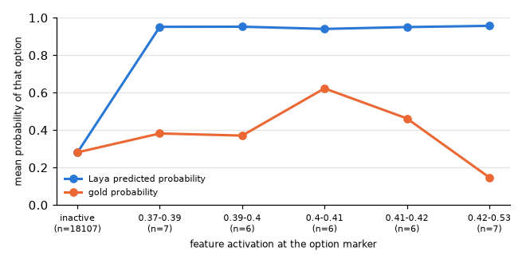

# Feature 87

Critérios em que aparece: pred_probe_right_laya_wrong_stratified

**Interpretação (preencher):** 

---

## Maiores ativações

**tr_customer_service_000295 / needs_human** (noul, customer_service) | ativação 3.406 em `estado` | opções ['false', 'true'] | Laya: **true** [0.294, 0.706] | gabarito: **true**

```
<bos> noul question: This conversation requires a human agent rather than automated handling.<eos>
▸ <mask> false: Automation can carry this to resolution.
▸ <mask> true: A human must take over: judgement, authority or empathy is required.

<eos>

 {"account": {"lifetime_value_usd": 4435, "prior_tickets_90d": 1, "seats": 3, "tenure_months": 49, "tier": "enterprise"}, "thread": [{"role": "customer", "text": "Our enterprise dashboard is crawling—pages take over a minute to load, and our team can’t meet the rollout deadline tomorrow. This needs to be fixed ASAP."}, {"role": "agent", "text": "I’m sorry you’re seeing that slowdown. Could you tell me which modules are affected and whether the⟦ latency⟧ started after the recent update you mentioned in ticket #98765?"}, {"role": "customer", "text": "It’s the analytics and reporting sections, and yes, the issue reappeared after the last patch. We need an immediate investigation; let me know what you can do before the deadline."}]}<eos>
```

**tr_customer_service_000295 / action** (choice, customer_service) | ativação 3.400 em `estado` | opções ['answer_directly', 'close_no_action', 'escalate_to_human', 'execute_refund', 'request_information'] | Laya: **answer_directly** [0.508, 0.136, 0.032, 0.292, 0.033] | gabarito: **escalate_to_human**

```
<bos> choice question: What should the assistant do next with this conversation?<eos>
▸ <mask> answer_directly: The assistant can resolve this itself with information it already has.
▸ <mask> close_no_action: No further action is warranted; the matter is settled.
▸ <mask> escalate_to_human: Hand off to a human agent with the appropriate authority.
▸ <mask> execute_refund: Issue the refund or credit the customer is owed.
▸ <mask> request_information: More detail is needed from the customer before anything can be done.

<eos>

 {"account": {"lifetime_value_usd": 4435, "prior_tickets_90d": 1, "seats": 3, "tenure_months": 49, "tier": "enterprise"}, "thread": [{"role": "customer", "text": "Our enterprise dashboard is crawling—pages take over a minute to load, and our team can’t meet the rollout deadline tomorrow. This needs to be fixed ASAP."}, {"role": "agent", "text": "I’m sorry you’re seeing that slowdown. Could you tell me which modules are affected and whether the⟦ latency⟧ started after the recent update you mentioned in ticket #98765?"}, {"role": "customer", "text": "It’s the analytics and reporting sections, and yes, the issue reappeared after the last patch. We need an immediate investigation; let me know what you can do before the deadline."}]}<eos>
```

**tr_customer_service_000295 / category** (choice, customer_service) | ativação 3.379 em `estado` | opções ['account', 'billing', 'delivery', 'refund', 'technical'] | Laya: **technical** [0.001, 0.001, 0.0, 0.0, 0.998] | gabarito: **technical**

```
<bos> choice question: What is this customer conversation primarily about?<eos>
▸ <mask> account: Login, plan changes, profile or access management.
▸ <mask> billing: A charge, invoice, subscription or payment problem.
▸ <mask> delivery: Shipping, fulfilment or delivery of a physical item.
▸ <mask> refund: The customer is explicitly asking for money back.
▸ <mask> technical: The product or service is not working as expected.

<eos>

 {"account": {"lifetime_value_usd": 4435, "prior_tickets_90d": 1, "seats": 3, "tenure_months": 49, "tier": "enterprise"}, "thread": [{"role": "customer", "text": "Our enterprise dashboard is crawling—pages take over a minute to load, and our team can’t meet the rollout deadline tomorrow. This needs to be fixed ASAP."}, {"role": "agent", "text": "I’m sorry you’re seeing that slowdown. Could you tell me which modules are affected and whether the⟦ latency⟧ started after the recent update you mentioned in ticket #98765?"}, {"role": "customer", "text": "It’s the analytics and reporting sections, and yes, the issue reappeared after the last patch. We need an immediate investigation; let me know what you can do before the deadline."}]}<eos>
```

**tr_security_incidents_000153 / credential_compromise** (noul, security_incidents) | ativação 3.346 em `estado` | opções ['false', 'true'] | Laya: **true** [0.099, 0.901] | gabarito: **true**

```
<bos> noul question: The evidence indicates a credential or account has been compromised.<eos>
▸ <mask> false: no, the statement does not hold
▸ <mask> true: yes, the statement holds

<eos>

 {"alert": {"description": "an unusual volume of files read in a short window", "evidence": "The user account accessed 450 files within a two-minute window, significantly exceeding the⟦ baseline⟧ for this principal. The activity originated from an unrecognized IP address at 03:14 UTC, outside of any scheduled change management window.", "rule": "mass_download"}, "context": {"asset_criticality": "low", "change_window_active": false, "source_on_allowlist": false}, "history": {"credential_rotation_days_ago": 3, "distinct_countries_30d": 1, "logins_30d": 415, "prior_alerts_90d": 0}, "principal": {"mfa_enrolled": true, "name": "adm-analytics-872", "privileges": ["repo:read"], "type": "employee"}}<eos>
```

**tr_customer_service_000251 / action** (choice, customer_service) | ativação 3.320 em `estado` | opções ['answer_directly', 'close_no_action', 'escalate_to_human', 'execute_refund', 'request_information'] | Laya: **answer_directly** [0.702, 0.275, 0.004, 0.016, 0.002] | gabarito: **request_information**

```
<bos> choice question: What should the assistant do next with this conversation?<eos>
▸ <mask> answer_directly: The assistant can resolve this itself with information it already has.
▸ <mask> close_no_action: No further action is warranted; the matter is settled.
▸ <mask> escalate_to_human: Hand off to a human agent with the appropriate authority.
▸ <mask> execute_refund: Issue the refund or credit the customer is owed.
▸ <mask> request_information: More detail is needed from the customer before anything can be done.

<eos>

 {"account": {"lifetime_value_usd": 173, "prior_tickets_90d": 0, "seats": 3, "tenure_months": 2, "tier": "enterprise"}, "orders": [{"amount_usd": 38, "date": "2026-02-05", "id": "A-71684", "status": "settled"}], "thread": [{"role": "customer", "text": "Our team’s been dealing with extremely slow load times on the dashboard for the past few days; everything feels laggy, and it’s hampering our workflow."}, {"role": "agent", "text": "I understand how frustrating that can be; can you tell me if the slowdown occurs on specific pages or across the entire platform?"}, {"role": "customer", "text": "It’s pretty much everywhere—reports, the analytics view, even the basic settings page takes ages to render."}, {"role": "agent", "text": "Got it. Have you noticed any pattern, like the issue worsening at certain times of day or after particular actions?"}, {"role": "customer", "text": "It seems constant, though it does feel a bit worse during our peak usage windows around 10 AM UTC."}, {"role": "agent", "text": "Thanks for that detail. Are you accessing the service via a VPN or any corporate proxy that might affect⟦ latency⟧?"}, {"role": "customer", "text": "We use our standard corporate VPN, which we’ve used without problems before, so I’m not sure if that’s a factor."}]}<eos>
```

## Ativações medianas (faixa 40-60%, mediana 1.998)

**tr_invoice_processing_000251 / disposition** (choice, invoice_processing) | ativação 1.983 em `estado` | opções ['approve', 'hold', 'manual_review', 'reject'] | Laya: **approve** [0.618, 0.18, 0.031, 0.172] | gabarito: **approve**

```
<bos> choice question: How should this vendor invoice be dispositioned?<eos>
▸ <mask> approve: Matches the order and delivery; approve for payment.
▸ <mask> hold: Something needs confirming before payment; hold pending clarification.
▸ <mask> manual_review: A human in finance must review the discrepancy.
▸ <mask> reject: Should not be paid: duplicate, unauthorised or materially wrong.

<eos>

 {"delivery": {"condition": "accepted", "date": "2026-03-10", "received_qty": 100}, "invoice": {"currency": "USD", "id": "INV-2026-9735", "lines": [{"qty": 100, "sku": "SKU-295", "total_usd": 1399.0, "unit_usd": 13.99}], "total_usd": 1399.0, "vendor": "Northwind Components"}, "payment": {"days_until_due": 44, "discount_expires_in_days": 8, "early_payment_discount_pct": 2.0, "status": "scheduled", "terms": "net 45"}, "purchase_order": {"freight_terms": "freight prepaid by vendor, not⟦ separately⟧ billable", "id": "PO-7774", "lines": [{"qty": 100, "unit_usd": 13.99}], "total_usd": 1399.0}, "vendor_history": {"disputes_12m": 5, "invoices_12m": 33, "prior_invoice_ids": ["INV-2026-2207", "INV-2026-7969", "INV-2026-9437"]}}<eos>
```

**tr_invoice_processing_000163 / duplicate** (noul, invoice_processing) | ativação 1.977 em `estado` | opções ['false', 'true'] | Laya: **true** [0.015, 0.985] | gabarito: **false**

```
<bos> noul question: This invoice appears to duplicate an invoice already submitted.<eos>
▸ <mask> false: no, the statement does not hold
▸ <mask> true: yes, the statement holds

<eos>

 {"delivery": {"condition": "accepted", "date": "2026-03-03", "received_qty": 1000}, "invoice": {"currency": "USD", "id": "INV-2026-4638", "lines": [{"qty": 1000, "sku": "SKU-842", "total_usd": 251570.0, "unit_usd": 251.57}], "total_usd": 251570.0, "vendor": "Kestrel Supply"}, "payment": {"days_until_due": 0, "discount_expires_in_days": null, "early_payment_discount_pct": null, "status": "scheduled", "terms": "net 30"}, "purchase_order": {"freight_terms": "freight prepaid by vendor, not⟦ separately⟧ billable", "id": null, "lines": [{"qty": 1000, "unit_usd": 251.57}], "total_usd": 251570.0}, "vendor_history": {"disputes_12m": 0, "invoices_12m": 55, "prior_invoice_ids": ["INV-2026-7565", "INV-2026-8662", "INV-2026-6843", "INV-2026-4110"]}}<eos>
```

**tr_invoice_processing_000204 / discrepancy_severity** (score, invoice_processing) | ativação 1.987 em `estado` | opções ['0', '1', '2', '3'] | Laya: **2** [0.064, 0.227, 0.608, 0.101] | gabarito: **3**

```
<bos> score question: How material is any discrepancy between the invoice, the order and the delivery?<eos>
▸ <mask> level 0: None: everything reconciles.
▸ <mask> level 1: Trivial: rounding or a cosmetic difference.
▸ <mask> level 2: Moderate: a real difference worth confirming.
▸ <mask> level 3: Material: a large or unexplained difference.

<eos>

 {"delivery": {"condition": "accepted", "date": null, "received_qty": 0}, "invoice": {"currency": "USD", "id": "INV-2026-9161", "lines": [{"qty": 250, "sku": "SKU-830", "total_usd": 11167.5, "unit_usd": 44.67}], "total_usd": 11167.5, "vendor": "Kestrel Supply"}, "payment": {"days_until_due": 18, "discount_expires_in_days": null, "early_payment_discount_pct": null, "status": "scheduled", "terms": "net 60"}, "purchase_order": {"freight_terms": "freight prepaid by vendor, not⟦ separately⟧ billable", "id": "PO-1261", "lines": [{"qty": 250, "unit_usd": 44.67}], "total_usd": 11167.5}, "vendor_history": {"disputes_12m": 0, "invoices_12m": 39, "prior_invoice_ids": ["INV-2026-1929"]}}<eos>
```

**tr_invoice_processing_000280 / discrepancy_severity** (score, invoice_processing) | ativação 1.982 em `estado` | opções ['0', '1', '2', '3'] | Laya: **2** [0.074, 0.278, 0.58, 0.067] | gabarito: **0**

```
<bos> score question: How material is any discrepancy between the invoice, the order and the delivery?<eos>
▸ <mask> level 0: None: everything reconciles.
▸ <mask> level 1: Trivial: rounding or a cosmetic difference.
▸ <mask> level 2: Moderate: a real difference worth confirming.
▸ <mask> level 3: Material: a large or unexplained difference.

<eos>

 {"delivery": {"condition": "accepted with exceptions", "date": "2026-03-21", "received_qty": 100}, "invoice": {"currency": "USD", "id": "INV-2026-9833", "lines": [{"qty": 100, "sku": "SKU-256", "total_usd": 6456.0, "unit_usd": 64.56}], "total_usd": 6456.0, "vendor": "Orbit Logistics"}, "payment": {"days_until_due": -9, "discount_expires_in_days": null, "early_payment_discount_pct": null, "status": "overdue", "terms": "net 30"}, "purchase_order": {"freight_terms": "freight prepaid by vendor, not⟦ separately⟧ billable", "id": "PO-1714", "lines": [{"qty": 100, "unit_usd": 64.56}], "total_usd": 6456.0}, "vendor_history": {"disputes_12m": 0, "invoices_12m": 53, "prior_invoice_ids": ["INV-2026-1203", "INV-2026-3021", "INV-2026-1676"]}}<eos>
```

**tr_invoice_processing_000192 / discrepancy_severity** (score, invoice_processing) | ativação 2.016 em `estado` | opções ['0', '1', '2', '3'] | Laya: **2** [0.072, 0.382, 0.472, 0.073] | gabarito: **0**

```
<bos> score question: How material is any discrepancy between the invoice, the order and the delivery?<eos>
▸ <mask> level 0: None: everything reconciles.
▸ <mask> level 1: Trivial: rounding or a cosmetic difference.
▸ <mask> level 2: Moderate: a real difference worth confirming.
▸ <mask> level 3: Material: a large or unexplained difference.

<eos>

 {"delivery": {"condition": "accepted with exceptions", "date": "2026-03-15", "received_qty": 100}, "invoice": {"currency": "USD", "id": "INV-2026-3889", "lines": [{"qty": 100, "sku": "SKU-203", "total_usd": 15547.0, "unit_usd": 155.47}], "total_usd": 15547.0, "vendor": "Vantage Materials"}, "payment": {"days_until_due": 44, "discount_expires_in_days": null, "early_payment_discount_pct": null, "status": "scheduled", "terms": "net 60"}, "purchase_order": {"freight_terms": "freight prepaid by vendor, not⟦ separately⟧ billable", "id": "PO-3301", "lines": [{"qty": 100, "unit_usd": 155.47}], "total_usd": 15547.0}, "vendor_history": {"disputes_12m": 2, "invoices_12m": 14, "prior_invoice_ids": ["INV-2026-3889", "INV-2026-9651", "INV-2026-8012", "INV-2026-5534"]}}<eos>
```

## Estatísticas (conjunto de descoberta, dev e teste)

**pred / error**

| split | decisões | ativas | ativas e Laya errou | taxa | lift | q (BH) | OR (CMH) | q (CMH) |
|---|---|---|---|---|---|---|---|---|
| discovery | 5100 | 32 | 19 | 0.594 | 0.92 | 0.725 | 1.53 | 0.582 |
| dev | 900 | 8 | 6 | 0.750 | 1.12 | nan | nan | nan |
| test | 2000 | 11 | 9 | 0.818 | 1.26 | nan | nan | nan |

**corr / error**

| split | decisões | ativas | ativas e Laya errou | taxa | lift | q (BH) | OR (CMH) | q (CMH) |
|---|---|---|---|---|---|---|---|---|
| discovery | 5100 | 13 | 0 | 0.000 | 0.00 | nan | nan | nan |
| dev | 900 | 2 | 0 | 0.000 | 0.00 | nan | nan | nan |
| test | 2000 | 2 | 0 | 0.000 | 0.00 | nan | nan | nan |

**state / error**

| split | decisões | ativas | ativas e Laya errou | taxa | lift | q (BH) | OR (CMH) | q (CMH) |
|---|---|---|---|---|---|---|---|---|
| discovery | 5100 | 1379 | 914 | 0.663 | 1.03 | 0.194 | 0.69 | 0.00574 |
| dev | 900 | 310 | 219 | 0.706 | 1.05 | 0.416 | 0.47 | 0.137 |
| test | 2000 | 568 | 390 | 0.687 | 1.06 | 0.173 | 0.79 | 0.526 |

**pred / probe_right_laya_wrong**

| split | decisões | ativas | ativas e Laya errou | taxa | lift | q (BH) | OR (CMH) | q (CMH) |
|---|---|---|---|---|---|---|---|---|
| discovery | 2819 | 20 | 15 | 0.750 | 1.16 | 0.516 | 4.84 | 0.0151 |
| dev | 520 | 5 | 5 | 1.000 | 1.48 | nan | nan | nan |
| test | 1106 | 8 | 8 | 1.000 | 1.58 | nan | nan | nan |

**corr / probe_right_laya_wrong**

| split | decisões | ativas | ativas e Laya errou | taxa | lift | q (BH) | OR (CMH) | q (CMH) |
|---|---|---|---|---|---|---|---|---|
| discovery | 2819 | 5 | 0 | 0.000 | 0.00 | nan | nan | nan |
| dev | 520 | 0 | 0 | nan | nan | nan | nan | nan |
| test | 1106 | 0 | 0 | nan | nan | nan | nan | nan |

**state / probe_right_laya_wrong**

| split | decisões | ativas | ativas e Laya errou | taxa | lift | q (BH) | OR (CMH) | q (CMH) |
|---|---|---|---|---|---|---|---|---|
| discovery | 2819 | 816 | 569 | 0.697 | 1.08 | 0.00181 | 0.47 | 1.85e-06 |
| dev | 520 | 187 | 133 | 0.711 | 1.05 | 0.533 | 0.25 | 0.00255 |
| test | 1106 | 335 | 236 | 0.704 | 1.11 | 0.0127 | 0.51 | 0.0392 |

Confusão mais sobre-representada (pred): `matches_order|1>0` (n=18, lift 24.11, p=4.04e-22). Formato `pergunta|índice previsto>índice correto`.

Confusão mais sobre-representada (state): `discrepancy_severity|2>0` (n=108, lift 3.70, p=0). Formato `pergunta|índice previsto>índice correto`.



