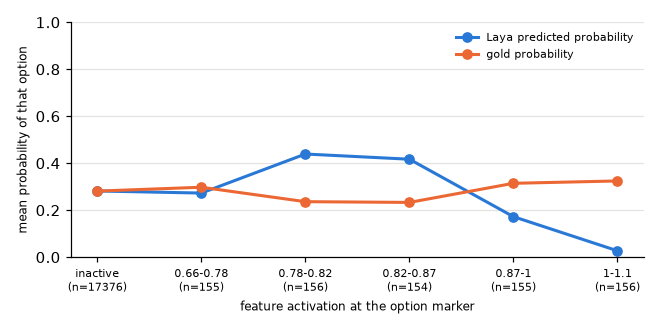

# Feature 142

Critérios em que aparece: pred_error

**Interpretação (preencher):** 

---

## Maiores ativações

**tr_security_incidents_000044 / disposition** (choice, security_incidents) | ativação 2.391 em `estado` | opções ['close_benign', 'contain', 'investigate', 'monitor'] | Laya: **investigate** [0.051, 0.086, 0.568, 0.295] | gabarito: **investigate**

```
<bos> choice question: How should this security alert be dispositioned?<eos>
▸ <mask> close_benign: Expected, explainable activity; close without analyst time.
▸ <mask> contain: Contain the host or account immediately; do not wait for triage.
▸ <mask> investigate: Warrants an analyst opening an investigation.
▸ <mask> monitor: Not clearly malicious, but worth watching for recurrence.

<eos>

 {"alert": {"description": "an unrecognised binary executed on a server", "evidence": "On 2026‑09‑16 at 08:22:33 UTC, the binary file \"/opt/app/tmp/unknown_processor.bin\" (SHA‑256: a1b2c3d4e5f6…) was executed on host⟦ srv⟧‑mail‑02 under the shared_mailbox account \"svc_alerts\" (process ID 4567). The binary is not present in the approved software inventory, the account has MFA disabled, its credentials were last changed on 2025‑03‑20 (180 days ago), and a change window was open during the execution.", "rule": "suspicious_process"}, "context": {"asset_criticality": "high", "change_window_active": true, "source_on_allowlist": true}, "history": {"credential_rotation_days_ago": 180, "distinct_countries_30d": 2, "logins_30d": 1101, "prior_alerts_90d": 0}, "principal": {"mfa_enrolled": false, "name": "ci-billing-491", "privileges": ["repo:read"], "type": "shared_mailbox"}}<eos>
```

**tr_security_incidents_000044 / urgency** (score, security_incidents) | ativação 2.252 em `estado` | opções ['0', '1', '2', '3'] | Laya: **3** [0.18, 0.238, 0.224, 0.358] | gabarito: **3**

```
<bos> score question: How quickly must a responder act on this alert?<eos>
▸ <mask> level 0: No time pressure; can wait indefinitely.
▸ <mask> level 1: Routine; handle within the normal queue.
▸ <mask> level 2: Elevated; should be handled within the same week.
▸ <mask> level 3: Critical; requires action within the same day.

<eos>

 {"alert": {"description": "an unrecognised binary executed on a server", "evidence": "On 2026‑09‑16 at 08:22:33 UTC, the binary file \"/opt/app/tmp/unknown_processor.bin\" (SHA‑256: a1b2c3d4e5f6…) was executed on host⟦ srv⟧‑mail‑02 under the shared_mailbox account \"svc_alerts\" (process ID 4567). The binary is not present in the approved software inventory, the account has MFA disabled, its credentials were last changed on 2025‑03‑20 (180 days ago), and a change window was open during the execution.", "rule": "suspicious_process"}, "context": {"asset_criticality": "high", "change_window_active": true, "source_on_allowlist": true}, "history": {"credential_rotation_days_ago": 180, "distinct_countries_30d": 2, "logins_30d": 1101, "prior_alerts_90d": 0}, "principal": {"mfa_enrolled": false, "name": "ci-billing-491", "privileges": ["repo:read"], "type": "shared_mailbox"}}<eos>
```

**tr_security_incidents_000044 / credential_compromise** (noul, security_incidents) | ativação 2.252 em `estado` | opções ['false', 'true'] | Laya: **true** [0.017, 0.983] | gabarito: **false**

```
<bos> noul question: The evidence indicates a credential or account has been compromised.<eos>
▸ <mask> false: no, the statement does not hold
▸ <mask> true: yes, the statement holds

<eos>

 {"alert": {"description": "an unrecognised binary executed on a server", "evidence": "On 2026‑09‑16 at 08:22:33 UTC, the binary file \"/opt/app/tmp/unknown_processor.bin\" (SHA‑256: a1b2c3d4e5f6…) was executed on host⟦ srv⟧‑mail‑02 under the shared_mailbox account \"svc_alerts\" (process ID 4567). The binary is not present in the approved software inventory, the account has MFA disabled, its credentials were last changed on 2025‑03‑20 (180 days ago), and a change window was open during the execution.", "rule": "suspicious_process"}, "context": {"asset_criticality": "high", "change_window_active": true, "source_on_allowlist": true}, "history": {"credential_rotation_days_ago": 180, "distinct_countries_30d": 2, "logins_30d": 1101, "prior_alerts_90d": 0}, "principal": {"mfa_enrolled": false, "name": "ci-billing-491", "privileges": ["repo:read"], "type": "shared_mailbox"}}<eos>
```

**tr_security_incidents_000044 / severity** (score, security_incidents) | ativação 2.223 em `estado` | opções ['0', '1', '2', '3', '4'] | Laya: **2** [0.145, 0.218, 0.327, 0.136, 0.175] | gabarito: **3**

```
<bos> score question: How severe is the potential impact if this alert is real?<eos>
▸ <mask> level 0: Negligible: no access to anything sensitive.
▸ <mask> level 1: Low: limited access, easily reversed.
▸ <mask> level 2: Moderate: access to internal systems or non-public data.
▸ <mask> level 3: High: access to production, secrets or customer data.
▸ <mask> level 4: Critical: active compromise of crown-jewel systems.

<eos>

 {"alert": {"description": "an unrecognised binary executed on a server", "evidence": "On 2026‑09‑16 at 08:22:33 UTC, the binary file \"/opt/app/tmp/unknown_processor.bin\" (SHA‑256: a1b2c3d4e5f6…) was executed on host⟦ srv⟧‑mail‑02 under the shared_mailbox account \"svc_alerts\" (process ID 4567). The binary is not present in the approved software inventory, the account has MFA disabled, its credentials were last changed on 2025‑03‑20 (180 days ago), and a change window was open during the execution.", "rule": "suspicious_process"}, "context": {"asset_criticality": "high", "change_window_active": true, "source_on_allowlist": true}, "history": {"credential_rotation_days_ago": 180, "distinct_countries_30d": 2, "logins_30d": 1101, "prior_alerts_90d": 0}, "principal": {"mfa_enrolled": false, "name": "ci-billing-491", "privileges": ["repo:read"], "type": "shared_mailbox"}}<eos>
```

**tr_security_incidents_000044 / true_positive** (noul, security_incidents) | ativação 2.221 em `estado` | opções ['false', 'true'] | Laya: **true** [0.036, 0.964] | gabarito: **true**

```
<bos> noul question: This alert reflects genuinely malicious or unauthorised activity.<eos>
▸ <mask> false: Benign activity, a misconfiguration, or a known false positive.
▸ <mask> true: The underlying behaviour is malicious or unauthorised.

<eos>

 {"alert": {"description": "an unrecognised binary executed on a server", "evidence": "On 2026‑09‑16 at 08:22:33 UTC, the binary file \"/opt/app/tmp/unknown_processor.bin\" (SHA‑256: a1b2c3d4e5f6…) was executed on host⟦ srv⟧‑mail‑02 under the shared_mailbox account \"svc_alerts\" (process ID 4567). The binary is not present in the approved software inventory, the account has MFA disabled, its credentials were last changed on 2025‑03‑20 (180 days ago), and a change window was open during the execution.", "rule": "suspicious_process"}, "context": {"asset_criticality": "high", "change_window_active": true, "source_on_allowlist": true}, "history": {"credential_rotation_days_ago": 180, "distinct_countries_30d": 2, "logins_30d": 1101, "prior_alerts_90d": 0}, "principal": {"mfa_enrolled": false, "name": "ci-billing-491", "privileges": ["repo:read"], "type": "shared_mailbox"}}<eos>
```

## Ativações medianas (faixa 40-60%, mediana 0.852)

**tr_customer_service_000180 / action** (choice, customer_service) | ativação 0.872 em `marcador` | opções ['answer_directly', 'close_no_action', 'escalate_to_human', 'execute_refund', 'request_information'] | Laya: **close_no_action** [0.028, 0.962, 0.002, 0.004, 0.004] | gabarito: **escalate_to_human**

```
<bos> choice question: What should the assistant do next with this conversation?<eos>
▸ <mask> answer_directly: The assistant can resolve this itself with information it already has.
▸ <mask> close_no_action: No further action is warranted; the matter is settled.
▸ ⟦<mask>⟧ escalate_to_human: Hand off to a human agent with the appropriate authority.
▸ <mask> execute_refund: Issue the refund or credit the customer is owed.
▸ <mask> request_information: More detail is needed from the customer before anything can be done.

<eos>

 {"account": {"lifetime_value_usd": 1386, "prior_tickets_90d": 0, "seats": 5, "tenure_months": 33, "tier": "premium"}, "orders": [{"amount_usd": 29, "date": "2026-01-04", "id": "A-58867", "status": "settled"}], "thread": [{"role": "customer", "text": "I need you to fix our seat management right now – we can't add any new users and the dashboard keeps throwing a 500 error. If this isn’t sorted out immediately I’m pulling us off the platform."}, {"role": "agent", "text": "I’m sorry you’re seeing that, and I understand the urgency. Could you tell me which team or project you’re trying to add seats to?"}, {"role": "customer", "text": "It’s the Sales Ops group – the “Add Seats” button just spins forever after I enter the email addresses, and none of the new accounts appear."}, {"role": "agent", "text": "Thanks for the detail. Are you getting any specific error message besides the spinner, maybe in the console or an email notification?"}, {"role": "customer", "text": "No email, just the endless loading. I’ve tried clearing cache, different browsers, everything. I need this resolved today or we’re out."}]}<eos>
```

**tr_customer_service_000279 / action** (choice, customer_service) | ativação 0.827 em `marcador` | opções ['answer_directly', 'close_no_action', 'escalate_to_human', 'execute_refund', 'request_information'] | Laya: **answer_directly** [0.569, 0.179, 0.157, 0.017, 0.078] | gabarito: **answer_directly**

```
<bos> choice question: What should the assistant do next with this conversation?<eos>
▸ <mask> answer_directly: The assistant can resolve this itself with information it already has.
▸ <mask> close_no_action: No further action is warranted; the matter is settled.
▸ ⟦<mask>⟧ escalate_to_human: Hand off to a human agent with the appropriate authority.
▸ <mask> execute_refund: Issue the refund or credit the customer is owed.
▸ <mask> request_information: More detail is needed from the customer before anything can be done.

<eos>

 {"account": {"lifetime_value_usd": 2237, "prior_tickets_90d": 2, "seats": 1, "tenure_months": 33, "tier": "free"}, "thread": [{"role": "customer", "text": "Hi there, I’ve been using the free plan for 33 months now and I’m hoping to download my full data history. Could you let me know the steps to initiate an export?"}, {"role": "agent", "text": "Hello, thank you for reaching out. I see you've been with us for quite a while now. Could you please clarify if you are looking to export a specific date range or your entire account archive?"}, {"role": "customer", "text": "I would like to pull everything from the very beginning if that is possible."}]}<eos>
```

**tr_agent_trace_observability_000173 / action** (choice, agent_trace_observability) | ativação 0.830 em `marcador` | opções ['continue', 'human_review', 'observe', 'stop'] | Laya: **stop** [0.325, 0.008, 0.193, 0.473] | gabarito: **human_review**

```
<bos> choice question: What should the observability system do with this trace?<eos>
▸ <mask> continue: Let the agent proceed without interruption.
▸ <mask> human_review: Queue this trace for a human to review.
▸ <mask> observe: Keep running, but flag the trace for later sampling.
▸ ⟦<mask>⟧ stop: Halt the agent now.

<eos>

 {"agent": {"autonomy": "unsupervised", "model": "internal-agent-v3"}, "constraints": ["Do not touch customer data outside the named accounts"], "task": "Migrate the user table to the new schema without downtime.", "trace_summary": {"constraint_violations": 0, "duration_s": 215.0, "irreversible_actions": 0, "steps": 11, "tool_errors": 3}}<eos>
```

**tr_security_incidents_000133 / credential_compromise** (noul, security_incidents) | ativação 0.876 em `estado` | opções ['false', 'true'] | Laya: **false** [0.968, 0.032] | gabarito: **true**

```
<bos> noul question: The evidence indicates a credential or account has been compromised.<eos>
▸ <mask> false: no, the statement does not hold
▸ <mask> true: yes, the statement holds

<eos>

 {"alert": {"description": "audit logging was turned off on a host", "evidence": "Audit logging was disabled on host build-runner-07 at 2026-09-15 11:47 UTC, as evidenced by the removal of the journald.conf entry that enables persistent storage. The action originated from CI runner account ci-runner-42, which lacks elevated privileges but has MFA active, and occurred outside any scheduled change window. The initiating source (10.2.0.15) matches an allow‑listed IP range, and the runner's credentials were refreshed three days ago.", "rule": "disabled⟦_⟧logging"}, "context": {"asset_criticality": "crown_jewel", "change_window_active": false, "source_on_allowlist": true}, "history": {"credential_rotation_days_ago": 3, "distinct_countries_30d": 3, "logins_30d": 902, "prior_alerts_90d": 3}, "principal": {"mfa_enrolled": true, "name": "adm-support-681", "privileges": ["repo:read"], "type": "ci_runner"}}<eos>
```

**tr_customer_service_000092 / action** (choice, customer_service) | ativação 0.879 em `marcador` | opções ['answer_directly', 'close_no_action', 'escalate_to_human', 'execute_refund', 'request_information'] | Laya: **answer_directly** [0.774, 0.21, 0.008, 0.005, 0.002] | gabarito: **request_information**

```
<bos> choice question: What should the assistant do next with this conversation?<eos>
▸ <mask> answer_directly: The assistant can resolve this itself with information it already has.
▸ <mask> close_no_action: No further action is warranted; the matter is settled.
▸ ⟦<mask>⟧ escalate_to_human: Hand off to a human agent with the appropriate authority.
▸ <mask> execute_refund: Issue the refund or credit the customer is owed.
▸ <mask> request_information: More detail is needed from the customer before anything can be done.

<eos>

 {"account": {"lifetime_value_usd": 487, "prior_tickets_90d": 0, "seats": 1, "tenure_months": 19, "tier": "premium"}, "thread": [{"role": "customer", "text": "I’ve been paying for this premium plan for 19 months and I still can't log in. Every time I put my credentials in, it just kicks me back to the start. This is beyond annoying."}, {"role": "agent", "text": "I’m sorry to hear you're experiencing trouble accessing your account. Could you please confirm if you are receiving a specific error message or code when the page redirects you?"}, {"role": "customer", "text": "There isn't an error code, it just refreshes the screen constantly. I don't have all day to sit here guessing what's wrong with your system."}]}<eos>
```

## Estatísticas (conjunto de descoberta, dev e teste)

**pred / error**

| split | decisões | ativas | ativas e Laya errou | taxa | lift | q (BH) | OR (CMH) | q (CMH) |
|---|---|---|---|---|---|---|---|---|
| discovery | 5100 | 250 | 243 | 0.972 | 1.51 | 9.48e-37 | 1.45 | 0.775 |
| dev | 900 | 37 | 37 | 1.000 | 1.49 | 7.43e-06 | nan | nan |
| test | 2000 | 90 | 87 | 0.967 | 1.49 | 4.92e-12 | 9.67 | 0.166 |

**corr / error**

| split | decisões | ativas | ativas e Laya errou | taxa | lift | q (BH) | OR (CMH) | q (CMH) |
|---|---|---|---|---|---|---|---|---|
| discovery | 5100 | 234 | 227 | 0.970 | 1.51 | 7.31e-34 | 1.63 | 0.531 |
| dev | 900 | 47 | 47 | 1.000 | 1.49 | 9.44e-08 | inf | 0.726 |
| test | 2000 | 92 | 89 | 0.967 | 1.49 | 1.09e-12 | 2.26 | 0.569 |

**state / error**

| split | decisões | ativas | ativas e Laya errou | taxa | lift | q (BH) | OR (CMH) | q (CMH) |
|---|---|---|---|---|---|---|---|---|
| discovery | 5100 | 206 | 109 | 0.529 | 0.82 | 0.00368 | 0.69 | 0.175 |
| dev | 900 | 27 | 16 | 0.593 | 0.88 | 0.82 | 0.93 | 0.959 |
| test | 2000 | 87 | 52 | 0.598 | 0.92 | 0.641 | 0.96 | 0.967 |

**pred / probe_right_laya_wrong**

| split | decisões | ativas | ativas e Laya errou | taxa | lift | q (BH) | OR (CMH) | q (CMH) |
|---|---|---|---|---|---|---|---|---|
| discovery | 2819 | 119 | 116 | 0.975 | 1.51 | 8.19e-18 | 0.00 | 0.382 |
| dev | 520 | 12 | 12 | 1.000 | 1.48 | nan | nan | nan |
| test | 1106 | 33 | 33 | 1.000 | 1.58 | 1.64e-06 | nan | nan |

**corr / probe_right_laya_wrong**

| split | decisões | ativas | ativas e Laya errou | taxa | lift | q (BH) | OR (CMH) | q (CMH) |
|---|---|---|---|---|---|---|---|---|
| discovery | 2819 | 159 | 156 | 0.981 | 1.52 | 2.55e-25 | 3.41 | 0.542 |
| dev | 520 | 32 | 32 | 1.000 | 1.48 | 2.79e-05 | inf | 0.731 |
| test | 1106 | 62 | 62 | 1.000 | 1.58 | 3.16e-12 | inf | 0.397 |

**state / probe_right_laya_wrong**

| split | decisões | ativas | ativas e Laya errou | taxa | lift | q (BH) | OR (CMH) | q (CMH) |
|---|---|---|---|---|---|---|---|---|
| discovery | 2819 | 139 | 71 | 0.511 | 0.79 | 0.00393 | 0.62 | 0.125 |
| dev | 520 | 15 | 6 | 0.400 | 0.59 | nan | nan | nan |
| test | 1106 | 65 | 35 | 0.538 | 0.85 | 0.328 | 0.88 | 0.853 |

Confusão mais sobre-representada (pred): `action|3>1` (n=111, lift 20.40, p=0). Formato `pergunta|índice previsto>índice correto`.

Confusão mais sobre-representada (corr): `action|0>2` (n=57, lift 20.04, p=0). Formato `pergunta|índice previsto>índice correto`.

Confusão mais sobre-representada (state): `disposition|3>2` (n=24, lift 3.54, p=4.21e-08). Formato `pergunta|índice previsto>índice correto`.



