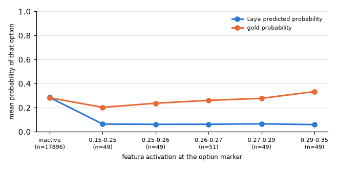

# Feature 149

Critérios em que aparece: corr_error

**Interpretação (preencher):** 

---

## Maiores ativações

**tr_customer_service_000155 / churn_risk** (score, customer_service) | ativação 3.367 em `estado` | opções ['0', '1', '2', '3'] | Laya: **1** [0.16, 0.574, 0.198, 0.067] | gabarito: **1**

```
<bos> score question: How likely is this customer to stop doing business with us because of this interaction?<eos>
▸ <mask> level 0: No sign of dissatisfaction.
▸ <mask> level 1: Mild frustration, but the relationship is intact.
▸ <mask> level 2: Clearly unhappy; repeat problems or explicit complaints.
▸ <mask> level 3: Imminent: threatening to cancel, dispute or leave.

<eos>

 {"account": {"lifetime_value_usd": 351, "prior_tickets_90d": 1, "seats": 1, "tenure_months": 8, "tier": "standard"}, "thread": [{"role": "customer", "text": "I need the CSV export of last month's transaction data right now; the system is still processing and it's⟦ holding⟧ up my audit."}, {"role": "agent", "text": "I understand the urgency. Could you tell me which account ID you’re exporting from?"}, {"role": "customer", "text": "It's account 45219; please expedite the export."}]}<eos>
```

**tr_customer_service_000155 / urgency** (score, customer_service) | ativação 3.332 em `estado` | opções ['0', '1', '2', '3'] | Laya: **2** [0.044, 0.318, 0.471, 0.166] | gabarito: **3**

```
<bos> score question: How time-sensitive is this conversation?<eos>
▸ <mask> level 0: No time pressure; can wait indefinitely.
▸ <mask> level 1: Routine; handle within the normal queue.
▸ <mask> level 2: Elevated; should be handled within the same week.
▸ <mask> level 3: Critical; requires action within the same day.

<eos>

 {"account": {"lifetime_value_usd": 351, "prior_tickets_90d": 1, "seats": 1, "tenure_months": 8, "tier": "standard"}, "thread": [{"role": "customer", "text": "I need the CSV export of last month's transaction data right now; the system is still processing and it's⟦ holding⟧ up my audit."}, {"role": "agent", "text": "I understand the urgency. Could you tell me which account ID you’re exporting from?"}, {"role": "customer", "text": "It's account 45219; please expedite the export."}]}<eos>
```

**tr_customer_service_000155 / needs_human** (noul, customer_service) | ativação 3.320 em `estado` | opções ['false', 'true'] | Laya: **true** [0.244, 0.756] | gabarito: **true**

```
<bos> noul question: This conversation requires a human agent rather than automated handling.<eos>
▸ <mask> false: Automation can carry this to resolution.
▸ <mask> true: A human must take over: judgement, authority or empathy is required.

<eos>

 {"account": {"lifetime_value_usd": 351, "prior_tickets_90d": 1, "seats": 1, "tenure_months": 8, "tier": "standard"}, "thread": [{"role": "customer", "text": "I need the CSV export of last month's transaction data right now; the system is still processing and it's⟦ holding⟧ up my audit."}, {"role": "agent", "text": "I understand the urgency. Could you tell me which account ID you’re exporting from?"}, {"role": "customer", "text": "It's account 45219; please expedite the export."}]}<eos>
```

**tr_customer_service_000155 / action** (choice, customer_service) | ativação 3.271 em `estado` | opções ['answer_directly', 'close_no_action', 'escalate_to_human', 'execute_refund', 'request_information'] | Laya: **request_information** [0.194, 0.107, 0.028, 0.037, 0.635] | gabarito: **escalate_to_human**

```
<bos> choice question: What should the assistant do next with this conversation?<eos>
▸ <mask> answer_directly: The assistant can resolve this itself with information it already has.
▸ <mask> close_no_action: No further action is warranted; the matter is settled.
▸ <mask> escalate_to_human: Hand off to a human agent with the appropriate authority.
▸ <mask> execute_refund: Issue the refund or credit the customer is owed.
▸ <mask> request_information: More detail is needed from the customer before anything can be done.

<eos>

 {"account": {"lifetime_value_usd": 351, "prior_tickets_90d": 1, "seats": 1, "tenure_months": 8, "tier": "standard"}, "thread": [{"role": "customer", "text": "I need the CSV export of last month's transaction data right now; the system is still processing and it's⟦ holding⟧ up my audit."}, {"role": "agent", "text": "I understand the urgency. Could you tell me which account ID you’re exporting from?"}, {"role": "customer", "text": "It's account 45219; please expedite the export."}]}<eos>
```

**tr_customer_service_000155 / category** (choice, customer_service) | ativação 3.168 em `estado` | opções ['account', 'billing', 'delivery', 'refund', 'technical'] | Laya: **account** [0.757, 0.016, 0.021, 0.004, 0.202] | gabarito: **technical**

```
<bos> choice question: What is this customer conversation primarily about?<eos>
▸ <mask> account: Login, plan changes, profile or access management.
▸ <mask> billing: A charge, invoice, subscription or payment problem.
▸ <mask> delivery: Shipping, fulfilment or delivery of a physical item.
▸ <mask> refund: The customer is explicitly asking for money back.
▸ <mask> technical: The product or service is not working as expected.

<eos>

 {"account": {"lifetime_value_usd": 351, "prior_tickets_90d": 1, "seats": 1, "tenure_months": 8, "tier": "standard"}, "thread": [{"role": "customer", "text": "I need the CSV export of last month's transaction data right now; the system is still processing and it's⟦ holding⟧ up my audit."}, {"role": "agent", "text": "I understand the urgency. Could you tell me which account ID you’re exporting from?"}, {"role": "customer", "text": "It's account 45219; please expedite the export."}]}<eos>
```

## Ativações medianas (faixa 40-60%, mediana 1.005)

**tr_invoice_processing_000212 / disposition** (choice, invoice_processing) | ativação 1.014 em `opção` | opções ['approve', 'hold', 'manual_review', 'reject'] | Laya: **approve** [0.48, 0.105, 0.018, 0.398] | gabarito: **manual_review**

```
<bos> choice question: How should this vendor invoice be dispositioned?<eos>
▸ <mask> approve: Matches the order and delivery; approve for payment.
▸ <mask> hold: Something needs confirming before payment;⟦ hold⟧ pending clarification.
▸ <mask> manual_review: A human in finance must review the discrepancy.
▸ <mask> reject: Should not be paid: duplicate, unauthorised or materially wrong.

<eos>

 {"delivery": {"condition": "accepted", "date": "2026-03-15", "received_qty": 50}, "invoice": {"currency": "USD", "id": "INV-2026-9746", "lines": [{"qty": 50, "sku": "SKU-109", "total_usd": 1888.0, "unit_usd": 37.76}], "total_usd": 1888.0, "vendor": "Kestrel Supply"}, "payment": {"days_until_due": 27, "discount_expires_in_days": null, "early_payment_discount_pct": null, "status": "scheduled", "terms": "net 60"}, "purchase_order": {"freight_terms": "freight prepaid by vendor, not separately billable", "id": "PO-9528", "lines": [{"qty": 50, "unit_usd": 26.97}], "total_usd": 1348.5}, "vendor_history": {"disputes_12m": 0, "invoices_12m": 31, "prior_invoice_ids": ["INV-2026-4023", "INV-2026-4752", "INV-2026-8633", "INV-2026-3220"]}}<eos>
```

**tr_invoice_processing_000221 / disposition** (choice, invoice_processing) | ativação 1.021 em `opção` | opções ['approve', 'hold', 'manual_review', 'reject'] | Laya: **reject** [0.329, 0.082, 0.015, 0.574] | gabarito: **manual_review**

```
<bos> choice question: How should this vendor invoice be dispositioned?<eos>
▸ <mask> approve: Matches the order and delivery; approve for payment.
▸ <mask> hold: Something needs confirming before payment;⟦ hold⟧ pending clarification.
▸ <mask> manual_review: A human in finance must review the discrepancy.
▸ <mask> reject: Should not be paid: duplicate, unauthorised or materially wrong.

<eos>

 {"delivery": {"condition": "accepted with exceptions", "date": "2026-03-03", "received_qty": 45}, "invoice": {"currency": "USD", "id": "INV-2026-7507", "lines": [{"qty": 45, "sku": "SKU-681", "total_usd": 11008.8, "unit_usd": 244.64}], "total_usd": 11008.8, "vendor": "Vantage Materials"}, "payment": {"days_until_due": -21, "discount_expires_in_days": null, "early_payment_discount_pct": null, "status": "overdue", "terms": "net 45"}, "purchase_order": {"freight_terms": "freight prepaid by vendor, not separately billable", "id": "PO-3942", "lines": [{"qty": 50, "unit_usd": 244.64}], "total_usd": 12232.0}, "vendor_history": {"disputes_12m": 0, "invoices_12m": 36, "prior_invoice_ids": ["INV-2026-8402", "INV-2026-7111", "INV-2026-7653", "INV-2026-6427"]}}<eos>
```

**tr_invoice_processing_000038 / disposition** (choice, invoice_processing) | ativação 1.011 em `opção` | opções ['approve', 'hold', 'manual_review', 'reject'] | Laya: **approve** [0.536, 0.08, 0.019, 0.365] | gabarito: **hold**

```
<bos> choice question: How should this vendor invoice be dispositioned?<eos>
▸ <mask> approve: Matches the order and delivery; approve for payment.
▸ <mask> hold: Something needs confirming before payment;⟦ hold⟧ pending clarification.
▸ <mask> manual_review: A human in finance must review the discrepancy.
▸ <mask> reject: Should not be paid: duplicate, unauthorised or materially wrong.

<eos>

 {"delivery": {"condition": "accepted with exceptions", "date": "2026-03-01", "received_qty": 50}, "invoice": {"currency": "USD", "id": "INV-2026-3588", "lines": [{"qty": 50, "sku": "SKU-203", "total_usd": 11633.5, "unit_usd": 232.67}], "total_usd": 11633.5, "vendor": "Acme Fabrication"}, "payment": {"days_until_due": 5, "discount_expires_in_days": null, "early_payment_discount_pct": null, "status": "scheduled", "terms": "net 30"}, "purchase_order": {"freight_terms": "freight prepaid by vendor, not separately billable", "id": "PO-6472", "lines": [{"qty": 50, "unit_usd": 232.67}], "total_usd": 11633.5}, "vendor_history": {"disputes_12m": 0, "invoices_12m": 3, "prior_invoice_ids": ["INV-2026-7693", "INV-2026-1074", "INV-2026-5345", "INV-2026-5454"]}}<eos>
```

**tr_invoice_processing_000252 / urgency** (score, invoice_processing) | ativação 1.304 em `pergunta` | opções ['0', '1', '2', '3'] | Laya: **1** [0.126, 0.425, 0.288, 0.161] | gabarito: **1**

```
<bos> score question: How time-sensitive is⟦ processing⟧ this invoice?<eos>
▸ <mask> level 0: No time pressure; can wait indefinitely.
▸ <mask> level 1: Routine; handle within the normal queue.
▸ <mask> level 2: Elevated; should be handled within the same week.
▸ <mask> level 3: Critical; requires action within the same day.

<eos>

 {"delivery": {"condition": "accepted", "date": "2026-03-13", "received_qty": 100}, "invoice": {"currency": "USD", "id": "INV-2026-6719", "lines": [{"qty": 100, "sku": "SKU-476", "total_usd": 8113.0, "unit_usd": 81.13}], "total_usd": 8113.0, "vendor": "Acme Fabrication"}, "payment": {"days_until_due": 18, "discount_expires_in_days": null, "early_payment_discount_pct": null, "status": "scheduled", "terms": "net 15"}, "purchase_order": {"freight_terms": "freight prepaid by vendor, not separately billable", "id": "PO-1307", "lines": [{"qty": 100, "unit_usd": 81.13}], "total_usd": 8113.0}, "vendor_history": {"disputes_12m": 0, "invoices_12m": 29, "prior_invoice_ids": ["INV-2026-7735", "INV-2026-2980", "INV-2026-5813"]}}<eos>
```

**tr_customer_service_000031 / category** (choice, customer_service) | ativação 1.245 em `estado` | opções ['account', 'billing', 'delivery', 'refund', 'technical'] | Laya: **billing** [0.0, 1.0, 0.0, 0.0, 0.0] | gabarito: **billing**

```
<bos> choice question: What is this customer conversation primarily about?<eos>
▸ <mask> account: Login, plan changes, profile or access management.
▸ <mask> billing: A charge, invoice, subscription or payment problem.
▸ <mask> delivery: Shipping, fulfilment or delivery of a physical item.
▸ <mask> refund: The customer is explicitly asking for money back.
▸ <mask> technical: The product or service is not working as expected.

<eos>

 {"account": {"lifetime_value_usd": 581, "prior_tickets_90d": 0, "seats": 3, "tenure_months": 14, "tier": "enterprise"}, "thread": [{"role": "customer", "text": "I noticed two identical charges on my bank statement for this month's enterprise subscription. I suppose I'm not surprised, but I'd like to know why this happened."}, {"role": "agent", "text": "I am sorry to hear that you are seeing duplicate charges. To help me investigate this further, could you please share the transaction IDs associated with those charges?"}, {"role": "customer", "text": "I'm not sure where to find those IDs. I just see the two lines on my dashboard history that match the ones on my bank app."}, {"role": "agent", "text": "No problem at all. If you could send over a screenshot of your billing history page or the exact timestamps listed for those two transactions, I can start looking into the account logs."}, {"role": "customer", "text": "Here is the screenshot. It’s the same amount charged twice on the same day, which seems like a bit of a mess."}, {"role": "agent", "text": "Thank you for attaching that file. I’ve received the document, and I’m going to begin reviewing our payment⟦ processing⟧ records to see how these entries were generated."}, {"role": "customer", "text": "Alright, let me know what you find whenever you get around to it, I guess."}]}<eos>
```

## Estatísticas (conjunto de descoberta, dev e teste)

**pred / error**

| split | decisões | ativas | ativas e Laya errou | taxa | lift | q (BH) | OR (CMH) | q (CMH) |
|---|---|---|---|---|---|---|---|---|
| discovery | 5100 | 0 | 0 | nan | nan | nan | nan | nan |
| dev | 900 | 0 | 0 | nan | nan | nan | nan | nan |
| test | 2000 | 0 | 0 | nan | nan | nan | nan | nan |

**corr / error**

| split | decisões | ativas | ativas e Laya errou | taxa | lift | q (BH) | OR (CMH) | q (CMH) |
|---|---|---|---|---|---|---|---|---|
| discovery | 5100 | 64 | 64 | 1.000 | 1.55 | 3.51e-12 | nan | nan |
| dev | 900 | 20 | 20 | 1.000 | 1.49 | 0.00164 | nan | nan |
| test | 2000 | 36 | 36 | 1.000 | 1.54 | 1.15e-06 | nan | nan |

**state / error**

| split | decisões | ativas | ativas e Laya errou | taxa | lift | q (BH) | OR (CMH) | q (CMH) |
|---|---|---|---|---|---|---|---|---|
| discovery | 5100 | 104 | 66 | 0.635 | 0.99 | 1 | 1.32 | 0.609 |
| dev | 900 | 16 | 6 | 0.375 | 0.56 | nan | nan | nan |
| test | 2000 | 23 | 12 | 0.522 | 0.80 | 0.57 | 0.61 | 0.681 |

**pred / probe_right_laya_wrong**

| split | decisões | ativas | ativas e Laya errou | taxa | lift | q (BH) | OR (CMH) | q (CMH) |
|---|---|---|---|---|---|---|---|---|
| discovery | 2819 | 0 | 0 | nan | nan | nan | nan | nan |
| dev | 520 | 0 | 0 | nan | nan | nan | nan | nan |
| test | 1106 | 0 | 0 | nan | nan | nan | nan | nan |

**corr / probe_right_laya_wrong**

| split | decisões | ativas | ativas e Laya errou | taxa | lift | q (BH) | OR (CMH) | q (CMH) |
|---|---|---|---|---|---|---|---|---|
| discovery | 2819 | 15 | 15 | 1.000 | 1.55 | nan | nan | nan |
| dev | 520 | 2 | 2 | 1.000 | 1.48 | nan | nan | nan |
| test | 1106 | 3 | 3 | 1.000 | 1.58 | nan | nan | nan |

**state / probe_right_laya_wrong**

| split | decisões | ativas | ativas e Laya errou | taxa | lift | q (BH) | OR (CMH) | q (CMH) |
|---|---|---|---|---|---|---|---|---|
| discovery | 2819 | 64 | 38 | 0.594 | 0.92 | 0.579 | 1.18 | 0.809 |
| dev | 520 | 9 | 3 | 0.333 | 0.49 | nan | nan | nan |
| test | 1106 | 15 | 7 | 0.467 | 0.74 | nan | nan | nan |

Confusão mais sobre-representada (corr): `discrepancy_severity|2>3` (n=59, lift 79.69, p=0). Formato `pergunta|índice previsto>índice correto`.

Confusão mais sobre-representada (state): `category|4>3` (n=2, lift 24.52, p=0.00241). Formato `pergunta|índice previsto>índice correto`.



