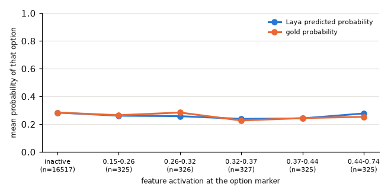

# Feature 174

Critérios em que aparece: attribution_toward_wrong

**Interpretação (preencher):** 

---

## Maiores ativações

**tr_customer_service_000016 / urgency** (score, customer_service) | ativação 3.297 em `estado` | opções ['0', '1', '2', '3'] | Laya: **1** [0.166, 0.646, 0.106, 0.082] | gabarito: **1**

```
<bos> score question: How time-sensitive is this conversation?<eos>
▸ <mask> level 0: No time pressure; can wait indefinitely.
▸ <mask> level 1: Routine; handle within the normal queue.
▸ <mask> level 2: Elevated; should be handled within the same week.
▸ <mask> level 3: Critical; requires action within the same day.

<eos>

 {"account": {"lifetime_value_usd": 1800, "prior_tickets_90d": 0, "seats": 1, "tenure_months": 41, "tier": "premium"}, "orders": [{"amount_usd": 87, "date": "2026-02-18", "id": "A-57523", "status": "settled"}, {"amount_usd": 87, "date": "2026-01-28", "id": "A-53386", "status": "settled"}, {"amount_usd": 87, "date": "2026-02-26", "id": "A-93511", "status": "failed"}], "thread": [{"role": "customer", "text": "I managed to drop my device on the tile floor this morning and the screen is completely shattered. I've been with you folks for over three years now, so I figured I’d reach out, though I know it’s likely my own fault."}, {"role": "agent", "text": "I am sorry to hear about the damage to your device. I see you are on our premium plan; could you please provide the serial number located on the back of the unit so I can review your account details?"}, {"role": "customer", "text": "I'll have to look for that in a minute. It’s an $87 model, so I suppose I should have been more careful with it. Is there anything that can even be done for something like this?"}, {"role": "agent", "text": "I understand your concern. To help me better assist you, could you describe the extent of the screen fracture and let me know if the device is still powering on at all?"}, {"role": "customer", "text": "It won't turn on. Everything is just dark. I don't know⟦,⟧ maybe it's just meant to be replaced, but I thought I'd ask before tossing it."}]}<eos>
```

**tr_customer_service_000016 / category** (choice, customer_service) | ativação 3.287 em `estado` | opções ['account', 'billing', 'delivery', 'refund', 'technical'] | Laya: **technical** [0.11, 0.259, 0.003, 0.004, 0.625] | gabarito: **technical**

```
<bos> choice question: What is this customer conversation primarily about?<eos>
▸ <mask> account: Login, plan changes, profile or access management.
▸ <mask> billing: A charge, invoice, subscription or payment problem.
▸ <mask> delivery: Shipping, fulfilment or delivery of a physical item.
▸ <mask> refund: The customer is explicitly asking for money back.
▸ <mask> technical: The product or service is not working as expected.

<eos>

 {"account": {"lifetime_value_usd": 1800, "prior_tickets_90d": 0, "seats": 1, "tenure_months": 41, "tier": "premium"}, "orders": [{"amount_usd": 87, "date": "2026-02-18", "id": "A-57523", "status": "settled"}, {"amount_usd": 87, "date": "2026-01-28", "id": "A-53386", "status": "settled"}, {"amount_usd": 87, "date": "2026-02-26", "id": "A-93511", "status": "failed"}], "thread": [{"role": "customer", "text": "I managed to drop my device on the tile floor this morning and the screen is completely shattered. I've been with you folks for over three years now, so I figured I’d reach out, though I know it’s likely my own fault."}, {"role": "agent", "text": "I am sorry to hear about the damage to your device. I see you are on our premium plan; could you please provide the serial number located on the back of the unit so I can review your account details?"}, {"role": "customer", "text": "I'll have to look for that in a minute. It’s an $87 model, so I suppose I should have been more careful with it. Is there anything that can even be done for something like this?"}, {"role": "agent", "text": "I understand your concern. To help me better assist you, could you describe the extent of the screen fracture and let me know if the device is still powering on at all?"}, {"role": "customer", "text": "It won't turn on. Everything is just dark. I don't know⟦,⟧ maybe it's just meant to be replaced, but I thought I'd ask before tossing it."}]}<eos>
```

**tr_customer_service_000016 / action** (choice, customer_service) | ativação 3.285 em `estado` | opções ['answer_directly', 'close_no_action', 'escalate_to_human', 'execute_refund', 'request_information'] | Laya: **close_no_action** [0.037, 0.898, 0.013, 0.01, 0.042] | gabarito: **request_information**

```
<bos> choice question: What should the assistant do next with this conversation?<eos>
▸ <mask> answer_directly: The assistant can resolve this itself with information it already has.
▸ <mask> close_no_action: No further action is warranted; the matter is settled.
▸ <mask> escalate_to_human: Hand off to a human agent with the appropriate authority.
▸ <mask> execute_refund: Issue the refund or credit the customer is owed.
▸ <mask> request_information: More detail is needed from the customer before anything can be done.

<eos>

 {"account": {"lifetime_value_usd": 1800, "prior_tickets_90d": 0, "seats": 1, "tenure_months": 41, "tier": "premium"}, "orders": [{"amount_usd": 87, "date": "2026-02-18", "id": "A-57523", "status": "settled"}, {"amount_usd": 87, "date": "2026-01-28", "id": "A-53386", "status": "settled"}, {"amount_usd": 87, "date": "2026-02-26", "id": "A-93511", "status": "failed"}], "thread": [{"role": "customer", "text": "I managed to drop my device on the tile floor this morning and the screen is completely shattered. I've been with you folks for over three years now, so I figured I’d reach out, though I know it’s likely my own fault."}, {"role": "agent", "text": "I am sorry to hear about the damage to your device. I see you are on our premium plan; could you please provide the serial number located on the back of the unit so I can review your account details?"}, {"role": "customer", "text": "I'll have to look for that in a minute. It’s an $87 model, so I suppose I should have been more careful with it. Is there anything that can even be done for something like this?"}, {"role": "agent", "text": "I understand your concern. To help me better assist you, could you describe the extent of the screen fracture and let me know if the device is still powering on at all?"}, {"role": "customer", "text": "It won't turn on. Everything is just dark. I don't know⟦,⟧ maybe it's just meant to be replaced, but I thought I'd ask before tossing it."}]}<eos>
```

**tr_customer_service_000016 / churn_risk** (score, customer_service) | ativação 3.277 em `estado` | opções ['0', '1', '2', '3'] | Laya: **2** [0.052, 0.392, 0.529, 0.026] | gabarito: **1**

```
<bos> score question: How likely is this customer to stop doing business with us because of this interaction?<eos>
▸ <mask> level 0: No sign of dissatisfaction.
▸ <mask> level 1: Mild frustration, but the relationship is intact.
▸ <mask> level 2: Clearly unhappy; repeat problems or explicit complaints.
▸ <mask> level 3: Imminent: threatening to cancel, dispute or leave.

<eos>

 {"account": {"lifetime_value_usd": 1800, "prior_tickets_90d": 0, "seats": 1, "tenure_months": 41, "tier": "premium"}, "orders": [{"amount_usd": 87, "date": "2026-02-18", "id": "A-57523", "status": "settled"}, {"amount_usd": 87, "date": "2026-01-28", "id": "A-53386", "status": "settled"}, {"amount_usd": 87, "date": "2026-02-26", "id": "A-93511", "status": "failed"}], "thread": [{"role": "customer", "text": "I managed to drop my device on the tile floor this morning and the screen is completely shattered. I've been with you folks for over three years now, so I figured I’d reach out, though I know it’s likely my own fault."}, {"role": "agent", "text": "I am sorry to hear about the damage to your device. I see you are on our premium plan; could you please provide the serial number located on the back of the unit so I can review your account details?"}, {"role": "customer", "text": "I'll have to look for that in a minute. It’s an $87 model, so I suppose I should have been more careful with it. Is there anything that can even be done for something like this?"}, {"role": "agent", "text": "I understand your concern. To help me better assist you, could you describe the extent of the screen fracture and let me know if the device is still powering on at all?"}, {"role": "customer", "text": "It won't turn on. Everything is just dark. I don't know⟦,⟧ maybe it's just meant to be replaced, but I thought I'd ask before tossing it."}]}<eos>
```

**tr_customer_service_000016 / needs_human** (noul, customer_service) | ativação 3.221 em `estado` | opções ['false', 'true'] | Laya: **true** [0.394, 0.606] | gabarito: **true**

```
<bos> noul question: This conversation requires a human agent rather than automated handling.<eos>
▸ <mask> false: Automation can carry this to resolution.
▸ <mask> true: A human must take over: judgement, authority or empathy is required.

<eos>

 {"account": {"lifetime_value_usd": 1800, "prior_tickets_90d": 0, "seats": 1, "tenure_months": 41, "tier": "premium"}, "orders": [{"amount_usd": 87, "date": "2026-02-18", "id": "A-57523", "status": "settled"}, {"amount_usd": 87, "date": "2026-01-28", "id": "A-53386", "status": "settled"}, {"amount_usd": 87, "date": "2026-02-26", "id": "A-93511", "status": "failed"}], "thread": [{"role": "customer", "text": "I managed to drop my device on the tile floor this morning and the screen is completely shattered. I've been with you folks for over three years now, so I figured I’d reach out, though I know it’s likely my own fault."}, {"role": "agent", "text": "I am sorry to hear about the damage to your device. I see you are on our premium plan; could you please provide the serial number located on the back of the unit so I can review your account details?"}, {"role": "customer", "text": "I'll have to look for that in a minute. It’s an $87 model, so I suppose I should have been more careful with it. Is there anything that can even be done for something like this?"}, {"role": "agent", "text": "I understand your concern. To help me better assist you, could you describe the extent of the screen fracture and let me know if the device is still powering on at all?"}, {"role": "customer", "text": "It won't turn on. Everything is just dark. I don't know⟦,⟧ maybe it's just meant to be replaced, but I thought I'd ask before tossing it."}]}<eos>
```

## Ativações medianas (faixa 40-60%, mediana 0.698)

**tr_customer_service_000119 / needs_human** (noul, customer_service) | ativação 0.731 em `opção` | opções ['false', 'true'] | Laya: **false** [0.609, 0.39] | gabarito: **true**

```
<bos> noul question: This conversation requires a human agent rather than automated handling.<eos>
▸ <mask> false: Automation can carry this to resolution.
▸ <mask> true: A human must take over: judgement⟦,⟧ authority or empathy is required.

<eos>

 {"account": {"lifetime_value_usd": 613, "prior_tickets_90d": 1, "seats": 1, "tenure_months": 11, "tier": "standard"}, "orders": [{"amount_usd": 299, "date": "2026-01-13", "id": "A-16098", "status": "failed"}], "thread": [{"role": "customer", "text": "I just received my delivery and it's completely wrong. I paid $299 for the standard plan upgrade equipment, but what arrived in the box is the basic version. I’m seriously considering canceling my subscription over this."}, {"role": "agent", "text": "I am very sorry to hear that the incorrect item was delivered. Could you please provide your order number and a photo of the item you received so I can review this?"}, {"role": "customer", "text": "I’ve attached the photo to this ticket. This is the second time I've had issues like this, and frankly, my patience is wearing thin."}]}<eos>
```

**tr_customer_service_000177 / urgency** (score, customer_service) | ativação 0.767 em `opção` | opções ['0', '1', '2', '3'] | Laya: **0** [0.528, 0.198, 0.185, 0.089] | gabarito: **3**

```
<bos> score question: How time-sensitive is this conversation?<eos>
▸ <mask> level 0: No time pressure; can wait indefinitely.
▸ <mask> level 1: Routine⟦;⟧ handle within the normal queue.
▸ <mask> level 2: Elevated; should be handled within the same week.
▸ <mask> level 3: Critical; requires action within the same day.

<eos>

 {"account": {"lifetime_value_usd": 1494, "prior_tickets_90d": 3, "seats": 1, "tenure_months": 26, "tier": "enterprise"}, "orders": [{"amount_usd": 49, "date": "2026-01-07", "id": "A-11099", "status": "failed"}, {"amount_usd": 49, "date": "2026-02-23", "id": "A-83844", "status": "refunded"}], "thread": [{"role": "customer", "text": "I'm furious that my data export still isn't ready. My deadline is tomorrow and I've been waiting for weeks!"}, {"role": "agent", "text": "I understand how frustrating this is. Could you provide your enterprise account ID and specify the exact export format you need?"}, {"role": "customer", "text": "My account is the enterprise one, 26 months with you, and I need the full CSV of all transactions, not this half‑baked JSON you sent before."}, {"role": "agent", "text": "Got it. Please confirm the date range for the export and the email address where you’d like us to send it."}, {"role": "customer", "text": "Send it to my corporate email now; I don't have time for more back‑and‑forth."}]}<eos>
```

**tr_customer_service_000157 / needs_human** (noul, customer_service) | ativação 0.667 em `estado` | opções ['false', 'true'] | Laya: **true** [0.086, 0.914] | gabarito: **true**

```
<bos> noul question: This conversation requires a human agent rather than automated handling.<eos>
▸ <mask> false: Automation can carry this to resolution.
▸ <mask> true: A human must take over: judgement, authority or empathy is required.

<eos>

 {"account": {"lifetime_value_usd": 3086, "prior_tickets_90d": 3, "seats": 1, "tenure_months": 49, "tier": "standard"}, "thread": [{"role": "customer", "text": "I need to get into my account right now⟦ –⟧ the login page just keeps looping back to the password screen and I can’t access anything."}, {"role": "agent", "text": "I understand the urgency. Could you share the exact error message you’re seeing, or let me know if you’ve tried resetting the password?"}, {"role": "customer", "text": "The message says “authentication failed” after I enter my credentials, and I’ve already tried the password reset twice with no luck."}]}<eos>
```

**tr_customer_service_000151 / category** (choice, customer_service) | ativação 0.634 em `estado` | opções ['account', 'billing', 'delivery', 'refund', 'technical'] | Laya: **technical** [0.006, 0.023, 0.006, 0.003, 0.962] | gabarito: **technical**

```
<bos> choice question: What is this customer conversation primarily about?<eos>
▸ <mask> account: Login, plan changes, profile or access management.
▸ <mask> billing: A charge, invoice, subscription or payment problem.
▸ <mask> delivery: Shipping, fulfilment or delivery of a physical item.
▸ <mask> refund: The customer is explicitly asking for money back.
▸ <mask> technical: The product or service is not working as expected.

<eos>

 {"account": {"lifetime_value_usd": 95, "prior_tickets_90d": 0, "seats": 1, "tenure_months": 3, "tier": "enterprise"}, "orders": [{"amount_usd": 299, "date": "2026-02-01", "id": "A-70416", "status": "failed"}, {"amount_usd": 299, "date": "2026-02-15", "id": "A-68913", "status": "pending"}], "thread": [{"role": "customer", "text": "Hello, I’m reaching out because the platform’s performance has been noticeably slow over the past week, and it’s affecting our workflow. We’re on the enterprise plan, paying $299 a month, and we need a stable experience."}, {"role": "agent", "text": "I’m sorry to hear about the slowdown. Could you tell me which features or pages are most affected, and any error messages you’ve encountered?"}, {"role": "customer", "text": "The dashboard and reporting modules take up to 45 seconds to load, and occasional time‑outs appear when we try to export data. I need a solution in place by next Friday, or we’ll have to look elsewhere."}, {"role": "agent", "text": "Thanks for the specifics. Do you have any recent logs or screenshots that show the time‑outs? That would help us pinpoint the bottleneck."}, {"role": "customer", "text": "I’ve attached the latest logs from our server and a couple of screenshots of the timeout dialogs. Please let me know what’s causing this lag."}, {"role": "agent", "text": "I appreciate you sending those files. I’ll have our performance team examine them and see what’s triggering the delay. Meanwhile, is there any temporary workaround you’ve tried that offers a bit more speed?"}, {"role": "customer", "text": "We’ve tried clearing caches and using a different browser, but the issue persists. If this isn’t sorted out by next Friday⟦,⟧ I’ll have to consider moving to a competitor."}]}<eos>
```

**tr_customer_service_000037 / urgency** (score, customer_service) | ativação 0.611 em `opção` | opções ['0', '1', '2', '3'] | Laya: **3** [0.09, 0.151, 0.368, 0.391] | gabarito: **3**

```
<bos> score question: How time-sensitive is this conversation?<eos>
▸ <mask> level 0: No time pressure; can wait indefinitely.
▸ <mask> level 1: Routine; handle within the normal queue.
▸ <mask> level 2: Elevated⟦;⟧ should be handled within the same week.
▸ <mask> level 3: Critical; requires action within the same day.

<eos>

 {"account": {"lifetime_value_usd": 4631, "prior_tickets_90d": 5, "seats": 1, "tenure_months": 72, "tier": "standard"}, "orders": [{"amount_usd": 99, "date": "2026-03-22", "id": "A-19833", "status": "settled"}, {"amount_usd": 99, "date": "2026-03-28", "id": "A-80963", "status": "settled"}, {"amount_usd": 99, "date": "2026-03-25", "id": "A-38277", "status": "refunded"}], "thread": [{"role": "customer", "text": "My $99 order just arrived but it's completely wrong. I need the correct items by tomorrow morning for an event—please help!"}, {"role": "agent", "text": "I am sorry to hear you received the incorrect items. Could you please send over your order number and a photo of what was delivered?"}, {"role": "customer", "text": "The order number is #998877. I've attached the photo. Can you tell me if the right ones can be overnighted immediately?"}]}<eos>
```

## Estatísticas (conjunto de descoberta, dev e teste)

**pred / error**

| split | decisões | ativas | ativas e Laya errou | taxa | lift | q (BH) | OR (CMH) | q (CMH) |
|---|---|---|---|---|---|---|---|---|
| discovery | 5100 | 419 | 260 | 0.621 | 0.96 | 0.378 | 1.17 | 0.568 |
| dev | 900 | 72 | 48 | 0.667 | 0.99 | 1 | 1.09 | 0.892 |
| test | 2000 | 155 | 94 | 0.606 | 0.93 | 0.344 | 0.76 | 0.577 |

**corr / error**

| split | decisões | ativas | ativas e Laya errou | taxa | lift | q (BH) | OR (CMH) | q (CMH) |
|---|---|---|---|---|---|---|---|---|
| discovery | 5100 | 415 | 256 | 0.617 | 0.96 | 0.299 | 1.14 | 0.538 |
| dev | 900 | 71 | 47 | 0.662 | 0.98 | 1 | 1.07 | 0.975 |
| test | 2000 | 144 | 83 | 0.576 | 0.89 | 0.0911 | 0.70 | 0.431 |

**state / error**

| split | decisões | ativas | ativas e Laya errou | taxa | lift | q (BH) | OR (CMH) | q (CMH) |
|---|---|---|---|---|---|---|---|---|
| discovery | 5100 | 1534 | 923 | 0.602 | 0.93 | 0.000351 | 1.22 | 0.27 |
| dev | 900 | 210 | 127 | 0.605 | 0.90 | 0.209 | 0.78 | 0.746 |
| test | 2000 | 571 | 353 | 0.618 | 0.95 | 0.237 | 1.00 | 0.997 |

**pred / probe_right_laya_wrong**

| split | decisões | ativas | ativas e Laya errou | taxa | lift | q (BH) | OR (CMH) | q (CMH) |
|---|---|---|---|---|---|---|---|---|
| discovery | 2819 | 177 | 104 | 0.588 | 0.91 | 0.134 | 1.53 | 0.192 |
| dev | 520 | 33 | 22 | 0.667 | 0.99 | 1 | 1.74 | 0.289 |
| test | 1106 | 74 | 49 | 0.662 | 1.05 | 0.778 | 2.63 | 0.103 |

**corr / probe_right_laya_wrong**

| split | decisões | ativas | ativas e Laya errou | taxa | lift | q (BH) | OR (CMH) | q (CMH) |
|---|---|---|---|---|---|---|---|---|
| discovery | 2819 | 183 | 110 | 0.601 | 0.93 | 0.245 | 1.31 | 0.499 |
| dev | 520 | 32 | 21 | 0.656 | 0.97 | 1 | 2.50 | 0.731 |
| test | 1106 | 72 | 47 | 0.653 | 1.03 | 0.876 | 1.56 | 0.471 |

**state / probe_right_laya_wrong**

| split | decisões | ativas | ativas e Laya errou | taxa | lift | q (BH) | OR (CMH) | q (CMH) |
|---|---|---|---|---|---|---|---|---|
| discovery | 2819 | 810 | 457 | 0.564 | 0.87 | 1.02e-07 | 1.56 | 0.0286 |
| dev | 520 | 110 | 63 | 0.573 | 0.85 | 0.144 | 0.91 | 0.931 |
| test | 1106 | 308 | 174 | 0.565 | 0.89 | 0.0303 | 1.71 | 0.225 |

Confusão mais sobre-representada (pred): `churn_risk|2>1` (n=18, lift 11.53, p=3.64e-19). Formato `pergunta|índice previsto>índice correto`.

Confusão mais sobre-representada (corr): `churn_risk|1>2` (n=46, lift 10.09, p=1.19e-41). Formato `pergunta|índice previsto>índice correto`.

Confusão mais sobre-representada (state): `action|1>2` (n=70, lift 3.28, p=4.95e-36). Formato `pergunta|índice previsto>índice correto`.



