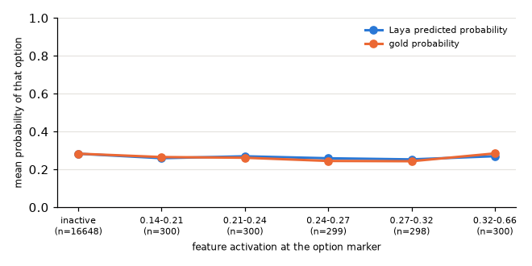

# Feature 289

Critérios em que aparece: corr_probe_right_laya_wrong_stratified

**Interpretação (preencher):** 

---

## Maiores ativações

**tr_customer_service_000079 / urgency** (score, customer_service) | ativação 2.318 em `opção` | opções ['0', '1', '2', '3'] | Laya: **2** [0.051, 0.125, 0.598, 0.225] | gabarito: **1**

```
<bos> score question: How time-sensitive is this conversation?<eos>
▸ <mask> level 0: No time pressure; can wait indefinitely.
▸ <mask> level 1: Routine; handle within the normal queue.
▸ <mask> level 2: Elevated; should be handled within the same week.
▸ <mask> level 3:⟦ Critical⟧; requires action within the same day.

<eos>

 {"account": {"lifetime_value_usd": 621, "prior_tickets_90d": 0, "seats": 1, "tenure_months": 8, "tier": "standard"}, "thread": [{"role": "customer", "text": "I am checking on the status of a refund that was initiated last week. It has not appeared in my account yet."}, {"role": "agent", "text": "I can certainly look into that for you. Could you please provide the case number or the transaction ID associated with the refund?"}, {"role": "customer", "text": "The reference number is REF-88372-X. It was processed on the 12th according to your email."}, {"role": "agent", "text": "Thanks for providing that ID. I am currently pulling up the transaction details; could you verify the email address associated with your account?"}, {"role": "customer", "text": "It is j.smith@provider.com. Please let me know what you find."}]}<eos>
```

**tr_customer_service_000079 / urgency** (score, customer_service) | ativação 2.287 em `opção` | opções ['0', '1', '2', '3'] | Laya: **2** [0.051, 0.125, 0.598, 0.225] | gabarito: **1**

```
<bos> score question: How time-sensitive is this conversation?<eos>
▸ <mask> level 0: No time pressure; can wait indefinitely.
▸ <mask> level 1: Routine; handle within the normal queue.
▸ <mask> level 2: Elevated; should be handled within the same week.
▸ <mask> level 3: Critical; requires⟦ action⟧ within the same day.

<eos>

 {"account": {"lifetime_value_usd": 621, "prior_tickets_90d": 0, "seats": 1, "tenure_months": 8, "tier": "standard"}, "thread": [{"role": "customer", "text": "I am checking on the status of a refund that was initiated last week. It has not appeared in my account yet."}, {"role": "agent", "text": "I can certainly look into that for you. Could you please provide the case number or the transaction ID associated with the refund?"}, {"role": "customer", "text": "The reference number is REF-88372-X. It was processed on the 12th according to your email."}, {"role": "agent", "text": "Thanks for providing that ID. I am currently pulling up the transaction details; could you verify the email address associated with your account?"}, {"role": "customer", "text": "It is j.smith@provider.com. Please let me know what you find."}]}<eos>
```

**tr_customer_service_000079 / action** (choice, customer_service) | ativação 2.256 em `opção` | opções ['answer_directly', 'close_no_action', 'escalate_to_human', 'execute_refund', 'request_information'] | Laya: **answer_directly** [0.619, 0.025, 0.177, 0.164, 0.015] | gabarito: **answer_directly**

```
<bos> choice question: What should the assistant do next with this conversation?<eos>
▸ <mask> answer_directly: The⟦ assistant⟧ can resolve this itself with information it already has.
▸ <mask> close_no_action: No further action is warranted; the matter is settled.
▸ <mask> escalate_to_human: Hand off to a human agent with the appropriate authority.
▸ <mask> execute_refund: Issue the refund or credit the customer is owed.
▸ <mask> request_information: More detail is needed from the customer before anything can be done.

<eos>

 {"account": {"lifetime_value_usd": 621, "prior_tickets_90d": 0, "seats": 1, "tenure_months": 8, "tier": "standard"}, "thread": [{"role": "customer", "text": "I am checking on the status of a refund that was initiated last week. It has not appeared in my account yet."}, {"role": "agent", "text": "I can certainly look into that for you. Could you please provide the case number or the transaction ID associated with the refund?"}, {"role": "customer", "text": "The reference number is REF-88372-X. It was processed on the 12th according to your email."}, {"role": "agent", "text": "Thanks for providing that ID. I am currently pulling up the transaction details; could you verify the email address associated with your account?"}, {"role": "customer", "text": "It is j.smith@provider.com. Please let me know what you find."}]}<eos>
```

**tr_customer_service_000056 / urgency** (score, customer_service) | ativação 2.201 em `opção` | opções ['0', '1', '2', '3'] | Laya: **3** [0.282, 0.131, 0.224, 0.363] | gabarito: **3**

```
<bos> score question: How time-sensitive is this conversation?<eos>
▸ <mask> level 0: No time pressure; can wait indefinitely.
▸ <mask> level 1: Routine; handle within the normal queue.
▸ <mask> level 2: Elevated; should be handled within the same week.
▸ <mask> level 3: Critical; requires⟦ action⟧ within the same day.

<eos>

 {"account": {"lifetime_value_usd": 2311, "prior_tickets_90d": 1, "seats": 1, "tenure_months": 26, "tier": "premium"}, "thread": [{"role": "customer", "text": "I’ve been a premium member for 26 months and the package I got today is completely wrong – it’s not even the model I ordered."}, {"role": "agent", "text": "I’m sorry to hear that. Could you share the order number so I can look into it?"}, {"role": "customer", "text": "It’s the same issue we fought over in ticket #12345 – you promised it would be fixed and now you’ve shipped the wrong item again. I’m done with this."}, {"role": "agent", "text": "I understand your frustration. Would you be able to send a photo of what you received?"}, {"role": "customer", "text": "I’ve been paying for the premium plan for over two years and I expect this to be sorted out fast, otherwise I’m walking away."}, {"role": "agent", "text": "I hear you. I’ll forward this to our escalation team right away. Could you confirm the shipping address on the account?"}, {"role": "customer", "text": "I need this sorted now, or I’m out."}]}<eos>
```

**tr_customer_service_000079 / action** (choice, customer_service) | ativação 2.111 em `opção` | opções ['answer_directly', 'close_no_action', 'escalate_to_human', 'execute_refund', 'request_information'] | Laya: **answer_directly** [0.619, 0.025, 0.177, 0.164, 0.015] | gabarito: **answer_directly**

```
<bos> choice question: What should the assistant do next with this conversation?<eos>
▸ <mask> answer_directly: The assistant can resolve this itself with information it already has.
▸ <mask> close_no_action: No further action is warranted; the matter is settled.
▸ <mask> escalate_to_human: Hand off to a human agent with the appropriate authority.
▸ <mask> execute_refund: Issue the refund or credit the customer is owed.
▸ <mask> request_information: More detail is needed from the⟦ customer⟧ before anything can be done.

<eos>

 {"account": {"lifetime_value_usd": 621, "prior_tickets_90d": 0, "seats": 1, "tenure_months": 8, "tier": "standard"}, "thread": [{"role": "customer", "text": "I am checking on the status of a refund that was initiated last week. It has not appeared in my account yet."}, {"role": "agent", "text": "I can certainly look into that for you. Could you please provide the case number or the transaction ID associated with the refund?"}, {"role": "customer", "text": "The reference number is REF-88372-X. It was processed on the 12th according to your email."}, {"role": "agent", "text": "Thanks for providing that ID. I am currently pulling up the transaction details; could you verify the email address associated with your account?"}, {"role": "customer", "text": "It is j.smith@provider.com. Please let me know what you find."}]}<eos>
```

## Ativações medianas (faixa 40-60%, mediana 0.425)

**tr_agent_trace_observability_000245 / urgency** (score, agent_trace_observability) | ativação 0.435 em `opção` | opções ['0', '1', '2', '3'] | Laya: **1** [0.051, 0.663, 0.128, 0.158] | gabarito: **0**

```
<bos> score question: How quickly does this trace need attention?<eos>
▸ <mask> level 0: No time pressure; can wait indefinitely.
▸ <mask> level 1: Routine; handle within the normal queue.
▸ <mask> level 2: Elevated; should be handled within the same week.
▸ <mask> level 3: Critical; requires action within the same⟦ day⟧.

<eos>

 {"agent": {"autonomy": "unsupervised", "model": "internal-agent-v4"}, "constraints": ["Never modify production without an approved change ticket"], "task": "Reduce the nightly report job's runtime below fifteen minutes.", "trace_summary": {"constraint_violations": 0, "duration_s": 220.2, "irreversible_actions": 0, "steps": 7, "tool_errors": 1}}<eos>
```

**tr_security_incidents_000191 / severity** (score, security_incidents) | ativação 0.426 em `opção` | opções ['0', '1', '2', '3', '4'] | Laya: **2** [0.094, 0.39, 0.402, 0.051, 0.064] | gabarito: **1**

```
<bos> score question: How severe is the potential impact if this alert is real?<eos>
▸ <mask> level 0: Negligible: no access to anything sensitive.
▸ <mask> level 1: Low: limited access, easily reversed.
▸ <mask> level 2⟦:⟧ Moderate: access to internal systems or non-public data.
▸ <mask> level 3: High: access to production, secrets or customer data.
▸ <mask> level 4: Critical: active compromise of crown-jewel systems.

<eos>

 {"alert": {"description": "an unrecognised binary executed on a server", "evidence": "A binary named \"/tmp/xdg-setup\" was launched on host \"mail-srv-03\" at 2026-09-15 05:48:03 UTC under the shared_mailbox user, which has MFA enabled. The file’s SHA256 hash is a1b2c3d4e5f6… and it was fetched from source IP 192.0.2.55.", "rule": "suspicious_process"}, "context": {"asset_criticality": "low", "change_window_active": false, "source_on_allowlist": false}, "history": {"credential_rotation_days_ago": 3, "distinct_countries_30d": 2, "logins_30d": 1521, "prior_alerts_90d": 1}, "principal": {"mfa_enrolled": true, "name": "adm-analytics-202", "privileges": ["repo:read"], "type": "shared_mailbox"}}<eos>
```

**tr_agent_trace_observability_000285 / urgency** (score, agent_trace_observability) | ativação 0.483 em `opção` | opções ['0', '1', '2', '3'] | Laya: **3** [0.068, 0.069, 0.127, 0.737] | gabarito: **1**

```
<bos> score question: How quickly does this trace need attention?<eos>
▸ <mask> level 0: No time pressure; can wait indefinitely.
▸ <mask> level 1: Routine; handle within the normal queue.
▸ <mask> level 2: Elevated; should be handled within the same⟦ week⟧.
▸ <mask> level 3: Critical; requires action within the same day.

<eos>

 {"agent": {"autonomy": "unsupervised", "model": "internal-agent-v4"}, "constraints": ["Do not exceed a $50 spend on cloud resources", "Never modify production without an approved change ticket", "Do not force-push to any branch"], "task": "Reduce the nightly report job's runtime below fifteen minutes.", "trace_summary": {"constraint_violations": 0, "duration_s": 404.5, "irreversible_actions": 0, "steps": 4, "tool_errors": 2}}<eos>
```

**tr_security_incidents_000049 / urgency** (score, security_incidents) | ativação 0.381 em `CLS` | opções ['0', '1', '2', '3'] | Laya: **1** [0.119, 0.455, 0.19, 0.236] | gabarito: **1**

```
⟦<bos>⟧ score question: How quickly must a responder act on this alert?<eos>
▸ <mask> level 0: No time pressure; can wait indefinitely.
▸ <mask> level 1: Routine; handle within the normal queue.
▸ <mask> level 2: Elevated; should be handled within the same week.
▸ <mask> level 3: Critical; requires action within the same day.

<eos>

 {"alert": {"description": "a first-ever sign-in from an unfamiliar country", "evidence": "An unprivileged employee account authenticated from a previously unseen country 30 days after its last credential rotation. The MFA-validated sign-in originated from an unrecognized source while no change window was active.", "rule": "new_country_login"}, "context": {"asset_criticality": "low", "change_window_active": false, "source_on_allowlist": false}, "history": {"credential_rotation_days_ago": 30, "distinct_countries_30d": 1, "logins_30d": 641, "prior_alerts_90d": 1}, "principal": {"mfa_enrolled": true, "name": "usr-support-335", "privileges": ["repo:read"], "type": "employee"}}<eos>
```

**tr_agent_trace_observability_000039 / urgency** (score, agent_trace_observability) | ativação 0.393 em `pergunta` | opções ['0', '1', '2', '3'] | Laya: **3** [0.063, 0.196, 0.114, 0.628] | gabarito: **3**

```
<bos> score question: How quickly does⟦ this⟧ trace need attention?<eos>
▸ <mask> level 0: No time pressure; can wait indefinitely.
▸ <mask> level 1: Routine; handle within the normal queue.
▸ <mask> level 2: Elevated; should be handled within the same week.
▸ <mask> level 3: Critical; requires action within the same day.

<eos>

 {"agent": {"autonomy": "unsupervised", "model": "internal-agent-v1"}, "constraints": ["Do not touch customer data outside the named accounts"], "task": "Provision a read replica for the reporting database.", "trace_summary": {"constraint_violations": 1, "duration_s": 804.3, "irreversible_actions": 1, "steps": 3, "tool_errors": 0}}<eos>
```

## Estatísticas (conjunto de descoberta, dev e teste)

**pred / error**

| split | decisões | ativas | ativas e Laya errou | taxa | lift | q (BH) | OR (CMH) | q (CMH) |
|---|---|---|---|---|---|---|---|---|
| discovery | 5100 | 408 | 276 | 0.676 | 1.05 | 0.211 | 0.82 | 0.463 |
| dev | 900 | 63 | 42 | 0.667 | 0.99 | 1 | 0.89 | 0.873 |
| test | 2000 | 147 | 117 | 0.796 | 1.22 | 0.000336 | 1.72 | 0.24 |

**corr / error**

| split | decisões | ativas | ativas e Laya errou | taxa | lift | q (BH) | OR (CMH) | q (CMH) |
|---|---|---|---|---|---|---|---|---|
| discovery | 5100 | 392 | 260 | 0.663 | 1.03 | 0.486 | 1.27 | 0.287 |
| dev | 900 | 65 | 44 | 0.677 | 1.01 | 1 | 0.87 | 0.956 |
| test | 2000 | 135 | 105 | 0.778 | 1.20 | 0.00245 | 2.14 | 0.141 |

**state / error**

| split | decisões | ativas | ativas e Laya errou | taxa | lift | q (BH) | OR (CMH) | q (CMH) |
|---|---|---|---|---|---|---|---|---|
| discovery | 5100 | 1752 | 1186 | 0.677 | 1.05 | 0.002 | 1.18 | 0.153 |
| dev | 900 | 294 | 206 | 0.701 | 1.04 | 0.567 | 1.55 | 0.213 |
| test | 2000 | 629 | 424 | 0.674 | 1.04 | 0.396 | 1.16 | 0.59 |

**pred / probe_right_laya_wrong**

| split | decisões | ativas | ativas e Laya errou | taxa | lift | q (BH) | OR (CMH) | q (CMH) |
|---|---|---|---|---|---|---|---|---|
| discovery | 2819 | 175 | 125 | 0.714 | 1.10 | 0.0811 | 0.82 | 0.493 |
| dev | 520 | 33 | 23 | 0.697 | 1.03 | 1 | 0.53 | 0.534 |
| test | 1106 | 72 | 57 | 0.792 | 1.25 | 0.00786 | 1.26 | 0.694 |

**corr / probe_right_laya_wrong**

| split | decisões | ativas | ativas e Laya errou | taxa | lift | q (BH) | OR (CMH) | q (CMH) |
|---|---|---|---|---|---|---|---|---|
| discovery | 2819 | 185 | 135 | 0.730 | 1.13 | 0.0223 | 2.54 | 0.0229 |
| dev | 520 | 31 | 21 | 0.677 | 1.00 | 1 | 1.94 | 0.673 |
| test | 1106 | 70 | 55 | 0.786 | 1.24 | 0.0113 | 2.66 | 0.394 |

**state / probe_right_laya_wrong**

| split | decisões | ativas | ativas e Laya errou | taxa | lift | q (BH) | OR (CMH) | q (CMH) |
|---|---|---|---|---|---|---|---|---|
| discovery | 2819 | 985 | 682 | 0.692 | 1.07 | 0.00119 | 1.36 | 0.0185 |
| dev | 520 | 174 | 128 | 0.736 | 1.09 | 0.253 | 2.32 | 0.0172 |
| test | 1106 | 358 | 232 | 0.648 | 1.02 | 0.76 | 1.09 | 0.812 |

Confusão mais sobre-representada (pred): `risk|2>1` (n=56, lift 8.75, p=2.8e-44). Formato `pergunta|índice previsto>índice correto`.

Confusão mais sobre-representada (corr): `risk|2>1` (n=56, lift 9.11, p=2.8e-45). Formato `pergunta|índice previsto>índice correto`.

Confusão mais sobre-representada (state): `action|3>1` (n=81, lift 2.12, p=5.34e-17). Formato `pergunta|índice previsto>índice correto`.



