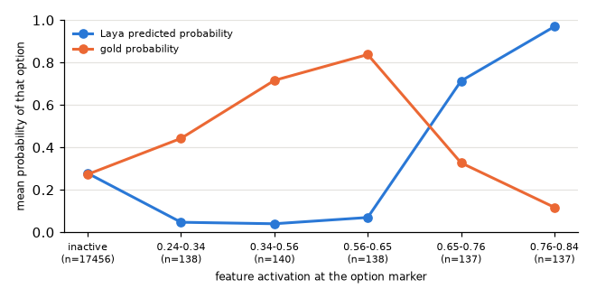

# Feature 496

Critérios em que aparece: corr_error_stratified, corr_probe_right_laya_wrong_stratified

**Interpretação (preencher):** 

---

## Maiores ativações

**tr_customer_service_000137 / urgency** (score, customer_service) | ativação 2.572 em `estado` | opções ['0', '1', '2', '3'] | Laya: **1** [0.108, 0.468, 0.225, 0.199] | gabarito: **2**

```
<bos> score question: How time-sensitive is this conversation?<eos>
▸ <mask> level 0: No time pressure; can wait indefinitely.
▸ <mask> level 1: Routine; handle within the normal queue.
▸ <mask> level 2: Elevated; should be handled within the same week.
▸ <mask> level 3: Critical; requires action within the same day.

<eos>

 {"account": {"lifetime_value_usd": 742, "prior_tickets_90d": 0, "seats": 1, "tenure_months": 8, "tier": "standard"}, "orders": [{"amount_usd": 299, "date": "2026-01-16", "id": "A-97848", "status": "settled"}], "thread": [{"role": "customer", "text": "Hello, I’m following up on my refund request for the $299 charge on my standard plan. I’ve been a customer for⟦ eight⟧ months and would appreciate an update."}, {"role": "agent", "text": "Thank you for reaching out. I can check the status for you—could you provide the ticket number or the date you submitted the request?"}, {"role": "customer", "text": "Sure, the request was submitted on September 2nd under ticket #4521. Any information you have would be helpful."}]}<eos>
```

**tr_customer_service_000137 / needs_human** (noul, customer_service) | ativação 2.514 em `estado` | opções ['false', 'true'] | Laya: **true** [0.486, 0.514] | gabarito: **true**

```
<bos> noul question: This conversation requires a human agent rather than automated handling.<eos>
▸ <mask> false: Automation can carry this to resolution.
▸ <mask> true: A human must take over: judgement, authority or empathy is required.

<eos>

 {"account": {"lifetime_value_usd": 742, "prior_tickets_90d": 0, "seats": 1, "tenure_months": 8, "tier": "standard"}, "orders": [{"amount_usd": 299, "date": "2026-01-16", "id": "A-97848", "status": "settled"}], "thread": [{"role": "customer", "text": "Hello, I’m following up on my refund request for the $299 charge on my standard plan. I’ve been a customer for⟦ eight⟧ months and would appreciate an update."}, {"role": "agent", "text": "Thank you for reaching out. I can check the status for you—could you provide the ticket number or the date you submitted the request?"}, {"role": "customer", "text": "Sure, the request was submitted on September 2nd under ticket #4521. Any information you have would be helpful."}]}<eos>
```

**tr_customer_service_000137 / action** (choice, customer_service) | ativação 2.498 em `estado` | opções ['answer_directly', 'close_no_action', 'escalate_to_human', 'execute_refund', 'request_information'] | Laya: **answer_directly** [0.609, 0.007, 0.003, 0.375, 0.005] | gabarito: **escalate_to_human**

```
<bos> choice question: What should the assistant do next with this conversation?<eos>
▸ <mask> answer_directly: The assistant can resolve this itself with information it already has.
▸ <mask> close_no_action: No further action is warranted; the matter is settled.
▸ <mask> escalate_to_human: Hand off to a human agent with the appropriate authority.
▸ <mask> execute_refund: Issue the refund or credit the customer is owed.
▸ <mask> request_information: More detail is needed from the customer before anything can be done.

<eos>

 {"account": {"lifetime_value_usd": 742, "prior_tickets_90d": 0, "seats": 1, "tenure_months": 8, "tier": "standard"}, "orders": [{"amount_usd": 299, "date": "2026-01-16", "id": "A-97848", "status": "settled"}], "thread": [{"role": "customer", "text": "Hello, I’m following up on my refund request for the $299 charge on my standard plan. I’ve been a customer for⟦ eight⟧ months and would appreciate an update."}, {"role": "agent", "text": "Thank you for reaching out. I can check the status for you—could you provide the ticket number or the date you submitted the request?"}, {"role": "customer", "text": "Sure, the request was submitted on September 2nd under ticket #4521. Any information you have would be helpful."}]}<eos>
```

**tr_customer_service_000137 / category** (choice, customer_service) | ativação 2.492 em `estado` | opções ['account', 'billing', 'delivery', 'refund', 'technical'] | Laya: **refund** [0.0, 0.0, 0.0, 1.0, 0.0] | gabarito: **refund**

```
<bos> choice question: What is this customer conversation primarily about?<eos>
▸ <mask> account: Login, plan changes, profile or access management.
▸ <mask> billing: A charge, invoice, subscription or payment problem.
▸ <mask> delivery: Shipping, fulfilment or delivery of a physical item.
▸ <mask> refund: The customer is explicitly asking for money back.
▸ <mask> technical: The product or service is not working as expected.

<eos>

 {"account": {"lifetime_value_usd": 742, "prior_tickets_90d": 0, "seats": 1, "tenure_months": 8, "tier": "standard"}, "orders": [{"amount_usd": 299, "date": "2026-01-16", "id": "A-97848", "status": "settled"}], "thread": [{"role": "customer", "text": "Hello, I’m following up on my refund request for the $299 charge on my standard plan. I’ve been a customer for⟦ eight⟧ months and would appreciate an update."}, {"role": "agent", "text": "Thank you for reaching out. I can check the status for you—could you provide the ticket number or the date you submitted the request?"}, {"role": "customer", "text": "Sure, the request was submitted on September 2nd under ticket #4521. Any information you have would be helpful."}]}<eos>
```

**tr_customer_service_000120 / urgency** (score, customer_service) | ativação 2.479 em `estado` | opções ['0', '1', '2', '3'] | Laya: **1** [0.038, 0.804, 0.099, 0.06] | gabarito: **2**

```
<bos> score question: How time-sensitive is this conversation?<eos>
▸ <mask> level 0: No time pressure; can wait indefinitely.
▸ <mask> level 1: Routine; handle within the normal queue.
▸ <mask> level 2: Elevated; should be handled within the same week.
▸ <mask> level 3: Critical; requires action within the same day.

<eos>

 {"account": {"lifetime_value_usd": 683, "prior_tickets_90d": 2, "seats": 1, "tenure_months": 8, "tier": "premium"}, "orders": [{"amount_usd": 29, "date": "2026-03-13", "id": "A-34569", "status": "pending"}, {"amount_usd": 29, "date": "2026-02-22", "id": "A-11297", "status": "refunded"}, {"amount_usd": 29, "date": "2026-01-21", "id": "A-20004", "status": "failed"}], "thread": [{"role": "customer", "text": "I am trying to remove two seats from my Premium plan, but the dashboard still shows them as active and billable for the next cycle. I've been a customer for⟦ eight⟧ months and this is the third time I've had to report this exact issue with the $29 per seat charge."}, {"role": "agent", "text": "I can certainly look into those seat settings for you. To clarify, are these seats currently assigned to specific users, or are they currently vacant in your dashboard?"}, {"role": "customer", "text": "They are vacant. I unassigned the users last week, but the total seat count refuses to decrease when I try to update the subscription preferences."}, {"role": "agent", "text": "Thank you for that detail. When you attempt to reduce the count, are you receiving a specific error message, or does the page simply refresh without saving the changes?"}, {"role": "customer", "text": "The page just refreshes. I've already had two tickets about this in the past that were resolved temporarily, but the bug seems to have returned."}, {"role": "agent", "text": "I see the history here in your account. Could you please provide a screenshot of the billing page as it appears now so I can verify the current seat allocation against our backend records?"}, {"role": "customer", "text": "I'll attach the screenshot now. I just need to ensure I am not billed for these two extra seats again because I shouldn't be paying for capacity I'm not using."}]}<eos>
```

## Ativações medianas (faixa 40-60%, mediana 0.651)

**tr_security_incidents_000008 / severity** (score, security_incidents) | ativação 0.640 em `opção` | opções ['0', '1', '2', '3', '4'] | Laya: **2** [0.134, 0.275, 0.306, 0.108, 0.177] | gabarito: **3**

```
<bos> score question: How severe is the potential impact if this alert is real?<eos>
▸ <mask> level 0: Neg⟦ligible⟧: no access to anything sensitive.
▸ <mask> level 1: Low: limited access, easily reversed.
▸ <mask> level 2: Moderate: access to internal systems or non-public data.
▸ <mask> level 3: High: access to production, secrets or customer data.
▸ <mask> level 4: Critical: active compromise of crown-jewel systems.

<eos>

 {"alert": {"description": "an unrecognised binary executed on a server", "evidence": "An unrecognized binary named 'svc_monitor.exe' was executed on server-04 at 14:22 UTC. The process was initiated by a standard employee account from an unknown IP address, and no maintenance or change window is currently active for this host.", "rule": "suspicious_process"}, "context": {"asset_criticality": "high", "change_window_active": false, "source_on_allowlist": false}, "history": {"credential_rotation_days_ago": 90, "distinct_countries_30d": 3, "logins_30d": 1921, "prior_alerts_90d": 0}, "principal": {"mfa_enrolled": true, "name": "svc-billing-525", "privileges": ["repo:read"], "type": "employee"}}<eos>
```

**tr_customer_service_000299 / urgency** (score, customer_service) | ativação 0.612 em `estado` | opções ['0', '1', '2', '3'] | Laya: **0** [0.382, 0.314, 0.099, 0.206] | gabarito: **3**

```
<bos> score question: How time-sensitive is this conversation?<eos>
▸ <mask> level 0: No time pressure; can wait indefinitely.
▸ <mask> level 1: Routine; handle within the normal queue.
▸ <mask> level 2: Elevated; should be handled within the same week.
▸ <mask> level 3: Critical; requires action within the same day.

<eos>

 {"account": {"lifetime_value_usd": 4289, "prior_tickets_90d": 1, "seats": 3, "tenure_months": 72, "tier": "premium"}, "orders": [{"amount_usd": 29, "date": "2026-01-21", "id": "A-19524", "status": "settled"}, {"amount_usd": 29, "date": "2026-03-11", "id": "A-67481", "status": "settled"}, {"amount_usd": 29, "date": "2026-03-12", "id": "A-89299", "status": "settled"}], "thread": [{"role": "customer", "text": "I've had this account for⟦ six⟧ years and I'm done. Cancel my subscription immediately!"}, {"role": "agent", "text": "I can certainly look into that for you. To ensure I have the right account, could you please verify the email address associated with your billing?"}, {"role": "customer", "text": "You should already have it from the ticket I opened last month that you guys barely even helped me with!"}]}<eos>
```

**tr_invoice_processing_000219 / duplicate** (noul, invoice_processing) | ativação 0.688 em `marcador` | opções ['false', 'true'] | Laya: **true** [0.02, 0.98] | gabarito: **false**

```
<bos> noul question: This invoice appears to duplicate an invoice already submitted.<eos>
▸ <mask> false: no, the statement does not hold
▸ ⟦<mask>⟧ true: yes, the statement holds

<eos>

 {"delivery": {"condition": "accepted", "date": "2026-03-15", "received_qty": 25}, "invoice": {"currency": "USD", "id": "INV-2026-4321", "lines": [{"qty": 25, "sku": "SKU-749", "total_usd": 10465.25, "unit_usd": 418.61}], "total_usd": 10465.25, "vendor": "Orbit Logistics"}, "payment": {"days_until_due": 2, "discount_expires_in_days": 7, "early_payment_discount_pct": 2.0, "status": "scheduled", "terms": "net 15"}, "purchase_order": {"freight_terms": "freight prepaid by vendor, not separately billable", "id": "PO-7678", "lines": [{"qty": 25, "unit_usd": 418.61}], "total_usd": 10465.25}, "vendor_history": {"disputes_12m": 0, "invoices_12m": 26, "prior_invoice_ids": ["INV-2026-4321", "INV-2026-7478", "INV-2026-8769", "INV-2026-2219"]}}<eos>
```

**tr_invoice_processing_000037 / duplicate** (noul, invoice_processing) | ativação 0.670 em `marcador` | opções ['false', 'true'] | Laya: **true** [0.063, 0.937] | gabarito: **false**

```
<bos> noul question: This invoice appears to duplicate an invoice already submitted.<eos>
▸ ⟦<mask>⟧ false: no, the statement does not hold
▸ <mask> true: yes, the statement holds

<eos>

 {"delivery": {"condition": "accepted with exceptions", "date": "2026-03-23", "received_qty": 200}, "invoice": {"currency": "USD", "id": "INV-2026-9870", "lines": [{"qty": 200, "sku": "SKU-797", "total_usd": 7030.0, "unit_usd": 35.15}], "total_usd": 7030.0, "vendor": "Northwind Components"}, "payment": {"days_until_due": -3, "discount_expires_in_days": null, "early_payment_discount_pct": null, "status": "overdue", "terms": "net 60"}, "purchase_order": {"freight_terms": "freight prepaid by vendor, not separately billable", "id": "PO-4534", "lines": [{"qty": 250, "unit_usd": 35.15}], "total_usd": 8787.5}, "vendor_history": {"disputes_12m": 1, "invoices_12m": 33, "prior_invoice_ids": ["INV-2026-1128"]}}<eos>
```

**tr_customer_service_000248 / category** (choice, customer_service) | ativação 0.695 em `estado` | opções ['account', 'billing', 'delivery', 'refund', 'technical'] | Laya: **technical** [0.013, 0.011, 0.024, 0.001, 0.951] | gabarito: **delivery**

```
<bos> choice question: What is this customer conversation primarily about?<eos>
▸ <mask> account: Login, plan changes, profile or access management.
▸ <mask> billing: A charge, invoice, subscription or payment problem.
▸ <mask> delivery: Shipping, fulfilment or delivery of a physical item.
▸ <mask> refund: The customer is explicitly asking for money back.
▸ <mask> technical: The product or service is not working as expected.

<eos>

 {"account": {"lifetime_value_usd": 5956, "prior_tickets_90d": 0, "seats": 1, "tenure_months": 72, "tier": "standard"}, "orders": [{"amount_usd": 19, "date": "2026-02-20", "id": "A-97410", "status": "pending"}], "thread": [{"role": "customer", "text": "I just opened my package and I'm quite puzzled, I ordered the matte black frame but the one in the box is a very bright glossy silver."}, {"role": "agent", "text": "I appreciate you reaching out about this discrepancy. Could you let me know if the SKU number printed on the external packaging matches your order confirmation?"}, {"role": "customer", "text": "Let's see... the box says SKU-992, but I'm looking at the email I got when I ordered it and that says I should have received SKU-995."}, {"role": "agent", "text": "⟦Thank⟧ you for checking that. Besides the color being incorrect, does the frame appear to be the correct size that you requested, or is that different as well?"}, {"role": "customer", "text": "The size seems to be the 11x14 I wanted, it's just the finish that's totally wrong and won't work for where I wanted to hang it."}, {"role": "agent", "text": "I understand. To help me document this correctly for our warehouse team, could you describe any other labels or markings you see on the inner protective wrapping?"}, {"role": "customer", "text": "There aren't really any other labels on the inside, just the clear plastic sleeve, so I'm still trying to figure out how I ended up with silver instead of black."}]}<eos>
```

## Estatísticas (conjunto de descoberta, dev e teste)

**pred / error**

| split | decisões | ativas | ativas e Laya errou | taxa | lift | q (BH) | OR (CMH) | q (CMH) |
|---|---|---|---|---|---|---|---|---|
| discovery | 5100 | 243 | 218 | 0.897 | 1.39 | 7.38e-19 | inf | 0.775 |
| dev | 900 | 58 | 55 | 0.948 | 1.41 | 7.43e-06 | nan | nan |
| test | 2000 | 101 | 90 | 0.891 | 1.37 | 2.71e-07 | inf | 0.894 |

**corr / error**

| split | decisões | ativas | ativas e Laya errou | taxa | lift | q (BH) | OR (CMH) | q (CMH) |
|---|---|---|---|---|---|---|---|---|
| discovery | 5100 | 334 | 309 | 0.925 | 1.44 | 1.37e-33 | inf | 1.4e-33 |
| dev | 900 | 84 | 81 | 0.964 | 1.43 | 2.77e-10 | inf | 1.2e-08 |
| test | 2000 | 144 | 133 | 0.924 | 1.42 | 7.12e-14 | inf | 1.15e-19 |

**state / error**

| split | decisões | ativas | ativas e Laya errou | taxa | lift | q (BH) | OR (CMH) | q (CMH) |
|---|---|---|---|---|---|---|---|---|
| discovery | 5100 | 434 | 260 | 0.599 | 0.93 | 0.125 | 1.07 | 0.913 |
| dev | 900 | 42 | 23 | 0.548 | 0.81 | 0.389 | 1.02 | 0.991 |
| test | 2000 | 141 | 96 | 0.681 | 1.05 | 0.772 | 1.53 | 0.399 |

**pred / probe_right_laya_wrong**

| split | decisões | ativas | ativas e Laya errou | taxa | lift | q (BH) | OR (CMH) | q (CMH) |
|---|---|---|---|---|---|---|---|---|
| discovery | 2819 | 218 | 218 | 1.000 | 1.55 | 7.04e-42 | inf | 0.863 |
| dev | 520 | 55 | 55 | 1.000 | 1.48 | 4.83e-09 | nan | nan |
| test | 1106 | 90 | 90 | 1.000 | 1.58 | 1.17e-17 | inf | 0.825 |

**corr / probe_right_laya_wrong**

| split | decisões | ativas | ativas e Laya errou | taxa | lift | q (BH) | OR (CMH) | q (CMH) |
|---|---|---|---|---|---|---|---|---|
| discovery | 2819 | 264 | 264 | 1.000 | 1.55 | 1.29e-51 | inf | 1.72e-21 |
| dev | 520 | 69 | 69 | 1.000 | 1.48 | 9.5e-12 | inf | 7.76e-06 |
| test | 1106 | 114 | 114 | 1.000 | 1.58 | 6.76e-23 | inf | 3.24e-13 |

**state / probe_right_laya_wrong**

| split | decisões | ativas | ativas e Laya errou | taxa | lift | q (BH) | OR (CMH) | q (CMH) |
|---|---|---|---|---|---|---|---|---|
| discovery | 2819 | 247 | 140 | 0.567 | 0.88 | 0.022 | 1.27 | 0.527 |
| dev | 520 | 26 | 13 | 0.500 | 0.74 | 0.354 | 1.03 | 0.987 |
| test | 1106 | 67 | 41 | 0.612 | 0.97 | 0.976 | 2.14 | 0.322 |

Confusão mais sobre-representada (pred): `duplicate|1>0` (n=217, lift 20.99, p=0). Formato `pergunta|índice previsto>índice correto`.

Confusão mais sobre-representada (corr): `duplicate|1>0` (n=217, lift 15.27, p=0). Formato `pergunta|índice previsto>índice correto`.

Confusão mais sobre-representada (state): `needs_human|0>1` (n=17, lift 3.70, p=1.15e-06). Formato `pergunta|índice previsto>índice correto`.



