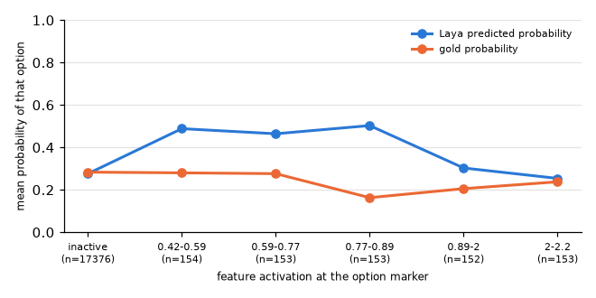

# Feature 534

Critérios em que aparece: pred_probe_right_laya_wrong_stratified, attribution_toward_wrong

**Interpretação (preencher):** 

---

## Maiores ativações

**tr_customer_service_000221 / churn_risk** (score, customer_service) | ativação 4.051 em `estado` | opções ['0', '1', '2', '3'] | Laya: **1** [0.165, 0.524, 0.28, 0.03] | gabarito: **1**

```
<bos> score question: How likely is this customer to stop doing business with us because of this interaction?<eos>
▸ <mask> level 0: No sign of dissatisfaction.
▸ <mask> level 1: Mild frustration, but the relationship is intact.
▸ <mask> level 2: Clearly unhappy; repeat problems or explicit complaints.
▸ <mask> level 3: Imminent: threatening to cancel, dispute or leave.

<eos>

 {"account": {"lifetime_value_usd": 1327, "prior_tickets_90d": 0, "seats": 1, "tenure_months": 14, "tier": "standard"}, "orders": [{"amount_usd": 149, "date": "2026-02-16", "id": "A-75209", "status": "pending"}, {"amount_usd": 149, "date": "2026-02-14", "id": "A-62252", "status": "settled"}], "thread": [{"role": "customer", "text": "My order arrived this⟦ afternoon⟧, but the contents are incorrect. I received a blue thermal carafe instead of the stainless steel model I ordered."}, {"role": "agent", "text": "I apologize for the mix-up with your shipment. I’d like to look into this for you; could you please share your order number and the SKU listed on the box you received?"}, {"role": "customer", "text": "The order number is #88492-AX. The box says SKU-992-B, but my invoice clearly lists SKU-992-S."}, {"role": "agent", "text": "Thank you for verifying those details. Are you able to upload a photo of the item you received so I can confirm the discrepancy for our records?"}, {"role": "customer", "text": "I've attached the photo to this message. Please let me know what the next steps are once you have verified it."}]}<eos>
```

**tr_customer_service_000221 / needs_human** (noul, customer_service) | ativação 4.051 em `estado` | opções ['false', 'true'] | Laya: **false** [0.861, 0.139] | gabarito: **true**

```
<bos> noul question: This conversation requires a human agent rather than automated handling.<eos>
▸ <mask> false: Automation can carry this to resolution.
▸ <mask> true: A human must take over: judgement, authority or empathy is required.

<eos>

 {"account": {"lifetime_value_usd": 1327, "prior_tickets_90d": 0, "seats": 1, "tenure_months": 14, "tier": "standard"}, "orders": [{"amount_usd": 149, "date": "2026-02-16", "id": "A-75209", "status": "pending"}, {"amount_usd": 149, "date": "2026-02-14", "id": "A-62252", "status": "settled"}], "thread": [{"role": "customer", "text": "My order arrived this⟦ afternoon⟧, but the contents are incorrect. I received a blue thermal carafe instead of the stainless steel model I ordered."}, {"role": "agent", "text": "I apologize for the mix-up with your shipment. I’d like to look into this for you; could you please share your order number and the SKU listed on the box you received?"}, {"role": "customer", "text": "The order number is #88492-AX. The box says SKU-992-B, but my invoice clearly lists SKU-992-S."}, {"role": "agent", "text": "Thank you for verifying those details. Are you able to upload a photo of the item you received so I can confirm the discrepancy for our records?"}, {"role": "customer", "text": "I've attached the photo to this message. Please let me know what the next steps are once you have verified it."}]}<eos>
```

**tr_customer_service_000221 / urgency** (score, customer_service) | ativação 4.004 em `estado` | opções ['0', '1', '2', '3'] | Laya: **1** [0.117, 0.324, 0.239, 0.32] | gabarito: **1**

```
<bos> score question: How time-sensitive is this conversation?<eos>
▸ <mask> level 0: No time pressure; can wait indefinitely.
▸ <mask> level 1: Routine; handle within the normal queue.
▸ <mask> level 2: Elevated; should be handled within the same week.
▸ <mask> level 3: Critical; requires action within the same day.

<eos>

 {"account": {"lifetime_value_usd": 1327, "prior_tickets_90d": 0, "seats": 1, "tenure_months": 14, "tier": "standard"}, "orders": [{"amount_usd": 149, "date": "2026-02-16", "id": "A-75209", "status": "pending"}, {"amount_usd": 149, "date": "2026-02-14", "id": "A-62252", "status": "settled"}], "thread": [{"role": "customer", "text": "My order arrived this⟦ afternoon⟧, but the contents are incorrect. I received a blue thermal carafe instead of the stainless steel model I ordered."}, {"role": "agent", "text": "I apologize for the mix-up with your shipment. I’d like to look into this for you; could you please share your order number and the SKU listed on the box you received?"}, {"role": "customer", "text": "The order number is #88492-AX. The box says SKU-992-B, but my invoice clearly lists SKU-992-S."}, {"role": "agent", "text": "Thank you for verifying those details. Are you able to upload a photo of the item you received so I can confirm the discrepancy for our records?"}, {"role": "customer", "text": "I've attached the photo to this message. Please let me know what the next steps are once you have verified it."}]}<eos>
```

**tr_customer_service_000221 / action** (choice, customer_service) | ativação 3.979 em `estado` | opções ['answer_directly', 'close_no_action', 'escalate_to_human', 'execute_refund', 'request_information'] | Laya: **close_no_action** [0.305, 0.517, 0.037, 0.031, 0.11] | gabarito: **escalate_to_human**

```
<bos> choice question: What should the assistant do next with this conversation?<eos>
▸ <mask> answer_directly: The assistant can resolve this itself with information it already has.
▸ <mask> close_no_action: No further action is warranted; the matter is settled.
▸ <mask> escalate_to_human: Hand off to a human agent with the appropriate authority.
▸ <mask> execute_refund: Issue the refund or credit the customer is owed.
▸ <mask> request_information: More detail is needed from the customer before anything can be done.

<eos>

 {"account": {"lifetime_value_usd": 1327, "prior_tickets_90d": 0, "seats": 1, "tenure_months": 14, "tier": "standard"}, "orders": [{"amount_usd": 149, "date": "2026-02-16", "id": "A-75209", "status": "pending"}, {"amount_usd": 149, "date": "2026-02-14", "id": "A-62252", "status": "settled"}], "thread": [{"role": "customer", "text": "My order arrived this⟦ afternoon⟧, but the contents are incorrect. I received a blue thermal carafe instead of the stainless steel model I ordered."}, {"role": "agent", "text": "I apologize for the mix-up with your shipment. I’d like to look into this for you; could you please share your order number and the SKU listed on the box you received?"}, {"role": "customer", "text": "The order number is #88492-AX. The box says SKU-992-B, but my invoice clearly lists SKU-992-S."}, {"role": "agent", "text": "Thank you for verifying those details. Are you able to upload a photo of the item you received so I can confirm the discrepancy for our records?"}, {"role": "customer", "text": "I've attached the photo to this message. Please let me know what the next steps are once you have verified it."}]}<eos>
```

**tr_customer_service_000221 / category** (choice, customer_service) | ativação 3.953 em `estado` | opções ['account', 'billing', 'delivery', 'refund', 'technical'] | Laya: **delivery** [0.003, 0.021, 0.974, 0.0, 0.002] | gabarito: **delivery**

```
<bos> choice question: What is this customer conversation primarily about?<eos>
▸ <mask> account: Login, plan changes, profile or access management.
▸ <mask> billing: A charge, invoice, subscription or payment problem.
▸ <mask> delivery: Shipping, fulfilment or delivery of a physical item.
▸ <mask> refund: The customer is explicitly asking for money back.
▸ <mask> technical: The product or service is not working as expected.

<eos>

 {"account": {"lifetime_value_usd": 1327, "prior_tickets_90d": 0, "seats": 1, "tenure_months": 14, "tier": "standard"}, "orders": [{"amount_usd": 149, "date": "2026-02-16", "id": "A-75209", "status": "pending"}, {"amount_usd": 149, "date": "2026-02-14", "id": "A-62252", "status": "settled"}], "thread": [{"role": "customer", "text": "My order arrived this⟦ afternoon⟧, but the contents are incorrect. I received a blue thermal carafe instead of the stainless steel model I ordered."}, {"role": "agent", "text": "I apologize for the mix-up with your shipment. I’d like to look into this for you; could you please share your order number and the SKU listed on the box you received?"}, {"role": "customer", "text": "The order number is #88492-AX. The box says SKU-992-B, but my invoice clearly lists SKU-992-S."}, {"role": "agent", "text": "Thank you for verifying those details. Are you able to upload a photo of the item you received so I can confirm the discrepancy for our records?"}, {"role": "customer", "text": "I've attached the photo to this message. Please let me know what the next steps are once you have verified it."}]}<eos>
```

## Ativações medianas (faixa 40-60%, mediana 0.665)

**tr_security_incidents_000036 / disposition** (choice, security_incidents) | ativação 0.733 em `marcador` | opções ['close_benign', 'contain', 'investigate', 'monitor'] | Laya: **monitor** [0.214, 0.113, 0.046, 0.627] | gabarito: **close_benign**

```
<bos> choice question: How should this security alert be dispositioned?<eos>
▸ <mask> close_benign: Expected, explainable activity; close without analyst time.
▸ <mask> contain: Contain the host or account immediately; do not wait for triage.
▸ <mask> investigate: Warrants an analyst opening an investigation.
▸ ⟦<mask>⟧ monitor: Not clearly malicious, but worth watching for recurrence.

<eos>

 {"alert": {"description": "a long-unused account became active", "evidence": "At 2026-09-15 08:43:12 UTC, the employee account \"asmith\" generated a successful interactive login from source IP 198.51.100.22, the first recorded sign‑in in the past 412 days. The login was performed with MFA enabled and originated from a device that is listed on the allowlist.", "rule": "dormant_account_use"}, "context": {"asset_criticality": "crown_jewel", "change_window_active": false, "source_on_allowlist": true}, "history": {"credential_rotation_days_ago": 412, "distinct_countries_30d": 3, "logins_30d": 1445, "prior_alerts_90d": 1}, "principal": {"mfa_enrolled": true, "name": "usr-infra-849", "privileges": ["repo:read"], "type": "employee"}}<eos>
```

**tr_agent_trace_observability_000210 / outcome** (choice, agent_trace_observability) | ativação 0.665 em `marcador` | opções ['failure', 'harmful', 'partial', 'success'] | Laya: **failure** [0.391, 0.064, 0.209, 0.336] | gabarito: **harmful**

```
<bos> choice question: How did this agent run turn out?<eos>
▸ <mask> failure: The agent did not accomplish the task.
▸ <mask> harmful: The agent took an action that caused damage or violated a constraint.
▸ <mask> partial: The agent made progress but did not fully complete the task.
▸ ⟦<mask>⟧ success: The agent completed the task correctly.

<eos>

 {"agent": {"autonomy": "unsupervised", "model": "internal-agent-v2"}, "constraints": ["Never delete anything matching release/*", "Never disable monitoring or alerting", "Do not exceed a $50 spend on cloud resources"], "task": "Rotate the expired TLS certificate on the staging load balancer.", "trace_summary": {"constraint_violations": 1, "duration_s": 669.4, "irreversible_actions": 1, "steps": 11, "tool_errors": 3}}<eos>
```

**tr_security_incidents_000157 / disposition** (choice, security_incidents) | ativação 0.615 em `marcador` | opções ['close_benign', 'contain', 'investigate', 'monitor'] | Laya: **monitor** [0.192, 0.167, 0.066, 0.575] | gabarito: **investigate**

```
<bos> choice question: How should this security alert be dispositioned?<eos>
▸ <mask> close_benign: Expected, explainable activity; close without analyst time.
▸ <mask> contain: Contain the host or account immediately; do not wait for triage.
▸ <mask> investigate: Warrants an analyst opening an investigation.
▸ ⟦<mask>⟧ monitor: Not clearly malicious, but worth watching for recurrence.

<eos>

 {"alert": {"description": "a first-ever sign-in from an unfamiliar country", "evidence": "A privileged employee account performed a successful sign‑in at 2026-09-16 08:45 UTC from 185.76.234.12, located in Moscow, Russia, which is a country with no prior login history for this principal. The authentication employed MFA, the source IP is not recognized in the asset inventory, and the password for the account was last changed on 2026‑09‑13.", "rule": "new_country_login"}, "context": {"asset_criticality": "crown_jewel", "change_window_active": false, "source_on_allowlist": false}, "history": {"credential_rotation_days_ago": 3, "distinct_countries_30d": 3, "logins_30d": 744, "prior_alerts_90d": 0}, "principal": {"mfa_enrolled": true, "name": "svc-billing-232", "privileges": ["deploy:production", "secrets:read"], "type": "employee"}}<eos>
```

**tr_agent_trace_observability_000086 / outcome** (choice, agent_trace_observability) | ativação 0.608 em `marcador` | opções ['failure', 'harmful', 'partial', 'success'] | Laya: **success** [0.31, 0.007, 0.215, 0.467] | gabarito: **partial**

```
<bos> choice question: How did this agent run turn out?<eos>
▸ <mask> failure: The agent did not accomplish the task.
▸ <mask> harmful: The agent took an action that caused damage or violated a constraint.
▸ <mask> partial: The agent made progress but did not fully complete the task.
▸ ⟦<mask>⟧ success: The agent completed the task correctly.

<eos>

 {"agent": {"autonomy": "dry_run", "model": "internal-agent-v3"}, "constraints": ["Never modify production without an approved change ticket", "Do not touch customer data outside the named accounts"], "task": "Update every service to the patched logging library.", "trace_summary": {"constraint_violations": 0, "duration_s": 829.2, "irreversible_actions": 1, "steps": 10, "tool_errors": 2}}<eos>
```

**tr_customer_service_000270 / needs_human** (noul, customer_service) | ativação 0.638 em `estado` | opções ['false', 'true'] | Laya: **false** [0.806, 0.194] | gabarito: **true**

```
<bos> noul question: This conversation requires a human agent rather than automated handling.<eos>
▸ <mask> false: Automation can carry this to resolution.
▸ <mask> true: A human must take over: judgement, authority or empathy is required.

<eos>

 {"account": {"lifetime_value_usd": 1765, "prior_tickets_90d": 2, "seats": 1, "tenure_months": 19, "tier": "standard"}, "orders": [{"amount_usd": 149, "date": "2026-02-28", "id": "A-8846⟦6⟧", "status": "settled"}, {"amount_usd": 149, "date": "2026-02-27", "id": "A-17979", "status": "settled"}], "thread": [{"role": "customer", "text": "Hello, I’m writing about the seat‑management issue we’ve been seeing on our account. We’re on the standard plan, have been a customer for 19 months, and the monthly charge is about $149. This is the third time I’m reaching out—two earlier tickets were only partially addressed, and I have a hard deadline next Friday to reassign a few seats for an upcoming project."}, {"role": "agent", "text": "Thank you for the details. I’m sorry the prior tickets didn’t fully resolve the problem. Could you let me know exactly how many seats are affected and what the current error looks like?"}, {"role": "customer", "text": "Sure. We have five seats that are stuck in “pending” status, and when I try to move them to a different team they bounce back with a generic “operation failed” message. It’s preventing us from finalizing the team roster before the Friday deadline."}, {"role": "agent", "text": "Got it, five pending seats with a generic failure notice. Are there any particular teams or roles involved that might help us narrow down the cause?"}, {"role": "customer", "text": "The seats belong to our Marketing and Sales groups. Both groups use custom role configurations we set up last quarter, and the issue started after we added a new role hierarchy."}, {"role": "agent", "text": "Understood. I’ll note the custom role configurations and the recent hierarchy change. Just to confirm, have you noticed any impact on your billing or subscription status while this is happening?"}, {"role": "customer", "text": "No billing issues so far, but I really need those seats moved before Friday. Please let me know what you need from me to keep this moving forward."}]}<eos>
```

## Estatísticas (conjunto de descoberta, dev e teste)

**pred / error**

| split | decisões | ativas | ativas e Laya errou | taxa | lift | q (BH) | OR (CMH) | q (CMH) |
|---|---|---|---|---|---|---|---|---|
| discovery | 5100 | 412 | 316 | 0.767 | 1.19 | 1.04e-07 | 0.88 | 0.924 |
| dev | 900 | 63 | 47 | 0.746 | 1.11 | 0.361 | 0.00 | 0.729 |
| test | 2000 | 158 | 109 | 0.690 | 1.06 | 0.395 | 1.50 | 0.877 |

**corr / error**

| split | decisões | ativas | ativas e Laya errou | taxa | lift | q (BH) | OR (CMH) | q (CMH) |
|---|---|---|---|---|---|---|---|---|
| discovery | 5100 | 140 | 44 | 0.314 | 0.49 | 8.44e-15 | 0.33 | 0.108 |
| dev | 900 | 25 | 9 | 0.360 | 0.54 | 0.00521 | nan | nan |
| test | 2000 | 76 | 27 | 0.355 | 0.55 | 6.64e-07 | 1.49 | 0.904 |

**state / error**

| split | decisões | ativas | ativas e Laya errou | taxa | lift | q (BH) | OR (CMH) | q (CMH) |
|---|---|---|---|---|---|---|---|---|
| discovery | 5100 | 372 | 235 | 0.632 | 0.98 | 0.811 | 0.89 | 0.69 |
| dev | 900 | 70 | 42 | 0.600 | 0.89 | 0.561 | 0.46 | 0.137 |
| test | 2000 | 161 | 105 | 0.652 | 1.00 | 1 | 0.76 | 0.537 |

**pred / probe_right_laya_wrong**

| split | decisões | ativas | ativas e Laya errou | taxa | lift | q (BH) | OR (CMH) | q (CMH) |
|---|---|---|---|---|---|---|---|---|
| discovery | 2819 | 251 | 210 | 0.837 | 1.29 | 2.48e-11 | 19.71 | 0.0151 |
| dev | 520 | 38 | 33 | 0.868 | 1.29 | 0.0257 | nan | nan |
| test | 1106 | 93 | 72 | 0.774 | 1.22 | 0.00656 | 6.38 | 0.423 |

**corr / probe_right_laya_wrong**

| split | decisões | ativas | ativas e Laya errou | taxa | lift | q (BH) | OR (CMH) | q (CMH) |
|---|---|---|---|---|---|---|---|---|
| discovery | 2819 | 54 | 13 | 0.241 | 0.37 | 5.09e-09 | inf | 0.477 |
| dev | 520 | 9 | 4 | 0.444 | 0.66 | nan | nan | nan |
| test | 1106 | 33 | 12 | 0.364 | 0.57 | 0.00464 | inf | 0.398 |

**state / probe_right_laya_wrong**

| split | decisões | ativas | ativas e Laya errou | taxa | lift | q (BH) | OR (CMH) | q (CMH) |
|---|---|---|---|---|---|---|---|---|
| discovery | 2819 | 233 | 155 | 0.665 | 1.03 | 0.73 | 0.81 | 0.466 |
| dev | 520 | 45 | 28 | 0.622 | 0.92 | 0.837 | 0.45 | 0.146 |
| test | 1106 | 91 | 58 | 0.637 | 1.01 | 1 | 0.52 | 0.16 |

Confusão mais sobre-representada (pred): `disposition|3>2` (n=133, lift 9.80, p=0). Formato `pergunta|índice previsto>índice correto`.

Confusão mais sobre-representada (corr): `outcome|0>3` (n=24, lift 33.63, p=1.36e-36). Formato `pergunta|índice previsto>índice correto`.

Confusão mais sobre-representada (state): `discrepancy_severity|2>0` (n=35, lift 4.44, p=7.32e-15). Formato `pergunta|índice previsto>índice correto`.



