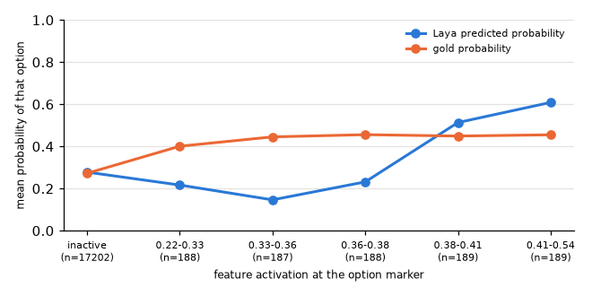

# Feature 768

Critérios em que aparece: corr_error_stratified, corr_probe_right_laya_wrong_stratified

**Interpretação (preencher):** 

---

## Maiores ativações

**tr_security_incidents_000155 / true_positive** (noul, security_incidents) | ativação 2.637 em `estado` | opções ['false', 'true'] | Laya: **true** [0.357, 0.643] | gabarito: **true**

```
<bos> noul question: This alert reflects genuinely malicious or unauthorised activity.<eos>
▸ <mask> false: Benign activity, a misconfiguration, or a known false positive.
▸ <mask> true: The underlying behaviour is malicious or unauthorised.

<eos>

 {"alert": {"description": "a security group was opened to the public internet", "evidence": "An administrative user updated the security group 'sg-0a1b2c3d' to permit ingress traffic on all ports from the 0.0.0.0/0 CID⟦R⟧ block. The modification was performed at 10:05 UTC from an unrecognized network origin during an active change window.", "rule": "config_drift"}, "context": {"asset_criticality": "low", "change_window_active": true, "source_on_allowlist": false}, "history": {"credential_rotation_days_ago": 180, "distinct_countries_30d": 1, "logins_30d": 1475, "prior_alerts_90d": 0}, "principal": {"mfa_enrolled": true, "name": "svc-billing-961", "privileges": ["deploy:production", "secrets:read"], "type": "admin"}}<eos>
```

**tr_customer_service_000232 / churn_risk** (score, customer_service) | ativação 2.557 em `estado` | opções ['0', '1', '2', '3'] | Laya: **2** [0.054, 0.212, 0.68, 0.054] | gabarito: **2**

```
<bos> score question: How likely is this customer to stop doing business with us because of this interaction?<eos>
▸ <mask> level 0: No sign of dissatisfaction.
▸ <mask> level 1: Mild frustration, but the relationship is intact.
▸ <mask> level 2: Clearly unhappy; repeat problems or explicit complaints.
▸ <mask> level 3: Imminent: threatening to cancel, dispute or leave.

<eos>

 {"account": {"lifetime_value_usd": 186, "prior_tickets_90d": 0, "seats": 5, "tenure_months": 3, "tier": "premium"}, "orders": [{"amount_usd": 2997, "date": "2026-01-02", "id": "A-95746", "status": "refunded"}, {"amount_usd": 2997, "date": "2026-03-02", "id": "A-16068", "status": "settled"}], "thread": [{"role": "customer", "text": "I'm looking at my dashboard and everything is grayed out, it says I'm on a trial but I've been a Premium member for three months? I don't understand why it would change now, especially since I have a massive project deadline tomorrow and I need my tools."}, {"role": "agent", "text": "I can certainly look into your subscription status for you. To get started, could you please confirm the email address associated with your $2997 annual Premium plan?"}, {"role": "customer", "text": "It's the same email I'm using for this chat, but I'm just so confused because my bank shows the payment went through months ago. Why would the system suddenly think I'm not a customer anymore?"}, {"role": "agent", "text": "Thank you for that information. I am reviewing your account history now. Have you recently made any changes to your team settings or tried to link a secondary account to this workspace?"}, {"role": "customer", "text": "I haven't touched the settings at all, I just logged in to finish my work and saw the 'downgraded' notification at the top. I'm really worried because I have to submit this work by 8 AM tomorrow and I can't even export my files right now."}, {"role": "agent", "text": "I appreciate you clarifying that. To help me narrow this down, could you tell me if you are seeing any specific error codes when you try to click on the export button?"}, {"role": "customer", "text": "There aren't any codes, it just opens a pop-up telling me to 'Upgrade⟦ to⟧ Premium' to use that feature, which makes no sense at all since I'm already paying. Can someone please figure out why the system isn't recognizing my plan before I lose my window to finish this?"}]}<eos>
```

**tr_security_incidents_000155 / disposition** (choice, security_incidents) | ativação 2.553 em `estado` | opções ['close_benign', 'contain', 'investigate', 'monitor'] | Laya: **monitor** [0.219, 0.364, 0.035, 0.382] | gabarito: **investigate**

```
<bos> choice question: How should this security alert be dispositioned?<eos>
▸ <mask> close_benign: Expected, explainable activity; close without analyst time.
▸ <mask> contain: Contain the host or account immediately; do not wait for triage.
▸ <mask> investigate: Warrants an analyst opening an investigation.
▸ <mask> monitor: Not clearly malicious, but worth watching for recurrence.

<eos>

 {"alert": {"description": "a security group was opened to the public internet", "evidence": "An administrative user updated the security group 'sg-0a1b2c3d' to permit ingress traffic on all ports from the 0.0.0.0/0 CID⟦R⟧ block. The modification was performed at 10:05 UTC from an unrecognized network origin during an active change window.", "rule": "config_drift"}, "context": {"asset_criticality": "low", "change_window_active": true, "source_on_allowlist": false}, "history": {"credential_rotation_days_ago": 180, "distinct_countries_30d": 1, "logins_30d": 1475, "prior_alerts_90d": 0}, "principal": {"mfa_enrolled": true, "name": "svc-billing-961", "privileges": ["deploy:production", "secrets:read"], "type": "admin"}}<eos>
```

**tr_security_incidents_000155 / urgency** (score, security_incidents) | ativação 2.535 em `estado` | opções ['0', '1', '2', '3'] | Laya: **1** [0.071, 0.521, 0.18, 0.228] | gabarito: **2**

```
<bos> score question: How quickly must a responder act on this alert?<eos>
▸ <mask> level 0: No time pressure; can wait indefinitely.
▸ <mask> level 1: Routine; handle within the normal queue.
▸ <mask> level 2: Elevated; should be handled within the same week.
▸ <mask> level 3: Critical; requires action within the same day.

<eos>

 {"alert": {"description": "a security group was opened to the public internet", "evidence": "An administrative user updated the security group 'sg-0a1b2c3d' to permit ingress traffic on all ports from the 0.0.0.0/0 CID⟦R⟧ block. The modification was performed at 10:05 UTC from an unrecognized network origin during an active change window.", "rule": "config_drift"}, "context": {"asset_criticality": "low", "change_window_active": true, "source_on_allowlist": false}, "history": {"credential_rotation_days_ago": 180, "distinct_countries_30d": 1, "logins_30d": 1475, "prior_alerts_90d": 0}, "principal": {"mfa_enrolled": true, "name": "svc-billing-961", "privileges": ["deploy:production", "secrets:read"], "type": "admin"}}<eos>
```

**tr_security_incidents_000155 / credential_compromise** (noul, security_incidents) | ativação 2.523 em `estado` | opções ['false', 'true'] | Laya: **false** [0.641, 0.359] | gabarito: **false**

```
<bos> noul question: The evidence indicates a credential or account has been compromised.<eos>
▸ <mask> false: no, the statement does not hold
▸ <mask> true: yes, the statement holds

<eos>

 {"alert": {"description": "a security group was opened to the public internet", "evidence": "An administrative user updated the security group 'sg-0a1b2c3d' to permit ingress traffic on all ports from the 0.0.0.0/0 CID⟦R⟧ block. The modification was performed at 10:05 UTC from an unrecognized network origin during an active change window.", "rule": "config_drift"}, "context": {"asset_criticality": "low", "change_window_active": true, "source_on_allowlist": false}, "history": {"credential_rotation_days_ago": 180, "distinct_countries_30d": 1, "logins_30d": 1475, "prior_alerts_90d": 0}, "principal": {"mfa_enrolled": true, "name": "svc-billing-961", "privileges": ["deploy:production", "secrets:read"], "type": "admin"}}<eos>
```

## Ativações medianas (faixa 40-60%, mediana 0.415)

**tr_security_incidents_000062 / disposition** (choice, security_incidents) | ativação 0.397 em `opção` | opções ['close_benign', 'contain', 'investigate', 'monitor'] | Laya: **investigate** [0.022, 0.062, 0.539, 0.377] | gabarito: **close_benign**

```
<bos> choice question: How should this security alert be dispositioned?<eos>
▸ <mask> close_benign: Expected, explainable activity; close without analyst time.
▸ <mask> contain: Contain the host or account immediately; do not wait for triage⟦.⟧
▸ <mask> investigate: Warrants an analyst opening an investigation.
▸ <mask> monitor: Not clearly malicious, but worth watching for recurrence.

<eos>

 {"alert": {"description": "an endpoint agent matched a known signature", "evidence": "At 2026-09-13 08:27:55 UTC the endpoint agent on host WIN-5F7A3B9C flagged the file C:\\Windows\\Temp\\malicious.exe as matching malware signature \"EICAR-Test-File\". The detection was associated with user \"admin_jdoe\" (admin role, unprivileged access) who has MFA enabled and whose credentials were last rotated 180 days ago. The source of the file could not be correlated to any known trusted location.", "rule": "malware_signature"}, "context": {"asset_criticality": "low", "change_window_active": false, "source_on_allowlist": false}, "history": {"credential_rotation_days_ago": 180, "distinct_countries_30d": 2, "logins_30d": 1336, "prior_alerts_90d": 3}, "principal": {"mfa_enrolled": true, "name": "svc-analytics-924", "privileges": ["repo:read"], "type": "admin"}}<eos>
```

**tr_invoice_processing_000192 / disposition** (choice, invoice_processing) | ativação 0.428 em `opção` | opções ['approve', 'hold', 'manual_review', 'reject'] | Laya: **reject** [0.433, 0.111, 0.019, 0.438] | gabarito: **approve**

```
<bos> choice question: How should this vendor invoice be dispositioned?<eos>
▸ <mask> approve: Matches the order and delivery; approve for payment⟦.⟧
▸ <mask> hold: Something needs confirming before payment; hold pending clarification.
▸ <mask> manual_review: A human in finance must review the discrepancy.
▸ <mask> reject: Should not be paid: duplicate, unauthorised or materially wrong.

<eos>

 {"delivery": {"condition": "accepted with exceptions", "date": "2026-03-15", "received_qty": 100}, "invoice": {"currency": "USD", "id": "INV-2026-3889", "lines": [{"qty": 100, "sku": "SKU-203", "total_usd": 15547.0, "unit_usd": 155.47}], "total_usd": 15547.0, "vendor": "Vantage Materials"}, "payment": {"days_until_due": 44, "discount_expires_in_days": null, "early_payment_discount_pct": null, "status": "scheduled", "terms": "net 60"}, "purchase_order": {"freight_terms": "freight prepaid by vendor, not separately billable", "id": "PO-3301", "lines": [{"qty": 100, "unit_usd": 155.47}], "total_usd": 15547.0}, "vendor_history": {"disputes_12m": 2, "invoices_12m": 14, "prior_invoice_ids": ["INV-2026-3889", "INV-2026-9651", "INV-2026-8012", "INV-2026-5534"]}}<eos>
```

**tr_agent_trace_observability_000090 / needs_review** (noul, agent_trace_observability) | ativação 0.462 em `marcador` | opções ['false', 'true'] | Laya: **false** [0.909, 0.091] | gabarito: **false**

```
<bos> noul question: This trace requires human review.<eos>
▸ ⟦<mask>⟧ false: No human attention is warranted.
▸ <mask> true: A human should inspect this run.

<eos>

 {"agent": {"autonomy": "unsupervised", "model": "internal-agent-v3"}, "constraints": ["Never disable monitoring or alerting", "Do not touch customer data outside the named accounts"], "task": "Provision a read replica for the reporting database.", "trace_summary": {"constraint_violations": 0, "duration_s": 631.7, "irreversible_actions": 0, "steps": 10, "tool_errors": 3}}<eos>
```

**tr_customer_service_000111 / category** (choice, customer_service) | ativação 0.399 em `estado` | opções ['account', 'billing', 'delivery', 'refund', 'technical'] | Laya: **account** [0.984, 0.002, 0.0, 0.001, 0.013] | gabarito: **account**

```
<bos> choice question: What is this customer conversation primarily about?<eos>
▸ <mask> account: Login, plan changes, profile or access management.
▸ <mask> billing: A charge, invoice, subscription or payment problem.
▸ <mask> delivery: Shipping, fulfilment or delivery of a physical item.
▸ <mask> refund: The customer is explicitly asking for money back.
▸ <mask> technical: The product or service is not working as expected.

<eos>

 {"account": {"lifetime_value_usd": 181, "prior_tickets_90d": 0, "seats": 1, "tenure_months": 2, "tier": "free"}, "thread": [{"role": "customer", "text": "We have to add three more seats to our team right now⟦,⟧ or we can't meet our client deadline tomorrow. If this isn't sorted immediately, we'll have to look for another service."}, {"role": "agent", "text": "Got it. Can you provide the account ID and let me know which usernames need the new seats?"}, {"role": "customer", "text": "We're on the free plan, account ID 98765. Please tell me what I need to do to get those seats added before 5 pm today."}]}<eos>
```

**tr_invoice_processing_000022 / urgency** (score, invoice_processing) | ativação 0.398 em `estado` | opções ['0', '1', '2', '3'] | Laya: **1** [0.088, 0.471, 0.288, 0.154] | gabarito: **1**

```
<bos> score question: How time-sensitive is processing this invoice?<eos>
▸ <mask> level 0: No time pressure; can wait indefinitely.
▸ <mask> level 1: Routine; handle within the normal queue.
▸ <mask> level 2: Elevated; should be handled within the same week.
▸ <mask> level 3: Critical; requires action within the same day.

<eos>

 {"delivery": {"condition": "accepted with exceptions", "date": "2026-03-26", "received_qty": 100}, "invoice": {"currency": "USD", "id": "INV-2026-5675", "lines": [{"qty": 100, "sku": "SKU-963", "total_usd": 36305.0, "unit_usd": 363.05}], "total_usd": 36305.0, "vendor": "Orbit Logistics"}, "payment": {"days_until_due": 0, "discount_expires_in_days": null, "early_payment_discount_pct": null, "status": "scheduled", "terms": "net 30"}, "purchase_order": {"freight_terms": "freight prepaid by vendor, not separately billable", "id": null, "lines": [{"qty": 100, "unit_usd": 363.05}], "total_usd": 36305.0}, "vendor_history": {"disputes⟦_⟧12m": 2, "invoices_12m": 56, "prior_invoice_ids": ["INV-2026-1608", "INV-2026-9071", "INV-2026-7901", "INV-2026-3913"]}}<eos>
```

## Estatísticas (conjunto de descoberta, dev e teste)

**pred / error**

| split | decisões | ativas | ativas e Laya errou | taxa | lift | q (BH) | OR (CMH) | q (CMH) |
|---|---|---|---|---|---|---|---|---|
| discovery | 5100 | 301 | 171 | 0.568 | 0.88 | 0.0113 | 1.49 | 0.753 |
| dev | 900 | 51 | 26 | 0.510 | 0.76 | 0.0505 | 0.75 | 0.931 |
| test | 2000 | 112 | 61 | 0.545 | 0.84 | 0.0371 | 0.68 | 0.964 |

**corr / error**

| split | decisões | ativas | ativas e Laya errou | taxa | lift | q (BH) | OR (CMH) | q (CMH) |
|---|---|---|---|---|---|---|---|---|
| discovery | 5100 | 389 | 259 | 0.666 | 1.03 | 0.424 | 2.11 | 1.58e-25 |
| dev | 900 | 82 | 57 | 0.695 | 1.03 | 0.84 | 2.28 | 3.66e-06 |
| test | 2000 | 154 | 103 | 0.669 | 1.03 | 0.739 | 2.28 | 2.28e-12 |

**state / error**

| split | decisões | ativas | ativas e Laya errou | taxa | lift | q (BH) | OR (CMH) | q (CMH) |
|---|---|---|---|---|---|---|---|---|
| discovery | 5100 | 3174 | 1924 | 0.606 | 0.94 | 2.26e-11 | 0.81 | 0.113 |
| dev | 900 | 554 | 359 | 0.648 | 0.96 | 0.298 | 0.76 | 0.634 |
| test | 2000 | 1261 | 787 | 0.624 | 0.96 | 0.0235 | 0.92 | 0.851 |

**pred / probe_right_laya_wrong**

| split | decisões | ativas | ativas e Laya errou | taxa | lift | q (BH) | OR (CMH) | q (CMH) |
|---|---|---|---|---|---|---|---|---|
| discovery | 2819 | 179 | 127 | 0.709 | 1.10 | 0.104 | 0.86 | 0.919 |
| dev | 520 | 35 | 23 | 0.657 | 0.97 | 1 | 1.50 | 0.899 |
| test | 1106 | 61 | 42 | 0.689 | 1.09 | 0.541 | 3.04 | 0.694 |

**corr / probe_right_laya_wrong**

| split | decisões | ativas | ativas e Laya errou | taxa | lift | q (BH) | OR (CMH) | q (CMH) |
|---|---|---|---|---|---|---|---|---|
| discovery | 2819 | 174 | 122 | 0.701 | 1.08 | 0.171 | 2.36 | 1.27e-19 |
| dev | 520 | 42 | 30 | 0.714 | 1.06 | 0.813 | 2.25 | 0.000384 |
| test | 1106 | 67 | 48 | 0.716 | 1.13 | 0.218 | 2.62 | 1.77e-09 |

**state / probe_right_laya_wrong**

| split | decisões | ativas | ativas e Laya errou | taxa | lift | q (BH) | OR (CMH) | q (CMH) |
|---|---|---|---|---|---|---|---|---|
| discovery | 2819 | 1862 | 1139 | 0.612 | 0.95 | 4.51e-07 | 0.98 | 0.985 |
| dev | 520 | 341 | 223 | 0.654 | 0.97 | 0.494 | 0.68 | 0.557 |
| test | 1106 | 756 | 464 | 0.614 | 0.97 | 0.186 | 1.07 | 0.885 |

Confusão mais sobre-representada (pred): `needs_human|0>1` (n=49, lift 15.37, p=0). Formato `pergunta|índice previsto>índice correto`.

Confusão mais sobre-representada (corr): `matches_order|1>0` (n=119, lift 13.11, p=0). Formato `pergunta|índice previsto>índice correto`.

Confusão mais sobre-representada (state): `duplicate|1>0` (n=207, lift 1.53, p=8.22e-32). Formato `pergunta|índice previsto>índice correto`.



