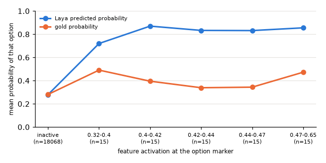

# Feature 871

Critérios em que aparece: pred_error_stratified, pred_probe_right_laya_wrong_stratified

**Interpretação (preencher):** 

---

## Maiores ativações

**tr_customer_service_000116 / churn_risk** (score, customer_service) | ativação 12.453 em `estado` | opções ['0', '1', '2', '3'] | Laya: **2** [0.024, 0.248, 0.686, 0.042] | gabarito: **2**

```
<bos> score question: How likely is this customer to stop doing business with us because of this interaction?<eos>
▸ <mask> level 0: No sign of dissatisfaction.
▸ <mask> level 1: Mild frustration, but the relationship is intact.
▸ <mask> level 2: Clearly unhappy; repeat problems or explicit complaints.
▸ <mask> level 3: Imminent: threatening to cancel, dispute or leave.

<eos>

 {"account": {"lifetime_value_usd": 720, "prior_tickets_90d": 2, "seats": 1, "tenure_months": 11, "tier": "standard"}, "orders": [{"amount_usd": 149, "date": "2026-03-09", "id": "A-35212", "status": "failed"}, {"amount_usd": 149, "date": "2026-01-13", "id": "A-58845", "status": "settled"}], "thread": [{"role": "customer", "text": "I just checked my statement and saw a charge for $149, which is completely unexpected! I've been on the standard plan for 11 months and it's never been this high before. Can you explain why this⟦ happened⟧?"}, {"role": "agent", "text": "I see the charge you're referring to. Could you please provide the billing date listed on that transaction so I can pull up the specific invoice details for you?"}, {"role": "customer", "text": "It’s dated for the 14th. This is the third time I’ve had to reach out about billing discrepancies, and I really need to get to the bottom of why these charges keep fluctuating."}]}<eos>
```

**tr_customer_service_000116 / needs_human** (noul, customer_service) | ativação 12.391 em `estado` | opções ['false', 'true'] | Laya: **false** [0.687, 0.313] | gabarito: **true**

```
<bos> noul question: This conversation requires a human agent rather than automated handling.<eos>
▸ <mask> false: Automation can carry this to resolution.
▸ <mask> true: A human must take over: judgement, authority or empathy is required.

<eos>

 {"account": {"lifetime_value_usd": 720, "prior_tickets_90d": 2, "seats": 1, "tenure_months": 11, "tier": "standard"}, "orders": [{"amount_usd": 149, "date": "2026-03-09", "id": "A-35212", "status": "failed"}, {"amount_usd": 149, "date": "2026-01-13", "id": "A-58845", "status": "settled"}], "thread": [{"role": "customer", "text": "I just checked my statement and saw a charge for $149, which is completely unexpected! I've been on the standard plan for 11 months and it's never been this high before. Can you explain why this⟦ happened⟧?"}, {"role": "agent", "text": "I see the charge you're referring to. Could you please provide the billing date listed on that transaction so I can pull up the specific invoice details for you?"}, {"role": "customer", "text": "It’s dated for the 14th. This is the third time I’ve had to reach out about billing discrepancies, and I really need to get to the bottom of why these charges keep fluctuating."}]}<eos>
```

**tr_customer_service_000116 / urgency** (score, customer_service) | ativação 12.375 em `estado` | opções ['0', '1', '2', '3'] | Laya: **3** [0.078, 0.206, 0.226, 0.49] | gabarito: **2**

```
<bos> score question: How time-sensitive is this conversation?<eos>
▸ <mask> level 0: No time pressure; can wait indefinitely.
▸ <mask> level 1: Routine; handle within the normal queue.
▸ <mask> level 2: Elevated; should be handled within the same week.
▸ <mask> level 3: Critical; requires action within the same day.

<eos>

 {"account": {"lifetime_value_usd": 720, "prior_tickets_90d": 2, "seats": 1, "tenure_months": 11, "tier": "standard"}, "orders": [{"amount_usd": 149, "date": "2026-03-09", "id": "A-35212", "status": "failed"}, {"amount_usd": 149, "date": "2026-01-13", "id": "A-58845", "status": "settled"}], "thread": [{"role": "customer", "text": "I just checked my statement and saw a charge for $149, which is completely unexpected! I've been on the standard plan for 11 months and it's never been this high before. Can you explain why this⟦ happened⟧?"}, {"role": "agent", "text": "I see the charge you're referring to. Could you please provide the billing date listed on that transaction so I can pull up the specific invoice details for you?"}, {"role": "customer", "text": "It’s dated for the 14th. This is the third time I’ve had to reach out about billing discrepancies, and I really need to get to the bottom of why these charges keep fluctuating."}]}<eos>
```

**tr_customer_service_000114 / needs_human** (noul, customer_service) | ativação 12.344 em `estado` | opções ['false', 'true'] | Laya: **false** [0.688, 0.312] | gabarito: **true**

```
<bos> noul question: This conversation requires a human agent rather than automated handling.<eos>
▸ <mask> false: Automation can carry this to resolution.
▸ <mask> true: A human must take over: judgement, authority or empathy is required.

<eos>

 {"account": {"lifetime_value_usd": 483, "prior_tickets_90d": 2, "seats": 1, "tenure_months": 11, "tier": "standard"}, "orders": [{"amount_usd": 18, "date": "2026-02-08", "id": "A-56150", "status": "settled"}, {"amount_usd": 18, "date": "2026-03-21", "id": "A-45857", "status": "settled"}], "thread": [{"role": "customer", "text": "The PDF export tool is failing to generate files again. I've been on the standard plan for 11 months now and this is the third time this specific feature has stopped working for me."}, {"role": "agent", "text": "I see that you've encountered issues with the PDF export previously. To help me triage this, could you let me know if you are seeing a specific error code when the generation fails?"}, {"role": "customer", "text": "There isn't an error code; the loading bar just hangs at 15% and then the browser times out. I'm paying about $18 a month for this and it's frustrating that a feature that was previously fixed has broken again."}, {"role": "agent", "text": "That sounds like a persistent hang in the rendering process. Does this happen with all of your documents, or is it only occurring with files that contain large images?"}, {"role": "customer", "text": "It's happening even with simple text-only documents. This is exactly what⟦ happened⟧ the last two times I reported this, so it seems like the old bug has returned."}]}<eos>
```

**tr_customer_service_000114 / urgency** (score, customer_service) | ativação 12.344 em `estado` | opções ['0', '1', '2', '3'] | Laya: **1** [0.058, 0.68, 0.096, 0.166] | gabarito: **2**

```
<bos> score question: How time-sensitive is this conversation?<eos>
▸ <mask> level 0: No time pressure; can wait indefinitely.
▸ <mask> level 1: Routine; handle within the normal queue.
▸ <mask> level 2: Elevated; should be handled within the same week.
▸ <mask> level 3: Critical; requires action within the same day.

<eos>

 {"account": {"lifetime_value_usd": 483, "prior_tickets_90d": 2, "seats": 1, "tenure_months": 11, "tier": "standard"}, "orders": [{"amount_usd": 18, "date": "2026-02-08", "id": "A-56150", "status": "settled"}, {"amount_usd": 18, "date": "2026-03-21", "id": "A-45857", "status": "settled"}], "thread": [{"role": "customer", "text": "The PDF export tool is failing to generate files again. I've been on the standard plan for 11 months now and this is the third time this specific feature has stopped working for me."}, {"role": "agent", "text": "I see that you've encountered issues with the PDF export previously. To help me triage this, could you let me know if you are seeing a specific error code when the generation fails?"}, {"role": "customer", "text": "There isn't an error code; the loading bar just hangs at 15% and then the browser times out. I'm paying about $18 a month for this and it's frustrating that a feature that was previously fixed has broken again."}, {"role": "agent", "text": "That sounds like a persistent hang in the rendering process. Does this happen with all of your documents, or is it only occurring with files that contain large images?"}, {"role": "customer", "text": "It's happening even with simple text-only documents. This is exactly what⟦ happened⟧ the last two times I reported this, so it seems like the old bug has returned."}]}<eos>
```

## Ativações medianas (faixa 40-60%, mediana 1.368)

**tr_security_incidents_000247 / disposition** (choice, security_incidents) | ativação 1.409 em `estado` | opções ['close_benign', 'contain', 'investigate', 'monitor'] | Laya: **investigate** [0.0, 0.001, 0.963, 0.036] | gabarito: **investigate**

```
<bos> choice question: How should this security alert be dispositioned?<eos>
▸ <mask> close_benign: Expected, explainable activity; close without analyst time.
▸ <mask> contain: Contain the host or account immediately; do not wait for triage.
▸ <mask> investigate: Warrants an analyst opening an investigation.
▸ <mask> monitor: Not clearly malicious, but worth watching for recurrence.

<eos>

 {"alert": {"description": "an endpoint agent matched a known signature", "evidence": "An endpoint agent detected the file 'win_payload.exe' matching a known malware signature on a host associated with a shared mailbox. This activity⟦ occurred⟧ outside of any approved change window, and the credentials for this account have not been updated in 365 days.", "rule": "malware_signature"}, "context": {"asset_criticality": "medium", "change_window_active": false, "source_on_allowlist": false}, "history": {"credential_rotation_days_ago": 365, "distinct_countries_30d": 4, "logins_30d": 1034, "prior_alerts_90d": 8}, "principal": {"mfa_enrolled": true, "name": "svc-analytics-742", "privileges": ["repo:read"], "type": "shared_mailbox"}}<eos>
```

**tr_security_incidents_000112 / urgency** (score, security_incidents) | ativação 1.418 em `estado` | opções ['0', '1', '2', '3'] | Laya: **3** [0.135, 0.216, 0.24, 0.409] | gabarito: **3**

```
<bos> score question: How quickly must a responder act on this alert?<eos>
▸ <mask> level 0: No time pressure; can wait indefinitely.
▸ <mask> level 1: Routine; handle within the normal queue.
▸ <mask> level 2: Elevated; should be handled within the same week.
▸ <mask> level 3: Critical; requires action within the same day.

<eos>

 {"alert": {"description": "a large transfer to an external destination", "evidence": "On 2026-09-16 02:11:43 UTC the admin user \"svc_admin\" initiated an SMB transfer of 3.74 GB from the host \"srv-data01\" to external destination 198.51.100.77, targeting the directory \\shared\\exports. The credentials used were last rotated 412 days ago and the activity⟦ occurred⟧ outside any scheduled change window.", "rule": "data_egress"}, "context": {"asset_criticality": "crown_jewel", "change_window_active": false, "source_on_allowlist": false}, "history": {"credential_rotation_days_ago": 412, "distinct_countries_30d": 1, "logins_30d": 475, "prior_alerts_90d": 8}, "principal": {"mfa_enrolled": true, "name": "ci-support-676", "privileges": ["repo:read"], "type": "admin"}}<eos>
```

**tr_security_incidents_000127 / true_positive** (noul, security_incidents) | ativação 1.297 em `estado` | opções ['false', 'true'] | Laya: **false** [0.651, 0.349] | gabarito: **true**

```
<bos> noul question: This alert reflects genuinely malicious or unauthorised activity.<eos>
▸ <mask> false: Benign activity, a misconfiguration, or a known false positive.
▸ <mask> true: The underlying behaviour is malicious or unauthorised.

<eos>

 {"alert": {"description": "a security group was opened to the public internet", "evidence": "On 2026‑09‑14 at 10:07 UTC, security group sg-0a1b2c3d was modified to allow inbound traffic from 0.0.0.0/0, exposing the associated resources publicly. The change was applied by an admin account with privileged access, MFA enabled, from an unknown source IP, and the account’s password last rotation⟦ occurred⟧ 180 days ago.", "rule": "config_drift"}, "context": {"asset_criticality": "low", "change_window_active": false, "source_on_allowlist": false}, "history": {"credential_rotation_days_ago": 180, "distinct_countries_30d": 1, "logins_30d": 1581, "prior_alerts_90d": 0}, "principal": {"mfa_enrolled": true, "name": "adm-analytics-822", "privileges": ["deploy:production", "secrets:read"], "type": "admin"}}<eos>
```

**tr_security_incidents_000247 / urgency** (score, security_incidents) | ativação 1.535 em `estado` | opções ['0', '1', '2', '3'] | Laya: **3** [0.169, 0.287, 0.192, 0.352] | gabarito: **3**

```
<bos> score question: How quickly must a responder act on this alert?<eos>
▸ <mask> level 0: No time pressure; can wait indefinitely.
▸ <mask> level 1: Routine; handle within the normal queue.
▸ <mask> level 2: Elevated; should be handled within the same week.
▸ <mask> level 3: Critical; requires action within the same day.

<eos>

 {"alert": {"description": "an endpoint agent matched a known signature", "evidence": "An endpoint agent detected the file 'win_payload.exe' matching a known malware signature on a host associated with a shared mailbox. This activity⟦ occurred⟧ outside of any approved change window, and the credentials for this account have not been updated in 365 days.", "rule": "malware_signature"}, "context": {"asset_criticality": "medium", "change_window_active": false, "source_on_allowlist": false}, "history": {"credential_rotation_days_ago": 365, "distinct_countries_30d": 4, "logins_30d": 1034, "prior_alerts_90d": 8}, "principal": {"mfa_enrolled": true, "name": "svc-analytics-742", "privileges": ["repo:read"], "type": "shared_mailbox"}}<eos>
```

**tr_agent_trace_observability_000255 / urgency** (score, agent_trace_observability) | ativação 1.353 em `pergunta` | opções ['0', '1', '2', '3'] | Laya: **1** [0.182, 0.382, 0.196, 0.241] | gabarito: **1**

```
<bos> score question: How quickly does this trace⟦ need⟧ attention?<eos>
▸ <mask> level 0: No time pressure; can wait indefinitely.
▸ <mask> level 1: Routine; handle within the normal queue.
▸ <mask> level 2: Elevated; should be handled within the same week.
▸ <mask> level 3: Critical; requires action within the same day.

<eos>

 {"agent": {"autonomy": "checkpointed", "model": "internal-agent-v1"}, "constraints": ["Do not force-push to any branch"], "task": "Reconcile the billing ledger against the payment provider.", "trace_summary": {"constraint_violations": 0, "duration_s": 434.3, "irreversible_actions": 1, "steps": 4, "tool_errors": 0}}<eos>
```

## Estatísticas (conjunto de descoberta, dev e teste)

**pred / error**

| split | decisões | ativas | ativas e Laya errou | taxa | lift | q (BH) | OR (CMH) | q (CMH) |
|---|---|---|---|---|---|---|---|---|
| discovery | 5100 | 64 | 36 | 0.562 | 0.87 | 0.271 | 2.59 | 0.0353 |
| dev | 900 | 15 | 12 | 0.800 | 1.19 | nan | nan | nan |
| test | 2000 | 32 | 19 | 0.594 | 0.91 | 0.673 | 2.71 | 0.18 |

**corr / error**

| split | decisões | ativas | ativas e Laya errou | taxa | lift | q (BH) | OR (CMH) | q (CMH) |
|---|---|---|---|---|---|---|---|---|
| discovery | 5100 | 35 | 7 | 0.200 | 0.31 | 4.26e-07 | 0.54 | 0.34 |
| dev | 900 | 3 | 0 | 0.000 | 0.00 | nan | nan | nan |
| test | 2000 | 15 | 2 | 0.133 | 0.20 | nan | nan | nan |

**state / error**

| split | decisões | ativas | ativas e Laya errou | taxa | lift | q (BH) | OR (CMH) | q (CMH) |
|---|---|---|---|---|---|---|---|---|
| discovery | 5100 | 613 | 356 | 0.581 | 0.90 | 0.00347 | 1.02 | 0.96 |
| dev | 900 | 118 | 70 | 0.593 | 0.88 | 0.309 | 0.99 | 0.991 |
| test | 2000 | 200 | 125 | 0.625 | 0.96 | 0.751 | 1.24 | 0.606 |

**pred / probe_right_laya_wrong**

| split | decisões | ativas | ativas e Laya errou | taxa | lift | q (BH) | OR (CMH) | q (CMH) |
|---|---|---|---|---|---|---|---|---|
| discovery | 2819 | 40 | 26 | 0.650 | 1.00 | 1 | 15.36 | 8.18e-08 |
| dev | 520 | 11 | 9 | 0.818 | 1.21 | nan | nan | nan |
| test | 1106 | 19 | 14 | 0.737 | 1.16 | nan | nan | nan |

**corr / probe_right_laya_wrong**

| split | decisões | ativas | ativas e Laya errou | taxa | lift | q (BH) | OR (CMH) | q (CMH) |
|---|---|---|---|---|---|---|---|---|
| discovery | 2819 | 19 | 5 | 0.263 | 0.41 | nan | nan | nan |
| dev | 520 | 2 | 0 | 0.000 | 0.00 | nan | nan | nan |
| test | 1106 | 6 | 1 | 0.167 | 0.26 | nan | nan | nan |

**state / probe_right_laya_wrong**

| split | decisões | ativas | ativas e Laya errou | taxa | lift | q (BH) | OR (CMH) | q (CMH) |
|---|---|---|---|---|---|---|---|---|
| discovery | 2819 | 380 | 215 | 0.566 | 0.87 | 0.00231 | 1.07 | 0.802 |
| dev | 520 | 76 | 45 | 0.592 | 0.88 | 0.423 | 1.17 | 0.807 |
| test | 1106 | 124 | 77 | 0.621 | 0.98 | 0.995 | 1.88 | 0.0887 |

Confusão mais sobre-representada (pred): `matches_order|1>0` (n=21, lift 14.06, p=1.57e-19). Formato `pergunta|índice previsto>índice correto`.

Confusão mais sobre-representada (corr): `needs_human|0>1` (n=7, lift 18.89, p=5.35e-08). Formato `pergunta|índice previsto>índice correto`.

Confusão mais sobre-representada (state): `disposition|3>2` (n=49, lift 2.43, p=9.81e-10). Formato `pergunta|índice previsto>índice correto`.



