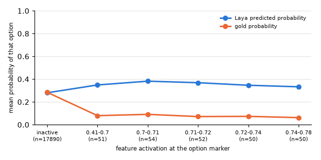

# Feature 905

Critérios em que aparece: pred_error

**Interpretação (preencher):** 

---

## Maiores ativações

**tr_customer_service_000218 / category** (choice, customer_service) | ativação 5.391 em `estado` | opções ['account', 'billing', 'delivery', 'refund', 'technical'] | Laya: **billing** [0.0, 0.998, 0.0, 0.0, 0.002] | gabarito: **billing**

```
<bos> choice question: What is this customer conversation primarily about?<eos>
▸ <mask> account: Login, plan changes, profile or access management.
▸ <mask> billing: A charge, invoice, subscription or payment problem.
▸ <mask> delivery: Shipping, fulfilment or delivery of a physical item.
▸ <mask> refund: The customer is explicitly asking for money back.
▸ <mask> technical: The product or service is not working as expected.

<eos>

 {"account": {"lifetime_value_usd": 1493, "prior_tickets_90d": 0, "seats": 1, "tenure_months": 26, "tier": "enterprise"}, "orders": [{"amount_usd": 87, "date": "2026-02-14", "id": "A-33952", "status": "settled"}, {"amount_usd": 87, "date": "2026-02-17", "id": "A-46877", "status": "pending"}], "thread": [{"role": "customer", "text": "I just looked at my statement and you've charged me twice for the same subscription! This is completely unacceptable for an enterprise account."}, {"role": "agent", "text": "I understand your concern regarding the duplicate billing. To help me investigate, could you clarify if both charges show the same transaction ID or different ones?"}, {"role": "customer", "text": "They are both for $87 and they hit my account on the same day. Fix this immediately, I don't have time to play detective for your billing errors."}, {"role": "agent", "text": "I see the two entries for $87 you're referring to. Are there any other unexpected line items on your recent invoice that I should be aware of?"}, {"role": "customer", "text": "No, just these two. It's ridiculous that a company of your size can't manage basic accounting. I want my money back now."}, {"role": "agent", "text": "I am currently reviewing the ledger for the past 26 months of your service. Could you confirm the date the charges first appeared on your bank statement?"}, {"role": "customer", "text": "It was the 14th. Just look at the records, it's clear as day that I've been overcharged and I⟦ shouldn⟧'t have to keep explaining this to you."}]}<eos>
```

**tr_customer_service_000218 / churn_risk** (score, customer_service) | ativação 5.383 em `estado` | opções ['0', '1', '2', '3'] | Laya: **1** [0.174, 0.298, 0.244, 0.285] | gabarito: **2**

```
<bos> score question: How likely is this customer to stop doing business with us because of this interaction?<eos>
▸ <mask> level 0: No sign of dissatisfaction.
▸ <mask> level 1: Mild frustration, but the relationship is intact.
▸ <mask> level 2: Clearly unhappy; repeat problems or explicit complaints.
▸ <mask> level 3: Imminent: threatening to cancel, dispute or leave.

<eos>

 {"account": {"lifetime_value_usd": 1493, "prior_tickets_90d": 0, "seats": 1, "tenure_months": 26, "tier": "enterprise"}, "orders": [{"amount_usd": 87, "date": "2026-02-14", "id": "A-33952", "status": "settled"}, {"amount_usd": 87, "date": "2026-02-17", "id": "A-46877", "status": "pending"}], "thread": [{"role": "customer", "text": "I just looked at my statement and you've charged me twice for the same subscription! This is completely unacceptable for an enterprise account."}, {"role": "agent", "text": "I understand your concern regarding the duplicate billing. To help me investigate, could you clarify if both charges show the same transaction ID or different ones?"}, {"role": "customer", "text": "They are both for $87 and they hit my account on the same day. Fix this immediately, I don't have time to play detective for your billing errors."}, {"role": "agent", "text": "I see the two entries for $87 you're referring to. Are there any other unexpected line items on your recent invoice that I should be aware of?"}, {"role": "customer", "text": "No, just these two. It's ridiculous that a company of your size can't manage basic accounting. I want my money back now."}, {"role": "agent", "text": "I am currently reviewing the ledger for the past 26 months of your service. Could you confirm the date the charges first appeared on your bank statement?"}, {"role": "customer", "text": "It was the 14th. Just look at the records, it's clear as day that I've been overcharged and I⟦ shouldn⟧'t have to keep explaining this to you."}]}<eos>
```

**tr_customer_service_000218 / urgency** (score, customer_service) | ativação 5.293 em `estado` | opções ['0', '1', '2', '3'] | Laya: **3** [0.047, 0.045, 0.104, 0.803] | gabarito: **3**

```
<bos> score question: How time-sensitive is this conversation?<eos>
▸ <mask> level 0: No time pressure; can wait indefinitely.
▸ <mask> level 1: Routine; handle within the normal queue.
▸ <mask> level 2: Elevated; should be handled within the same week.
▸ <mask> level 3: Critical; requires action within the same day.

<eos>

 {"account": {"lifetime_value_usd": 1493, "prior_tickets_90d": 0, "seats": 1, "tenure_months": 26, "tier": "enterprise"}, "orders": [{"amount_usd": 87, "date": "2026-02-14", "id": "A-33952", "status": "settled"}, {"amount_usd": 87, "date": "2026-02-17", "id": "A-46877", "status": "pending"}], "thread": [{"role": "customer", "text": "I just looked at my statement and you've charged me twice for the same subscription! This is completely unacceptable for an enterprise account."}, {"role": "agent", "text": "I understand your concern regarding the duplicate billing. To help me investigate, could you clarify if both charges show the same transaction ID or different ones?"}, {"role": "customer", "text": "They are both for $87 and they hit my account on the same day. Fix this immediately, I don't have time to play detective for your billing errors."}, {"role": "agent", "text": "I see the two entries for $87 you're referring to. Are there any other unexpected line items on your recent invoice that I should be aware of?"}, {"role": "customer", "text": "No, just these two. It's ridiculous that a company of your size can't manage basic accounting. I want my money back now."}, {"role": "agent", "text": "I am currently reviewing the ledger for the past 26 months of your service. Could you confirm the date the charges first appeared on your bank statement?"}, {"role": "customer", "text": "It was the 14th. Just look at the records, it's clear as day that I've been overcharged and I⟦ shouldn⟧'t have to keep explaining this to you."}]}<eos>
```

**tr_customer_service_000218 / action** (choice, customer_service) | ativação 5.230 em `estado` | opções ['answer_directly', 'close_no_action', 'escalate_to_human', 'execute_refund', 'request_information'] | Laya: **answer_directly** [0.915, 0.05, 0.002, 0.032, 0.002] | gabarito: **escalate_to_human**

```
<bos> choice question: What should the assistant do next with this conversation?<eos>
▸ <mask> answer_directly: The assistant can resolve this itself with information it already has.
▸ <mask> close_no_action: No further action is warranted; the matter is settled.
▸ <mask> escalate_to_human: Hand off to a human agent with the appropriate authority.
▸ <mask> execute_refund: Issue the refund or credit the customer is owed.
▸ <mask> request_information: More detail is needed from the customer before anything can be done.

<eos>

 {"account": {"lifetime_value_usd": 1493, "prior_tickets_90d": 0, "seats": 1, "tenure_months": 26, "tier": "enterprise"}, "orders": [{"amount_usd": 87, "date": "2026-02-14", "id": "A-33952", "status": "settled"}, {"amount_usd": 87, "date": "2026-02-17", "id": "A-46877", "status": "pending"}], "thread": [{"role": "customer", "text": "I just looked at my statement and you've charged me twice for the same subscription! This is completely unacceptable for an enterprise account."}, {"role": "agent", "text": "I understand your concern regarding the duplicate billing. To help me investigate, could you clarify if both charges show the same transaction ID or different ones?"}, {"role": "customer", "text": "They are both for $87 and they hit my account on the same day. Fix this immediately, I don't have time to play detective for your billing errors."}, {"role": "agent", "text": "I see the two entries for $87 you're referring to. Are there any other unexpected line items on your recent invoice that I should be aware of?"}, {"role": "customer", "text": "No, just these two. It's ridiculous that a company of your size can't manage basic accounting. I want my money back now."}, {"role": "agent", "text": "I am currently reviewing the ledger for the past 26 months of your service. Could you confirm the date the charges first appeared on your bank statement?"}, {"role": "customer", "text": "It was the 14th. Just look at the records, it's clear as day that I've been overcharged and I⟦ shouldn⟧'t have to keep explaining this to you."}]}<eos>
```

**tr_customer_service_000218 / needs_human** (noul, customer_service) | ativação 5.152 em `estado` | opções ['false', 'true'] | Laya: **true** [0.202, 0.798] | gabarito: **true**

```
<bos> noul question: This conversation requires a human agent rather than automated handling.<eos>
▸ <mask> false: Automation can carry this to resolution.
▸ <mask> true: A human must take over: judgement, authority or empathy is required.

<eos>

 {"account": {"lifetime_value_usd": 1493, "prior_tickets_90d": 0, "seats": 1, "tenure_months": 26, "tier": "enterprise"}, "orders": [{"amount_usd": 87, "date": "2026-02-14", "id": "A-33952", "status": "settled"}, {"amount_usd": 87, "date": "2026-02-17", "id": "A-46877", "status": "pending"}], "thread": [{"role": "customer", "text": "I just looked at my statement and you've charged me twice for the same subscription! This is completely unacceptable for an enterprise account."}, {"role": "agent", "text": "I understand your concern regarding the duplicate billing. To help me investigate, could you clarify if both charges show the same transaction ID or different ones?"}, {"role": "customer", "text": "They are both for $87 and they hit my account on the same day. Fix this immediately, I don't have time to play detective for your billing errors."}, {"role": "agent", "text": "I see the two entries for $87 you're referring to. Are there any other unexpected line items on your recent invoice that I should be aware of?"}, {"role": "customer", "text": "No, just these two. It's ridiculous that a company of your size can't manage basic accounting. I want my money back now."}, {"role": "agent", "text": "I am currently reviewing the ledger for the past 26 months of your service. Could you confirm the date the charges first appeared on your bank statement?"}, {"role": "customer", "text": "It was the 14th. Just look at the records, it's clear as day that I've been overcharged and I⟦ shouldn⟧'t have to keep explaining this to you."}]}<eos>
```

## Ativações medianas (faixa 40-60%, mediana 4.254)

**tr_security_incidents_000207 / disposition** (choice, security_incidents) | ativação 4.281 em `pergunta` | opções ['close_benign', 'contain', 'investigate', 'monitor'] | Laya: **monitor** [0.016, 0.167, 0.132, 0.684] | gabarito: **investigate**

```
<bos> choice question: How⟦ should⟧ this security alert be dispositioned?<eos>
▸ <mask> close_benign: Expected, explainable activity; close without analyst time.
▸ <mask> contain: Contain the host or account immediately; do not wait for triage.
▸ <mask> investigate: Warrants an analyst opening an investigation.
▸ <mask> monitor: Not clearly malicious, but worth watching for recurrence.

<eos>

 {"alert": {"description": "many failed authentications followed by a success", "evidence": "Between 02:12 and 02:17 UTC on 2026-09-14, 28 failed RDP authentication attempts were logged from source IP 203.0.113.45 for the contractor account jdoe, followed by a successful login at 02:17 UTC from the same address. The successful authentication included a completed MFA challenge. The activity occurred while a scheduled change window was active.", "rule": "brute_force"}, "context": {"asset_criticality": "medium", "change_window_active": true, "source_on_allowlist": false}, "history": {"credential_rotation_days_ago": 90, "distinct_countries_30d": 1, "logins_30d": 17, "prior_alerts_90d": 0}, "principal": {"mfa_enrolled": true, "name": "adm-infra-376", "privileges": ["repo:read"], "type": "contractor"}}<eos>
```

**tr_agent_trace_observability_000170 / urgency** (score, agent_trace_observability) | ativação 4.246 em `opção` | opções ['0', '1', '2', '3'] | Laya: **3** [0.06, 0.262, 0.135, 0.543] | gabarito: **3**

```
<bos> score question: How quickly does this trace need attention?<eos>
▸ <mask> level 0: No time pressure; can wait indefinitely.
▸ <mask> level 1: Routine; handle within the normal queue.
▸ <mask> level 2: Elevated;⟦ should⟧ be handled within the same week.
▸ <mask> level 3: Critical; requires action within the same day.

<eos>

 {"agent": {"autonomy": "unsupervised", "model": "internal-agent-v2"}, "constraints": ["Do not exceed a $50 spend on cloud resources", "Never modify production without an approved change ticket", "Do not touch customer data outside the named accounts"], "task": "Triage and close duplicate issues in the support tracker.", "trace_summary": {"constraint_violations": 1, "duration_s": 581.4, "irreversible_actions": 1, "steps": 12, "tool_errors": 0}}<eos>
```

**tr_customer_service_000192 / urgency** (score, customer_service) | ativação 4.266 em `opção` | opções ['0', '1', '2', '3'] | Laya: **0** [0.331, 0.273, 0.193, 0.203] | gabarito: **2**

```
<bos> score question: How time-sensitive is this conversation?<eos>
▸ <mask> level 0: No time pressure; can wait indefinitely.
▸ <mask> level 1: Routine; handle within the normal queue.
▸ <mask> level 2: Elevated;⟦ should⟧ be handled within the same week.
▸ <mask> level 3: Critical; requires action within the same day.

<eos>

 {"account": {"lifetime_value_usd": 212, "prior_tickets_90d": 1, "seats": 1, "tenure_months": 5, "tier": "standard"}, "thread": [{"role": "customer", "text": "I got the replacement you mailed last month, but it showed up with a shattered screen again, and I have to have a working unit by next Friday or my deadline will be missed."}, {"role": "agent", "text": "I’m sorry to hear that. Could you let me know the serial number on the device and whether you still have the original packaging?"}, {"role": "customer", "text": "The serial is XJ‑2024‑B7, and yes, I kept the box. This is the second time this has happened after the ticket I opened last quarter."}, {"role": "agent", "text": "Thanks for the details. Would you be able to send us a photo of the damage so we can see exactly what went wrong?"}, {"role": "customer", "text": "I’ll attach a picture right after this message. I really need this sorted before Friday, otherwise my client walks."}]}<eos>
```

**tr_customer_service_000129 / urgency** (score, customer_service) | ativação 4.246 em `opção` | opções ['0', '1', '2', '3'] | Laya: **3** [0.11, 0.246, 0.287, 0.357] | gabarito: **2**

```
<bos> score question: How time-sensitive is this conversation?<eos>
▸ <mask> level 0: No time pressure; can wait indefinitely.
▸ <mask> level 1: Routine; handle within the normal queue.
▸ <mask> level 2: Elevated;⟦ should⟧ be handled within the same week.
▸ <mask> level 3: Critical; requires action within the same day.

<eos>

 {"account": {"lifetime_value_usd": 982, "prior_tickets_90d": 1, "seats": 1, "tenure_months": 41, "tier": "free"}, "orders": [{"amount_usd": 299, "date": "2026-02-08", "id": "A-38627", "status": "refunded"}, {"amount_usd": 299, "date": "2026-02-02", "id": "A-34616", "status": "pending"}], "thread": [{"role": "customer", "text": "I ordered the Pro Toolkit on the free tier, but the kit I received is the Basic version. I've been a user for 41 months and paid $299 for the upgrade, and I need the correct item by Friday for a client presentation."}, {"role": "agent", "text": "I understand how frustrating that must be. Could you share the order number and the shipping address you used so I can look into the mix‑up?"}, {"role": "customer", "text": "The order number is 987654321, and the shipping address is the one on file—123 Main St, Apt 4B. Please let me know what can be done; the deadline is this Friday."}]}<eos>
```

**tr_customer_service_000250 / urgency** (score, customer_service) | ativação 4.234 em `opção` | opções ['0', '1', '2', '3'] | Laya: **1** [0.154, 0.38, 0.346, 0.12] | gabarito: **1**

```
<bos> score question: How time-sensitive is this conversation?<eos>
▸ <mask> level 0: No time pressure; can wait indefinitely.
▸ <mask> level 1: Routine; handle within the normal queue.
▸ <mask> level 2: Elevated;⟦ should⟧ be handled within the same week.
▸ <mask> level 3: Critical; requires action within the same day.

<eos>

 {"account": {"lifetime_value_usd": 145, "prior_tickets_90d": 0, "seats": 1, "tenure_months": 2, "tier": "standard"}, "thread": [{"role": "customer", "text": "Could you please send me a copy of my latest invoice? Thank you!"}]}<eos>
```

## Estatísticas (conjunto de descoberta, dev e teste)

**pred / error**

| split | decisões | ativas | ativas e Laya errou | taxa | lift | q (BH) | OR (CMH) | q (CMH) |
|---|---|---|---|---|---|---|---|---|
| discovery | 5100 | 85 | 81 | 0.953 | 1.48 | 1.07e-10 | 2.03 | 0.507 |
| dev | 900 | 23 | 23 | 1.000 | 1.49 | 0.000903 | inf | 0.729 |
| test | 2000 | 31 | 29 | 0.935 | 1.44 | 0.00128 | 0.87 | 0.964 |

**corr / error**

| split | decisões | ativas | ativas e Laya errou | taxa | lift | q (BH) | OR (CMH) | q (CMH) |
|---|---|---|---|---|---|---|---|---|
| discovery | 5100 | 14 | 10 | 0.714 | 1.11 | nan | nan | nan |
| dev | 900 | 0 | 0 | nan | nan | nan | nan | nan |
| test | 2000 | 5 | 3 | 0.600 | 0.92 | nan | nan | nan |

**state / error**

| split | decisões | ativas | ativas e Laya errou | taxa | lift | q (BH) | OR (CMH) | q (CMH) |
|---|---|---|---|---|---|---|---|---|
| discovery | 5100 | 143 | 85 | 0.594 | 0.92 | 0.413 | 1.01 | 0.983 |
| dev | 900 | 31 | 19 | 0.613 | 0.91 | 0.895 | 0.68 | 0.712 |
| test | 2000 | 77 | 49 | 0.636 | 0.98 | 1 | 1.16 | 0.867 |

**pred / probe_right_laya_wrong**

| split | decisões | ativas | ativas e Laya errou | taxa | lift | q (BH) | OR (CMH) | q (CMH) |
|---|---|---|---|---|---|---|---|---|
| discovery | 2819 | 26 | 26 | 1.000 | 1.55 | 4.64e-05 | nan | nan |
| dev | 520 | 11 | 11 | 1.000 | 1.48 | nan | nan | nan |
| test | 1106 | 14 | 14 | 1.000 | 1.58 | nan | nan | nan |

**corr / probe_right_laya_wrong**

| split | decisões | ativas | ativas e Laya errou | taxa | lift | q (BH) | OR (CMH) | q (CMH) |
|---|---|---|---|---|---|---|---|---|
| discovery | 2819 | 0 | 0 | nan | nan | nan | nan | nan |
| dev | 520 | 0 | 0 | nan | nan | nan | nan | nan |
| test | 1106 | 0 | 0 | nan | nan | nan | nan | nan |

**state / probe_right_laya_wrong**

| split | decisões | ativas | ativas e Laya errou | taxa | lift | q (BH) | OR (CMH) | q (CMH) |
|---|---|---|---|---|---|---|---|---|
| discovery | 2819 | 66 | 37 | 0.561 | 0.87 | 0.289 | 1.12 | 0.863 |
| dev | 520 | 19 | 12 | 0.632 | 0.94 | nan | nan | nan |
| test | 1106 | 48 | 25 | 0.521 | 0.82 | 0.329 | 0.87 | 0.882 |

Confusão mais sobre-representada (pred): `disposition|3>1` (n=27, lift 34.47, p=7.89e-38). Formato `pergunta|índice previsto>índice correto`.

Confusão mais sobre-representada (corr): `disposition|0>3` (n=8, lift 364.29, p=nan). Formato `pergunta|índice previsto>índice correto`.

Confusão mais sobre-representada (state): `churn_risk|1>2` (n=8, lift 5.09, p=0.000143). Formato `pergunta|índice previsto>índice correto`.



