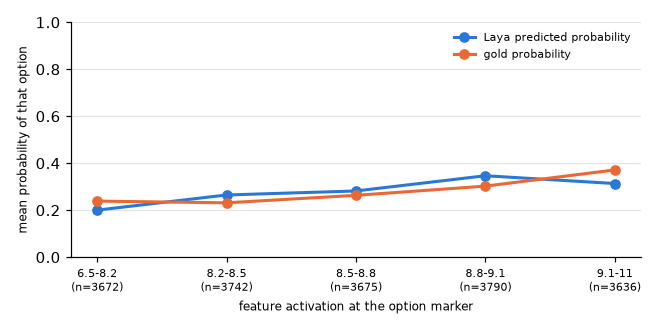

# Feature 926

Critérios em que aparece: attribution_toward_correct

**Interpretação (preencher):** 

---

## Maiores ativações

**tr_customer_service_000112 / churn_risk** (score, customer_service) | ativação 47.281 em `SEP-fim` | opções ['0', '1', '2', '3'] | Laya: **1** [0.047, 0.561, 0.311, 0.081] | gabarito: **2**

```
<bos> score question: How likely is this customer to stop doing business with us because of this interaction?<eos>
▸ <mask> level 0: No sign of dissatisfaction.
▸ <mask> level 1: Mild frustration, but the relationship is intact.
▸ <mask> level 2: Clearly unhappy; repeat problems or explicit complaints.
▸ <mask> level 3: Imminent: threatening to cancel, dispute or leave.

<eos>

 {"account": {"lifetime_value_usd": 2088, "prior_tickets_90d": 5, "seats": 5, "tenure_months": 72, "tier": "premium"}, "thread": [{"role": "customer", "text": "I'm looking at my bank statement and I see two separate charges for my premium subscription again. This is the sixth time I've had to reach out about this specific double-billing issue, and I'm just tired of having to repeat the same conversation every month."}, {"role": "agent", "text": "I'm sorry to hear that you're seeing a duplicate transaction on your account again. To help me investigate, could you please confirm if both charges appeared on the same date?"}, {"role": "customer", "text": "They both showed up on the 14th. I've been a customer for six years and I really expected that after five previous tickets, someone would have found a permanent solution to stop this from happening."}, {"role": "agent", "text": "I appreciate your long-standing loyalty to our service. I'm looking into your billing history now; are you seeing two different invoice numbers in your account portal, or just one?"}, {"role": "customer", "text": "There is only one invoice listed in the portal, but the money has definitely left my account twice. I just want to know why this keeps recurring when I was told last month it was finally handled."}]}⟦<eos>⟧
```

**tr_customer_service_000112 / action** (choice, customer_service) | ativação 47.000 em `SEP-fim` | opções ['answer_directly', 'close_no_action', 'escalate_to_human', 'execute_refund', 'request_information'] | Laya: **close_no_action** [0.379, 0.52, 0.024, 0.061, 0.016] | gabarito: **escalate_to_human**

```
<bos> choice question: What should the assistant do next with this conversation?<eos>
▸ <mask> answer_directly: The assistant can resolve this itself with information it already has.
▸ <mask> close_no_action: No further action is warranted; the matter is settled.
▸ <mask> escalate_to_human: Hand off to a human agent with the appropriate authority.
▸ <mask> execute_refund: Issue the refund or credit the customer is owed.
▸ <mask> request_information: More detail is needed from the customer before anything can be done.

<eos>

 {"account": {"lifetime_value_usd": 2088, "prior_tickets_90d": 5, "seats": 5, "tenure_months": 72, "tier": "premium"}, "thread": [{"role": "customer", "text": "I'm looking at my bank statement and I see two separate charges for my premium subscription again. This is the sixth time I've had to reach out about this specific double-billing issue, and I'm just tired of having to repeat the same conversation every month."}, {"role": "agent", "text": "I'm sorry to hear that you're seeing a duplicate transaction on your account again. To help me investigate, could you please confirm if both charges appeared on the same date?"}, {"role": "customer", "text": "They both showed up on the 14th. I've been a customer for six years and I really expected that after five previous tickets, someone would have found a permanent solution to stop this from happening."}, {"role": "agent", "text": "I appreciate your long-standing loyalty to our service. I'm looking into your billing history now; are you seeing two different invoice numbers in your account portal, or just one?"}, {"role": "customer", "text": "There is only one invoice listed in the portal, but the money has definitely left my account twice. I just want to know why this keeps recurring when I was told last month it was finally handled."}]}⟦<eos>⟧
```

**tr_customer_service_000029 / action** (choice, customer_service) | ativação 46.969 em `SEP-fim` | opções ['answer_directly', 'close_no_action', 'escalate_to_human', 'execute_refund', 'request_information'] | Laya: **answer_directly** [0.364, 0.235, 0.349, 0.044, 0.007] | gabarito: **escalate_to_human**

```
<bos> choice question: What should the assistant do next with this conversation?<eos>
▸ <mask> answer_directly: The assistant can resolve this itself with information it already has.
▸ <mask> close_no_action: No further action is warranted; the matter is settled.
▸ <mask> escalate_to_human: Hand off to a human agent with the appropriate authority.
▸ <mask> execute_refund: Issue the refund or credit the customer is owed.
▸ <mask> request_information: More detail is needed from the customer before anything can be done.

<eos>

 {"account": {"lifetime_value_usd": 5176, "prior_tickets_90d": 1, "seats": 1, "tenure_months": 72, "tier": "standard"}, "thread": [{"role": "customer", "text": "I am beyond frustrated right now. I've been a loyal customer for six years and I requested a downgrade from the Standard plan weeks ago. I was told it was taken care of, but I just got hit with another full-price bill."}, {"role": "agent", "text": "I am very sorry to hear that the downgrade wasn't processed as expected, especially given your long history with us. I can certainly understand why seeing that charge is upsetting."}, {"role": "customer", "text": "This is the second time I've had to open a ticket for this exact same issue. The last agent promised me it was resolved, yet here I am again wasting my time because your system won't update my status."}, {"role": "agent", "text": "I see your previous interaction in our logs. To assist me in investigating why the change didn't take effect, could you let me know if you received a confirmation email after your last conversation regarding the plan change?"}, {"role": "customer", "text": "I never received any confirmation, which is why I'm so annoyed. I shouldn't have to keep chasing you guys down to stop charging me for features I am no longer using."}]}⟦<eos>⟧
```

**tr_customer_service_000029 / churn_risk** (score, customer_service) | ativação 46.938 em `SEP-fim` | opções ['0', '1', '2', '3'] | Laya: **2** [0.028, 0.172, 0.745, 0.055] | gabarito: **2**

```
<bos> score question: How likely is this customer to stop doing business with us because of this interaction?<eos>
▸ <mask> level 0: No sign of dissatisfaction.
▸ <mask> level 1: Mild frustration, but the relationship is intact.
▸ <mask> level 2: Clearly unhappy; repeat problems or explicit complaints.
▸ <mask> level 3: Imminent: threatening to cancel, dispute or leave.

<eos>

 {"account": {"lifetime_value_usd": 5176, "prior_tickets_90d": 1, "seats": 1, "tenure_months": 72, "tier": "standard"}, "thread": [{"role": "customer", "text": "I am beyond frustrated right now. I've been a loyal customer for six years and I requested a downgrade from the Standard plan weeks ago. I was told it was taken care of, but I just got hit with another full-price bill."}, {"role": "agent", "text": "I am very sorry to hear that the downgrade wasn't processed as expected, especially given your long history with us. I can certainly understand why seeing that charge is upsetting."}, {"role": "customer", "text": "This is the second time I've had to open a ticket for this exact same issue. The last agent promised me it was resolved, yet here I am again wasting my time because your system won't update my status."}, {"role": "agent", "text": "I see your previous interaction in our logs. To assist me in investigating why the change didn't take effect, could you let me know if you received a confirmation email after your last conversation regarding the plan change?"}, {"role": "customer", "text": "I never received any confirmation, which is why I'm so annoyed. I shouldn't have to keep chasing you guys down to stop charging me for features I am no longer using."}]}⟦<eos>⟧
```

**tr_customer_service_000029 / category** (choice, customer_service) | ativação 46.938 em `SEP-fim` | opções ['account', 'billing', 'delivery', 'refund', 'technical'] | Laya: **technical** [0.011, 0.067, 0.001, 0.001, 0.92] | gabarito: **billing**

```
<bos> choice question: What is this customer conversation primarily about?<eos>
▸ <mask> account: Login, plan changes, profile or access management.
▸ <mask> billing: A charge, invoice, subscription or payment problem.
▸ <mask> delivery: Shipping, fulfilment or delivery of a physical item.
▸ <mask> refund: The customer is explicitly asking for money back.
▸ <mask> technical: The product or service is not working as expected.

<eos>

 {"account": {"lifetime_value_usd": 5176, "prior_tickets_90d": 1, "seats": 1, "tenure_months": 72, "tier": "standard"}, "thread": [{"role": "customer", "text": "I am beyond frustrated right now. I've been a loyal customer for six years and I requested a downgrade from the Standard plan weeks ago. I was told it was taken care of, but I just got hit with another full-price bill."}, {"role": "agent", "text": "I am very sorry to hear that the downgrade wasn't processed as expected, especially given your long history with us. I can certainly understand why seeing that charge is upsetting."}, {"role": "customer", "text": "This is the second time I've had to open a ticket for this exact same issue. The last agent promised me it was resolved, yet here I am again wasting my time because your system won't update my status."}, {"role": "agent", "text": "I see your previous interaction in our logs. To assist me in investigating why the change didn't take effect, could you let me know if you received a confirmation email after your last conversation regarding the plan change?"}, {"role": "customer", "text": "I never received any confirmation, which is why I'm so annoyed. I shouldn't have to keep chasing you guys down to stop charging me for features I am no longer using."}]}⟦<eos>⟧
```

## Ativações medianas (faixa 40-60%, mediana 4.316)

**tr_security_incidents_000238 / disposition** (choice, security_incidents) | ativação 4.895 em `estado` | opções ['close_benign', 'contain', 'investigate', 'monitor'] | Laya: **monitor** [0.046, 0.181, 0.022, 0.751] | gabarito: **investigate**

```
<bos> choice question: How should this security alert be dispositioned?<eos>
▸ <mask> close_benign: Expected, explainable activity; close without analyst time.
▸ <mask> contain: Contain the host or account immediately; do not wait for triage.
▸ <mask> investigate: Warrants an analyst opening an investigation.
▸ <mask> monitor: Not clearly malicious, but worth watching for recurrence.

<eos>

 {"alert": {"description": "a session token was presented from a second address", "evidence": "An unprivileged employee’s session token (ID: abc123def) was used from IP 198.51.100.22 (New York) at 2026-09-16T08:45:22Z, then presented again from IP 203.0.113.78 (London) at 2026-09-16T08:46:01Z. The⟦ token⟧ reuse occurred while a change window was active; the user’s credentials were last updated on 2025-08-11 (412 days ago).", "rule": "token_reuse"}, "context": {"asset_criticality": "medium", "change_window_active": true, "source_on_allowlist": false}, "history": {"credential_rotation_days_ago": 412, "distinct_countries_30d": 1, "logins_30d": 440, "prior_alerts_90d": 3}, "principal": {"mfa_enrolled": true, "name": "adm-support-728", "privileges": ["repo:read"], "type": "employee"}}<eos>
```

**tr_invoice_processing_000148 / discrepancy_severity** (score, invoice_processing) | ativação 4.250 em `estado` | opções ['0', '1', '2', '3'] | Laya: **2** [0.074, 0.307, 0.553, 0.066] | gabarito: **2**

```
<bos> score question: How material is any discrepancy between the invoice, the order and the delivery?<eos>
▸ <mask> level 0: None: everything reconciles.
▸ <mask> level 1: Trivial: rounding or a cosmetic difference.
▸ <mask> level 2: Moderate: a real difference worth confirming.
▸ <mask> level 3: Material: a large or unexplained difference.

<eos>

 {"delivery": {"condition": "accepted with exceptions", "date": "2026-03-10", "received_qty": 5}, "invoice": {"currency": "USD", "id": "INV-2026-3732", "lines": [{"qty": 5, "sku": "SKU-791", "total_usd": 754.3, "unit_usd": 150.86}], "total_usd": 754.3, "vendor": "Kestrel Supply"}, "payment": {"days_until_due": 27, "discount_expires_in_days": null, "early_payment_discount_pct": null, "status": "scheduled", "terms": "net 45"}, "purchase_order": {"freight_terms": "freight prepaid by vendor, not separately billable", "id": "PO-5462", "lines": [{"qty": 25, "unit_usd": 150.86}], "total_usd": 3771.5}, "vendor_history": {"disputes_12m": 0, "invoices_12m":⟦ ⟧7, "prior_invoice_ids": ["INV-2026-3327", "INV-2026-7628", "INV-2026-3255", "INV-2026-7154"]}}<eos>
```

**tr_security_incidents_000293 / true_positive** (noul, security_incidents) | ativação 3.711 em `estado` | opções ['false', 'true'] | Laya: **true** [0.057, 0.943] | gabarito: **false**

```
<bos> noul question: This alert reflects genuinely malicious or unauthorised activity.<eos>
▸ <mask> false: Benign activity, a misconfiguration, or a known false positive.
▸ <mask> true: The underlying behaviour is malicious or unauthorised.

<eos>

 {"alert": {"description": "a session token was presented from a second address", "evidence": "A single session token was used to access resources from two distinct, unrecognized IP addresses within a 15-minute span⟦.⟧ While the user is a contractor currently operating within an active change window, the second connection originated from an unknown network source.", "rule": "token_reuse"}, "context": {"asset_criticality": "medium", "change_window_active": true, "source_on_allowlist": false}, "history": {"credential_rotation_days_ago": 30, "distinct_countries_30d": 2, "logins_30d": 1286, "prior_alerts_90d": 0}, "principal": {"mfa_enrolled": true, "name": "adm-deploy-459", "privileges": ["repo:read"], "type": "contractor"}}<eos>
```

**tr_customer_service_000218 / needs_human** (noul, customer_service) | ativação 4.273 em `estado` | opções ['false', 'true'] | Laya: **true** [0.202, 0.798] | gabarito: **true**

```
<bos> noul question: This conversation requires a human agent rather than automated handling.<eos>
▸ <mask> false: Automation can carry this to resolution.
▸ <mask> true: A human must take over: judgement, authority or empathy is required.

<eos>

 {"account": {"lifetime_value_usd": 1493, "prior_tickets_90d": 0, "seats⟦":⟧ 1, "tenure_months": 26, "tier": "enterprise"}, "orders": [{"amount_usd": 87, "date": "2026-02-14", "id": "A-33952", "status": "settled"}, {"amount_usd": 87, "date": "2026-02-17", "id": "A-46877", "status": "pending"}], "thread": [{"role": "customer", "text": "I just looked at my statement and you've charged me twice for the same subscription! This is completely unacceptable for an enterprise account."}, {"role": "agent", "text": "I understand your concern regarding the duplicate billing. To help me investigate, could you clarify if both charges show the same transaction ID or different ones?"}, {"role": "customer", "text": "They are both for $87 and they hit my account on the same day. Fix this immediately, I don't have time to play detective for your billing errors."}, {"role": "agent", "text": "I see the two entries for $87 you're referring to. Are there any other unexpected line items on your recent invoice that I should be aware of?"}, {"role": "customer", "text": "No, just these two. It's ridiculous that a company of your size can't manage basic accounting. I want my money back now."}, {"role": "agent", "text": "I am currently reviewing the ledger for the past 26 months of your service. Could you confirm the date the charges first appeared on your bank statement?"}, {"role": "customer", "text": "It was the 14th. Just look at the records, it's clear as day that I've been overcharged and I shouldn't have to keep explaining this to you."}]}<eos>
```

**tr_invoice_processing_000164 / urgency** (score, invoice_processing) | ativação 5.207 em `estado` | opções ['0', '1', '2', '3'] | Laya: **1** [0.116, 0.461, 0.275, 0.147] | gabarito: **2**

```
<bos> score question: How time-sensitive is processing this invoice?<eos>
▸ <mask> level 0: No time pressure; can wait indefinitely.
▸ <mask> level 1: Routine; handle within the normal queue.
▸ <mask> level 2: Elevated; should be handled within the same week.
▸ <mask> level 3: Critical; requires action within the same day.

<eos>

 {"delivery": {"condition": "accepted", "date": "2026-03-19", "received_qty": 1000}, "invoice": {"currency": "USD", "id": "INV-2026-3652", "lines": [{"qty": 1000, "sku": "SKU-103", "total_usd": 299850.0, "unit_usd": 299.85}], "total_usd": 299850.0, "vendor": "Northwind Components"}, "payment": {"days_until_due":⟦ ⟧5, "discount_expires_in_days": null, "early_payment_discount_pct": null, "status": "scheduled", "terms": "net 30"}, "purchase_order": {"freight_terms": "freight prepaid by vendor, not separately billable", "id": "PO-1013", "lines": [{"qty": 1000, "unit_usd": 299.85}], "total_usd": 299850.0}, "vendor_history": {"disputes_12m": 0, "invoices_12m": 56, "prior_invoice_ids": ["INV-2026-9880", "INV-2026-6717", "INV-2026-5969"]}}<eos>
```

## Estatísticas (conjunto de descoberta, dev e teste)

**pred / error**

| split | decisões | ativas | ativas e Laya errou | taxa | lift | q (BH) | OR (CMH) | q (CMH) |
|---|---|---|---|---|---|---|---|---|
| discovery | 5100 | 5100 | 3283 | 0.644 | 1.00 | 1 | nan | nan |
| dev | 900 | 900 | 605 | 0.672 | 1.00 | 1 | nan | nan |
| test | 2000 | 2000 | 1301 | 0.650 | 1.00 | 1 | nan | nan |

**corr / error**

| split | decisões | ativas | ativas e Laya errou | taxa | lift | q (BH) | OR (CMH) | q (CMH) |
|---|---|---|---|---|---|---|---|---|
| discovery | 5100 | 5100 | 3283 | 0.644 | 1.00 | 1 | nan | nan |
| dev | 900 | 900 | 605 | 0.672 | 1.00 | 1 | nan | nan |
| test | 2000 | 2000 | 1301 | 0.650 | 1.00 | 1 | nan | nan |

**state / error**

| split | decisões | ativas | ativas e Laya errou | taxa | lift | q (BH) | OR (CMH) | q (CMH) |
|---|---|---|---|---|---|---|---|---|
| discovery | 5100 | 5100 | 3283 | 0.644 | 1.00 | 1 | nan | nan |
| dev | 900 | 900 | 605 | 0.672 | 1.00 | 1 | nan | nan |
| test | 2000 | 2000 | 1301 | 0.650 | 1.00 | 1 | nan | nan |

**pred / probe_right_laya_wrong**

| split | decisões | ativas | ativas e Laya errou | taxa | lift | q (BH) | OR (CMH) | q (CMH) |
|---|---|---|---|---|---|---|---|---|
| discovery | 2819 | 2819 | 1824 | 0.647 | 1.00 | 1 | nan | nan |
| dev | 520 | 520 | 351 | 0.675 | 1.00 | 1 | nan | nan |
| test | 1106 | 1106 | 700 | 0.633 | 1.00 | 1 | nan | nan |

**corr / probe_right_laya_wrong**

| split | decisões | ativas | ativas e Laya errou | taxa | lift | q (BH) | OR (CMH) | q (CMH) |
|---|---|---|---|---|---|---|---|---|
| discovery | 2819 | 2819 | 1824 | 0.647 | 1.00 | 1 | nan | nan |
| dev | 520 | 520 | 351 | 0.675 | 1.00 | 1 | nan | nan |
| test | 1106 | 1106 | 700 | 0.633 | 1.00 | 1 | nan | nan |

**state / probe_right_laya_wrong**

| split | decisões | ativas | ativas e Laya errou | taxa | lift | q (BH) | OR (CMH) | q (CMH) |
|---|---|---|---|---|---|---|---|---|
| discovery | 2819 | 2819 | 1824 | 0.647 | 1.00 | 1 | nan | nan |
| dev | 520 | 520 | 351 | 0.675 | 1.00 | 1 | nan | nan |
| test | 1106 | 1106 | 700 | 0.633 | 1.00 | 1 | nan | nan |

Confusão mais sobre-representada (pred): `action|0>1` (n=6, lift 1.00, p=1). Formato `pergunta|índice previsto>índice correto`.

Confusão mais sobre-representada (corr): `action|0>1` (n=6, lift 1.00, p=1). Formato `pergunta|índice previsto>índice correto`.

Confusão mais sobre-representada (state): `action|0>1` (n=6, lift 1.00, p=1). Formato `pergunta|índice previsto>índice correto`.



