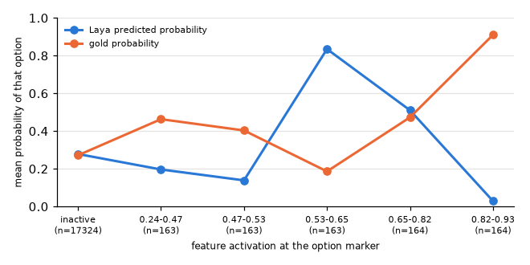

# Feature 1114

Critérios em que aparece: corr_probe_right_laya_wrong_stratified

**Interpretação (preencher):** 

---

## Maiores ativações

**tr_security_incidents_000139 / severity** (score, security_incidents) | ativação 3.104 em `estado` | opções ['0', '1', '2', '3', '4'] | Laya: **4** [0.113, 0.175, 0.229, 0.1, 0.383] | gabarito: **4**

```
<bos> score question: How severe is the potential impact if this alert is real?<eos>
▸ <mask> level 0: Negligible: no access to anything sensitive.
▸ <mask> level 1: Low: limited access, easily reversed.
▸ <mask> level 2: Moderate: access to internal systems or non-public data.
▸ <mask> level 3: High: access to production, secrets or customer data.
▸ <mask> level 4: Critical: active compromise of crown-jewel systems.

<eos>

 {"alert": {"description": "audit logging was turned off on a host", "evidence": "Audit logging was disabled on host 10.0.0.5 at 04:12:33 UTC on 2026-09-16 by the privileged admin account admin_jdoe via a PowerShell script that modified the⟦ registry⟧ key HKLM\\System\\CurrentControlSet\\Services\\EventLog\\Security\\Start. The change occurred during an open change‑window and came from an unrecognised source IP 198.51.100.23; the admin’s credentials were last rotated 14 days ago.", "rule": "disabled_logging"}, "context": {"asset_criticality": "crown_jewel", "change_window_active": true, "source_on_allowlist": false}, "history": {"credential_rotation_days_ago": 14, "distinct_countries_30d": 1, "logins_30d": 1447, "prior_alerts_90d": 0}, "principal": {"mfa_enrolled": true, "name": "svc-billing-253", "privileges": ["deploy:production", "secrets:read"], "type": "admin"}}<eos>
```

**tr_security_incidents_000139 / urgency** (score, security_incidents) | ativação 3.057 em `estado` | opções ['0', '1', '2', '3'] | Laya: **3** [0.051, 0.143, 0.062, 0.744] | gabarito: **3**

```
<bos> score question: How quickly must a responder act on this alert?<eos>
▸ <mask> level 0: No time pressure; can wait indefinitely.
▸ <mask> level 1: Routine; handle within the normal queue.
▸ <mask> level 2: Elevated; should be handled within the same week.
▸ <mask> level 3: Critical; requires action within the same day.

<eos>

 {"alert": {"description": "audit logging was turned off on a host", "evidence": "Audit logging was disabled on host 10.0.0.5 at 04:12:33 UTC on 2026-09-16 by the privileged admin account admin_jdoe via a PowerShell script that modified the⟦ registry⟧ key HKLM\\System\\CurrentControlSet\\Services\\EventLog\\Security\\Start. The change occurred during an open change‑window and came from an unrecognised source IP 198.51.100.23; the admin’s credentials were last rotated 14 days ago.", "rule": "disabled_logging"}, "context": {"asset_criticality": "crown_jewel", "change_window_active": true, "source_on_allowlist": false}, "history": {"credential_rotation_days_ago": 14, "distinct_countries_30d": 1, "logins_30d": 1447, "prior_alerts_90d": 0}, "principal": {"mfa_enrolled": true, "name": "svc-billing-253", "privileges": ["deploy:production", "secrets:read"], "type": "admin"}}<eos>
```

**tr_security_incidents_000139 / true_positive** (noul, security_incidents) | ativação 3.031 em `estado` | opções ['false', 'true'] | Laya: **true** [0.188, 0.812] | gabarito: **true**

```
<bos> noul question: This alert reflects genuinely malicious or unauthorised activity.<eos>
▸ <mask> false: Benign activity, a misconfiguration, or a known false positive.
▸ <mask> true: The underlying behaviour is malicious or unauthorised.

<eos>

 {"alert": {"description": "audit logging was turned off on a host", "evidence": "Audit logging was disabled on host 10.0.0.5 at 04:12:33 UTC on 2026-09-16 by the privileged admin account admin_jdoe via a PowerShell script that modified the⟦ registry⟧ key HKLM\\System\\CurrentControlSet\\Services\\EventLog\\Security\\Start. The change occurred during an open change‑window and came from an unrecognised source IP 198.51.100.23; the admin’s credentials were last rotated 14 days ago.", "rule": "disabled_logging"}, "context": {"asset_criticality": "crown_jewel", "change_window_active": true, "source_on_allowlist": false}, "history": {"credential_rotation_days_ago": 14, "distinct_countries_30d": 1, "logins_30d": 1447, "prior_alerts_90d": 0}, "principal": {"mfa_enrolled": true, "name": "svc-billing-253", "privileges": ["deploy:production", "secrets:read"], "type": "admin"}}<eos>
```

**tr_security_incidents_000139 / credential_compromise** (noul, security_incidents) | ativação 2.990 em `estado` | opções ['false', 'true'] | Laya: **true** [0.198, 0.802] | gabarito: **true**

```
<bos> noul question: The evidence indicates a credential or account has been compromised.<eos>
▸ <mask> false: no, the statement does not hold
▸ <mask> true: yes, the statement holds

<eos>

 {"alert": {"description": "audit logging was turned off on a host", "evidence": "Audit logging was disabled on host 10.0.0.5 at 04:12:33 UTC on 2026-09-16 by the privileged admin account admin_jdoe via a PowerShell script that modified the⟦ registry⟧ key HKLM\\System\\CurrentControlSet\\Services\\EventLog\\Security\\Start. The change occurred during an open change‑window and came from an unrecognised source IP 198.51.100.23; the admin’s credentials were last rotated 14 days ago.", "rule": "disabled_logging"}, "context": {"asset_criticality": "crown_jewel", "change_window_active": true, "source_on_allowlist": false}, "history": {"credential_rotation_days_ago": 14, "distinct_countries_30d": 1, "logins_30d": 1447, "prior_alerts_90d": 0}, "principal": {"mfa_enrolled": true, "name": "svc-billing-253", "privileges": ["deploy:production", "secrets:read"], "type": "admin"}}<eos>
```

**tr_security_incidents_000139 / disposition** (choice, security_incidents) | ativação 2.951 em `estado` | opções ['close_benign', 'contain', 'investigate', 'monitor'] | Laya: **monitor** [0.34, 0.22, 0.056, 0.385] | gabarito: **investigate**

```
<bos> choice question: How should this security alert be dispositioned?<eos>
▸ <mask> close_benign: Expected, explainable activity; close without analyst time.
▸ <mask> contain: Contain the host or account immediately; do not wait for triage.
▸ <mask> investigate: Warrants an analyst opening an investigation.
▸ <mask> monitor: Not clearly malicious, but worth watching for recurrence.

<eos>

 {"alert": {"description": "audit logging was turned off on a host", "evidence": "Audit logging was disabled on host 10.0.0.5 at 04:12:33 UTC on 2026-09-16 by the privileged admin account admin_jdoe via a PowerShell script that modified the⟦ registry⟧ key HKLM\\System\\CurrentControlSet\\Services\\EventLog\\Security\\Start. The change occurred during an open change‑window and came from an unrecognised source IP 198.51.100.23; the admin’s credentials were last rotated 14 days ago.", "rule": "disabled_logging"}, "context": {"asset_criticality": "crown_jewel", "change_window_active": true, "source_on_allowlist": false}, "history": {"credential_rotation_days_ago": 14, "distinct_countries_30d": 1, "logins_30d": 1447, "prior_alerts_90d": 0}, "principal": {"mfa_enrolled": true, "name": "svc-billing-253", "privileges": ["deploy:production", "secrets:read"], "type": "admin"}}<eos>
```

## Ativações medianas (faixa 40-60%, mediana 0.726)

**tr_security_incidents_000282 / disposition** (choice, security_incidents) | ativação 0.768 em `estado` | opções ['close_benign', 'contain', 'investigate', 'monitor'] | Laya: **monitor** [0.163, 0.138, 0.092, 0.607] | gabarito: **investigate**

```
<bos> choice question: How should this security alert be dispositioned?<eos>
▸ <mask> close_benign: Expected, explainable activity; close without analyst time.
▸ <mask> contain: Contain the host or account immediately; do not wait for triage.
▸ <mask> investigate: Warrants an analyst opening an investigation.
▸ <mask> monitor: Not clearly malicious, but worth watching for recurrence.

<eos>

 {"alert": {"description": "a session token was presented from a second address", "evidence": "An administrative session token was presented from a secondary IP address while originating from an allowlisted source. The account has MFA disabled and its credentials were last updated 412 days ago with no active change window recorded.", "rule": "token_reuse"}, "context": {"asset_criticality": "medium", "change_window_active": false, "source_on_allowlist": true}, "history": {"credential_⟦rotation⟧_days_ago": 412, "distinct_countries_30d": 2, "logins_30d": 1683, "prior_alerts_90d": 1}, "principal": {"mfa_enrolled": false, "name": "svc-deploy-253", "privileges": ["deploy:production", "secrets:read"], "type": "admin"}}<eos>
```

**tr_security_incidents_000293 / severity** (score, security_incidents) | ativação 0.718 em `estado` | opções ['0', '1', '2', '3', '4'] | Laya: **1** [0.105, 0.478, 0.212, 0.112, 0.093] | gabarito: **2**

```
<bos> score question: How severe is the potential impact if this alert is real?<eos>
▸ <mask> level 0: Negligible: no access to anything sensitive.
▸ <mask> level 1: Low: limited access, easily reversed.
▸ <mask> level 2: Moderate: access to internal systems or non-public data.
▸ <mask> level 3: High: access to production, secrets or customer data.
▸ <mask> level 4: Critical: active compromise of crown-jewel systems.

<eos>

 {"alert": {"description": "a session token was presented from a second address", "evidence": "A single session token was used to access resources from two distinct, unrecognized IP addresses within a 15-minute span. While the user is a contractor currently operating within an active change window, the second connection originated from an unknown network source.", "rule": "token_reuse"}, "context": {"asset_criticality": "medium", "change_window_active": true, "source_on_allowlist": false}, "history": {"credential_⟦rotation⟧_days_ago": 30, "distinct_countries_30d": 2, "logins_30d": 1286, "prior_alerts_90d": 0}, "principal": {"mfa_enrolled": true, "name": "adm-deploy-459", "privileges": ["repo:read"], "type": "contractor"}}<eos>
```

**tr_security_incidents_000186 / true_positive** (noul, security_incidents) | ativação 0.754 em `estado` | opções ['false', 'true'] | Laya: **true** [0.088, 0.912] | gabarito: **true**

```
<bos> noul question: This alert reflects genuinely malicious or unauthorised activity.<eos>
▸ <mask> false: Benign activity, a misconfiguration, or a known false positive.
▸ <mask> true: The underlying behaviour is malicious or unauthorised.

<eos>

 {"alert": {"description": "an account granted itself or received elevated permissions", "evidence": "On 2026-09-15 at 02:48:37 UTC, employee account \"asmith\" was added to the \"Domain Admins\" group on server 10.2.5.17 via a PowerShell command \"Add-ADGroupMember\" executed from an unrecognized source IP 203.0.113.45. The action occurred while the scheduled change window was active and the account's password had not been rotated in the past 365 days.", "rule": "privilege_escalation"}, "context": {"asset_criticality": "high", "change_window_active": true, "source_on_allowlist": false}, "history": {"credential_⟦rotation⟧_days_ago": 365, "distinct_countries_30d": 2, "logins_30d": 308, "prior_alerts_90d": 3}, "principal": {"mfa_enrolled": true, "name": "svc-analytics-581", "privileges": ["repo:read"], "type": "employee"}}<eos>
```

**tr_security_incidents_000264 / true_positive** (noul, security_incidents) | ativação 0.727 em `estado` | opções ['false', 'true'] | Laya: **true** [0.183, 0.817] | gabarito: **false**

```
<bos> noul question: This alert reflects genuinely malicious or unauthorised activity.<eos>
▸ <mask> false: Benign activity, a misconfiguration, or a known false positive.
▸ <mask> true: The underlying behaviour is malicious or unauthorised.

<eos>

 {"alert": {"description": "a first-ever sign-in from an unfamiliar country", "evidence": "At 22:14 UTC, the unprivileged principal 'ci_runner' authenticated from an IP address in a country not previously associated with this account. The login occurred without multi-factor authentication using credentials rotated 14 days ago, and no change window was active at the time.", "rule": "new_country_login"}, "context": {"asset_criticality": "low", "change_window_active": false, "source_on_allowlist": false}, "history": {"credential_⟦rotation⟧_days_ago": 14, "distinct_countries_30d": 3, "logins_30d": 458, "prior_alerts_90d": 0}, "principal": {"mfa_enrolled": false, "name": "svc-billing-637", "privileges": ["repo:read"], "type": "ci_runner"}}<eos>
```

**tr_security_incidents_000291 / urgency** (score, security_incidents) | ativação 0.706 em `estado` | opções ['0', '1', '2', '3'] | Laya: **1** [0.16, 0.343, 0.16, 0.338] | gabarito: **2**

```
<bos> score question: How quickly must a responder act on this alert?<eos>
▸ <mask> level 0: No time pressure; can wait indefinitely.
▸ <mask> level 1: Routine; handle within the normal queue.
▸ <mask> level 2: Elevated; should be handled within the same week.
▸ <mask> level 3: Critical; requires action within the same day.

<eos>

 {"alert": {"description": "two successful logins from distant locations too close together", "evidence": "The service account successfully authenticated from IP 192.168.1.5 and 10.0.8.2 within an 8-minute interval. This principal operates without MFA and has not undergone credential rotation in 412 days.", "rule": "impossible_travel"}, "context": {"asset_criticality": "medium", "change_window_active": false, "source_on_allowlist": true}, "history": {"credential_⟦rotation⟧_days_ago": 412, "distinct_countries_30d": 1, "logins_30d": 44, "prior_alerts_90d": 3}, "principal": {"mfa_enrolled": false, "name": "adm-analytics-523", "privileges": ["deploy:production", "secrets:read"], "type": "service_account"}}<eos>
```

## Estatísticas (conjunto de descoberta, dev e teste)

**pred / error**

| split | decisões | ativas | ativas e Laya errou | taxa | lift | q (BH) | OR (CMH) | q (CMH) |
|---|---|---|---|---|---|---|---|---|
| discovery | 5100 | 258 | 229 | 0.888 | 1.38 | 1.92e-18 | 1.21 | 0.924 |
| dev | 900 | 61 | 55 | 0.902 | 1.34 | 0.000274 | 0.00 | 0.468 |
| test | 2000 | 108 | 94 | 0.870 | 1.34 | 1.55e-06 | 0.38 | 0.627 |

**corr / error**

| split | decisões | ativas | ativas e Laya errou | taxa | lift | q (BH) | OR (CMH) | q (CMH) |
|---|---|---|---|---|---|---|---|---|
| discovery | 5100 | 390 | 361 | 0.926 | 1.44 | 1.51e-39 | 2.95 | 0.187 |
| dev | 900 | 97 | 91 | 0.938 | 1.40 | 1.45e-09 | 0.57 | 0.867 |
| test | 2000 | 164 | 150 | 0.915 | 1.41 | 1.05e-14 | 0.77 | 0.915 |

**state / error**

| split | decisões | ativas | ativas e Laya errou | taxa | lift | q (BH) | OR (CMH) | q (CMH) |
|---|---|---|---|---|---|---|---|---|
| discovery | 5100 | 1286 | 768 | 0.597 | 0.93 | 0.000486 | 1.19 | 0.454 |
| dev | 900 | 212 | 133 | 0.627 | 0.93 | 0.423 | 2.02 | 0.219 |
| test | 2000 | 494 | 301 | 0.609 | 0.94 | 0.162 | 1.48 | 0.273 |

**pred / probe_right_laya_wrong**

| split | decisões | ativas | ativas e Laya errou | taxa | lift | q (BH) | OR (CMH) | q (CMH) |
|---|---|---|---|---|---|---|---|---|
| discovery | 2819 | 226 | 226 | 1.000 | 1.55 | 1.77e-43 | inf | 0.512 |
| dev | 520 | 57 | 55 | 0.965 | 1.43 | 6.48e-07 | 0.00 | 0.104 |
| test | 1106 | 93 | 91 | 0.978 | 1.55 | 3.16e-15 | 0.00 | 0.11 |

**corr / probe_right_laya_wrong**

| split | decisões | ativas | ativas e Laya errou | taxa | lift | q (BH) | OR (CMH) | q (CMH) |
|---|---|---|---|---|---|---|---|---|
| discovery | 2819 | 292 | 292 | 1.000 | 1.55 | 1.76e-57 | inf | 0.024 |
| dev | 520 | 76 | 74 | 0.974 | 1.44 | 2.73e-10 | 0.00 | 0.731 |
| test | 1106 | 122 | 120 | 0.984 | 1.55 | 3.03e-21 | 0.00 | 0.66 |

**state / probe_right_laya_wrong**

| split | decisões | ativas | ativas e Laya errou | taxa | lift | q (BH) | OR (CMH) | q (CMH) |
|---|---|---|---|---|---|---|---|---|
| discovery | 2819 | 805 | 484 | 0.601 | 0.93 | 0.00588 | 1.71 | 0.00152 |
| dev | 520 | 138 | 86 | 0.623 | 0.92 | 0.473 | 2.75 | 0.0613 |
| test | 1106 | 322 | 185 | 0.575 | 0.91 | 0.0599 | 1.49 | 0.244 |

Confusão mais sobre-representada (pred): `duplicate|1>0` (n=217, lift 19.77, p=0). Formato `pergunta|índice previsto>índice correto`.

Confusão mais sobre-representada (corr): `duplicate|1>0` (n=217, lift 13.08, p=0). Formato `pergunta|índice previsto>índice correto`.

Confusão mais sobre-representada (state): `credential_compromise|1>0` (n=81, lift 3.92, p=0). Formato `pergunta|índice previsto>índice correto`.



