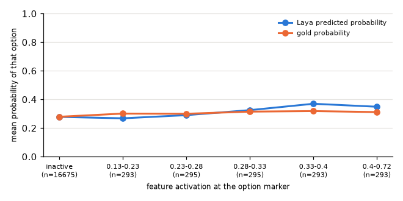

# Feature 1296

Critérios em que aparece: attribution_toward_wrong

**Interpretação (preencher):** 

---

## Maiores ativações

**tr_customer_service_000216 / category** (choice, customer_service) | ativação 2.203 em `estado` | opções ['account', 'billing', 'delivery', 'refund', 'technical'] | Laya: **delivery** [0.0, 0.0, 0.997, 0.0, 0.002] | gabarito: **delivery**

```
<bos> choice question: What is this customer conversation primarily about?<eos>
▸ <mask> account: Login, plan changes, profile or access management.
▸ <mask> billing: A charge, invoice, subscription or payment problem.
▸ <mask> delivery: Shipping, fulfilment or delivery of a physical item.
▸ <mask> refund: The customer is explicitly asking for money back.
▸ <mask> technical: The product or service is not working as expected.

<eos>

 {"account": {"lifetime_value_usd": 90, "prior_tickets_90d": 0, "seats": 1, "tenure_months": 2, "tier": "free"}, "thread": [{"role": "customer", "text": "Hello there, I am checking on the status of my order. It’s for a birthday party this weekend, so I’m a bit worried it hasn't arrived yet."}, {"role": "agent", "text": "I would be happy to look into that for you. Could you please provide the order number so I can check the current shipping status in our system?"}, {"role": "customer", "text": "Of course, the order number is #44921. I really need these supplies by Friday at the latest for the⟦ event⟧ to go smoothly, so any help is appreciated."}]}<eos>
```

**tr_customer_service_000217 / needs_human** (noul, customer_service) | ativação 2.195 em `estado` | opções ['false', 'true'] | Laya: **true** [0.151, 0.849] | gabarito: **false**

```
<bos> noul question: This conversation requires a human agent rather than automated handling.<eos>
▸ <mask> false: Automation can carry this to resolution.
▸ <mask> true: A human must take over: judgement, authority or empathy is required.

<eos>

 {"account": {"lifetime_value_usd": 835, "prior_tickets_90d": 0, "seats": 1, "tenure_months": 33, "tier": "free"}, "thread": [{"role": "customer", "text": "I've been using this account for nearly three years without an issue, but now I'm locked out and the reset emails just aren't arriving. I suppose this is just how it goes sometimes; I'm not sure what⟦ else⟧ to try."}]}<eos>
```

**tr_customer_service_000228 / needs_human** (noul, customer_service) | ativação 2.191 em `estado` | opções ['false', 'true'] | Laya: **true** [0.228, 0.772] | gabarito: **true**

```
<bos> noul question: This conversation requires a human agent rather than automated handling.<eos>
▸ <mask> false: Automation can carry this to resolution.
▸ <mask> true: A human must take over: judgement, authority or empathy is required.

<eos>

 {"account": {"lifetime_value_usd": 1521, "prior_tickets_90d": 1, "seats": 1, "tenure_months": 26, "tier": "standard"}, "thread": [{"role": "customer", "text": "I've been with the standard plan for over two years now, and I think it's time to close my account. Please go ahead and cancel it."}, {"role": "agent", "text": "I’m sorry to hear you’⟦d⟧ like to cancel. Could you confirm the email address associated with the account so I can pull up the details?"}, {"role": "customer", "text": "Sure, it's jane.doe@example.com. I’ve already tried this before; the last ticket was closed but the issue kept coming back."}]}<eos>
```

**tr_customer_service_000217 / urgency** (score, customer_service) | ativação 2.172 em `estado` | opções ['0', '1', '2', '3'] | Laya: **1** [0.194, 0.552, 0.149, 0.105] | gabarito: **2**

```
<bos> score question: How time-sensitive is this conversation?<eos>
▸ <mask> level 0: No time pressure; can wait indefinitely.
▸ <mask> level 1: Routine; handle within the normal queue.
▸ <mask> level 2: Elevated; should be handled within the same week.
▸ <mask> level 3: Critical; requires action within the same day.

<eos>

 {"account": {"lifetime_value_usd": 835, "prior_tickets_90d": 0, "seats": 1, "tenure_months": 33, "tier": "free"}, "thread": [{"role": "customer", "text": "I've been using this account for nearly three years without an issue, but now I'm locked out and the reset emails just aren't arriving. I suppose this is just how it goes sometimes; I'm not sure what⟦ else⟧ to try."}]}<eos>
```

**tr_customer_service_000217 / churn_risk** (score, customer_service) | ativação 2.164 em `estado` | opções ['0', '1', '2', '3'] | Laya: **2** [0.04, 0.255, 0.644, 0.061] | gabarito: **1**

```
<bos> score question: How likely is this customer to stop doing business with us because of this interaction?<eos>
▸ <mask> level 0: No sign of dissatisfaction.
▸ <mask> level 1: Mild frustration, but the relationship is intact.
▸ <mask> level 2: Clearly unhappy; repeat problems or explicit complaints.
▸ <mask> level 3: Imminent: threatening to cancel, dispute or leave.

<eos>

 {"account": {"lifetime_value_usd": 835, "prior_tickets_90d": 0, "seats": 1, "tenure_months": 33, "tier": "free"}, "thread": [{"role": "customer", "text": "I've been using this account for nearly three years without an issue, but now I'm locked out and the reset emails just aren't arriving. I suppose this is just how it goes sometimes; I'm not sure what⟦ else⟧ to try."}]}<eos>
```

## Ativações medianas (faixa 40-60%, mediana 0.678)

**tr_agent_trace_observability_000239 / outcome** (choice, agent_trace_observability) | ativação 0.687 em `estado` | opções ['failure', 'harmful', 'partial', 'success'] | Laya: **success** [0.106, 0.011, 0.112, 0.772] | gabarito: **partial**

```
<bos> choice question: How did this agent run turn out?<eos>
▸ <mask> failure: The agent did not accomplish the task.
▸ <mask> harmful: The agent took an action that caused damage or violated a constraint.
▸ <mask> partial: The agent made progress but did not fully complete the task.
▸ <mask> success: The agent completed the task correctly.

<eos>

 {"agent": {"autonomy": "unsupervised", "model": "internal-agent-v3"}, "constraints": ["Do⟦ not⟧ force-push to any branch", "Never modify production without an approved change ticket"], "task": "Reconcile the billing ledger against the payment provider.", "trace_summary": {"constraint_violations": 0, "duration_s": 263.5, "irreversible_actions": 0, "steps": 10, "tool_errors": 3}}<eos>
```

**tr_agent_trace_observability_000050 / needs_review** (noul, agent_trace_observability) | ativação 0.684 em `estado` | opções ['false', 'true'] | Laya: **false** [0.775, 0.225] | gabarito: **true**

```
<bos> noul question: This trace requires human review.<eos>
▸ <mask> false: No human attention is warranted.
▸ <mask> true: A human should inspect this run.

<eos>

 {"agent": {"autonomy": "unsupervised", "model": "internal-agent-v1"}, "constraints": ["Do not exceed a $50 spend on cloud resources"], "task": "Migrate the user table to the new schema without downtime.", "trace_summary": {"constraint_violations": 0, "duration_s": ⟦1⟧80.3, "irreversible_actions": 1, "steps": 3, "tool_errors": 2}}<eos>
```

**tr_customer_service_000275 / urgency** (score, customer_service) | ativação 0.732 em `estado` | opções ['0', '1', '2', '3'] | Laya: **2** [0.258, 0.21, 0.358, 0.174] | gabarito: **2**

```
<bos> score question: How time-sensitive is this conversation?<eos>
▸ <mask> level 0: No time pressure; can wait indefinitely.
▸ <mask> level 1: Routine; handle within the normal queue.
▸ <mask> level 2: Elevated; should be handled within the same week.
▸ <mask> level 3: Critical; requires action within the same day.

<eos>

 {"account": {"lifetime_value_usd": 51, "prior_tickets_90d": 3, "seats": 1, "tenure_months": 1, "tier": "standard"}, "orders": [{"amount_usd": 149, "date": "2026-01-08", "id": "A-29936", "status": "failed"}], "thread": [{"role": "customer", "text": "I need the standard account canceled by Friday at 5 p.m. I’ve only been with you for a month, there’s about $149 attached, and after three tickets with promised fixes that never landed⟦,⟧ I can’t keep waiting."}]}<eos>
```

**tr_invoice_processing_000149 / disposition** (choice, invoice_processing) | ativação 0.707 em `opção` | opções ['approve', 'hold', 'manual_review', 'reject'] | Laya: **approve** [0.499, 0.243, 0.029, 0.228] | gabarito: **approve**

```
<bos> choice question: How should this vendor invoice be dispositioned?<eos>
▸ <mask> approve: Matches the order and delivery; approve for payment.
▸ <mask> hold: Something needs confirming before payment; hold pending clarification.
▸ <mask> manual_review: A human⟦ in⟧ finance must review the discrepancy.
▸ <mask> reject: Should not be paid: duplicate, unauthorised or materially wrong.

<eos>

 {"delivery": {"condition": "accepted", "date": "2026-03-14", "received_qty": 50}, "invoice": {"currency": "USD", "id": "INV-2026-2574", "lines": [{"qty": 50, "sku": "SKU-822", "total_usd": 4408.0, "unit_usd": 88.16}], "total_usd": 4408.0, "vendor": "Orbit Logistics"}, "payment": {"days_until_due": 18, "discount_expires_in_days": 7, "early_payment_discount_pct": 2.0, "status": "scheduled", "terms": "net 15"}, "purchase_order": {"freight_terms": "freight prepaid by vendor, not separately billable", "id": "PO-5874", "lines": [{"qty": 50, "unit_usd": 88.16}], "total_usd": 4408.0}, "vendor_history": {"disputes_12m": 0, "invoices_12m": 23, "prior_invoice_ids": ["INV-2026-1898", "INV-2026-1599", "INV-2026-7232"]}}<eos>
```

**tr_customer_service_000297 / churn_risk** (score, customer_service) | ativação 0.661 em `pergunta` | opções ['0', '1', '2', '3'] | Laya: **1** [0.2, 0.608, 0.167, 0.024] | gabarito: **1**

```
<bos> score question: How⟦ likely⟧ is this customer to stop doing business with us because of this interaction?<eos>
▸ <mask> level 0: No sign of dissatisfaction.
▸ <mask> level 1: Mild frustration, but the relationship is intact.
▸ <mask> level 2: Clearly unhappy; repeat problems or explicit complaints.
▸ <mask> level 3: Imminent: threatening to cancel, dispute or leave.

<eos>

 {"account": {"lifetime_value_usd": 581, "prior_tickets_90d": 2, "seats": 40, "tenure_months": 11, "tier": "enterprise"}, "orders": [{"amount_usd": 299, "date": "2026-03-03", "id": "A-90996", "status": "settled"}], "thread": [{"role": "customer", "text": "I just opened the box and the hardware is cracked, but I'm not sure if this happened during shipping or if it was like this already? I have a hard deadline this Friday and really need this working."}, {"role": "agent", "text": "I'm sorry to hear about the damage. To help me look into this, could you please provide your order number and upload a few photos of the packaging?"}, {"role": "customer", "text": "I think I sent photos in my last two tickets, but I can't remember if they actually saw them. Where do I upload them again?"}]}<eos>
```

## Estatísticas (conjunto de descoberta, dev e teste)

**pred / error**

| split | decisões | ativas | ativas e Laya errou | taxa | lift | q (BH) | OR (CMH) | q (CMH) |
|---|---|---|---|---|---|---|---|---|
| discovery | 5100 | 499 | 282 | 0.565 | 0.88 | 0.000377 | 0.82 | 0.447 |
| dev | 900 | 74 | 46 | 0.622 | 0.92 | 0.536 | 1.18 | 0.834 |
| test | 2000 | 162 | 99 | 0.611 | 0.94 | 0.388 | 0.76 | 0.589 |

**corr / error**

| split | decisões | ativas | ativas e Laya errou | taxa | lift | q (BH) | OR (CMH) | q (CMH) |
|---|---|---|---|---|---|---|---|---|
| discovery | 5100 | 475 | 258 | 0.543 | 0.84 | 5.99e-06 | 1.13 | 0.519 |
| dev | 900 | 62 | 34 | 0.548 | 0.82 | 0.0804 | 1.43 | 0.778 |
| test | 2000 | 149 | 86 | 0.577 | 0.89 | 0.0884 | 0.94 | 0.92 |

**state / error**

| split | decisões | ativas | ativas e Laya errou | taxa | lift | q (BH) | OR (CMH) | q (CMH) |
|---|---|---|---|---|---|---|---|---|
| discovery | 5100 | 5041 | 3249 | 0.645 | 1.00 | 0.519 | 1.02 | 0.99 |
| dev | 900 | 884 | 597 | 0.675 | 1.00 | 0.561 | 1.76 | 0.649 |
| test | 2000 | 1975 | 1289 | 0.653 | 1.00 | 0.345 | 1.37 | 0.824 |

**pred / probe_right_laya_wrong**

| split | decisões | ativas | ativas e Laya errou | taxa | lift | q (BH) | OR (CMH) | q (CMH) |
|---|---|---|---|---|---|---|---|---|
| discovery | 2819 | 236 | 138 | 0.585 | 0.90 | 0.0594 | 0.90 | 0.725 |
| dev | 520 | 39 | 23 | 0.590 | 0.87 | 0.454 | 1.04 | 0.954 |
| test | 1106 | 74 | 46 | 0.622 | 0.98 | 0.965 | 0.93 | 0.99 |

**corr / probe_right_laya_wrong**

| split | decisões | ativas | ativas e Laya errou | taxa | lift | q (BH) | OR (CMH) | q (CMH) |
|---|---|---|---|---|---|---|---|---|
| discovery | 2819 | 219 | 121 | 0.553 | 0.85 | 0.0048 | 1.34 | 0.389 |
| dev | 520 | 28 | 12 | 0.429 | 0.63 | 0.0183 | 0.87 | 0.898 |
| test | 1106 | 65 | 37 | 0.569 | 0.90 | 0.389 | 1.02 | 0.968 |

**state / probe_right_laya_wrong**

| split | decisões | ativas | ativas e Laya errou | taxa | lift | q (BH) | OR (CMH) | q (CMH) |
|---|---|---|---|---|---|---|---|---|
| discovery | 2819 | 2781 | 1805 | 0.649 | 1.00 | 0.163 | 1.21 | 0.827 |
| dev | 520 | 508 | 347 | 0.683 | 1.01 | 0.206 | 3.28 | 0.215 |
| test | 1106 | 1087 | 693 | 0.638 | 1.01 | 0.121 | 1.75 | 0.649 |

Confusão mais sobre-representada (pred): `churn_risk|1>2` (n=38, lift 6.94, p=4.7e-26). Formato `pergunta|índice previsto>índice correto`.

Confusão mais sobre-representada (corr): `churn_risk|1>2` (n=35, lift 6.71, p=5.44e-23). Formato `pergunta|índice previsto>índice correto`.

Confusão mais sobre-representada (state): `duplicate|1>0` (n=217, lift 1.01, p=0.0757). Formato `pergunta|índice previsto>índice correto`.



