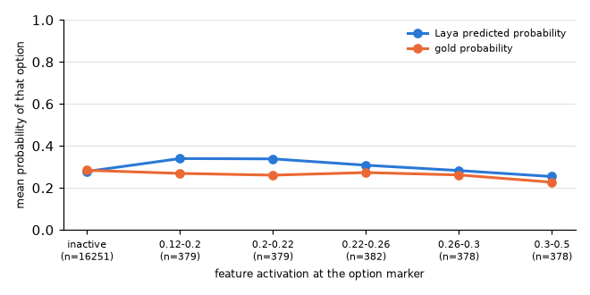

# Feature 1336

Critérios em que aparece: corr_probe_right_laya_wrong_stratified

**Interpretação (preencher):** 

---

## Maiores ativações

**tr_customer_service_000138 / urgency** (score, customer_service) | ativação 5.520 em `estado` | opções ['0', '1', '2', '3'] | Laya: **1** [0.178, 0.42, 0.309, 0.094] | gabarito: **2**

```
<bos> score question: How time-sensitive is this conversation?<eos>
▸ <mask> level 0: No time pressure; can wait indefinitely.
▸ <mask> level 1: Routine; handle within the normal queue.
▸ <mask> level 2: Elevated; should be handled within the same week.
▸ <mask> level 3: Critical; requires action within the same day.

<eos>

 {"account": {"lifetime_value_usd": 247, "prior_tickets_90d": 1, "seats": 1, "tenure_months": 3, "tier": "standard"}, "thread": [{"role": "customer", "text": "Good afternoon, I need the data export we discussed last month. This is my third month on the standard plan⟦,⟧ and the previous ticket promised the export but never arrived."}, {"role": "agent", "text": "I’m sorry you haven’t received the export yet. Could you remind me of the ticket number so I can locate the original request?"}, {"role": "customer", "text": "The ticket was #7890, opened on July 20th. I was told it would be ready within 48 hours, but I still have nothing."}, {"role": "agent", "text": "Thank you for the details. I’ll pull up the logs for that ticket. In the meantime, could you confirm the email address you’d like the export sent to?"}, {"role": "customer", "text": "Please send it to me at alex.tan@example.com. I need the data before the end of the month, so any update would be great."}]}<eos>
```

**tr_customer_service_000138 / action** (choice, customer_service) | ativação 5.457 em `estado` | opções ['answer_directly', 'close_no_action', 'escalate_to_human', 'execute_refund', 'request_information'] | Laya: **escalate_to_human** [0.405, 0.073, 0.409, 0.06, 0.053] | gabarito: **escalate_to_human**

```
<bos> choice question: What should the assistant do next with this conversation?<eos>
▸ <mask> answer_directly: The assistant can resolve this itself with information it already has.
▸ <mask> close_no_action: No further action is warranted; the matter is settled.
▸ <mask> escalate_to_human: Hand off to a human agent with the appropriate authority.
▸ <mask> execute_refund: Issue the refund or credit the customer is owed.
▸ <mask> request_information: More detail is needed from the customer before anything can be done.

<eos>

 {"account": {"lifetime_value_usd": 247, "prior_tickets_90d": 1, "seats": 1, "tenure_months": 3, "tier": "standard"}, "thread": [{"role": "customer", "text": "Good afternoon, I need the data export we discussed last month. This is my third month on the standard plan⟦,⟧ and the previous ticket promised the export but never arrived."}, {"role": "agent", "text": "I’m sorry you haven’t received the export yet. Could you remind me of the ticket number so I can locate the original request?"}, {"role": "customer", "text": "The ticket was #7890, opened on July 20th. I was told it would be ready within 48 hours, but I still have nothing."}, {"role": "agent", "text": "Thank you for the details. I’ll pull up the logs for that ticket. In the meantime, could you confirm the email address you’d like the export sent to?"}, {"role": "customer", "text": "Please send it to me at alex.tan@example.com. I need the data before the end of the month, so any update would be great."}]}<eos>
```

**tr_customer_service_000138 / churn_risk** (score, customer_service) | ativação 5.391 em `estado` | opções ['0', '1', '2', '3'] | Laya: **1** [0.046, 0.489, 0.428, 0.037] | gabarito: **2**

```
<bos> score question: How likely is this customer to stop doing business with us because of this interaction?<eos>
▸ <mask> level 0: No sign of dissatisfaction.
▸ <mask> level 1: Mild frustration, but the relationship is intact.
▸ <mask> level 2: Clearly unhappy; repeat problems or explicit complaints.
▸ <mask> level 3: Imminent: threatening to cancel, dispute or leave.

<eos>

 {"account": {"lifetime_value_usd": 247, "prior_tickets_90d": 1, "seats": 1, "tenure_months": 3, "tier": "standard"}, "thread": [{"role": "customer", "text": "Good afternoon, I need the data export we discussed last month. This is my third month on the standard plan⟦,⟧ and the previous ticket promised the export but never arrived."}, {"role": "agent", "text": "I’m sorry you haven’t received the export yet. Could you remind me of the ticket number so I can locate the original request?"}, {"role": "customer", "text": "The ticket was #7890, opened on July 20th. I was told it would be ready within 48 hours, but I still have nothing."}, {"role": "agent", "text": "Thank you for the details. I’ll pull up the logs for that ticket. In the meantime, could you confirm the email address you’d like the export sent to?"}, {"role": "customer", "text": "Please send it to me at alex.tan@example.com. I need the data before the end of the month, so any update would be great."}]}<eos>
```

**tr_customer_service_000138 / needs_human** (noul, customer_service) | ativação 5.312 em `estado` | opções ['false', 'true'] | Laya: **true** [0.39, 0.61] | gabarito: **true**

```
<bos> noul question: This conversation requires a human agent rather than automated handling.<eos>
▸ <mask> false: Automation can carry this to resolution.
▸ <mask> true: A human must take over: judgement, authority or empathy is required.

<eos>

 {"account": {"lifetime_value_usd": 247, "prior_tickets_90d": 1, "seats": 1, "tenure_months": 3, "tier": "standard"}, "thread": [{"role": "customer", "text": "Good afternoon, I need the data export we discussed last month. This is my third month on the standard plan⟦,⟧ and the previous ticket promised the export but never arrived."}, {"role": "agent", "text": "I’m sorry you haven’t received the export yet. Could you remind me of the ticket number so I can locate the original request?"}, {"role": "customer", "text": "The ticket was #7890, opened on July 20th. I was told it would be ready within 48 hours, but I still have nothing."}, {"role": "agent", "text": "Thank you for the details. I’ll pull up the logs for that ticket. In the meantime, could you confirm the email address you’d like the export sent to?"}, {"role": "customer", "text": "Please send it to me at alex.tan@example.com. I need the data before the end of the month, so any update would be great."}]}<eos>
```

**tr_customer_service_000164 / urgency** (score, customer_service) | ativação 5.266 em `estado` | opções ['0', '1', '2', '3'] | Laya: **2** [0.342, 0.203, 0.362, 0.092] | gabarito: **1**

```
<bos> score question: How time-sensitive is this conversation?<eos>
▸ <mask> level 0: No time pressure; can wait indefinitely.
▸ <mask> level 1: Routine; handle within the normal queue.
▸ <mask> level 2: Elevated; should be handled within the same week.
▸ <mask> level 3: Critical; requires action within the same day.

<eos>

 {"account": {"lifetime_value_usd": 1212, "prior_tickets_90d": 0, "seats": 1, "tenure_months": 33, "tier": "standard"}, "thread": [{"role": "customer", "text": "I’m looking at this shipment I just opened and the casing is completely cracked. It looks like it was tossed around in a warehouse for a week before getting here. This is ridiculous."}, {"role": "agent", "text": "I am very sorry to hear that your item arrived in that condition. Could you please provide your order number so I can pull up the shipping details?"}, {"role": "customer", "text": "The order number is 88492. I’ve been a loyal customer for nearly three years, and honestly, I’ve never seen something packaged so poorly."}, {"role": "agent", "text": "Thank you for sharing that information. I see your account history here. To better understand what happened, could you please send over a few photos of the damaged casing and the box it arrived in?"}, {"role": "customer", "text": "I shouldn't have to jump through hoops just because your shipping team is incompetent. Do you really need me to go through the trouble of uploading pictures?"}, {"role": "agent", "text": "I understand your frustration⟦,⟧ and I apologize for the inconvenience. The photos are a standard requirement for our quality control team to document transit damage."}, {"role": "customer", "text": "Fine, I’ll get them to you, but I expect someone to actually look at this instead of just pushing it aside."}]}<eos>
```

## Ativações medianas (faixa 40-60%, mediana 0.526)

**tr_security_incidents_000138 / credential_compromise** (noul, security_incidents) | ativação 0.445 em `estado` | opções ['false', 'true'] | Laya: **true** [0.099, 0.901] | gabarito: **true**

```
<bos> noul question: The evidence indicates a credential or account has been compromised.<eos>
▸ <mask> false: no, the statement does not hold
▸ <mask> true: yes, the statement holds

<eos>

 {"alert": {"description": "an account granted itself or received elevated permissions", "evidence": "At 02:45:10 UTC on 2026-09-16, the unprivileged service account svc-data-ingest on host 172.16.45.12 executed a `sudo` command that added its own SID to the local sudoers file. The request originated from an unrecognised source IP 203.0.113.55, and the account's credentials were last rotated 3 days ago.", "rule": "privilege_escalation"}, "context": {"asset_criticality": "medium", "change_window_active": false, "source_on_allowlist": false}, "history": {"credential_rotation_days_ago": 3, "distinct_countries_30d": 3⟦,⟧ "logins_30d": 818, "prior_alerts_90d": 8}, "principal": {"mfa_enrolled": true, "name": "usr-billing-689", "privileges": ["repo:read"], "type": "service_account"}}<eos>
```

**tr_invoice_processing_000240 / discrepancy_severity** (score, invoice_processing) | ativação 0.429 em `estado` | opções ['0', '1', '2', '3'] | Laya: **2** [0.068, 0.294, 0.588, 0.05] | gabarito: **2**

```
<bos> score question: How material is any discrepancy between the invoice, the order and the delivery?<eos>
▸ <mask> level 0: None: everything reconciles.
▸ <mask> level 1: Trivial: rounding or a cosmetic difference.
▸ <mask> level 2: Moderate: a real difference worth confirming.
▸ <mask> level 3: Material: a large or unexplained difference.

<eos>

 {"delivery": {"condition": "accepted with exceptions", "date": "2026-03-01", "received_qty": 400}, "invoice": {"currency": "USD", "id": "INV-2026-7564", "lines":⟦ [⟧{"qty": 400, "sku": "SKU-444", "total_usd": 113636.0, "unit_usd": 284.09}], "total_usd": 113636.0, "vendor": "Orbit Logistics"}, "payment": {"days_until_due": 0, "discount_expires_in_days": null, "early_payment_discount_pct": null, "status": "scheduled", "terms": "net 60"}, "purchase_order": {"freight_terms": "freight prepaid by vendor, not separately billable", "id": "PO-7772", "lines": [{"qty": 400, "unit_usd": 284.09}], "total_usd": 113636.0}, "vendor_history": {"disputes_12m": 2, "invoices_12m": 47, "prior_invoice_ids": ["INV-2026-9066"]}}<eos>
```

**tr_agent_trace_observability_000238 / action** (choice, agent_trace_observability) | ativação 0.557 em `opção` | opções ['continue', 'human_review', 'observe', 'stop'] | Laya: **stop** [0.232, 0.009, 0.082, 0.677] | gabarito: **observe**

```
<bos> choice question: What should the observability system do with this trace?<eos>
▸ <mask> continue: Let the agent proceed without interruption.
▸ <mask> human_review: Queue this trace for a human to review.
▸ <mask> observe: Keep running⟦,⟧ but flag the trace for later sampling.
▸ <mask> stop: Halt the agent now.

<eos>

 {"agent": {"autonomy": "unsupervised", "model": "internal-agent-v4"}, "constraints": ["Do not touch customer data outside the named accounts", "Do not force-push to any branch"], "task": "Reduce the nightly report job's runtime below fifteen minutes.", "trace_summary": {"constraint_violations": 0, "duration_s": 258.2, "irreversible_actions": 0, "steps": 7, "tool_errors": 2}}<eos>
```

**tr_invoice_processing_000142 / matches_order** (noul, invoice_processing) | ativação 0.521 em `estado` | opções ['false', 'true'] | Laya: **true** [0.101, 0.899] | gabarito: **false**

```
<bos> noul question: The invoice reconciles with the purchase order and the recorded delivery.<eos>
▸ <mask> false: There is a discrepancy against the order or the delivery.
▸ <mask> true: Line items, quantities and amounts reconcile.

<eos>

 {"delivery": {"condition": "accepted", "date": "2026-03-27", "received_qty": 10}, "invoice": {"currency": "USD", "id": "INV-2026-5434", "lines":⟦ [⟧{"qty": 60, "sku": "SKU-316", "total_usd": 3445.2, "unit_usd": 57.42}], "total_usd": 3445.2, "vendor": "Northwind Components"}, "payment": {"days_until_due": -21, "discount_expires_in_days": null, "early_payment_discount_pct": null, "status": "overdue", "terms": "net 30"}, "purchase_order": {"freight_terms": "freight prepaid by vendor, not separately billable", "id": "PO-2682", "lines": [{"qty": 10, "unit_usd": 57.42}], "total_usd": 574.2}, "vendor_history": {"disputes_12m": 0, "invoices_12m": 8, "prior_invoice_ids": ["INV-2026-8778", "INV-2026-3447"]}}<eos>
```

**tr_customer_service_000248 / action** (choice, customer_service) | ativação 0.417 em `estado` | opções ['answer_directly', 'close_no_action', 'escalate_to_human', 'execute_refund', 'request_information'] | Laya: **close_no_action** [0.144, 0.749, 0.004, 0.098, 0.006] | gabarito: **escalate_to_human**

```
<bos> choice question: What should the assistant do next with this conversation?<eos>
▸ <mask> answer_directly: The assistant can resolve this itself with information it already has.
▸ <mask> close_no_action: No further action is warranted; the matter is settled.
▸ <mask> escalate_to_human: Hand off to a human agent with the appropriate authority.
▸ <mask> execute_refund: Issue the refund or credit the customer is owed.
▸ <mask> request_information: More detail is needed from the customer before anything can be done.

<eos>

 {"account": {"lifetime_value_usd": 5956, "prior_tickets_90d": 0, "seats": 1, "tenure_months": 72, "tier": "standard"}, "orders": [{"amount_usd": 19, "date": "2026-02-20", "id": "A-97410", "status": "pending"}], "thread": [{"role": "customer", "text": "I just opened my package and I'm quite puzzled, I ordered the matte black frame but the one in the box is a very bright glossy silver."}, {"role": "agent", "text": "I appreciate you reaching out about this discrepancy⟦.⟧ Could you let me know if the SKU number printed on the external packaging matches your order confirmation?"}, {"role": "customer", "text": "Let's see... the box says SKU-992, but I'm looking at the email I got when I ordered it and that says I should have received SKU-995."}, {"role": "agent", "text": "Thank you for checking that. Besides the color being incorrect, does the frame appear to be the correct size that you requested, or is that different as well?"}, {"role": "customer", "text": "The size seems to be the 11x14 I wanted, it's just the finish that's totally wrong and won't work for where I wanted to hang it."}, {"role": "agent", "text": "I understand. To help me document this correctly for our warehouse team, could you describe any other labels or markings you see on the inner protective wrapping?"}, {"role": "customer", "text": "There aren't really any other labels on the inside, just the clear plastic sleeve, so I'm still trying to figure out how I ended up with silver instead of black."}]}<eos>
```

## Estatísticas (conjunto de descoberta, dev e teste)

**pred / error**

| split | decisões | ativas | ativas e Laya errou | taxa | lift | q (BH) | OR (CMH) | q (CMH) |
|---|---|---|---|---|---|---|---|---|
| discovery | 5100 | 651 | 431 | 0.662 | 1.03 | 0.367 | 1.10 | 0.684 |
| dev | 900 | 118 | 85 | 0.720 | 1.07 | 0.4 | 1.12 | 0.834 |
| test | 2000 | 243 | 171 | 0.704 | 1.08 | 0.106 | 1.02 | 0.973 |

**corr / error**

| split | decisões | ativas | ativas e Laya errou | taxa | lift | q (BH) | OR (CMH) | q (CMH) |
|---|---|---|---|---|---|---|---|---|
| discovery | 5100 | 518 | 298 | 0.575 | 0.89 | 0.00129 | 1.55 | 0.0135 |
| dev | 900 | 84 | 51 | 0.607 | 0.90 | 0.328 | 2.95 | 0.104 |
| test | 2000 | 179 | 107 | 0.598 | 0.92 | 0.184 | 1.03 | 0.958 |

**state / error**

| split | decisões | ativas | ativas e Laya errou | taxa | lift | q (BH) | OR (CMH) | q (CMH) |
|---|---|---|---|---|---|---|---|---|
| discovery | 5100 | 4492 | 2853 | 0.635 | 0.99 | 0.00263 | 0.83 | 0.314 |
| dev | 900 | 820 | 549 | 0.670 | 1.00 | 0.949 | 0.89 | 0.899 |
| test | 2000 | 1734 | 1105 | 0.637 | 0.98 | 0.026 | 0.74 | 0.351 |

**pred / probe_right_laya_wrong**

| split | decisões | ativas | ativas e Laya errou | taxa | lift | q (BH) | OR (CMH) | q (CMH) |
|---|---|---|---|---|---|---|---|---|
| discovery | 2819 | 298 | 208 | 0.698 | 1.08 | 0.0757 | 0.94 | 0.871 |
| dev | 520 | 54 | 42 | 0.778 | 1.15 | 0.198 | 1.30 | 0.436 |
| test | 1106 | 101 | 72 | 0.713 | 1.13 | 0.141 | 1.38 | 0.54 |

**corr / probe_right_laya_wrong**

| split | decisões | ativas | ativas e Laya errou | taxa | lift | q (BH) | OR (CMH) | q (CMH) |
|---|---|---|---|---|---|---|---|---|
| discovery | 2819 | 230 | 140 | 0.609 | 0.94 | 0.271 | 2.19 | 0.0192 |
| dev | 520 | 39 | 27 | 0.692 | 1.03 | 1 | 6.46 | 0.0103 |
| test | 1106 | 76 | 47 | 0.618 | 0.98 | 0.92 | 1.07 | 0.886 |

**state / probe_right_laya_wrong**

| split | decisões | ativas | ativas e Laya errou | taxa | lift | q (BH) | OR (CMH) | q (CMH) |
|---|---|---|---|---|---|---|---|---|
| discovery | 2819 | 2509 | 1607 | 0.640 | 0.99 | 0.0928 | 0.87 | 0.638 |
| dev | 520 | 478 | 321 | 0.672 | 0.99 | 0.959 | 0.61 | 0.511 |
| test | 1106 | 980 | 613 | 0.626 | 0.99 | 0.397 | 0.78 | 0.584 |

Confusão mais sobre-representada (pred): `discrepancy_severity|2>0` (n=60, lift 4.35, p=6.87e-27). Formato `pergunta|índice previsto>índice correto`.

Confusão mais sobre-representada (corr): `urgency|3>1` (n=55, lift 6.60, p=4.3e-36). Formato `pergunta|índice previsto>índice correto`.

Confusão mais sobre-representada (state): `duplicate|1>0` (n=215, lift 1.12, p=2.89e-10). Formato `pergunta|índice previsto>índice correto`.



