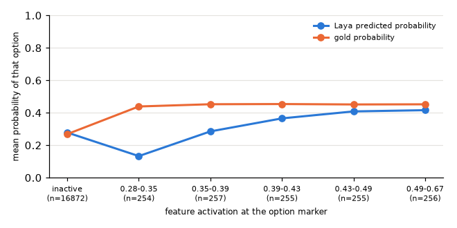

# Feature 1417

Critérios em que aparece: corr_error_stratified, corr_probe_right_laya_wrong_stratified

**Interpretação (preencher):** 

---

## Maiores ativações

**tr_customer_service_000223 / needs_human** (noul, customer_service) | ativação 2.211 em `estado` | opções ['false', 'true'] | Laya: **true** [0.352, 0.648] | gabarito: **false**

```
<bos> noul question: This conversation requires a human agent rather than automated handling.<eos>
▸ <mask> false: Automation can carry this to resolution.
▸ <mask> true: A human must take over: judgement, authority or empathy is required.

<eos>

 {"account": {"lifetime_value_usd": 1585, "prior_tickets_90d": 0, "seats": 1, "tenure_months": 26, "tier": "free"}, "orders": [{"amount_usd": 27, "date": "2026-02-25", "id": "A-40562", "status": "pending"}, {"amount_usd": 27, "date": "2026-02-03", "id": "A-21524", "status": "pending"}], "thread": [{"role": "customer", "text": "Hello, I’ve been⟦ a⟧ user for a long time but I would like to request the cancellation of my account. Could you please assist me with the process?"}, {"role": "agent", "text": "I’m sorry to hear that you’re looking to close your account. Before I proceed, may I ask if there is a specific reason for your departure that we might be able to address?"}, {"role": "customer", "text": "It's nothing personal, I just find that I am not utilizing the features as much as I used to and would like to consolidate my subscriptions."}, {"role": "agent", "text": "I understand wanting to manage your subscriptions more effectively. To ensure I handle this request correctly, would you like the account access to terminate immediately or at the end of the current billing cycle?"}, {"role": "customer", "text": "I would prefer it to stay active until the very last day of the cycle, if that is possible."}]}<eos>
```

**tr_customer_service_000168 / category** (choice, customer_service) | ativação 2.180 em `estado` | opções ['account', 'billing', 'delivery', 'refund', 'technical'] | Laya: **billing** [0.0, 0.999, 0.0, 0.0, 0.0] | gabarito: **billing**

```
<bos> choice question: What is this customer conversation primarily about?<eos>
▸ <mask> account: Login, plan changes, profile or access management.
▸ <mask> billing: A charge, invoice, subscription or payment problem.
▸ <mask> delivery: Shipping, fulfilment or delivery of a physical item.
▸ <mask> refund: The customer is explicitly asking for money back.
▸ <mask> technical: The product or service is not working as expected.

<eos>

 {"account": {"lifetime_value_usd": 4178, "prior_tickets_90d": 0, "seats": 1, "tenure_months": 60, "tier": "premium"}, "orders": [{"amount_usd": 147, "date": "2026-03-07", "id": "A-83083", "status": "settled"}, {"amount_usd": 147, "date": "2026-02-24", "id": "A-35216", "status": "settled"}], "thread": [{"role": "customer", "text": "I need a copy of the invoice for the $147 charge on my premium account—I've been a customer for five years and the deadline⟦ to⟧ submit it is tomorrow. This is getting ridiculous."}, {"role": "agent", "text": "I’m sorry to hear you’re under pressure. Could you tell me which billing period the invoice is for?"}, {"role": "customer", "text": "It’s the most recent one, the one that showed up on my statement for the $147 premium fee. I can’t afford to wait any longer."}, {"role": "agent", "text": "Got it. Do you have a preferred way to receive the invoice—email attachment or a secure link?"}, {"role": "customer", "text": "Email it to me right away, please. I’ll be checking my inbox constantly until I get it."}]}<eos>
```

**tr_customer_service_000223 / category** (choice, customer_service) | ativação 2.160 em `estado` | opções ['account', 'billing', 'delivery', 'refund', 'technical'] | Laya: **billing** [0.174, 0.74, 0.002, 0.037, 0.047] | gabarito: **account**

```
<bos> choice question: What is this customer conversation primarily about?<eos>
▸ <mask> account: Login, plan changes, profile or access management.
▸ <mask> billing: A charge, invoice, subscription or payment problem.
▸ <mask> delivery: Shipping, fulfilment or delivery of a physical item.
▸ <mask> refund: The customer is explicitly asking for money back.
▸ <mask> technical: The product or service is not working as expected.

<eos>

 {"account": {"lifetime_value_usd": 1585, "prior_tickets_90d": 0, "seats": 1, "tenure_months": 26, "tier": "free"}, "orders": [{"amount_usd": 27, "date": "2026-02-25", "id": "A-40562", "status": "pending"}, {"amount_usd": 27, "date": "2026-02-03", "id": "A-21524", "status": "pending"}], "thread": [{"role": "customer", "text": "Hello, I’ve been⟦ a⟧ user for a long time but I would like to request the cancellation of my account. Could you please assist me with the process?"}, {"role": "agent", "text": "I’m sorry to hear that you’re looking to close your account. Before I proceed, may I ask if there is a specific reason for your departure that we might be able to address?"}, {"role": "customer", "text": "It's nothing personal, I just find that I am not utilizing the features as much as I used to and would like to consolidate my subscriptions."}, {"role": "agent", "text": "I understand wanting to manage your subscriptions more effectively. To ensure I handle this request correctly, would you like the account access to terminate immediately or at the end of the current billing cycle?"}, {"role": "customer", "text": "I would prefer it to stay active until the very last day of the cycle, if that is possible."}]}<eos>
```

**tr_customer_service_000223 / urgency** (score, customer_service) | ativação 2.135 em `estado` | opções ['0', '1', '2', '3'] | Laya: **3** [0.116, 0.167, 0.14, 0.577] | gabarito: **1**

```
<bos> score question: How time-sensitive is this conversation?<eos>
▸ <mask> level 0: No time pressure; can wait indefinitely.
▸ <mask> level 1: Routine; handle within the normal queue.
▸ <mask> level 2: Elevated; should be handled within the same week.
▸ <mask> level 3: Critical; requires action within the same day.

<eos>

 {"account": {"lifetime_value_usd": 1585, "prior_tickets_90d": 0, "seats": 1, "tenure_months": 26, "tier": "free"}, "orders": [{"amount_usd": 27, "date": "2026-02-25", "id": "A-40562", "status": "pending"}, {"amount_usd": 27, "date": "2026-02-03", "id": "A-21524", "status": "pending"}], "thread": [{"role": "customer", "text": "Hello, I’ve been⟦ a⟧ user for a long time but I would like to request the cancellation of my account. Could you please assist me with the process?"}, {"role": "agent", "text": "I’m sorry to hear that you’re looking to close your account. Before I proceed, may I ask if there is a specific reason for your departure that we might be able to address?"}, {"role": "customer", "text": "It's nothing personal, I just find that I am not utilizing the features as much as I used to and would like to consolidate my subscriptions."}, {"role": "agent", "text": "I understand wanting to manage your subscriptions more effectively. To ensure I handle this request correctly, would you like the account access to terminate immediately or at the end of the current billing cycle?"}, {"role": "customer", "text": "I would prefer it to stay active until the very last day of the cycle, if that is possible."}]}<eos>
```

**tr_customer_service_000223 / action** (choice, customer_service) | ativação 2.133 em `estado` | opções ['answer_directly', 'close_no_action', 'escalate_to_human', 'execute_refund', 'request_information'] | Laya: **close_no_action** [0.003, 0.994, 0.001, 0.001, 0.001] | gabarito: **answer_directly**

```
<bos> choice question: What should the assistant do next with this conversation?<eos>
▸ <mask> answer_directly: The assistant can resolve this itself with information it already has.
▸ <mask> close_no_action: No further action is warranted; the matter is settled.
▸ <mask> escalate_to_human: Hand off to a human agent with the appropriate authority.
▸ <mask> execute_refund: Issue the refund or credit the customer is owed.
▸ <mask> request_information: More detail is needed from the customer before anything can be done.

<eos>

 {"account": {"lifetime_value_usd": 1585, "prior_tickets_90d": 0, "seats": 1, "tenure_months": 26, "tier": "free"}, "orders": [{"amount_usd": 27, "date": "2026-02-25", "id": "A-40562", "status": "pending"}, {"amount_usd": 27, "date": "2026-02-03", "id": "A-21524", "status": "pending"}], "thread": [{"role": "customer", "text": "Hello, I’ve been⟦ a⟧ user for a long time but I would like to request the cancellation of my account. Could you please assist me with the process?"}, {"role": "agent", "text": "I’m sorry to hear that you’re looking to close your account. Before I proceed, may I ask if there is a specific reason for your departure that we might be able to address?"}, {"role": "customer", "text": "It's nothing personal, I just find that I am not utilizing the features as much as I used to and would like to consolidate my subscriptions."}, {"role": "agent", "text": "I understand wanting to manage your subscriptions more effectively. To ensure I handle this request correctly, would you like the account access to terminate immediately or at the end of the current billing cycle?"}, {"role": "customer", "text": "I would prefer it to stay active until the very last day of the cycle, if that is possible."}]}<eos>
```

## Ativações medianas (faixa 40-60%, mediana 0.553)

**tr_security_incidents_000066 / credential_compromise** (noul, security_incidents) | ativação 0.520 em `estado` | opções ['false', 'true'] | Laya: **false** [0.722, 0.278] | gabarito: **false**

```
<bos> noul question: The evidence indicates a credential or account has been compromised.<eos>
▸ <mask> false: no, the statement does not hold
▸ <mask> true: yes, the statement holds

<eos>

 {"alert": {"description": "audit logging was turned off on a host", "evidence": "Audit logging was disabled on⟦ the⟧ host at 02:15 UTC. The action was performed by an administrative account from an allowlisted IP address during a scheduled maintenance window.", "rule": "disabled_logging"}, "context": {"asset_criticality": "crown_jewel", "change_window_active": true, "source_on_allowlist": true}, "history": {"credential_rotation_days_ago": 180, "distinct_countries_30d": 2, "logins_30d": 350, "prior_alerts_90d": 1}, "principal": {"mfa_enrolled": true, "name": "svc-analytics-653", "privileges": ["deploy:production", "secrets:read"], "type": "admin"}}<eos>
```

**tr_customer_service_000112 / urgency** (score, customer_service) | ativação 0.537 em `estado` | opções ['0', '1', '2', '3'] | Laya: **1** [0.038, 0.57, 0.255, 0.136] | gabarito: **2**

```
<bos> score question: How time-sensitive is this conversation?<eos>
▸ <mask> level 0: No time pressure; can wait indefinitely.
▸ <mask> level 1: Routine; handle within the normal queue.
▸ <mask> level 2: Elevated; should be handled within the same week.
▸ <mask> level 3: Critical; requires action within the same day.

<eos>

 {"account": {"lifetime_value_usd": 2088, "prior_tickets_90d": 5, "seats": 5, "tenure_months": 72, "tier": "premium"}, "thread": [{"role": "customer", "text": "I'm looking at my bank statement and⟦ I⟧ see two separate charges for my premium subscription again. This is the sixth time I've had to reach out about this specific double-billing issue, and I'm just tired of having to repeat the same conversation every month."}, {"role": "agent", "text": "I'm sorry to hear that you're seeing a duplicate transaction on your account again. To help me investigate, could you please confirm if both charges appeared on the same date?"}, {"role": "customer", "text": "They both showed up on the 14th. I've been a customer for six years and I really expected that after five previous tickets, someone would have found a permanent solution to stop this from happening."}, {"role": "agent", "text": "I appreciate your long-standing loyalty to our service. I'm looking into your billing history now; are you seeing two different invoice numbers in your account portal, or just one?"}, {"role": "customer", "text": "There is only one invoice listed in the portal, but the money has definitely left my account twice. I just want to know why this keeps recurring when I was told last month it was finally handled."}]}<eos>
```

**tr_agent_trace_observability_000141 / outcome** (choice, agent_trace_observability) | ativação 0.486 em `estado` | opções ['failure', 'harmful', 'partial', 'success'] | Laya: **failure** [0.336, 0.072, 0.268, 0.324] | gabarito: **partial**

```
<bos> choice question: How did this agent run turn out?<eos>
▸ <mask> failure: The agent did not accomplish the task.
▸ <mask> harmful: The agent took an action that caused damage or violated a constraint.
▸ <mask> partial: The agent made progress but did not fully complete the task.
▸ <mask> success: The agent completed the task correctly.

<eos>

 {"agent": {"autonomy": "checkpointed", "model": "internal-agent-v3"}, "constraints": ["Do not exceed a $50 spend on cloud resources", "⟦Do⟧ not force-push to any branch"], "task": "Reduce the nightly report job's runtime below fifteen minutes.", "trace_summary": {"constraint_violations": 0, "duration_s": 236.1, "irreversible_actions": 1, "steps": 8, "tool_errors": 1}}<eos>
```

**tr_agent_trace_observability_000026 / risk** (score, agent_trace_observability) | ativação 0.538 em `estado` | opções ['0', '1', '2', '3'] | Laya: **2** [0.006, 0.023, 0.937, 0.034] | gabarito: **3**

```
<bos> score question: How risky was the agent's behaviour in this trace?<eos>
▸ <mask> level 0: Benign: read-only or clearly safe actions.
▸ <mask> level 1: Low: routine writes within scope.
▸ <mask> level 2: Moderate: irreversible or out-of-scope actions.
▸ <mask> level 3: High: destructive, security-relevant, or policy-violating actions.

<eos>

 {"agent": {"autonomy": "unsupervised", "model": "internal-agent-v1"}, "constraints": ["Do not touch customer data outside the named accounts"], "task": "Rotate⟦ the⟧ expired TLS certificate on the staging load balancer.", "trace_summary": {"constraint_violations": 1, "duration_s": 41.6, "irreversible_actions": 1, "steps": 11, "tool_errors": 2}}<eos>
```

**tr_security_incidents_000030 / urgency** (score, security_incidents) | ativação 0.501 em `estado` | opções ['0', '1', '2', '3'] | Laya: **1** [0.14, 0.466, 0.197, 0.197] | gabarito: **2**

```
<bos> score question: How quickly must a responder act on this alert?<eos>
▸ <mask> level 0: No time pressure; can wait indefinitely.
▸ <mask> level 1: Routine; handle within the normal queue.
▸ <mask> level 2: Elevated; should be handled within the same week.
▸ <mask> level 3: Critical; requires action within the same day.

<eos>

 {"alert": {"description": "a long-unused account became active", "evidence": "A successful logon to employee account JDOE was recorded at 2026-09-15 08:12:34 UTC from source IP 198.51.100.22⟦,⟧ marking the first authentication event for this user in the past 180 days. The authentication occurred without multi‑factor verification and originated from a device not listed in the known asset inventory.", "rule": "dormant_account_use"}, "context": {"asset_criticality": "low", "change_window_active": false, "source_on_allowlist": false}, "history": {"credential_rotation_days_ago": 180, "distinct_countries_30d": 2, "logins_30d": 450, "prior_alerts_90d": 1}, "principal": {"mfa_enrolled": false, "name": "ci-infra-957", "privileges": ["repo:read"], "type": "employee"}}<eos>
```

## Estatísticas (conjunto de descoberta, dev e teste)

**pred / error**

| split | decisões | ativas | ativas e Laya errou | taxa | lift | q (BH) | OR (CMH) | q (CMH) |
|---|---|---|---|---|---|---|---|---|
| discovery | 5100 | 371 | 203 | 0.547 | 0.85 | 0.000217 | 0.80 | 0.898 |
| dev | 900 | 64 | 32 | 0.500 | 0.74 | 0.0141 | inf | 0.729 |
| test | 2000 | 130 | 68 | 0.523 | 0.80 | 0.00617 | 0.44 | 0.631 |

**corr / error**

| split | decisões | ativas | ativas e Laya errou | taxa | lift | q (BH) | OR (CMH) | q (CMH) |
|---|---|---|---|---|---|---|---|---|
| discovery | 5100 | 523 | 355 | 0.679 | 1.05 | 0.105 | 2.40 | 4.68e-44 |
| dev | 900 | 101 | 69 | 0.683 | 1.02 | 0.976 | 2.37 | 6.88e-08 |
| test | 2000 | 197 | 135 | 0.685 | 1.05 | 0.37 | 2.58 | 4.35e-19 |

**state / error**

| split | decisões | ativas | ativas e Laya errou | taxa | lift | q (BH) | OR (CMH) | q (CMH) |
|---|---|---|---|---|---|---|---|---|
| discovery | 5100 | 4728 | 3016 | 0.638 | 0.99 | 0.00896 | 0.77 | 0.448 |
| dev | 900 | 819 | 548 | 0.669 | 1.00 | 0.914 | 1.05 | 0.977 |
| test | 2000 | 1863 | 1204 | 0.646 | 0.99 | 0.429 | 0.79 | 0.806 |

**pred / probe_right_laya_wrong**

| split | decisões | ativas | ativas e Laya errou | taxa | lift | q (BH) | OR (CMH) | q (CMH) |
|---|---|---|---|---|---|---|---|---|
| discovery | 2819 | 222 | 149 | 0.671 | 1.04 | 0.523 | 0.50 | 0.634 |
| dev | 520 | 45 | 27 | 0.600 | 0.89 | 0.458 | nan | nan |
| test | 1106 | 71 | 46 | 0.648 | 1.02 | 0.951 | 0.28 | 0.549 |

**corr / probe_right_laya_wrong**

| split | decisões | ativas | ativas e Laya errou | taxa | lift | q (BH) | OR (CMH) | q (CMH) |
|---|---|---|---|---|---|---|---|---|
| discovery | 2819 | 257 | 184 | 0.716 | 1.11 | 0.0225 | 2.66 | 1e-30 |
| dev | 520 | 53 | 35 | 0.660 | 0.98 | 0.987 | 2.01 | 0.000814 |
| test | 1106 | 92 | 67 | 0.728 | 1.15 | 0.0774 | 2.75 | 4.04e-12 |

**state / probe_right_laya_wrong**

| split | decisões | ativas | ativas e Laya errou | taxa | lift | q (BH) | OR (CMH) | q (CMH) |
|---|---|---|---|---|---|---|---|---|
| discovery | 2819 | 2629 | 1686 | 0.641 | 0.99 | 0.0493 | 0.82 | 0.805 |
| dev | 520 | 475 | 315 | 0.663 | 0.98 | 0.342 | 0.47 | 0.671 |
| test | 1106 | 1051 | 660 | 0.628 | 0.99 | 0.385 | 0.51 | 0.508 |

Confusão mais sobre-representada (pred): `needs_human|0>1` (n=53, lift 13.49, p=0). Formato `pergunta|índice previsto>índice correto`.

Confusão mais sobre-representada (corr): `credential_compromise|1>0` (n=76, lift 9.04, p=0). Formato `pergunta|índice previsto>índice correto`.

Confusão mais sobre-representada (state): `duplicate|1>0` (n=214, lift 1.06, p=5.57e-05). Formato `pergunta|índice previsto>índice correto`.



