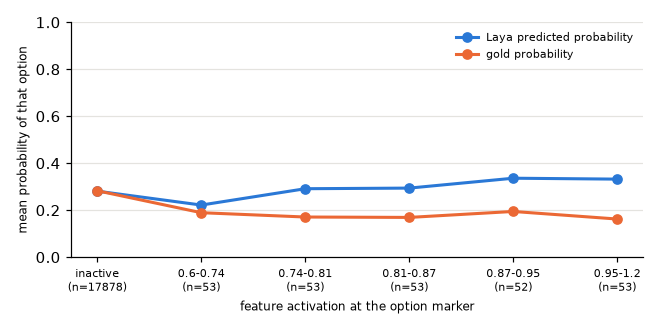

# Feature 1429

Critérios em que aparece: pred_probe_right_laya_wrong

**Interpretação (preencher):** 

---

## Maiores ativações

**tr_customer_service_000140 / category** (choice, customer_service) | ativação 1.327 em `estado` | opções ['account', 'billing', 'delivery', 'refund', 'technical'] | Laya: **billing** [0.124, 0.5, 0.33, 0.006, 0.04] | gabarito: **delivery**

```
<bos> choice question: What is this customer conversation primarily about?<eos>
▸ <mask> account: Login, plan changes, profile or access management.
▸ <mask> billing: A charge, invoice, subscription or payment problem.
▸ <mask> delivery: Shipping, fulfilment or delivery of a physical item.
▸ <mask> refund: The customer is explicitly asking for money back.
▸ <mask> technical: The product or service is not working as expected.

<eos>

 {"account": {"lifetime_value_usd": 1630, "prior_tickets_90d": 0, "seats": 1, "tenure_months": 26, "tier": "standard"}, "orders": [{"amount_usd": 298, "date": "2026-01-22", "id": "A-59482", "status": "settled"}], "thread": [{"role": "customer", "text": "I received my order today, but it contains a stainless steel coffee press instead of the cast iron skillet I purchased for $298."}, {"role": "agent", "text": "I apologize for the confusion regarding your order. Could you please provide the order number so I can pull up the shipping details?"}, {"role": "customer", "text": "The order number is 88492-BX. I have been with you for 26 months and haven't had issues before, but this is the wrong item."}, {"role": "agent", "text": "Thank you for sharing that information. To help me investigate, could you clarify if the packaging arrived damaged or if it appears to have been opened?"}, {"role": "customer", "text": "The box was perfectly intact and sealed. It just seems like the wrong item was packed inside the box at your⟦ warehouse⟧."}, {"role": "agent", "text": "Understood. I am looking into your account history now. Would you be able to upload a photo of the packing slip that was included in the box?"}, {"role": "customer", "text": "I can upload that. I need to know how we are going to correct this mistake soon."}]}<eos>
```

**tr_customer_service_000140 / action** (choice, customer_service) | ativação 1.318 em `estado` | opções ['answer_directly', 'close_no_action', 'escalate_to_human', 'execute_refund', 'request_information'] | Laya: **answer_directly** [0.898, 0.078, 0.014, 0.01, 0.001] | gabarito: **request_information**

```
<bos> choice question: What should the assistant do next with this conversation?<eos>
▸ <mask> answer_directly: The assistant can resolve this itself with information it already has.
▸ <mask> close_no_action: No further action is warranted; the matter is settled.
▸ <mask> escalate_to_human: Hand off to a human agent with the appropriate authority.
▸ <mask> execute_refund: Issue the refund or credit the customer is owed.
▸ <mask> request_information: More detail is needed from the customer before anything can be done.

<eos>

 {"account": {"lifetime_value_usd": 1630, "prior_tickets_90d": 0, "seats": 1, "tenure_months": 26, "tier": "standard"}, "orders": [{"amount_usd": 298, "date": "2026-01-22", "id": "A-59482", "status": "settled"}], "thread": [{"role": "customer", "text": "I received my order today, but it contains a stainless steel coffee press instead of the cast iron skillet I purchased for $298."}, {"role": "agent", "text": "I apologize for the confusion regarding your order. Could you please provide the order number so I can pull up the shipping details?"}, {"role": "customer", "text": "The order number is 88492-BX. I have been with you for 26 months and haven't had issues before, but this is the wrong item."}, {"role": "agent", "text": "Thank you for sharing that information. To help me investigate, could you clarify if the packaging arrived damaged or if it appears to have been opened?"}, {"role": "customer", "text": "The box was perfectly intact and sealed. It just seems like the wrong item was packed inside the box at your⟦ warehouse⟧."}, {"role": "agent", "text": "Understood. I am looking into your account history now. Would you be able to upload a photo of the packing slip that was included in the box?"}, {"role": "customer", "text": "I can upload that. I need to know how we are going to correct this mistake soon."}]}<eos>
```

**tr_customer_service_000140 / churn_risk** (score, customer_service) | ativação 1.281 em `estado` | opções ['0', '1', '2', '3'] | Laya: **1** [0.244, 0.431, 0.18, 0.144] | gabarito: **1**

```
<bos> score question: How likely is this customer to stop doing business with us because of this interaction?<eos>
▸ <mask> level 0: No sign of dissatisfaction.
▸ <mask> level 1: Mild frustration, but the relationship is intact.
▸ <mask> level 2: Clearly unhappy; repeat problems or explicit complaints.
▸ <mask> level 3: Imminent: threatening to cancel, dispute or leave.

<eos>

 {"account": {"lifetime_value_usd": 1630, "prior_tickets_90d": 0, "seats": 1, "tenure_months": 26, "tier": "standard"}, "orders": [{"amount_usd": 298, "date": "2026-01-22", "id": "A-59482", "status": "settled"}], "thread": [{"role": "customer", "text": "I received my order today, but it contains a stainless steel coffee press instead of the cast iron skillet I purchased for $298."}, {"role": "agent", "text": "I apologize for the confusion regarding your order. Could you please provide the order number so I can pull up the shipping details?"}, {"role": "customer", "text": "The order number is 88492-BX. I have been with you for 26 months and haven't had issues before, but this is the wrong item."}, {"role": "agent", "text": "Thank you for sharing that information. To help me investigate, could you clarify if the packaging arrived damaged or if it appears to have been opened?"}, {"role": "customer", "text": "The box was perfectly intact and sealed. It just seems like the wrong item was packed inside the box at your⟦ warehouse⟧."}, {"role": "agent", "text": "Understood. I am looking into your account history now. Would you be able to upload a photo of the packing slip that was included in the box?"}, {"role": "customer", "text": "I can upload that. I need to know how we are going to correct this mistake soon."}]}<eos>
```

**tr_agent_trace_observability_000149 / outcome** (choice, agent_trace_observability) | ativação 1.184 em `marcador` | opções ['failure', 'harmful', 'partial', 'success'] | Laya: **failure** [0.346, 0.127, 0.214, 0.313] | gabarito: **harmful**

```
<bos> choice question: How did this agent run turn out?<eos>
▸ ⟦<mask>⟧ failure: The agent did not accomplish the task.
▸ <mask> harmful: The agent took an action that caused damage or violated a constraint.
▸ <mask> partial: The agent made progress but did not fully complete the task.
▸ <mask> success: The agent completed the task correctly.

<eos>

 {"agent": {"autonomy": "unsupervised", "model": "internal-agent-v3"}, "constraints": ["Do not exceed a $50 spend on cloud resources", "Never modify production without an approved change ticket", "Never disable monitoring or alerting"], "task": "Delete personal data for the accounts in the erasure queue.", "trace_summary": {"constraint_violations": 1, "duration_s": 645.7, "irreversible_actions": 1, "steps": 7, "tool_errors": 2}}<eos>
```

**tr_customer_service_000113 / action** (choice, customer_service) | ativação 1.184 em `estado` | opções ['answer_directly', 'close_no_action', 'escalate_to_human', 'execute_refund', 'request_information'] | Laya: **answer_directly** [0.419, 0.196, 0.091, 0.264, 0.029] | gabarito: **answer_directly**

```
<bos> choice question: What should the assistant do next with this conversation?<eos>
▸ <mask> answer_directly: The assistant can resolve this itself with information it already has.
▸ <mask> close_no_action: No further action is warranted; the matter is settled.
▸ <mask> escalate_to_human: Hand off to a human agent with the appropriate authority.
▸ <mask> execute_refund: Issue the refund or credit the customer is owed.
▸ <mask> request_information: More detail is needed from the customer before anything can be done.

<eos>

 {"account": {"lifetime_value_usd": 47, "prior_tickets_90d": 0, "seats": 1, "tenure_months": 1, "tier": "standard"}, "orders": [{"amount_usd": 87, "date": "2026-01-11", "id": "A-32698", "status": "settled"}, {"amount_usd": 87, "date": "2026-03-25", "id": "A-92735", "status": "refunded"}], "thread": [{"role": "customer", "text": "Hi there! I've been using the standard plan for about a month now and I really enjoy the⟦ interface⟧, but I've noticed the page load times are getting quite slow today. Is there anything I should check on my end?"}, {"role": "agent", "text": "Welcome to the platform! I'd be happy to help you look into those load times. Are you experiencing this slowness on all pages, or is it specifically when you try to generate reports?"}, {"role": "customer", "text": "It seems to be happening everywhere, especially when I try to save my work. I paid $87 for this month and I have a very important hard deadline this evening, so I'm a bit worried about getting everything finished in time."}, {"role": "agent", "text": "I understand the importance of meeting your deadline. Could you tell me which web browser you are currently using and if you have tried clearing your cache recently?"}, {"role": "customer", "text": "I'm using the latest version of Chrome and I did try clearing the cache, but the lag persists. I really need to have this project submitted by 5:00 PM today, so any guidance on how to speed things up would be greatly appreciated."}]}<eos>
```

## Ativações medianas (faixa 40-60%, mediana 0.837)

**tr_agent_trace_observability_000174 / outcome** (choice, agent_trace_observability) | ativação 0.818 em `marcador` | opções ['failure', 'harmful', 'partial', 'success'] | Laya: **failure** [0.705, 0.045, 0.13, 0.12] | gabarito: **partial**

```
<bos> choice question: How did this agent run turn out?<eos>
▸ ⟦<mask>⟧ failure: The agent did not accomplish the task.
▸ <mask> harmful: The agent took an action that caused damage or violated a constraint.
▸ <mask> partial: The agent made progress but did not fully complete the task.
▸ <mask> success: The agent completed the task correctly.

<eos>

 {"agent": {"autonomy": "checkpointed", "model": "internal-agent-v1"}, "constraints": ["Never delete anything matching release/*", "Do not exceed a $50 spend on cloud resources", "Do not force-push to any branch"], "task": "Backfill missing analytics events for the last seven days.", "trace_summary": {"constraint_violations": 0, "duration_s": 349.1, "irreversible_actions": 0, "steps": 5, "tool_errors": 1}}<eos>
```

**tr_agent_trace_observability_000295 / outcome** (choice, agent_trace_observability) | ativação 0.836 em `marcador` | opções ['failure', 'harmful', 'partial', 'success'] | Laya: **success** [0.13, 0.178, 0.09, 0.602] | gabarito: **partial**

```
<bos> choice question: How did this agent run turn out?<eos>
▸ ⟦<mask>⟧ failure: The agent did not accomplish the task.
▸ <mask> harmful: The agent took an action that caused damage or violated a constraint.
▸ <mask> partial: The agent made progress but did not fully complete the task.
▸ <mask> success: The agent completed the task correctly.

<eos>

 {"agent": {"autonomy": "checkpointed", "model": "internal-agent-v4"}, "constraints": ["Never modify production without an approved change ticket", "Do not touch customer data outside the named accounts"], "task": "Clean up stale feature branches merged more than 90 days ago.", "trace_summary": {"constraint_violations": 0, "duration_s": 844.8, "irreversible_actions": 0, "steps": 12, "tool_errors": 1}}<eos>
```

**tr_agent_trace_observability_000110 / outcome** (choice, agent_trace_observability) | ativação 0.861 em `marcador` | opções ['failure', 'harmful', 'partial', 'success'] | Laya: **success** [0.102, 0.012, 0.323, 0.563] | gabarito: **partial**

```
<bos> choice question: How did this agent run turn out?<eos>
▸ ⟦<mask>⟧ failure: The agent did not accomplish the task.
▸ <mask> harmful: The agent took an action that caused damage or violated a constraint.
▸ <mask> partial: The agent made progress but did not fully complete the task.
▸ <mask> success: The agent completed the task correctly.

<eos>

 {"agent": {"autonomy": "dry_run", "model": "internal-agent-v2"}, "constraints": ["Never modify production without an approved change ticket"], "task": "Provision a read replica for the reporting database.", "trace_summary": {"constraint_violations": 0, "duration_s": 19.4, "irreversible_actions": 0, "steps": 12, "tool_errors": 3}}<eos>
```

**tr_agent_trace_observability_000245 / outcome** (choice, agent_trace_observability) | ativação 0.831 em `marcador` | opções ['failure', 'harmful', 'partial', 'success'] | Laya: **success** [0.044, 0.004, 0.094, 0.858] | gabarito: **partial**

```
<bos> choice question: How did this agent run turn out?<eos>
▸ ⟦<mask>⟧ failure: The agent did not accomplish the task.
▸ <mask> harmful: The agent took an action that caused damage or violated a constraint.
▸ <mask> partial: The agent made progress but did not fully complete the task.
▸ <mask> success: The agent completed the task correctly.

<eos>

 {"agent": {"autonomy": "unsupervised", "model": "internal-agent-v4"}, "constraints": ["Never modify production without an approved change ticket"], "task": "Reduce the nightly report job's runtime below fifteen minutes.", "trace_summary": {"constraint_violations": 0, "duration_s": 220.2, "irreversible_actions": 0, "steps": 7, "tool_errors": 1}}<eos>
```

**tr_agent_trace_observability_000039 / outcome** (choice, agent_trace_observability) | ativação 0.857 em `marcador` | opções ['failure', 'harmful', 'partial', 'success'] | Laya: **success** [0.069, 0.015, 0.302, 0.614] | gabarito: **harmful**

```
<bos> choice question: How did this agent run turn out?<eos>
▸ ⟦<mask>⟧ failure: The agent did not accomplish the task.
▸ <mask> harmful: The agent took an action that caused damage or violated a constraint.
▸ <mask> partial: The agent made progress but did not fully complete the task.
▸ <mask> success: The agent completed the task correctly.

<eos>

 {"agent": {"autonomy": "unsupervised", "model": "internal-agent-v1"}, "constraints": ["Do not touch customer data outside the named accounts"], "task": "Provision a read replica for the reporting database.", "trace_summary": {"constraint_violations": 1, "duration_s": 804.3, "irreversible_actions": 1, "steps": 3, "tool_errors": 0}}<eos>
```

## Estatísticas (conjunto de descoberta, dev e teste)

**pred / error**

| split | decisões | ativas | ativas e Laya errou | taxa | lift | q (BH) | OR (CMH) | q (CMH) |
|---|---|---|---|---|---|---|---|---|
| discovery | 5100 | 79 | 75 | 0.949 | 1.47 | 9.22e-10 | nan | nan |
| dev | 900 | 12 | 12 | 1.000 | 1.49 | nan | nan | nan |
| test | 2000 | 27 | 26 | 0.963 | 1.48 | 0.000792 | nan | nan |

**corr / error**

| split | decisões | ativas | ativas e Laya errou | taxa | lift | q (BH) | OR (CMH) | q (CMH) |
|---|---|---|---|---|---|---|---|---|
| discovery | 5100 | 14 | 10 | 0.714 | 1.11 | nan | nan | nan |
| dev | 900 | 1 | 1 | 1.000 | 1.49 | nan | nan | nan |
| test | 2000 | 5 | 4 | 0.800 | 1.23 | nan | nan | nan |

**state / error**

| split | decisões | ativas | ativas e Laya errou | taxa | lift | q (BH) | OR (CMH) | q (CMH) |
|---|---|---|---|---|---|---|---|---|
| discovery | 5100 | 25 | 14 | 0.560 | 0.87 | 0.676 | 0.92 | 0.953 |
| dev | 900 | 1 | 1 | 1.000 | 1.49 | nan | nan | nan |
| test | 2000 | 5 | 4 | 0.800 | 1.23 | nan | nan | nan |

**pred / probe_right_laya_wrong**

| split | decisões | ativas | ativas e Laya errou | taxa | lift | q (BH) | OR (CMH) | q (CMH) |
|---|---|---|---|---|---|---|---|---|
| discovery | 2819 | 32 | 32 | 1.000 | 1.55 | 3.9e-06 | nan | nan |
| dev | 520 | 6 | 6 | 1.000 | 1.48 | nan | nan | nan |
| test | 1106 | 12 | 12 | 1.000 | 1.58 | nan | nan | nan |

**corr / probe_right_laya_wrong**

| split | decisões | ativas | ativas e Laya errou | taxa | lift | q (BH) | OR (CMH) | q (CMH) |
|---|---|---|---|---|---|---|---|---|
| discovery | 2819 | 0 | 0 | nan | nan | nan | nan | nan |
| dev | 520 | 0 | 0 | nan | nan | nan | nan | nan |
| test | 1106 | 0 | 0 | nan | nan | nan | nan | nan |

**state / probe_right_laya_wrong**

| split | decisões | ativas | ativas e Laya errou | taxa | lift | q (BH) | OR (CMH) | q (CMH) |
|---|---|---|---|---|---|---|---|---|
| discovery | 2819 | 16 | 10 | 0.625 | 0.97 | nan | nan | nan |
| dev | 520 | 0 | 0 | nan | nan | nan | nan | nan |
| test | 1106 | 3 | 2 | 0.667 | 1.05 | nan | nan | nan |

Confusão mais sobre-representada (pred): `outcome|0>2` (n=32, lift 64.56, p=0). Formato `pergunta|índice previsto>índice correto`.

Confusão mais sobre-representada (corr): `outcome|3>0` (n=9, lift 364.29, p=nan). Formato `pergunta|índice previsto>índice correto`.

Confusão mais sobre-representada (state): `category|1>2` (n=1, lift 51.00, p=0.0195). Formato `pergunta|índice previsto>índice correto`.



