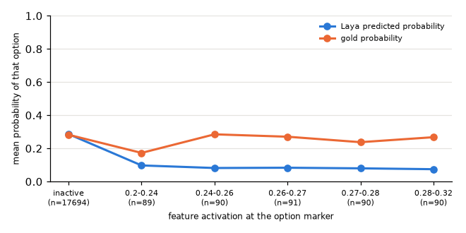

# Feature 1464

Critérios em que aparece: corr_error, corr_probe_right_laya_wrong

**Interpretação (preencher):** 

---

## Maiores ativações

**tr_customer_service_000253 / category** (choice, customer_service) | ativação 4.453 em `estado` | opções ['account', 'billing', 'delivery', 'refund', 'technical'] | Laya: **delivery** [0.0, 0.0, 1.0, 0.0, 0.0] | gabarito: **delivery**

```
<bos> choice question: What is this customer conversation primarily about?<eos>
▸ <mask> account: Login, plan changes, profile or access management.
▸ <mask> billing: A charge, invoice, subscription or payment problem.
▸ <mask> delivery: Shipping, fulfilment or delivery of a physical item.
▸ <mask> refund: The customer is explicitly asking for money back.
▸ <mask> technical: The product or service is not working as expected.

<eos>

 {"account": {"lifetime_value_usd": 4869, "prior_tickets_90d": 1, "seats": 40, "tenure_months": 60, "tier": "premium"}, "thread": [{"role": "customer", "text": "My premium package is late yet again. I’ve been a loyal customer for 60 months, and frankly, I’m tired of dealing with these same logistical failures."}, {"role": "agent", "text": "I understand your frustration regarding this delay. To help me investigate the status of your shipment, could you please provide your order reference number?"}, {"role": "customer", "text": "It’s 8829-X. You guys had this issue last year, and here we are repeating the exact same problem."}, {"role": "agent", "text": "Thank you for that information. I am checking the current⟦ tracking⟧ status for you now; could you verify if the address listed on your account is the one where the delivery was expected?"}, {"role": "customer", "text": "Yes, it is the same address as always. Just tell me where the package is instead of making me repeat myself."}]}<eos>
```

**tr_customer_service_000253 / action** (choice, customer_service) | ativação 4.359 em `estado` | opções ['answer_directly', 'close_no_action', 'escalate_to_human', 'execute_refund', 'request_information'] | Laya: **answer_directly** [0.706, 0.131, 0.151, 0.009, 0.004] | gabarito: **answer_directly**

```
<bos> choice question: What should the assistant do next with this conversation?<eos>
▸ <mask> answer_directly: The assistant can resolve this itself with information it already has.
▸ <mask> close_no_action: No further action is warranted; the matter is settled.
▸ <mask> escalate_to_human: Hand off to a human agent with the appropriate authority.
▸ <mask> execute_refund: Issue the refund or credit the customer is owed.
▸ <mask> request_information: More detail is needed from the customer before anything can be done.

<eos>

 {"account": {"lifetime_value_usd": 4869, "prior_tickets_90d": 1, "seats": 40, "tenure_months": 60, "tier": "premium"}, "thread": [{"role": "customer", "text": "My premium package is late yet again. I’ve been a loyal customer for 60 months, and frankly, I’m tired of dealing with these same logistical failures."}, {"role": "agent", "text": "I understand your frustration regarding this delay. To help me investigate the status of your shipment, could you please provide your order reference number?"}, {"role": "customer", "text": "It’s 8829-X. You guys had this issue last year, and here we are repeating the exact same problem."}, {"role": "agent", "text": "Thank you for that information. I am checking the current⟦ tracking⟧ status for you now; could you verify if the address listed on your account is the one where the delivery was expected?"}, {"role": "customer", "text": "Yes, it is the same address as always. Just tell me where the package is instead of making me repeat myself."}]}<eos>
```

**tr_customer_service_000253 / churn_risk** (score, customer_service) | ativação 4.293 em `estado` | opções ['0', '1', '2', '3'] | Laya: **1** [0.133, 0.702, 0.137, 0.028] | gabarito: **2**

```
<bos> score question: How likely is this customer to stop doing business with us because of this interaction?<eos>
▸ <mask> level 0: No sign of dissatisfaction.
▸ <mask> level 1: Mild frustration, but the relationship is intact.
▸ <mask> level 2: Clearly unhappy; repeat problems or explicit complaints.
▸ <mask> level 3: Imminent: threatening to cancel, dispute or leave.

<eos>

 {"account": {"lifetime_value_usd": 4869, "prior_tickets_90d": 1, "seats": 40, "tenure_months": 60, "tier": "premium"}, "thread": [{"role": "customer", "text": "My premium package is late yet again. I’ve been a loyal customer for 60 months, and frankly, I’m tired of dealing with these same logistical failures."}, {"role": "agent", "text": "I understand your frustration regarding this delay. To help me investigate the status of your shipment, could you please provide your order reference number?"}, {"role": "customer", "text": "It’s 8829-X. You guys had this issue last year, and here we are repeating the exact same problem."}, {"role": "agent", "text": "Thank you for that information. I am checking the current⟦ tracking⟧ status for you now; could you verify if the address listed on your account is the one where the delivery was expected?"}, {"role": "customer", "text": "Yes, it is the same address as always. Just tell me where the package is instead of making me repeat myself."}]}<eos>
```

**tr_customer_service_000291 / churn_risk** (score, customer_service) | ativação 4.273 em `estado` | opções ['0', '1', '2', '3'] | Laya: **1** [0.062, 0.636, 0.25, 0.052] | gabarito: **2**

```
<bos> score question: How likely is this customer to stop doing business with us because of this interaction?<eos>
▸ <mask> level 0: No sign of dissatisfaction.
▸ <mask> level 1: Mild frustration, but the relationship is intact.
▸ <mask> level 2: Clearly unhappy; repeat problems or explicit complaints.
▸ <mask> level 3: Imminent: threatening to cancel, dispute or leave.

<eos>

 {"account": {"lifetime_value_usd": 403, "prior_tickets_90d": 1, "seats": 1, "tenure_months": 5, "tier": "standard"}, "thread": [{"role": "customer", "text": "My recent order, number 992-BX, has not arrived by the scheduled date of Tuesday and the⟦ tracking⟧ hasn't updated."}, {"role": "agent", "text": "I can look into that for you. Could you please provide the email address associated with your standard plan account?"}, {"role": "customer", "text": "The email is j.smith@example.com. I'm checking back because when I had a delay last month, the ticket was only partially addressed and I still haven't seen the full resolution."}, {"role": "agent", "text": "I see that prior ticket in our records. To help me narrow this down, has the tracking status changed at all in the last 24 hours?"}, {"role": "customer", "text": "The tracking has stayed at 'Processing' since Monday morning, so I would like to know the current location of the package."}]}<eos>
```

**tr_customer_service_000253 / needs_human** (noul, customer_service) | ativação 4.270 em `estado` | opções ['false', 'true'] | Laya: **false** [0.52, 0.48] | gabarito: **true**

```
<bos> noul question: This conversation requires a human agent rather than automated handling.<eos>
▸ <mask> false: Automation can carry this to resolution.
▸ <mask> true: A human must take over: judgement, authority or empathy is required.

<eos>

 {"account": {"lifetime_value_usd": 4869, "prior_tickets_90d": 1, "seats": 40, "tenure_months": 60, "tier": "premium"}, "thread": [{"role": "customer", "text": "My premium package is late yet again. I’ve been a loyal customer for 60 months, and frankly, I’m tired of dealing with these same logistical failures."}, {"role": "agent", "text": "I understand your frustration regarding this delay. To help me investigate the status of your shipment, could you please provide your order reference number?"}, {"role": "customer", "text": "It’s 8829-X. You guys had this issue last year, and here we are repeating the exact same problem."}, {"role": "agent", "text": "Thank you for that information. I am checking the current⟦ tracking⟧ status for you now; could you verify if the address listed on your account is the one where the delivery was expected?"}, {"role": "customer", "text": "Yes, it is the same address as always. Just tell me where the package is instead of making me repeat myself."}]}<eos>
```

## Ativações medianas (faixa 40-60%, mediana 0.266)

**tr_invoice_processing_000060 / discrepancy_severity** (score, invoice_processing) | ativação 0.273 em `marcador` | opções ['0', '1', '2', '3'] | Laya: **2** [0.049, 0.24, 0.653, 0.058] | gabarito: **3**

```
<bos> score question: How material is any discrepancy between the invoice, the order and the delivery?<eos>
▸ ⟦<mask>⟧ level 0: None: everything reconciles.
▸ <mask> level 1: Trivial: rounding or a cosmetic difference.
▸ <mask> level 2: Moderate: a real difference worth confirming.
▸ <mask> level 3: Material: a large or unexplained difference.

<eos>

 {"delivery": {"condition": "accepted", "date": "2026-03-20", "received_qty": 400}, "invoice": {"currency": "USD", "id": "INV-2026-6086", "lines": [{"qty": 450, "sku": "SKU-902", "total_usd": 98122.5, "unit_usd": 218.05}], "total_usd": 98122.5, "vendor": "Kestrel Supply"}, "payment": {"days_until_due": -21, "discount_expires_in_days": 3, "early_payment_discount_pct": 2.0, "status": "overdue", "terms": "net 30"}, "purchase_order": {"freight_terms": "freight prepaid by vendor, not separately billable", "id": "PO-8955", "lines": [{"qty": 400, "unit_usd": 218.05}], "total_usd": 87220.0}, "vendor_history": {"disputes_12m": 0, "invoices_12m": 29, "prior_invoice_ids": ["INV-2026-8411"]}}<eos>
```

**tr_invoice_processing_000256 / discrepancy_severity** (score, invoice_processing) | ativação 0.262 em `marcador` | opções ['0', '1', '2', '3'] | Laya: **2** [0.04, 0.297, 0.583, 0.08] | gabarito: **0**

```
<bos> score question: How material is any discrepancy between the invoice, the order and the delivery?<eos>
▸ ⟦<mask>⟧ level 0: None: everything reconciles.
▸ <mask> level 1: Trivial: rounding or a cosmetic difference.
▸ <mask> level 2: Moderate: a real difference worth confirming.
▸ <mask> level 3: Material: a large or unexplained difference.

<eos>

 {"delivery": {"condition": "accepted", "date": "2026-03-11", "received_qty": 1000}, "invoice": {"currency": "USD", "id": "INV-2026-3080", "lines": [{"qty": 1000, "sku": "SKU-121", "total_usd": 21200.0, "unit_usd": 21.2}], "total_usd": 21200.0, "vendor": "Acme Fabrication"}, "payment": {"days_until_due": 0, "discount_expires_in_days": null, "early_payment_discount_pct": null, "status": "scheduled", "terms": "net 30"}, "purchase_order": {"freight_terms": "freight prepaid by vendor, not separately billable", "id": "PO-1628", "lines": [{"qty": 1000, "unit_usd": 21.2}], "total_usd": 21200.0}, "vendor_history": {"disputes_12m": 0, "invoices_12m": 36, "prior_invoice_ids": ["INV-2026-3080", "INV-2026-9683", "INV-2026-4712", "INV-2026-8075"]}}<eos>
```

**tr_invoice_processing_000023 / urgency** (score, invoice_processing) | ativação 0.261 em `marcador` | opções ['0', '1', '2', '3'] | Laya: **1** [0.079, 0.545, 0.252, 0.124] | gabarito: **2**

```
<bos> score question: How time-sensitive is processing this invoice?<eos>
▸ ⟦<mask>⟧ level 0: No time pressure; can wait indefinitely.
▸ <mask> level 1: Routine; handle within the normal queue.
▸ <mask> level 2: Elevated; should be handled within the same week.
▸ <mask> level 3: Critical; requires action within the same day.

<eos>

 {"delivery": {"condition": "accepted with exceptions", "date": "2026-03-25", "received_qty": 250}, "invoice": {"currency": "USD", "id": "INV-2026-8598", "lines": [{"qty": 250, "sku": "SKU-575", "total_usd": 31660.0, "unit_usd": 126.64}], "total_usd": 31660.0, "vendor": "Northwind Components"}, "payment": {"days_until_due": 5, "discount_expires_in_days": null, "early_payment_discount_pct": null, "status": "scheduled", "terms": "net 60"}, "purchase_order": {"freight_terms": "freight prepaid by vendor, not separately billable", "id": "PO-4453", "lines": [{"qty": 250, "unit_usd": 126.64}], "total_usd": 31660.0}, "vendor_history": {"disputes_12m": 0, "invoices_12m": 12, "prior_invoice_ids": ["INV-2026-3394", "INV-2026-7717", "INV-2026-6892", "INV-2026-2732"]}}<eos>
```

**tr_invoice_processing_000061 / discrepancy_severity** (score, invoice_processing) | ativação 0.264 em `marcador` | opções ['0', '1', '2', '3'] | Laya: **2** [0.045, 0.257, 0.611, 0.087] | gabarito: **3**

```
<bos> score question: How material is any discrepancy between the invoice, the order and the delivery?<eos>
▸ ⟦<mask>⟧ level 0: None: everything reconciles.
▸ <mask> level 1: Trivial: rounding or a cosmetic difference.
▸ <mask> level 2: Moderate: a real difference worth confirming.
▸ <mask> level 3: Material: a large or unexplained difference.

<eos>

 {"delivery": {"condition": "accepted with exceptions", "date": null, "received_qty": 0}, "invoice": {"currency": "USD", "id": "INV-2026-6615", "lines": [{"qty": 400, "sku": "SKU-909", "total_usd": 127980.0, "unit_usd": 319.95}], "total_usd": 127980.0, "vendor": "Acme Fabrication"}, "payment": {"days_until_due": 44, "discount_expires_in_days": null, "early_payment_discount_pct": null, "status": "scheduled", "terms": "net 45"}, "purchase_order": {"freight_terms": "freight prepaid by vendor, not separately billable", "id": "PO-9226", "lines": [{"qty": 400, "unit_usd": 319.95}], "total_usd": 127980.0}, "vendor_history": {"disputes_12m": 2, "invoices_12m": 5, "prior_invoice_ids": ["INV-2026-5422", "INV-2026-8931", "INV-2026-8502"]}}<eos>
```

**tr_invoice_processing_000055 / urgency** (score, invoice_processing) | ativação 0.270 em `marcador` | opções ['0', '1', '2', '3'] | Laya: **1** [0.091, 0.447, 0.255, 0.208] | gabarito: **1**

```
<bos> score question: How time-sensitive is processing this invoice?<eos>
▸ ⟦<mask>⟧ level 0: No time pressure; can wait indefinitely.
▸ <mask> level 1: Routine; handle within the normal queue.
▸ <mask> level 2: Elevated; should be handled within the same week.
▸ <mask> level 3: Critical; requires action within the same day.

<eos>

 {"delivery": {"condition": "accepted", "date": "2026-03-24", "received_qty": 10}, "invoice": {"currency": "USD", "id": "INV-2026-2278", "lines": [{"qty": 10, "sku": "SKU-174", "total_usd": 2565.3, "unit_usd": 256.53}], "total_usd": 2565.3, "vendor": "Orbit Logistics"}, "payment": {"days_until_due": 44, "discount_expires_in_days": null, "early_payment_discount_pct": null, "status": "scheduled", "terms": "net 15"}, "purchase_order": {"freight_terms": "freight prepaid by vendor, not separately billable", "id": "PO-1729", "lines": [{"qty": 10, "unit_usd": 256.53}], "total_usd": 2565.3}, "vendor_history": {"disputes_12m": 2, "invoices_12m": 35, "prior_invoice_ids": ["INV-2026-2466", "INV-2026-1629", "INV-2026-2511", "INV-2026-3620"]}}<eos>
```

## Estatísticas (conjunto de descoberta, dev e teste)

**pred / error**

| split | decisões | ativas | ativas e Laya errou | taxa | lift | q (BH) | OR (CMH) | q (CMH) |
|---|---|---|---|---|---|---|---|---|
| discovery | 5100 | 0 | 0 | nan | nan | nan | nan | nan |
| dev | 900 | 0 | 0 | nan | nan | nan | nan | nan |
| test | 2000 | 0 | 0 | nan | nan | nan | nan | nan |

**corr / error**

| split | decisões | ativas | ativas e Laya errou | taxa | lift | q (BH) | OR (CMH) | q (CMH) |
|---|---|---|---|---|---|---|---|---|
| discovery | 5100 | 104 | 104 | 1.000 | 1.55 | 1.17e-19 | nan | nan |
| dev | 900 | 24 | 24 | 1.000 | 1.49 | 0.000425 | nan | nan |
| test | 2000 | 46 | 46 | 1.000 | 1.54 | 2.24e-08 | nan | nan |

**state / error**

| split | decisões | ativas | ativas e Laya errou | taxa | lift | q (BH) | OR (CMH) | q (CMH) |
|---|---|---|---|---|---|---|---|---|
| discovery | 5100 | 63 | 34 | 0.540 | 0.84 | 0.231 | 0.90 | 0.912 |
| dev | 900 | 27 | 19 | 0.704 | 1.05 | 1 | 1.83 | 0.628 |
| test | 2000 | 41 | 22 | 0.537 | 0.82 | 0.432 | 0.71 | 0.711 |

**pred / probe_right_laya_wrong**

| split | decisões | ativas | ativas e Laya errou | taxa | lift | q (BH) | OR (CMH) | q (CMH) |
|---|---|---|---|---|---|---|---|---|
| discovery | 2819 | 0 | 0 | nan | nan | nan | nan | nan |
| dev | 520 | 0 | 0 | nan | nan | nan | nan | nan |
| test | 1106 | 0 | 0 | nan | nan | nan | nan | nan |

**corr / probe_right_laya_wrong**

| split | decisões | ativas | ativas e Laya errou | taxa | lift | q (BH) | OR (CMH) | q (CMH) |
|---|---|---|---|---|---|---|---|---|
| discovery | 2819 | 101 | 101 | 1.000 | 1.55 | 4.6e-19 | nan | nan |
| dev | 520 | 23 | 23 | 1.000 | 1.48 | 0.000517 | nan | nan |
| test | 1106 | 46 | 46 | 1.000 | 1.58 | 4.61e-09 | nan | nan |

**state / probe_right_laya_wrong**

| split | decisões | ativas | ativas e Laya errou | taxa | lift | q (BH) | OR (CMH) | q (CMH) |
|---|---|---|---|---|---|---|---|---|
| discovery | 2819 | 43 | 25 | 0.581 | 0.90 | 0.593 | 1.42 | 0.649 |
| dev | 520 | 17 | 10 | 0.588 | 0.87 | nan | nan | nan |
| test | 1106 | 30 | 16 | 0.533 | 0.84 | 0.585 | 0.97 | 0.98 |

Confusão mais sobre-representada (corr): `discrepancy_severity|2>0` (n=103, lift 46.77, p=0). Formato `pergunta|índice previsto>índice correto`.

Confusão mais sobre-representada (state): `needs_human|0>1` (n=5, lift 7.50, p=0.000486). Formato `pergunta|índice previsto>índice correto`.



