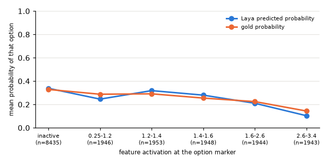

# Feature 1484

Critérios em que aparece: attribution_toward_correct

**Interpretação (preencher):** 

---

## Maiores ativações

**tr_customer_service_000038 / needs_human** (noul, customer_service) | ativação 12.398 em `estado` | opções ['false', 'true'] | Laya: **false** [0.7, 0.3] | gabarito: **false**

```
<bos> noul question: This conversation requires a human agent rather than automated handling.<eos>
▸ <mask> false: Automation can carry this to resolution.
▸ <mask> true: A human must take over: judgement, authority or empathy is required.

<eos>

 {"account": {"lifetime_value_usd": 316, "prior_tickets_90d": 1, "seats": 1, "tenure_months": 11, "tier": "free"}, "thread": [{"role": "customer", "text": "⟦Hello⟧, I am checking on the status of my order. It has been a bit longer than the expected delivery window, and I was wondering if you could provide an update?"}, {"role": "agent", "text": "I apologize for the delay. Could you please provide your order number so I can check the current tracking status for you?"}, {"role": "customer", "text": "Certainly, the order number is 44556. I appreciate you looking into this."}, {"role": "agent", "text": "Thank you. I am looking into the shipment details now; could you confirm the shipping address provided during checkout?"}, {"role": "customer", "text": "Yes, it is 123 Maple Street, Apartment 4B. Please let me know what you find."}]}<eos>
```

**tr_customer_service_000152 / needs_human** (noul, customer_service) | ativação 12.344 em `estado` | opções ['false', 'true'] | Laya: **true** [0.129, 0.871] | gabarito: **true**

```
<bos> noul question: This conversation requires a human agent rather than automated handling.<eos>
▸ <mask> false: Automation can carry this to resolution.
▸ <mask> true: A human must take over: judgement, authority or empathy is required.

<eos>

 {"account": {"lifetime_value_usd": 799, "prior_tickets_90d": 0, "seats": 1, "tenure_months": 33, "tier": "standard"}, "thread": [{"role": "customer", "text": "⟦Hello⟧, I'm writing because the analytics dashboard stopped updating as of this morning, and I need the latest data by 5 pm today to finalize my report. Could you please look into this?"}]}<eos>
```

**tr_customer_service_000038 / action** (choice, customer_service) | ativação 12.250 em `estado` | opções ['answer_directly', 'close_no_action', 'escalate_to_human', 'execute_refund', 'request_information'] | Laya: **answer_directly** [0.739, 0.159, 0.094, 0.004, 0.004] | gabarito: **answer_directly**

```
<bos> choice question: What should the assistant do next with this conversation?<eos>
▸ <mask> answer_directly: The assistant can resolve this itself with information it already has.
▸ <mask> close_no_action: No further action is warranted; the matter is settled.
▸ <mask> escalate_to_human: Hand off to a human agent with the appropriate authority.
▸ <mask> execute_refund: Issue the refund or credit the customer is owed.
▸ <mask> request_information: More detail is needed from the customer before anything can be done.

<eos>

 {"account": {"lifetime_value_usd": 316, "prior_tickets_90d": 1, "seats": 1, "tenure_months": 11, "tier": "free"}, "thread": [{"role": "customer", "text": "⟦Hello⟧, I am checking on the status of my order. It has been a bit longer than the expected delivery window, and I was wondering if you could provide an update?"}, {"role": "agent", "text": "I apologize for the delay. Could you please provide your order number so I can check the current tracking status for you?"}, {"role": "customer", "text": "Certainly, the order number is 44556. I appreciate you looking into this."}, {"role": "agent", "text": "Thank you. I am looking into the shipment details now; could you confirm the shipping address provided during checkout?"}, {"role": "customer", "text": "Yes, it is 123 Maple Street, Apartment 4B. Please let me know what you find."}]}<eos>
```

**tr_customer_service_000152 / action** (choice, customer_service) | ativação 12.203 em `estado` | opções ['answer_directly', 'close_no_action', 'escalate_to_human', 'execute_refund', 'request_information'] | Laya: **close_no_action** [0.222, 0.642, 0.068, 0.044, 0.024] | gabarito: **request_information**

```
<bos> choice question: What should the assistant do next with this conversation?<eos>
▸ <mask> answer_directly: The assistant can resolve this itself with information it already has.
▸ <mask> close_no_action: No further action is warranted; the matter is settled.
▸ <mask> escalate_to_human: Hand off to a human agent with the appropriate authority.
▸ <mask> execute_refund: Issue the refund or credit the customer is owed.
▸ <mask> request_information: More detail is needed from the customer before anything can be done.

<eos>

 {"account": {"lifetime_value_usd": 799, "prior_tickets_90d": 0, "seats": 1, "tenure_months": 33, "tier": "standard"}, "thread": [{"role": "customer", "text": "⟦Hello⟧, I'm writing because the analytics dashboard stopped updating as of this morning, and I need the latest data by 5 pm today to finalize my report. Could you please look into this?"}]}<eos>
```

**tr_customer_service_000276 / churn_risk** (score, customer_service) | ativação 12.188 em `estado` | opções ['0', '1', '2', '3'] | Laya: **2** [0.014, 0.088, 0.488, 0.41] | gabarito: **1**

```
<bos> score question: How likely is this customer to stop doing business with us because of this interaction?<eos>
▸ <mask> level 0: No sign of dissatisfaction.
▸ <mask> level 1: Mild frustration, but the relationship is intact.
▸ <mask> level 2: Clearly unhappy; repeat problems or explicit complaints.
▸ <mask> level 3: Imminent: threatening to cancel, dispute or leave.

<eos>

 {"account": {"lifetime_value_usd": 2578, "prior_tickets_90d": 2, "seats": 1, "tenure_months": 33, "tier": "free"}, "orders": [{"amount_usd": 19, "date": "2026-02-10", "id": "A-44819", "status": "pending"}, {"amount_usd": 19, "date": "2026-02-04", "id": "A-86947", "status": "refunded"}, {"amount_usd": 19, "date": "2026-03-02", "id": "A-96218", "status": "refunded"}], "thread": [{"role": "customer", "text": "Hi there. I’m checking in on the $19 refund I requested a while back. I’ve been with you for 33 months on the free plan, and since I have a hard deadline for my accounting this Friday, I was hoping for an update."}, {"role": "agent", "text": "⟦Hello⟧. I appreciate your long-standing loyalty over the last few years. I can certainly look into the status of that refund request for you; could you please provide the reference number from your previous inquiries?"}, {"role": "customer", "text": "I’ve opened two tickets already, but they seem to have stalled. I’m trying to keep my records clean before my deadline at the end of the week, so any movement on this would be greatly appreciated."}, {"role": "agent", "text": "Thank you for that clarification. I am currently reviewing your account history and the previous tickets mentioned to see where the hold-up might be occurring."}, {"role": "customer", "text": "I understand. I’m just really concerned about hitting that Friday cutoff, so please let me know as soon as you find anything out."}]}<eos>
```

## Ativações medianas (faixa 40-60%, mediana 1.491)

**tr_security_incidents_000073 / severity** (score, security_incidents) | ativação 1.474 em `marcador` | opções ['0', '1', '2', '3', '4'] | Laya: **1** [0.08, 0.406, 0.336, 0.077, 0.101] | gabarito: **1**

```
<bos> score question: How severe is the potential impact if this alert is real?<eos>
▸ <mask> level 0: Negligible: no access to anything sensitive.
▸ <mask> level 1: Low: limited access, easily reversed.
▸ <mask> level 2: Moderate: access to internal systems or non-public data.
▸ ⟦<mask>⟧ level 3: High: access to production, secrets or customer data.
▸ <mask> level 4: Critical: active compromise of crown-jewel systems.

<eos>

 {"alert": {"description": "an endpoint agent matched a known signature", "evidence": "An endpoint agent on `ci-executor-04` identified a file matching signature `WORM_RS_A` during a scheduled change window. The associated unprivileged `ci_runner` principal accessed the system from the allowlisted source 10.50.2.1 using credentials rotated 3 days ago.", "rule": "malware_signature"}, "context": {"asset_criticality": "low", "change_window_active": true, "source_on_allowlist": true}, "history": {"credential_rotation_days_ago": 3, "distinct_countries_30d": 4, "logins_30d": 731, "prior_alerts_90d": 0}, "principal": {"mfa_enrolled": true, "name": "adm-billing-719", "privileges": ["repo:read"], "type": "ci_runner"}}<eos>
```

**tr_security_incidents_000113 / urgency** (score, security_incidents) | ativação 1.460 em `marcador` | opções ['0', '1', '2', '3'] | Laya: **3** [0.086, 0.335, 0.114, 0.465] | gabarito: **3**

```
<bos> score question: How quickly must a responder act on this alert?<eos>
▸ <mask> level 0: No time pressure; can wait indefinitely.
▸ <mask> level 1: Routine; handle within the normal queue.
▸ ⟦<mask>⟧ level 2: Elevated; should be handled within the same week.
▸ <mask> level 3: Critical; requires action within the same day.

<eos>

 {"alert": {"description": "audit logging was turned off on a host", "evidence": "At 2026-09-15 09:03:12 UTC the process \"auditctl\" executed on host \"win-01.example.com\" with arguments \"-e 0\" and disabled audit logging for the system. The command was issued by the shared_mailbox account \"audit_monitor\" from an allow‑listed source, and MFA was disabled for this principal.", "rule": "disabled_logging"}, "context": {"asset_criticality": "crown_jewel", "change_window_active": false, "source_on_allowlist": true}, "history": {"credential_rotation_days_ago": 412, "distinct_countries_30d": 2, "logins_30d": 491, "prior_alerts_90d": 8}, "principal": {"mfa_enrolled": false, "name": "adm-support-214", "privileges": ["repo:read"], "type": "shared_mailbox"}}<eos>
```

**tr_security_incidents_000162 / severity** (score, security_incidents) | ativação 1.437 em `marcador` | opções ['0', '1', '2', '3', '4'] | Laya: **2** [0.09, 0.187, 0.595, 0.066, 0.062] | gabarito: **2**

```
<bos> score question: How severe is the potential impact if this alert is real?<eos>
▸ <mask> level 0: Negligible: no access to anything sensitive.
▸ <mask> level 1: Low: limited access, easily reversed.
▸ <mask> level 2: Moderate: access to internal systems or non-public data.
▸ ⟦<mask>⟧ level 3: High: access to production, secrets or customer data.
▸ <mask> level 4: Critical: active compromise of crown-jewel systems.

<eos>

 {"alert": {"description": "a first-ever sign-in from an unfamiliar country", "evidence": "An administrative account accessed the system from an unrecognized IP address located in a country with no prior login history. The credentials for this principal have not been updated in 700 days.", "rule": "new_country_login"}, "context": {"asset_criticality": "medium", "change_window_active": false, "source_on_allowlist": false}, "history": {"credential_rotation_days_ago": 700, "distinct_countries_30d": 1, "logins_30d": 1674, "prior_alerts_90d": 1}, "principal": {"mfa_enrolled": true, "name": "svc-support-499", "privileges": ["repo:read"], "type": "admin"}}<eos>
```

**tr_invoice_processing_000010 / urgency** (score, invoice_processing) | ativação 1.399 em `marcador` | opções ['0', '1', '2', '3'] | Laya: **1** [0.099, 0.438, 0.301, 0.161] | gabarito: **1**

```
<bos> score question: How time-sensitive is processing this invoice?<eos>
▸ <mask> level 0: No time pressure; can wait indefinitely.
▸ <mask> level 1: Routine; handle within the normal queue.
▸ <mask> level 2: Elevated; should be handled within the same week.
▸ ⟦<mask>⟧ level 3: Critical; requires action within the same day.

<eos>

 {"delivery": {"condition": "accepted", "date": "2026-03-03", "received_qty": 25}, "invoice": {"currency": "USD", "id": "INV-2026-2741", "lines": [{"qty": 25, "sku": "SKU-184", "total_usd": 8079.5, "unit_usd": 323.18}], "total_usd": 8079.5, "vendor": "Northwind Components"}, "payment": {"days_until_due": 11, "discount_expires_in_days": null, "early_payment_discount_pct": null, "status": "scheduled", "terms": "net 45"}, "purchase_order": {"freight_terms": "freight prepaid by vendor, not separately billable", "id": "PO-1829", "lines": [{"qty": 25, "unit_usd": 323.18}], "total_usd": 8079.5}, "vendor_history": {"disputes_12m": 2, "invoices_12m": 52, "prior_invoice_ids": ["INV-2026-7791", "INV-2026-6320", "INV-2026-2697"]}}<eos>
```

**tr_invoice_processing_000083 / urgency** (score, invoice_processing) | ativação 1.473 em `marcador` | opções ['0', '1', '2', '3'] | Laya: **1** [0.073, 0.496, 0.333, 0.098] | gabarito: **2**

```
<bos> score question: How time-sensitive is processing this invoice?<eos>
▸ <mask> level 0: No time pressure; can wait indefinitely.
▸ <mask> level 1: Routine; handle within the normal queue.
▸ <mask> level 2: Elevated; should be handled within the same week.
▸ ⟦<mask>⟧ level 3: Critical; requires action within the same day.

<eos>

 {"delivery": {"condition": "accepted", "date": "2026-03-22", "received_qty": 250}, "invoice": {"currency": "USD", "id": "INV-2026-5770", "lines": [{"qty": 270, "sku": "SKU-534", "total_usd": 67348.8, "unit_usd": 249.44}], "total_usd": 67348.8, "vendor": "Northwind Components"}, "payment": {"days_until_due": 5, "discount_expires_in_days": 4, "early_payment_discount_pct": 2.0, "status": "scheduled", "terms": "net 45"}, "purchase_order": {"freight_terms": "freight prepaid by vendor, not separately billable", "id": "PO-4308", "lines": [{"qty": 250, "unit_usd": 249.44}], "total_usd": 62360.0}, "vendor_history": {"disputes_12m": 2, "invoices_12m": 25, "prior_invoice_ids": ["INV-2026-4832", "INV-2026-5647"]}}<eos>
```

## Estatísticas (conjunto de descoberta, dev e teste)

**pred / error**

| split | decisões | ativas | ativas e Laya errou | taxa | lift | q (BH) | OR (CMH) | q (CMH) |
|---|---|---|---|---|---|---|---|---|
| discovery | 5100 | 2242 | 1424 | 0.635 | 0.99 | 0.321 | 0.38 | 0.635 |
| dev | 900 | 392 | 260 | 0.663 | 0.99 | 0.787 | nan | nan |
| test | 2000 | 877 | 594 | 0.677 | 1.04 | 0.0477 | nan | nan |

**corr / error**

| split | decisões | ativas | ativas e Laya errou | taxa | lift | q (BH) | OR (CMH) | q (CMH) |
|---|---|---|---|---|---|---|---|---|
| discovery | 5100 | 2347 | 1529 | 0.651 | 1.01 | 0.348 | 1.61 | 0.69 |
| dev | 900 | 403 | 271 | 0.672 | 1.00 | 1 | nan | nan |
| test | 2000 | 908 | 625 | 0.688 | 1.06 | 0.0026 | 0.19 | 0.87 |

**state / error**

| split | decisões | ativas | ativas e Laya errou | taxa | lift | q (BH) | OR (CMH) | q (CMH) |
|---|---|---|---|---|---|---|---|---|
| discovery | 5100 | 199 | 115 | 0.578 | 0.90 | 0.144 | 1.08 | 0.888 |
| dev | 900 | 17 | 13 | 0.765 | 1.14 | nan | nan | nan |
| test | 2000 | 57 | 36 | 0.632 | 0.97 | 1 | 1.24 | 0.785 |

**pred / probe_right_laya_wrong**

| split | decisões | ativas | ativas e Laya errou | taxa | lift | q (BH) | OR (CMH) | q (CMH) |
|---|---|---|---|---|---|---|---|---|
| discovery | 2819 | 1081 | 693 | 0.641 | 0.99 | 0.671 | 0.14 | 0.812 |
| dev | 520 | 196 | 132 | 0.673 | 1.00 | 1 | nan | nan |
| test | 1106 | 428 | 282 | 0.659 | 1.04 | 0.239 | nan | nan |

**corr / probe_right_laya_wrong**

| split | decisões | ativas | ativas e Laya errou | taxa | lift | q (BH) | OR (CMH) | q (CMH) |
|---|---|---|---|---|---|---|---|---|
| discovery | 2819 | 1154 | 766 | 0.664 | 1.03 | 0.159 | nan | nan |
| dev | 520 | 201 | 137 | 0.682 | 1.01 | 0.958 | nan | nan |
| test | 1106 | 445 | 299 | 0.672 | 1.06 | 0.0452 | nan | nan |

**state / probe_right_laya_wrong**

| split | decisões | ativas | ativas e Laya errou | taxa | lift | q (BH) | OR (CMH) | q (CMH) |
|---|---|---|---|---|---|---|---|---|
| discovery | 2819 | 101 | 52 | 0.515 | 0.80 | 0.0212 | 1.28 | 0.609 |
| dev | 520 | 10 | 6 | 0.600 | 0.89 | nan | nan | nan |
| test | 1106 | 23 | 14 | 0.609 | 0.96 | 1 | 2.10 | 0.341 |

Confusão mais sobre-representada (pred): `urgency|1>2` (n=209, lift 2.27, p=0). Formato `pergunta|índice previsto>índice correto`.

Confusão mais sobre-representada (corr): `urgency|1>2` (n=209, lift 2.17, p=0). Formato `pergunta|índice previsto>índice correto`.

Confusão mais sobre-representada (state): `needs_human|0>1` (n=12, lift 5.70, p=7.25e-07). Formato `pergunta|índice previsto>índice correto`.



