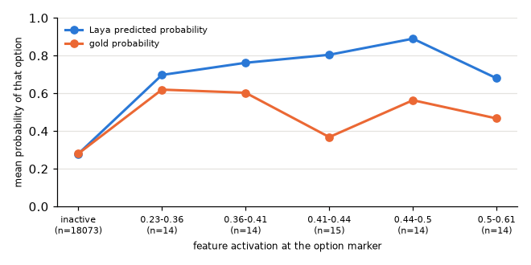

# Feature 1547

Critérios em que aparece: pred_probe_right_laya_wrong_stratified

**Interpretação (preencher):** 

---

## Maiores ativações

**tr_customer_service_000176 / needs_human** (noul, customer_service) | ativação 2.393 em `estado` | opções ['false', 'true'] | Laya: **true** [0.156, 0.844] | gabarito: **true**

```
<bos> noul question: This conversation requires a human agent rather than automated handling.<eos>
▸ <mask> false: Automation can carry this to resolution.
▸ <mask> true: A human must take over: judgement, authority or empathy is required.

<eos>

 {"account": {"lifetime_value_usd": 389, "prior_tickets_90d": 0, "seats": 1, "tenure_months": 8, "tier": "standard"}, "orders": [{"amount_usd": 447, "date": "2026-03-17", "id": "A-79887", "status": "pending"}, {"amount_usd": 447, "date": "2026-02-17", "id": "A-28475", "status": "refunded"}], "thread": [{"role": "customer", "text": "I've been on the standard plan for eight months now, paying about $447, and I still can't get into my account."}, {"role": "agent", "text": "I’m sorry you’re experiencing this. Could you tell me what error message appears, or share the username you’re trying to sign in with?"}, {"role": "customer", "text": "It just says “invalid credentials”⟦ no⟧ matter what I type."}, {"role": "agent", "text": "Thanks for letting me know. Have you attempted a password reset, and if so, did you receive the reset email?"}, {"role": "customer", "text": "I tried resetting, but the reset email never arrives."}]}<eos>
```

**tr_customer_service_000176 / churn_risk** (score, customer_service) | ativação 2.359 em `estado` | opções ['0', '1', '2', '3'] | Laya: **2** [0.084, 0.342, 0.492, 0.082] | gabarito: **2**

```
<bos> score question: How likely is this customer to stop doing business with us because of this interaction?<eos>
▸ <mask> level 0: No sign of dissatisfaction.
▸ <mask> level 1: Mild frustration, but the relationship is intact.
▸ <mask> level 2: Clearly unhappy; repeat problems or explicit complaints.
▸ <mask> level 3: Imminent: threatening to cancel, dispute or leave.

<eos>

 {"account": {"lifetime_value_usd": 389, "prior_tickets_90d": 0, "seats": 1, "tenure_months": 8, "tier": "standard"}, "orders": [{"amount_usd": 447, "date": "2026-03-17", "id": "A-79887", "status": "pending"}, {"amount_usd": 447, "date": "2026-02-17", "id": "A-28475", "status": "refunded"}], "thread": [{"role": "customer", "text": "I've been on the standard plan for eight months now, paying about $447, and I still can't get into my account."}, {"role": "agent", "text": "I’m sorry you’re experiencing this. Could you tell me what error message appears, or share the username you’re trying to sign in with?"}, {"role": "customer", "text": "It just says “invalid credentials”⟦ no⟧ matter what I type."}, {"role": "agent", "text": "Thanks for letting me know. Have you attempted a password reset, and if so, did you receive the reset email?"}, {"role": "customer", "text": "I tried resetting, but the reset email never arrives."}]}<eos>
```

**tr_customer_service_000176 / urgency** (score, customer_service) | ativação 2.340 em `estado` | opções ['0', '1', '2', '3'] | Laya: **1** [0.199, 0.48, 0.106, 0.215] | gabarito: **2**

```
<bos> score question: How time-sensitive is this conversation?<eos>
▸ <mask> level 0: No time pressure; can wait indefinitely.
▸ <mask> level 1: Routine; handle within the normal queue.
▸ <mask> level 2: Elevated; should be handled within the same week.
▸ <mask> level 3: Critical; requires action within the same day.

<eos>

 {"account": {"lifetime_value_usd": 389, "prior_tickets_90d": 0, "seats": 1, "tenure_months": 8, "tier": "standard"}, "orders": [{"amount_usd": 447, "date": "2026-03-17", "id": "A-79887", "status": "pending"}, {"amount_usd": 447, "date": "2026-02-17", "id": "A-28475", "status": "refunded"}], "thread": [{"role": "customer", "text": "I've been on the standard plan for eight months now, paying about $447, and I still can't get into my account."}, {"role": "agent", "text": "I’m sorry you’re experiencing this. Could you tell me what error message appears, or share the username you’re trying to sign in with?"}, {"role": "customer", "text": "It just says “invalid credentials”⟦ no⟧ matter what I type."}, {"role": "agent", "text": "Thanks for letting me know. Have you attempted a password reset, and if so, did you receive the reset email?"}, {"role": "customer", "text": "I tried resetting, but the reset email never arrives."}]}<eos>
```

**tr_customer_service_000176 / action** (choice, customer_service) | ativação 2.268 em `estado` | opções ['answer_directly', 'close_no_action', 'escalate_to_human', 'execute_refund', 'request_information'] | Laya: **answer_directly** [0.696, 0.26, 0.006, 0.031, 0.008] | gabarito: **request_information**

```
<bos> choice question: What should the assistant do next with this conversation?<eos>
▸ <mask> answer_directly: The assistant can resolve this itself with information it already has.
▸ <mask> close_no_action: No further action is warranted; the matter is settled.
▸ <mask> escalate_to_human: Hand off to a human agent with the appropriate authority.
▸ <mask> execute_refund: Issue the refund or credit the customer is owed.
▸ <mask> request_information: More detail is needed from the customer before anything can be done.

<eos>

 {"account": {"lifetime_value_usd": 389, "prior_tickets_90d": 0, "seats": 1, "tenure_months": 8, "tier": "standard"}, "orders": [{"amount_usd": 447, "date": "2026-03-17", "id": "A-79887", "status": "pending"}, {"amount_usd": 447, "date": "2026-02-17", "id": "A-28475", "status": "refunded"}], "thread": [{"role": "customer", "text": "I've been on the standard plan for eight months now, paying about $447, and I still can't get into my account."}, {"role": "agent", "text": "I’m sorry you’re experiencing this. Could you tell me what error message appears, or share the username you’re trying to sign in with?"}, {"role": "customer", "text": "It just says “invalid credentials”⟦ no⟧ matter what I type."}, {"role": "agent", "text": "Thanks for letting me know. Have you attempted a password reset, and if so, did you receive the reset email?"}, {"role": "customer", "text": "I tried resetting, but the reset email never arrives."}]}<eos>
```

**tr_customer_service_000176 / category** (choice, customer_service) | ativação 2.266 em `estado` | opções ['account', 'billing', 'delivery', 'refund', 'technical'] | Laya: **account** [0.916, 0.003, 0.0, 0.0, 0.081] | gabarito: **account**

```
<bos> choice question: What is this customer conversation primarily about?<eos>
▸ <mask> account: Login, plan changes, profile or access management.
▸ <mask> billing: A charge, invoice, subscription or payment problem.
▸ <mask> delivery: Shipping, fulfilment or delivery of a physical item.
▸ <mask> refund: The customer is explicitly asking for money back.
▸ <mask> technical: The product or service is not working as expected.

<eos>

 {"account": {"lifetime_value_usd": 389, "prior_tickets_90d": 0, "seats": 1, "tenure_months": 8, "tier": "standard"}, "orders": [{"amount_usd": 447, "date": "2026-03-17", "id": "A-79887", "status": "pending"}, {"amount_usd": 447, "date": "2026-02-17", "id": "A-28475", "status": "refunded"}], "thread": [{"role": "customer", "text": "I've been on the standard plan for eight months now, paying about $447, and I still can't get into my account."}, {"role": "agent", "text": "I’m sorry you’re experiencing this. Could you tell me what error message appears, or share the username you’re trying to sign in with?"}, {"role": "customer", "text": "It just says “invalid credentials”⟦ no⟧ matter what I type."}, {"role": "agent", "text": "Thanks for letting me know. Have you attempted a password reset, and if so, did you receive the reset email?"}, {"role": "customer", "text": "I tried resetting, but the reset email never arrives."}]}<eos>
```

## Ativações medianas (faixa 40-60%, mediana 0.643)

**tr_security_incidents_000261 / credential_compromise** (noul, security_incidents) | ativação 0.734 em `estado` | opções ['false', 'true'] | Laya: **true** [0.005, 0.995] | gabarito: **true**

```
<bos> noul question: The evidence indicates a credential or account has been compromised.<eos>
▸ <mask> false: no, the statement does not hold
▸ <mask> true: yes, the statement holds

<eos>

 {"alert": {"description": "an unrecognised binary executed on a server", "evidence": "At 02:14 UTC on 2026-09-15, a process named \"c:\\temp\\svchost.exe\" was launched on server APP01 by contractor user jdoe (ID C12345). The binary’s SHA‑25⟦6⟧ hash (a1b2c3d4e5…) does not appear in the approved software inventory. MFA authentication succeeded and no maintenance window was active.", "rule": "suspicious_process"}, "context": {"asset_criticality": "medium", "change_window_active": false, "source_on_allowlist": true}, "history": {"credential_rotation_days_ago": 700, "distinct_countries_30d": 1, "logins_30d": 1197, "prior_alerts_90d": 0}, "principal": {"mfa_enrolled": true, "name": "svc-billing-358", "privileges": ["repo:read"], "type": "contractor"}}<eos>
```

**tr_customer_service_000263 / needs_human** (noul, customer_service) | ativação 0.572 em `estado` | opções ['false', 'true'] | Laya: **false** [0.653, 0.347] | gabarito: **true**

```
<bos> noul question: This conversation requires a human agent rather than automated handling.<eos>
▸ <mask> false: Automation can carry this to resolution.
▸ <mask> true: A human must take over: judgement, authority or empathy is required.

<eos>

 {"account": {"lifetime_value_usd": 270, "prior_tickets_90d": 5, "seats": 1, "tenure_months": 3, "tier": "enterprise"}, "orders": [{"amount_usd": 9, "date": "2026-02-14", "id": "A-24⟦6⟧58", "status": "settled"}, {"amount_usd": 9, "date": "2026-01-01", "id": "A-74253", "status": "settled"}], "thread": [{"role": "customer", "text": "This is the sixth time in three months I’ve received the wrong shipment, despite being on an Enterprise agreement. I’ve had five tickets about this already that were supposedly resolved, but the error keeps recurring and I absolutely need the correct hardware for our site launch on Friday."}]}<eos>
```

**tr_security_incidents_000254 / disposition** (choice, security_incidents) | ativação 0.679 em `estado` | opções ['close_benign', 'contain', 'investigate', 'monitor'] | Laya: **monitor** [0.199, 0.08, 0.335, 0.386] | gabarito: **contain**

```
<bos> choice question: How should this security alert be dispositioned?<eos>
▸ <mask> close_benign: Expected, explainable activity; close without analyst time.
▸ <mask> contain: Contain the host or account immediately; do not wait for triage.
▸ <mask> investigate: Warrants an analyst opening an investigation.
▸ <mask> monitor: Not clearly malicious, but worth watching for recurrence.

<eos>

 {"alert": {"description": "a security group was opened to the public internet", "evidence": "At 10:45:23 UTC on 2026‑09‑16, the security group \"Finance_Users\" was modified to include an inbound rule allowing 0.0.0.0/0 on TCP port 3389. The change was performed by employee \"alice.smith\" without MFA, outside any scheduled change window, and the employee’⟦s⟧ password was last changed 30 days ago.", "rule": "config_drift"}, "context": {"asset_criticality": "medium", "change_window_active": false, "source_on_allowlist": false}, "history": {"credential_rotation_days_ago": 30, "distinct_countries_30d": 4, "logins_30d": 1904, "prior_alerts_90d": 8}, "principal": {"mfa_enrolled": false, "name": "svc-infra-326", "privileges": ["repo:read"], "type": "employee"}}<eos>
```

**tr_customer_service_000056 / churn_risk** (score, customer_service) | ativação 0.562 em `estado` | opções ['0', '1', '2', '3'] | Laya: **3** [0.03, 0.118, 0.12, 0.732] | gabarito: **3**

```
<bos> score question: How likely is this customer to stop doing business with us because of this interaction?<eos>
▸ <mask> level 0: No sign of dissatisfaction.
▸ <mask> level 1: Mild frustration, but the relationship is intact.
▸ <mask> level 2: Clearly unhappy; repeat problems or explicit complaints.
▸ <mask> level 3: Imminent: threatening to cancel, dispute or leave.

<eos>

 {"account": {"lifetime_value_usd": 2311, "prior_tickets_90d": 1, "seats": 1, "tenure_months": 26, "tier": "premium"}, "thread": [{"role": "customer", "text": "I’ve been a premium member for 26 months and the package I got today is completely wrong – it’s not even the model I ordered."}, {"role": "agent", "text": "I’m sorry to hear that. Could you share the order number so I can look into it⟦?"⟧}, {"role": "customer", "text": "It’s the same issue we fought over in ticket #12345 – you promised it would be fixed and now you’ve shipped the wrong item again. I’m done with this."}, {"role": "agent", "text": "I understand your frustration. Would you be able to send a photo of what you received?"}, {"role": "customer", "text": "I’ve been paying for the premium plan for over two years and I expect this to be sorted out fast, otherwise I’m walking away."}, {"role": "agent", "text": "I hear you. I’ll forward this to our escalation team right away. Could you confirm the shipping address on the account?"}, {"role": "customer", "text": "I need this sorted now, or I’m out."}]}<eos>
```

**tr_security_incidents_000159 / disposition** (choice, security_incidents) | ativação 0.593 em `estado` | opções ['close_benign', 'contain', 'investigate', 'monitor'] | Laya: **contain** [0.068, 0.454, 0.108, 0.371] | gabarito: **investigate**

```
<bos> choice question: How should this security alert be dispositioned?<eos>
▸ <mask> close_benign: Expected, explainable activity; close without analyst time.
▸ <mask> contain: Contain the host or account immediately; do not wait for triage.
▸ <mask> investigate: Warrants an analyst opening an investigation.
▸ <mask> monitor: Not clearly malicious, but worth watching for recurrence.

<eos>

 {"alert": {"description": "a first-ever sign-in from an unfamiliar country", "evidence": "At 2026-09-15 04:32 UTC a service account (svc-data-ingest) authenticated from IP 203.0.113.45, which resolves to Country X— a location not previously associated with this account. This represents the first successful sign‑in from that country and the account’s MFA setting was disabled. The credentials for the account were rotated three days earlier on 2026-09-12.", "rule": "new_country_login"}, "context": {"asset_⟦critical⟧ity": "crown_jewel", "change_window_active": false, "source_on_allowlist": false}, "history": {"credential_rotation_days_ago": 3, "distinct_countries_30d": 1, "logins_30d": 1102, "prior_alerts_90d": 8}, "principal": {"mfa_enrolled": false, "name": "usr-analytics-473", "privileges": ["repo:read"], "type": "service_account"}}<eos>
```

## Estatísticas (conjunto de descoberta, dev e teste)

**pred / error**

| split | decisões | ativas | ativas e Laya errou | taxa | lift | q (BH) | OR (CMH) | q (CMH) |
|---|---|---|---|---|---|---|---|---|
| discovery | 5100 | 53 | 25 | 0.472 | 0.73 | 0.0242 | 2.50 | 0.0616 |
| dev | 900 | 9 | 3 | 0.333 | 0.50 | nan | nan | nan |
| test | 2000 | 24 | 9 | 0.375 | 0.58 | 0.0185 | 2.35 | 0.416 |

**corr / error**

| split | decisões | ativas | ativas e Laya errou | taxa | lift | q (BH) | OR (CMH) | q (CMH) |
|---|---|---|---|---|---|---|---|---|
| discovery | 5100 | 34 | 6 | 0.176 | 0.27 | 1.39e-07 | 1.69 | 0.49 |
| dev | 900 | 8 | 2 | 0.250 | 0.37 | nan | nan | nan |
| test | 2000 | 16 | 1 | 0.062 | 0.10 | nan | nan | nan |

**state / error**

| split | decisões | ativas | ativas e Laya errou | taxa | lift | q (BH) | OR (CMH) | q (CMH) |
|---|---|---|---|---|---|---|---|---|
| discovery | 5100 | 364 | 210 | 0.577 | 0.90 | 0.0268 | 0.91 | 0.75 |
| dev | 900 | 66 | 41 | 0.621 | 0.92 | 0.777 | 1.24 | 0.802 |
| test | 2000 | 149 | 92 | 0.617 | 0.95 | 0.719 | 0.86 | 0.748 |

**pred / probe_right_laya_wrong**

| split | decisões | ativas | ativas e Laya errou | taxa | lift | q (BH) | OR (CMH) | q (CMH) |
|---|---|---|---|---|---|---|---|---|
| discovery | 2819 | 39 | 16 | 0.410 | 0.63 | 0.00607 | 3.72 | 0.00689 |
| dev | 520 | 6 | 2 | 0.333 | 0.49 | nan | nan | nan |
| test | 1106 | 18 | 3 | 0.167 | 0.26 | nan | nan | nan |

**corr / probe_right_laya_wrong**

| split | decisões | ativas | ativas e Laya errou | taxa | lift | q (BH) | OR (CMH) | q (CMH) |
|---|---|---|---|---|---|---|---|---|
| discovery | 2819 | 29 | 6 | 0.207 | 0.32 | 5.31e-06 | 1.99 | 0.477 |
| dev | 520 | 5 | 1 | 0.200 | 0.30 | nan | nan | nan |
| test | 1106 | 16 | 1 | 0.062 | 0.10 | nan | nan | nan |

**state / probe_right_laya_wrong**

| split | decisões | ativas | ativas e Laya errou | taxa | lift | q (BH) | OR (CMH) | q (CMH) |
|---|---|---|---|---|---|---|---|---|
| discovery | 2819 | 186 | 101 | 0.543 | 0.84 | 0.0104 | 0.89 | 0.749 |
| dev | 520 | 36 | 20 | 0.556 | 0.82 | 0.478 | 1.37 | 0.698 |
| test | 1106 | 82 | 51 | 0.622 | 0.98 | 1 | 1.23 | 0.687 |

Confusão mais sobre-representada (pred): `true_positive|1>0` (n=25, lift 34.37, p=1.54e-34). Formato `pergunta|índice previsto>índice correto`.

Confusão mais sobre-representada (corr): `true_positive|0>1` (n=6, lift 40.91, p=3.82e-09). Formato `pergunta|índice previsto>índice correto`.

Confusão mais sobre-representada (state): `churn_risk|1>2` (n=11, lift 2.75, p=0.00169). Formato `pergunta|índice previsto>índice correto`.



