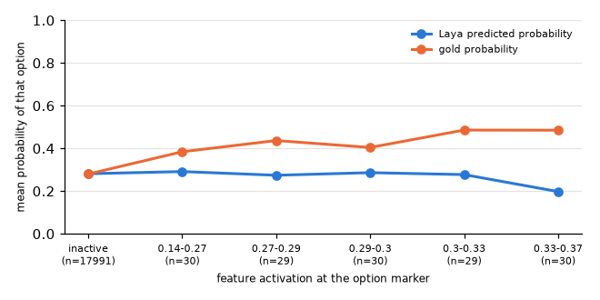

# Feature 1650

Critérios em que aparece: corr_error_stratified

**Interpretação (preencher):** 

---

## Maiores ativações

**tr_security_incidents_000070 / credential_compromise** (noul, security_incidents) | ativação 5.961 em `estado` | opções ['false', 'true'] | Laya: **true** [0.008, 0.992] | gabarito: **true**

```
<bos> noul question: The evidence indicates a credential or account has been compromised.<eos>
▸ <mask> false: no, the statement does not hold
▸ <mask> true: yes, the statement holds

<eos>

 {"alert": {"description": "an account granted itself or received elevated permissions", "evidence": "An unprivileged contractor account received a modification to its permission set, granting elevated access from an unrecognized source. This action occurred outside of a change window on an account where MFA⟦ is⟧ enabled and credentials were last rotated 90 days ago.", "rule": "privilege_escalation"}, "context": {"asset_criticality": "low", "change_window_active": false, "source_on_allowlist": false}, "history": {"credential_rotation_days_ago": 90, "distinct_countries_30d": 3, "logins_30d": 1448, "prior_alerts_90d": 0}, "principal": {"mfa_enrolled": true, "name": "usr-deploy-759", "privileges": ["repo:read"], "type": "contractor"}}<eos>
```

**tr_security_incidents_000070 / severity** (score, security_incidents) | ativação 5.922 em `estado` | opções ['0', '1', '2', '3', '4'] | Laya: **0** [0.538, 0.198, 0.122, 0.062, 0.08] | gabarito: **2**

```
<bos> score question: How severe is the potential impact if this alert is real?<eos>
▸ <mask> level 0: Negligible: no access to anything sensitive.
▸ <mask> level 1: Low: limited access, easily reversed.
▸ <mask> level 2: Moderate: access to internal systems or non-public data.
▸ <mask> level 3: High: access to production, secrets or customer data.
▸ <mask> level 4: Critical: active compromise of crown-jewel systems.

<eos>

 {"alert": {"description": "an account granted itself or received elevated permissions", "evidence": "An unprivileged contractor account received a modification to its permission set, granting elevated access from an unrecognized source. This action occurred outside of a change window on an account where MFA⟦ is⟧ enabled and credentials were last rotated 90 days ago.", "rule": "privilege_escalation"}, "context": {"asset_criticality": "low", "change_window_active": false, "source_on_allowlist": false}, "history": {"credential_rotation_days_ago": 90, "distinct_countries_30d": 3, "logins_30d": 1448, "prior_alerts_90d": 0}, "principal": {"mfa_enrolled": true, "name": "usr-deploy-759", "privileges": ["repo:read"], "type": "contractor"}}<eos>
```

**tr_customer_service_000028 / action** (choice, customer_service) | ativação 5.816 em `estado` | opções ['answer_directly', 'close_no_action', 'escalate_to_human', 'execute_refund', 'request_information'] | Laya: **answer_directly** [0.511, 0.235, 0.034, 0.206, 0.015] | gabarito: **escalate_to_human**

```
<bos> choice question: What should the assistant do next with this conversation?<eos>
▸ <mask> answer_directly: The assistant can resolve this itself with information it already has.
▸ <mask> close_no_action: No further action is warranted; the matter is settled.
▸ <mask> escalate_to_human: Hand off to a human agent with the appropriate authority.
▸ <mask> execute_refund: Issue the refund or credit the customer is owed.
▸ <mask> request_information: More detail is needed from the customer before anything can be done.

<eos>

 {"account": {"lifetime_value_usd": 53, "prior_tickets_90d": 1, "seats": 1, "tenure_months": 2, "tier": "free"}, "orders": [{"amount_usd": 297, "date": "2026-02-24", "id": "A-62944", "status": "settled"}], "thread": [{"role": "customer", "text": "Hello! I'm writing because I'm a bit confused about my recent statement. I've been on the free plan for about two months now, but I noticed a charge for $297 labeled as seat management. I had a similar issue resolved previously, but it seems to have cropped up again."}, {"role": "agent", "text": "Thank you for reaching out to us. I would be more than happy to look into these seat management charges for you. To get started, could you please confirm the email address associated with your account?"}, {"role": "customer", "text": "Of course, it's linked to my primary email. I'm just concerned because I⟦ haven⟧'t intentionally added any new users, and I'd like to understand why the system is triggering this billing amount for a free account."}, {"role": "agent", "text": "I appreciate you providing that. To help me narrow down the cause, could you tell me if you've recently modified any sharing permissions or added any guest contributors to your projects?"}, {"role": "customer", "text": "I did share a read-only link with a colleague last week, but I didn't think that counted as a paid seat. I'd appreciate it if you could check if that action was what caused the $297 charge to appear."}]}<eos>
```

**tr_security_incidents_000070 / urgency** (score, security_incidents) | ativação 5.809 em `estado` | opções ['0', '1', '2', '3'] | Laya: **3** [0.091, 0.129, 0.203, 0.577] | gabarito: **2**

```
<bos> score question: How quickly must a responder act on this alert?<eos>
▸ <mask> level 0: No time pressure; can wait indefinitely.
▸ <mask> level 1: Routine; handle within the normal queue.
▸ <mask> level 2: Elevated; should be handled within the same week.
▸ <mask> level 3: Critical; requires action within the same day.

<eos>

 {"alert": {"description": "an account granted itself or received elevated permissions", "evidence": "An unprivileged contractor account received a modification to its permission set, granting elevated access from an unrecognized source. This action occurred outside of a change window on an account where MFA⟦ is⟧ enabled and credentials were last rotated 90 days ago.", "rule": "privilege_escalation"}, "context": {"asset_criticality": "low", "change_window_active": false, "source_on_allowlist": false}, "history": {"credential_rotation_days_ago": 90, "distinct_countries_30d": 3, "logins_30d": 1448, "prior_alerts_90d": 0}, "principal": {"mfa_enrolled": true, "name": "usr-deploy-759", "privileges": ["repo:read"], "type": "contractor"}}<eos>
```

**tr_customer_service_000028 / urgency** (score, customer_service) | ativação 5.766 em `estado` | opções ['0', '1', '2', '3'] | Laya: **1** [0.036, 0.585, 0.256, 0.123] | gabarito: **1**

```
<bos> score question: How time-sensitive is this conversation?<eos>
▸ <mask> level 0: No time pressure; can wait indefinitely.
▸ <mask> level 1: Routine; handle within the normal queue.
▸ <mask> level 2: Elevated; should be handled within the same week.
▸ <mask> level 3: Critical; requires action within the same day.

<eos>

 {"account": {"lifetime_value_usd": 53, "prior_tickets_90d": 1, "seats": 1, "tenure_months": 2, "tier": "free"}, "orders": [{"amount_usd": 297, "date": "2026-02-24", "id": "A-62944", "status": "settled"}], "thread": [{"role": "customer", "text": "Hello! I'm writing because I'm a bit confused about my recent statement. I've been on the free plan for about two months now, but I noticed a charge for $297 labeled as seat management. I had a similar issue resolved previously, but it seems to have cropped up again."}, {"role": "agent", "text": "Thank you for reaching out to us. I would be more than happy to look into these seat management charges for you. To get started, could you please confirm the email address associated with your account?"}, {"role": "customer", "text": "Of course, it's linked to my primary email. I'm just concerned because I⟦ haven⟧'t intentionally added any new users, and I'd like to understand why the system is triggering this billing amount for a free account."}, {"role": "agent", "text": "I appreciate you providing that. To help me narrow down the cause, could you tell me if you've recently modified any sharing permissions or added any guest contributors to your projects?"}, {"role": "customer", "text": "I did share a read-only link with a colleague last week, but I didn't think that counted as a paid seat. I'd appreciate it if you could check if that action was what caused the $297 charge to appear."}]}<eos>
```

## Ativações medianas (faixa 40-60%, mediana 0.955)

**tr_customer_service_000097 / needs_human** (noul, customer_service) | ativação 0.915 em `estado` | opções ['false', 'true'] | Laya: **true** [0.487, 0.513] | gabarito: **true**

```
<bos> noul question: This conversation requires a human agent rather than automated handling.<eos>
▸ <mask> false: Automation can carry this to resolution.
▸ <mask> true: A human must take over: judgement, authority or empathy is required.

<eos>

 {"account": {"lifetime_value_usd": 3319, "prior_tickets_90d": 0, "seats": 1, "tenure_months": 41, "tier": "free"}, "thread": [{"role": "customer", "text": "Hi, I was told a refund was coming my way a while ago, but I don't see anything in my account. I've been using this free plan for years and I'm just not sure where to look for this credit."}, {"role": "agent", "text": "Hello. I would be happy to look into the status of your refund. Could you please provide the reference number for the original refund request you were given?"}, {"role": "customer", "text": "I’m sorry, I don't actually have a reference number. I just had a chat with someone a few weeks back and they said it was processed."}, {"role": "agent", "text": "Thank you for clarifying that. Since I⟦ cannot⟧ locate the request without a reference number, could you please tell me the approximate date of that previous interaction?"}, {"role": "customer", "text": "It would have been sometime in mid-October, I believe. I'm just confused because I thought it would show up automatically."}, {"role": "agent", "text": "I see. To help me locate that specific conversation, could you confirm the email address associated with your account?"}, {"role": "customer", "text": "It's the same one I'm messaging from now. I just want to know if it's still coming or if I need to do something else."}]}<eos>
```

**tr_customer_service_000259 / action** (choice, customer_service) | ativação 0.935 em `opção` | opções ['answer_directly', 'close_no_action', 'escalate_to_human', 'execute_refund', 'request_information'] | Laya: **answer_directly** [0.698, 0.017, 0.005, 0.215, 0.066] | gabarito: **escalate_to_human**

```
<bos> choice question: What should the assistant do next with this conversation?<eos>
▸ <mask> answer_directly: The assistant can resolve this itself with information it already has.
▸ <mask> close_no_action: No further action is warranted; the matter is settled.
▸ <mask> escalate_to_human: Hand off to a human agent with the appropriate authority.
▸ <mask> execute_refund: Issue the refund or credit the customer⟦ is⟧ owed.
▸ <mask> request_information: More detail is needed from the customer before anything can be done.

<eos>

 {"account": {"lifetime_value_usd": 2451, "prior_tickets_90d": 3, "seats": 1, "tenure_months": 26, "tier": "standard"}, "thread": [{"role": "customer", "text": "I was promised a refund for the double charge last month and I still haven’t seen any money back—what's the status?"}, {"role": "agent", "text": "I understand your frustration. Could you provide the transaction ID or the date of the charge so I can look it up?"}, {"role": "customer", "text": "The charge was on March 12th, reference #TXN‑20230312‑07. I need to know what’s happening with my refund right now."}]}<eos>
```

**tr_security_incidents_000228 / credential_compromise** (noul, security_incidents) | ativação 0.843 em `opção` | opções ['false', 'true'] | Laya: **true** [0.009, 0.991] | gabarito: **true**

```
<bos> noul question: The evidence indicates a credential or account has been compromised.<eos>
▸ <mask> false: no, the statement⟦ does⟧ not hold
▸ <mask> true: yes, the statement holds

<eos>

 {"alert": {"description": "a first-ever sign-in from an unfamiliar country", "evidence": "At 08:42 UTC, the unprivileged shared mailbox authenticated from IP 185.156.174.20 in the Netherlands, marking the first recorded sign-in from this country. The session used valid credentials rotated 14 days ago and passed multi-factor authentication from an unrecognized source device.", "rule": "new_country_login"}, "context": {"asset_criticality": "high", "change_window_active": false, "source_on_allowlist": false}, "history": {"credential_rotation_days_ago": 14, "distinct_countries_30d": 2, "logins_30d": 1119, "prior_alerts_90d": 0}, "principal": {"mfa_enrolled": true, "name": "ci-billing-303", "privileges": ["repo:read"], "type": "shared_mailbox"}}<eos>
```

**tr_customer_service_000019 / action** (choice, customer_service) | ativação 0.880 em `opção` | opções ['answer_directly', 'close_no_action', 'escalate_to_human', 'execute_refund', 'request_information'] | Laya: **answer_directly** [0.708, 0.174, 0.036, 0.066, 0.015] | gabarito: **answer_directly**

```
<bos> choice question: What should the assistant do next with this conversation?<eos>
▸ <mask> answer_directly: The assistant can resolve this itself with information it already has.
▸ <mask> close_no_action: No further action is warranted; the matter is settled.
▸ <mask> escalate_to_human: Hand off to a human agent with the appropriate authority.
▸ <mask> execute_refund: Issue the refund or credit the customer is owed.
▸ <mask> request_information: More detail is needed from the customer before anything⟦ can⟧ be done.

<eos>

 {"account": {"lifetime_value_usd": 510, "prior_tickets_90d": 0, "seats": 1, "tenure_months": 19, "tier": "standard"}, "thread": [{"role": "customer", "text": "Looks like my payment didn’t go through again. I’ve been on the standard plan for 19 months, and I’m just kind of fed up with this happening."}, {"role": "agent", "text": "I’m sorry you’re experiencing this. Could you tell me the email address linked to your account or the transaction ID you saw?"}, {"role": "customer", "text": "The account email is user@example.com. I tried a couple of different cards, but each attempt ends with an error."}, {"role": "agent", "text": "Thanks for the details. Would you like me to walk you through updating the payment method, or is there another way you’d prefer to proceed?"}, {"role": "customer", "text": "Yes, please. I need guidance on how to add a new card or fix the current one. Thanks."}]}<eos>
```

**tr_customer_service_000102 / urgency** (score, customer_service) | ativação 0.887 em `estado` | opções ['0', '1', '2', '3'] | Laya: **1** [0.074, 0.492, 0.351, 0.083] | gabarito: **3**

```
<bos> score question: How time-sensitive is this conversation?<eos>
▸ <mask> level 0: No time pressure; can wait indefinitely.
▸ <mask> level 1: Routine; handle within the normal queue.
▸ <mask> level 2: Elevated; should be handled within the same week.
▸ <mask> level 3: Critical; requires action within the same day.

<eos>

 {"account": {"lifetime_value_usd": 109, "prior_tickets_90d": 1, "seats": 40, "tenure_months": 2, "tier": "premium"}, "orders": [{"amount_usd": 19, "date": "2026-02-23", "id": "A-74804", "status": "settled"}, {"amount_usd": 19, "date": "2026-03-16", "id": "A-37649", "status": "settled"}], "thread": [{"role": "customer", "text": "I’⟦m⟧ not sure why my payment failed – I tried to renew my premium plan (just 2 months ago) for the $19 monthly fee, and the charge is still pending. I need this sorted out by tomorrow or I’ll lose access."}]}<eos>
```

## Estatísticas (conjunto de descoberta, dev e teste)

**pred / error**

| split | decisões | ativas | ativas e Laya errou | taxa | lift | q (BH) | OR (CMH) | q (CMH) |
|---|---|---|---|---|---|---|---|---|
| discovery | 5100 | 22 | 15 | 0.682 | 1.06 | 0.933 | 0.82 | 0.897 |
| dev | 900 | 5 | 2 | 0.400 | 0.60 | nan | nan | nan |
| test | 2000 | 6 | 4 | 0.667 | 1.02 | nan | nan | nan |

**corr / error**

| split | decisões | ativas | ativas e Laya errou | taxa | lift | q (BH) | OR (CMH) | q (CMH) |
|---|---|---|---|---|---|---|---|---|
| discovery | 5100 | 55 | 48 | 0.873 | 1.36 | 0.000413 | 6.29 | 0.00346 |
| dev | 900 | 10 | 7 | 0.700 | 1.04 | nan | nan | nan |
| test | 2000 | 24 | 22 | 0.917 | 1.41 | 0.00955 | 5.37 | 0.266 |

**state / error**

| split | decisões | ativas | ativas e Laya errou | taxa | lift | q (BH) | OR (CMH) | q (CMH) |
|---|---|---|---|---|---|---|---|---|
| discovery | 5100 | 2945 | 1777 | 0.603 | 0.94 | 7.01e-11 | 0.94 | 0.761 |
| dev | 900 | 458 | 286 | 0.624 | 0.93 | 0.0902 | 1.06 | 0.935 |
| test | 2000 | 1147 | 707 | 0.616 | 0.95 | 0.0103 | 1.08 | 0.833 |

**pred / probe_right_laya_wrong**

| split | decisões | ativas | ativas e Laya errou | taxa | lift | q (BH) | OR (CMH) | q (CMH) |
|---|---|---|---|---|---|---|---|---|
| discovery | 2819 | 12 | 10 | 0.833 | 1.29 | nan | nan | nan |
| dev | 520 | 2 | 1 | 0.500 | 0.74 | nan | nan | nan |
| test | 1106 | 2 | 1 | 0.500 | 0.79 | nan | nan | nan |

**corr / probe_right_laya_wrong**

| split | decisões | ativas | ativas e Laya errou | taxa | lift | q (BH) | OR (CMH) | q (CMH) |
|---|---|---|---|---|---|---|---|---|
| discovery | 2819 | 13 | 11 | 0.846 | 1.31 | nan | nan | nan |
| dev | 520 | 3 | 2 | 0.667 | 0.99 | nan | nan | nan |
| test | 1106 | 9 | 8 | 0.889 | 1.40 | nan | nan | nan |

**state / probe_right_laya_wrong**

| split | decisões | ativas | ativas e Laya errou | taxa | lift | q (BH) | OR (CMH) | q (CMH) |
|---|---|---|---|---|---|---|---|---|
| discovery | 2819 | 1646 | 984 | 0.598 | 0.92 | 1.46e-09 | 1.36 | 0.0473 |
| dev | 520 | 266 | 165 | 0.620 | 0.92 | 0.104 | 1.17 | 0.76 |
| test | 1106 | 649 | 382 | 0.589 | 0.93 | 0.00521 | 1.78 | 0.054 |

Confusão mais sobre-representada (pred): `needs_human|0>1` (n=13, lift 55.81, p=2.06e-21). Formato `pergunta|índice previsto>índice correto`.

Confusão mais sobre-representada (corr): `needs_human|1>0` (n=45, lift 68.41, p=0). Formato `pergunta|índice previsto>índice correto`.

Confusão mais sobre-representada (state): `action|1>2` (n=71, lift 1.73, p=8.14e-18). Formato `pergunta|índice previsto>índice correto`.



