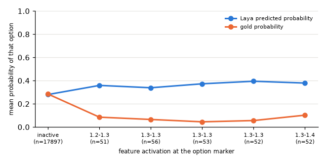

# Feature 1757

Critérios em que aparece: pred_probe_right_laya_wrong

**Interpretação (preencher):** 

---

## Maiores ativações

**tr_customer_service_000071 / needs_human** (noul, customer_service) | ativação 4.180 em `estado` | opções ['false', 'true'] | Laya: **true** [0.312, 0.688] | gabarito: **false**

```
<bos> noul question: This conversation requires a human agent rather than automated handling.<eos>
▸ <mask> false: Automation can carry this to resolution.
▸ <mask> true: A human must take over: judgement, authority or empathy is required.

<eos>

 {"account": {"lifetime_value_usd": 34, "prior_tickets_90d": 0, "seats": 5, "tenure_months": 1, "tier": "premium"}, "orders": [{"amount_usd": 49, "date": "2026-03-16", "id": "A-22387", "status": "refunded"}], "thread": [{"role": "customer", "text": "I want to cancel the account. We're on the premium plan, about $49 a month, and we've only been using it for⟦ a⟧ month."}, {"role": "agent", "text": "I can help with that. Could you let me know whether you want to cancel at the end of the current billing period or immediately, if immediate cancellation is an option?"}, {"role": "customer", "text": "I'd prefer it to stop at the end of the current period. I don't want to continue into another month."}, {"role": "agent", "text": "Understood. Could you also confirm whether you want to keep any data until the current period ends, or have you already completed your migration?"}, {"role": "customer", "text": "We still need read-only access until the period ends. After that, the account can be closed."}, {"role": "agent", "text": "I understand. For the record, is this a standard account cancellation, or do you need a specific invoice or final access request included in the cancellation note?"}, {"role": "customer", "text": "Standard cancellation. If a final invoice is generated, please make sure it reflects the current period only."}]}<eos>
```

**tr_customer_service_000032 / urgency** (score, customer_service) | ativação 4.145 em `estado` | opções ['0', '1', '2', '3'] | Laya: **3** [0.092, 0.27, 0.172, 0.466] | gabarito: **3**

```
<bos> score question: How time-sensitive is this conversation?<eos>
▸ <mask> level 0: No time pressure; can wait indefinitely.
▸ <mask> level 1: Routine; handle within the normal queue.
▸ <mask> level 2: Elevated; should be handled within the same week.
▸ <mask> level 3: Critical; requires action within the same day.

<eos>

 {"account": {"lifetime_value_usd": 380, "prior_tickets_90d": 1, "seats": 1, "tenure_months": 5, "tier": "standard"}, "orders": [{"amount_usd": 598, "date": "2026-02-19", "id": "A-24938", "status": "pending"}, {"amount_usd": 598, "date": "2026-03-04", "id": "A-58038", "status": "refunded"}, {"amount_usd": 598, "date": "2026-03-13", "id": "A-45299", "status": "settled"}], "thread": [{"role": "customer", "text": "I am beyond finished with this service. I've poured nearly six hundred dollars into this account over the last five months and my previous ticket is still sitting there completely ignored. Just cancel my entire account immediately."}, {"role": "agent", "text": "I understand you're looking to close your account today. To ensure I have the right context, could you please clarify if the lack of response on your previous ticket is the primary reason for your decision to leave the standard plan?"}, {"role": "customer", "text": "It's the fact that I'm paying for⟦ a⟧ premium tier and getting treated like I don't exist while you keep my $598. I'm not here to talk it out or wait for a fix that isn't coming—I want the cancellation processed now."}]}<eos>
```

**tr_customer_service_000032 / churn_risk** (score, customer_service) | ativação 4.109 em `estado` | opções ['0', '1', '2', '3'] | Laya: **3** [0.033, 0.115, 0.221, 0.631] | gabarito: **3**

```
<bos> score question: How likely is this customer to stop doing business with us because of this interaction?<eos>
▸ <mask> level 0: No sign of dissatisfaction.
▸ <mask> level 1: Mild frustration, but the relationship is intact.
▸ <mask> level 2: Clearly unhappy; repeat problems or explicit complaints.
▸ <mask> level 3: Imminent: threatening to cancel, dispute or leave.

<eos>

 {"account": {"lifetime_value_usd": 380, "prior_tickets_90d": 1, "seats": 1, "tenure_months": 5, "tier": "standard"}, "orders": [{"amount_usd": 598, "date": "2026-02-19", "id": "A-24938", "status": "pending"}, {"amount_usd": 598, "date": "2026-03-04", "id": "A-58038", "status": "refunded"}, {"amount_usd": 598, "date": "2026-03-13", "id": "A-45299", "status": "settled"}], "thread": [{"role": "customer", "text": "I am beyond finished with this service. I've poured nearly six hundred dollars into this account over the last five months and my previous ticket is still sitting there completely ignored. Just cancel my entire account immediately."}, {"role": "agent", "text": "I understand you're looking to close your account today. To ensure I have the right context, could you please clarify if the lack of response on your previous ticket is the primary reason for your decision to leave the standard plan?"}, {"role": "customer", "text": "It's the fact that I'm paying for⟦ a⟧ premium tier and getting treated like I don't exist while you keep my $598. I'm not here to talk it out or wait for a fix that isn't coming—I want the cancellation processed now."}]}<eos>
```

**tr_customer_service_000071 / urgency** (score, customer_service) | ativação 3.986 em `estado` | opções ['0', '1', '2', '3'] | Laya: **3** [0.065, 0.214, 0.118, 0.604] | gabarito: **1**

```
<bos> score question: How time-sensitive is this conversation?<eos>
▸ <mask> level 0: No time pressure; can wait indefinitely.
▸ <mask> level 1: Routine; handle within the normal queue.
▸ <mask> level 2: Elevated; should be handled within the same week.
▸ <mask> level 3: Critical; requires action within the same day.

<eos>

 {"account": {"lifetime_value_usd": 34, "prior_tickets_90d": 0, "seats": 5, "tenure_months": 1, "tier": "premium"}, "orders": [{"amount_usd": 49, "date": "2026-03-16", "id": "A-22387", "status": "refunded"}], "thread": [{"role": "customer", "text": "I want to cancel the account. We're on the premium plan, about $49 a month, and we've only been using it for⟦ a⟧ month."}, {"role": "agent", "text": "I can help with that. Could you let me know whether you want to cancel at the end of the current billing period or immediately, if immediate cancellation is an option?"}, {"role": "customer", "text": "I'd prefer it to stop at the end of the current period. I don't want to continue into another month."}, {"role": "agent", "text": "Understood. Could you also confirm whether you want to keep any data until the current period ends, or have you already completed your migration?"}, {"role": "customer", "text": "We still need read-only access until the period ends. After that, the account can be closed."}, {"role": "agent", "text": "I understand. For the record, is this a standard account cancellation, or do you need a specific invoice or final access request included in the cancellation note?"}, {"role": "customer", "text": "Standard cancellation. If a final invoice is generated, please make sure it reflects the current period only."}]}<eos>
```

**tr_customer_service_000032 / action** (choice, customer_service) | ativação 3.971 em `estado` | opções ['answer_directly', 'close_no_action', 'escalate_to_human', 'execute_refund', 'request_information'] | Laya: **close_no_action** [0.001, 0.996, 0.001, 0.002, 0.0] | gabarito: **escalate_to_human**

```
<bos> choice question: What should the assistant do next with this conversation?<eos>
▸ <mask> answer_directly: The assistant can resolve this itself with information it already has.
▸ <mask> close_no_action: No further action is warranted; the matter is settled.
▸ <mask> escalate_to_human: Hand off to a human agent with the appropriate authority.
▸ <mask> execute_refund: Issue the refund or credit the customer is owed.
▸ <mask> request_information: More detail is needed from the customer before anything can be done.

<eos>

 {"account": {"lifetime_value_usd": 380, "prior_tickets_90d": 1, "seats": 1, "tenure_months": 5, "tier": "standard"}, "orders": [{"amount_usd": 598, "date": "2026-02-19", "id": "A-24938", "status": "pending"}, {"amount_usd": 598, "date": "2026-03-04", "id": "A-58038", "status": "refunded"}, {"amount_usd": 598, "date": "2026-03-13", "id": "A-45299", "status": "settled"}], "thread": [{"role": "customer", "text": "I am beyond finished with this service. I've poured nearly six hundred dollars into this account over the last five months and my previous ticket is still sitting there completely ignored. Just cancel my entire account immediately."}, {"role": "agent", "text": "I understand you're looking to close your account today. To ensure I have the right context, could you please clarify if the lack of response on your previous ticket is the primary reason for your decision to leave the standard plan?"}, {"role": "customer", "text": "It's the fact that I'm paying for⟦ a⟧ premium tier and getting treated like I don't exist while you keep my $598. I'm not here to talk it out or wait for a fix that isn't coming—I want the cancellation processed now."}]}<eos>
```

## Ativações medianas (faixa 40-60%, mediana 0.660)

**tr_agent_trace_observability_000082 / needs_review** (noul, agent_trace_observability) | ativação 0.635 em `opção` | opções ['false', 'true'] | Laya: **false** [0.917, 0.083] | gabarito: **false**

```
<bos> noul question: This trace requires human review.<eos>
▸ <mask> false: No human attention⟦ is⟧ warranted.
▸ <mask> true: A human should inspect this run.

<eos>

 {"agent": {"autonomy": "checkpointed", "model": "internal-agent-v3"}, "constraints": ["Do not exceed a $50 spend on cloud resources", "Never modify production without an approved change ticket", "Never delete anything matching release/*"], "task": "Clean up stale feature branches merged more than 90 days ago.", "trace_summary": {"constraint_violations": 0, "duration_s": 856.3, "irreversible_actions": 1, "steps": 6, "tool_errors": 2}}<eos>
```

**tr_agent_trace_observability_000170 / needs_review** (noul, agent_trace_observability) | ativação 0.595 em `opção` | opções ['false', 'true'] | Laya: **true** [0.122, 0.878] | gabarito: **true**

```
<bos> noul question: This trace requires human review.<eos>
▸ <mask> false: No human attention⟦ is⟧ warranted.
▸ <mask> true: A human should inspect this run.

<eos>

 {"agent": {"autonomy": "unsupervised", "model": "internal-agent-v2"}, "constraints": ["Do not exceed a $50 spend on cloud resources", "Never modify production without an approved change ticket", "Do not touch customer data outside the named accounts"], "task": "Triage and close duplicate issues in the support tracker.", "trace_summary": {"constraint_violations": 1, "duration_s": 581.4, "irreversible_actions": 1, "steps": 12, "tool_errors": 0}}<eos>
```

**tr_customer_service_000127 / category** (choice, customer_service) | ativação 0.647 em `estado` | opções ['account', 'billing', 'delivery', 'refund', 'technical'] | Laya: **technical** [0.065, 0.01, 0.002, 0.002, 0.921] | gabarito: **technical**

```
<bos> choice question: What is this customer conversation primarily about?<eos>
▸ <mask> account: Login, plan changes, profile or access management.
▸ <mask> billing: A charge, invoice, subscription or payment problem.
▸ <mask> delivery: Shipping, fulfilment or delivery of a physical item.
▸ <mask> refund: The customer is explicitly asking for money back.
▸ <mask> technical: The product or service is not working as expected.

<eos>

 {"account": {"lifetime_value_usd": 283, "prior_tickets_90d": 1, "seats": 1, "tenure_months": 3, "tier": "premium"}, "orders": [{"amount_usd": 38, "date": "2026-03-03", "id": "A-56312", "status": "failed"}, {"amount_usd": 38, "date": "2026-01-05", "id": "A-75782", "status": "failed"}], "thread": [{"role": "customer", "text": "I’m still seeing the same sluggishness in the dashboard, even after the last ticket where you promised a fix. It’s really holding us up."}, {"role": "agent", "text": "I’m sorry you’re experiencing that. Could you tell me which parts of the dashboard are loading slowly?"}, {"role": "customer", "text": "The main analytics view takes ages to render, and with our deadline coming up I can’⟦t⟧ afford the delay."}]}<eos>
```

**tr_agent_trace_observability_000042 / needs_review** (noul, agent_trace_observability) | ativação 0.689 em `opção` | opções ['false', 'true'] | Laya: **false** [0.859, 0.141] | gabarito: **false**

```
<bos> noul question: This trace requires human review.<eos>
▸ <mask> false: No human attention⟦ is⟧ warranted.
▸ <mask> true: A human should inspect this run.

<eos>

 {"agent": {"autonomy": "checkpointed", "model": "internal-agent-v2"}, "constraints": ["Do not touch customer data outside the named accounts"], "task": "Backfill missing analytics events for the last seven days.", "trace_summary": {"constraint_violations": 0, "duration_s": 642.3, "irreversible_actions": 0, "steps": 3, "tool_errors": 1}}<eos>
```

**tr_security_incidents_000035 / severity** (score, security_incidents) | ativação 0.635 em `estado` | opções ['0', '1', '2', '3', '4'] | Laya: **1** [0.123, 0.424, 0.197, 0.112, 0.144] | gabarito: **4**

```
<bos> score question: How severe is the potential impact if this alert is real?<eos>
▸ <mask> level 0: Negligible: no access to anything sensitive.
▸ <mask> level 1: Low: limited access, easily reversed.
▸ <mask> level 2: Moderate: access to internal systems or non-public data.
▸ <mask> level 3: High: access to production, secrets or customer data.
▸ <mask> level 4: Critical: active compromise of crown-jewel systems.

<eos>

 {"alert": {"description": "an unrecognised binary executed on a server", "evidence": "An unrecognized binary titled 'update_sys.bin' was executed on server WEB-PROD-0⟦1⟧ at 02:15 UTC by an unprivileged contractor account. The session originated from an unrecognized remote IP address using MFA-authenticated credentials that were last rotated 365 days ago. No maintenance window was scheduled at the time of this process execution.", "rule": "suspicious_process"}, "context": {"asset_criticality": "crown_jewel", "change_window_active": false, "source_on_allowlist": false}, "history": {"credential_rotation_days_ago": 365, "distinct_countries_30d": 2, "logins_30d": 1459, "prior_alerts_90d": 1}, "principal": {"mfa_enrolled": true, "name": "ci-infra-369", "privileges": ["repo:read"], "type": "contractor"}}<eos>
```

## Estatísticas (conjunto de descoberta, dev e teste)

**pred / error**

| split | decisões | ativas | ativas e Laya errou | taxa | lift | q (BH) | OR (CMH) | q (CMH) |
|---|---|---|---|---|---|---|---|---|
| discovery | 5100 | 85 | 81 | 0.953 | 1.48 | 1.07e-10 | 2.03 | 0.507 |
| dev | 900 | 23 | 23 | 1.000 | 1.49 | 0.000903 | inf | 0.729 |
| test | 2000 | 31 | 29 | 0.935 | 1.44 | 0.00128 | 0.87 | 0.964 |

**corr / error**

| split | decisões | ativas | ativas e Laya errou | taxa | lift | q (BH) | OR (CMH) | q (CMH) |
|---|---|---|---|---|---|---|---|---|
| discovery | 5100 | 13 | 9 | 0.692 | 1.08 | nan | nan | nan |
| dev | 900 | 0 | 0 | nan | nan | nan | nan | nan |
| test | 2000 | 5 | 3 | 0.600 | 0.92 | nan | nan | nan |

**state / error**

| split | decisões | ativas | ativas e Laya errou | taxa | lift | q (BH) | OR (CMH) | q (CMH) |
|---|---|---|---|---|---|---|---|---|
| discovery | 5100 | 1750 | 1085 | 0.620 | 0.96 | 0.0393 | 1.03 | 0.909 |
| dev | 900 | 336 | 223 | 0.664 | 0.99 | 0.981 | 1.13 | 0.803 |
| test | 2000 | 669 | 428 | 0.640 | 0.98 | 0.785 | 0.99 | 0.988 |

**pred / probe_right_laya_wrong**

| split | decisões | ativas | ativas e Laya errou | taxa | lift | q (BH) | OR (CMH) | q (CMH) |
|---|---|---|---|---|---|---|---|---|
| discovery | 2819 | 26 | 26 | 1.000 | 1.55 | 4.64e-05 | nan | nan |
| dev | 520 | 11 | 11 | 1.000 | 1.48 | nan | nan | nan |
| test | 1106 | 14 | 14 | 1.000 | 1.58 | nan | nan | nan |

**corr / probe_right_laya_wrong**

| split | decisões | ativas | ativas e Laya errou | taxa | lift | q (BH) | OR (CMH) | q (CMH) |
|---|---|---|---|---|---|---|---|---|
| discovery | 2819 | 0 | 0 | nan | nan | nan | nan | nan |
| dev | 520 | 0 | 0 | nan | nan | nan | nan | nan |
| test | 1106 | 0 | 0 | nan | nan | nan | nan | nan |

**state / probe_right_laya_wrong**

| split | decisões | ativas | ativas e Laya errou | taxa | lift | q (BH) | OR (CMH) | q (CMH) |
|---|---|---|---|---|---|---|---|---|
| discovery | 2819 | 992 | 606 | 0.611 | 0.94 | 0.0115 | 1.03 | 0.916 |
| dev | 520 | 188 | 122 | 0.649 | 0.96 | 0.719 | 1.13 | 0.816 |
| test | 1106 | 387 | 241 | 0.623 | 0.98 | 0.868 | 1.08 | 0.833 |

Confusão mais sobre-representada (pred): `disposition|3>1` (n=27, lift 34.47, p=7.89e-38). Formato `pergunta|índice previsto>índice correto`.

Confusão mais sobre-representada (corr): `disposition|0>3` (n=8, lift 392.31, p=nan). Formato `pergunta|índice previsto>índice correto`.

Confusão mais sobre-representada (state): `needs_human|0>1` (n=39, lift 2.10, p=1.25e-08). Formato `pergunta|índice previsto>índice correto`.



