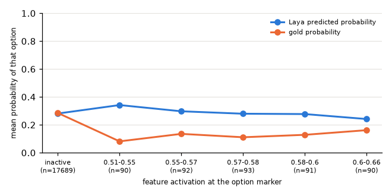

# Feature 1778

Critérios em que aparece: corr_error_stratified, pred_probe_right_laya_wrong

**Interpretação (preencher):** 

---

## Maiores ativações

**tr_customer_service_000055 / action** (choice, customer_service) | ativação 8.016 em `estado` | opções ['answer_directly', 'close_no_action', 'escalate_to_human', 'execute_refund', 'request_information'] | Laya: **answer_directly** [0.946, 0.037, 0.002, 0.012, 0.004] | gabarito: **request_information**

```
<bos> choice question: What should the assistant do next with this conversation?<eos>
▸ <mask> answer_directly: The assistant can resolve this itself with information it already has.
▸ <mask> close_no_action: No further action is warranted; the matter is settled.
▸ <mask> escalate_to_human: Hand off to a human agent with the appropriate authority.
▸ <mask> execute_refund: Issue the refund or credit the customer is owed.
▸ <mask> request_information: More detail is needed from the customer before anything can be done.

<eos>

 {"account": {"lifetime_value_usd": 936, "prior_tickets_90d": 0, "seats": 40, "tenure_months": 19, "tier": "premium"}, "orders": [{"amount_usd": 149, "date": "2026-03-09", "id": "A-69038", "status": "pending"}, {"amount_usd": 149, "date": "2026-03-25", "id": "A-22591", "status": "settled"}], "thread": [{"role": "customer", "text": "I just checked my statement and see two identical charges for $149 on the same day. I’m on the premium plan and this is really puzzling."}, {"role": "agent", "text": "I’m sorry for the confusion. Could you provide the transaction dates and the last four digits of the card used, so I can locate the duplicate entries?"}, {"role": "customer", "text": "Both charges are dated September 5th, and the card ends in 9012. I need this sorted out before the 15th of this month."}, {"role": "agent", "text": "Got it, thank you. I’ll need⟦ to⟧ verify the merchant name associated with those charges. Could you let me know how the description appears on your statement?"}, {"role": "customer", "text": "It just says ‘Premium Service – Monthly Billing’. Please let me know what you find."}]}<eos>
```

**tr_customer_service_000022 / churn_risk** (score, customer_service) | ativação 7.855 em `estado` | opções ['0', '1', '2', '3'] | Laya: **2** [0.034, 0.201, 0.75, 0.015] | gabarito: **1**

```
<bos> score question: How likely is this customer to stop doing business with us because of this interaction?<eos>
▸ <mask> level 0: No sign of dissatisfaction.
▸ <mask> level 1: Mild frustration, but the relationship is intact.
▸ <mask> level 2: Clearly unhappy; repeat problems or explicit complaints.
▸ <mask> level 3: Imminent: threatening to cancel, dispute or leave.

<eos>

 {"account": {"lifetime_value_usd": 60, "prior_tickets_90d": 1, "seats": 1, "tenure_months": 1, "tier": "premium"}, "thread": [{"role": "customer", "text": "Last week you promised a refund for my premium subscription, but nothing’s shown up yet. I’m just waiting for an update."}, {"role": "agent", "text": "I’m sorry you haven’t seen the refund yet. Could you provide the ticket number you were given for that request?"}, {"role": "customer", "text": "The ticket number is #4529. I just need⟦ to⟧ know if the refund is on its way."}, {"role": "agent", "text": "Thanks for the reference. I’ll check with our finance team. Do you still have the original payment method details handy?"}, {"role": "customer", "text": "Yes, it was the Visa ending in 1234. I’ll wait for your next update."}]}<eos>
```

**tr_customer_service_000052 / churn_risk** (score, customer_service) | ativação 7.770 em `estado` | opções ['0', '1', '2', '3'] | Laya: **1** [0.047, 0.528, 0.399, 0.026] | gabarito: **2**

```
<bos> score question: How likely is this customer to stop doing business with us because of this interaction?<eos>
▸ <mask> level 0: No sign of dissatisfaction.
▸ <mask> level 1: Mild frustration, but the relationship is intact.
▸ <mask> level 2: Clearly unhappy; repeat problems or explicit complaints.
▸ <mask> level 3: Imminent: threatening to cancel, dispute or leave.

<eos>

 {"account": {"lifetime_value_usd": 1015, "prior_tickets_90d": 3, "seats": 1, "tenure_months": 11, "tier": "standard"}, "orders": [{"amount_usd": 149, "date": "2026-01-24", "id": "A-11891", "status": "refunded"}, {"amount_usd": 149, "date": "2026-02-03", "id": "A-76056", "status": "failed"}], "thread": [{"role": "customer", "text": "Hello, I'm having trouble logging into my account. I've been a subscriber for 11 months on the standard plan, paying about $149, and I've already opened three tickets that haven't been resolved. Could you please look into this?"}, {"role": "agent", "text": "I’m sorry you’re still experiencing this. Could you let me know the exact error message you see when you try to sign in, and whether you’ve tried resetting your password?"}, {"role": "customer", "text": "Sure, the page just says 'Invalid credentials' even after I reset the password. I’m using the same email as before."}, {"role": "agent", "text": "Thank you for confirming that. I’ll need⟦ to⟧ check the status of your account and the recent password reset attempts. May I have the email address associated with the account?"}, {"role": "customer", "text": "The email is john.doe@example.com. Please let me know what you find."}]}<eos>
```

**tr_customer_service_000055 / churn_risk** (score, customer_service) | ativação 7.754 em `estado` | opções ['0', '1', '2', '3'] | Laya: **1** [0.061, 0.666, 0.23, 0.043] | gabarito: **1**

```
<bos> score question: How likely is this customer to stop doing business with us because of this interaction?<eos>
▸ <mask> level 0: No sign of dissatisfaction.
▸ <mask> level 1: Mild frustration, but the relationship is intact.
▸ <mask> level 2: Clearly unhappy; repeat problems or explicit complaints.
▸ <mask> level 3: Imminent: threatening to cancel, dispute or leave.

<eos>

 {"account": {"lifetime_value_usd": 936, "prior_tickets_90d": 0, "seats": 40, "tenure_months": 19, "tier": "premium"}, "orders": [{"amount_usd": 149, "date": "2026-03-09", "id": "A-69038", "status": "pending"}, {"amount_usd": 149, "date": "2026-03-25", "id": "A-22591", "status": "settled"}], "thread": [{"role": "customer", "text": "I just checked my statement and see two identical charges for $149 on the same day. I’m on the premium plan and this is really puzzling."}, {"role": "agent", "text": "I’m sorry for the confusion. Could you provide the transaction dates and the last four digits of the card used, so I can locate the duplicate entries?"}, {"role": "customer", "text": "Both charges are dated September 5th, and the card ends in 9012. I need this sorted out before the 15th of this month."}, {"role": "agent", "text": "Got it, thank you. I’ll need⟦ to⟧ verify the merchant name associated with those charges. Could you let me know how the description appears on your statement?"}, {"role": "customer", "text": "It just says ‘Premium Service – Monthly Billing’. Please let me know what you find."}]}<eos>
```

**tr_customer_service_000052 / action** (choice, customer_service) | ativação 7.742 em `estado` | opções ['answer_directly', 'close_no_action', 'escalate_to_human', 'execute_refund', 'request_information'] | Laya: **answer_directly** [0.398, 0.379, 0.062, 0.104, 0.056] | gabarito: **escalate_to_human**

```
<bos> choice question: What should the assistant do next with this conversation?<eos>
▸ <mask> answer_directly: The assistant can resolve this itself with information it already has.
▸ <mask> close_no_action: No further action is warranted; the matter is settled.
▸ <mask> escalate_to_human: Hand off to a human agent with the appropriate authority.
▸ <mask> execute_refund: Issue the refund or credit the customer is owed.
▸ <mask> request_information: More detail is needed from the customer before anything can be done.

<eos>

 {"account": {"lifetime_value_usd": 1015, "prior_tickets_90d": 3, "seats": 1, "tenure_months": 11, "tier": "standard"}, "orders": [{"amount_usd": 149, "date": "2026-01-24", "id": "A-11891", "status": "refunded"}, {"amount_usd": 149, "date": "2026-02-03", "id": "A-76056", "status": "failed"}], "thread": [{"role": "customer", "text": "Hello, I'm having trouble logging into my account. I've been a subscriber for 11 months on the standard plan, paying about $149, and I've already opened three tickets that haven't been resolved. Could you please look into this?"}, {"role": "agent", "text": "I’m sorry you’re still experiencing this. Could you let me know the exact error message you see when you try to sign in, and whether you’ve tried resetting your password?"}, {"role": "customer", "text": "Sure, the page just says 'Invalid credentials' even after I reset the password. I’m using the same email as before."}, {"role": "agent", "text": "Thank you for confirming that. I’ll need⟦ to⟧ check the status of your account and the recent password reset attempts. May I have the email address associated with the account?"}, {"role": "customer", "text": "The email is john.doe@example.com. Please let me know what you find."}]}<eos>
```

## Ativações medianas (faixa 40-60%, mediana 0.626)

**tr_customer_service_000175 / category** (choice, customer_service) | ativação 0.693 em `estado` | opções ['account', 'billing', 'delivery', 'refund', 'technical'] | Laya: **delivery** [0.0, 0.0, 1.0, 0.0, 0.0] | gabarito: **delivery**

```
<bos> choice question: What is this customer conversation primarily about?<eos>
▸ <mask> account: Login, plan changes, profile or access management.
▸ <mask> billing: A charge, invoice, subscription or payment problem.
▸ <mask> delivery: Shipping, fulfilment or delivery of a physical item.
▸ <mask> refund: The customer is explicitly asking for money back.
▸ <mask> technical: The product or service is not working as expected.

<eos>

 {"account": {"lifetime_value_usd": 133, "prior_tickets_90d": 1, "seats": 40, "tenure_months": 8, "tier": "enterprise"}, "orders": [{"amount_usd": 149, "date": "2026-01-04", "id": "A-23809", "status": "settled"}, {"amount_usd": 149, "date": "2026-01-20", "id": "A-52054", "status": "refunded"}], "thread": [{"role": "customer", "text": "I just opened my enterprise delivery and it is the completely wrong item. After the last issue with the missing shipment, I guess I shouldn⟦'⟧t be surprised that this is happening again."}, {"role": "agent", "text": "I am very sorry to hear that you received the incorrect item. Could you please provide the order number and describe the item you received instead?"}, {"role": "customer", "text": "The order number is #88291. It was supposed to be the $149 hardware kit, but I got a box of cables instead. I need the correct items by Friday morning at the latest."}, {"role": "agent", "text": "Thank you for those details. I've noted the discrepancy regarding the hardware kit. Could you please send over a photo of the packing slip that was included in the box?"}, {"role": "customer", "text": "I've attached the photo to this message. I really hope we can get this resolved before my event starts."}]}<eos>
```

**tr_customer_service_000173 / action** (choice, customer_service) | ativação 0.575 em `opção` | opções ['answer_directly', 'close_no_action', 'escalate_to_human', 'execute_refund', 'request_information'] | Laya: **close_no_action** [0.303, 0.352, 0.076, 0.247, 0.022] | gabarito: **execute_refund**

```
<bos> choice question: What should the assistant do next with this conversation?<eos>
▸ <mask> answer_directly: The assistant can resolve this itself with information it already has.
▸ <mask> close_no_action: No further action is warranted; the matter is settled.
▸ <mask> escalate_to_human: Hand off to a human agent with the appropriate authority.
▸ <mask> execute_refund: Issue the refund or credit the customer is owed.
▸ <mask> request_information:⟦ More⟧ detail is needed from the customer before anything can be done.

<eos>

 {"account": {"lifetime_value_usd": 985, "prior_tickets_90d": 0, "seats": 1, "tenure_months": 11, "tier": "free"}, "orders": [{"amount_usd": 19, "date": "2026-01-24", "id": "A-47026", "status": "pending"}], "thread": [{"role": "customer", "text": "It has been two weeks since I requested my $19 refund and I still haven't seen anything. I've been a loyal customer for 11 months, but if you guys can't handle basic billing, I’m taking my business elsewhere."}, {"role": "agent", "text": "I apologize for the delay you've experienced. Could you please provide the case number from your initial refund request so I can look into the status of that transaction for you?"}, {"role": "customer", "text": "I don't have a case number because nobody ever sent me one, which is exactly why I'm so frustrated."}]}<eos>
```

**tr_invoice_processing_000006 / disposition** (choice, invoice_processing) | ativação 0.599 em `marcador` | opções ['approve', 'hold', 'manual_review', 'reject'] | Laya: **approve** [0.499, 0.226, 0.027, 0.248] | gabarito: **approve**

```
<bos> choice question: How should this vendor invoice be dispositioned?<eos>
▸ <mask> approve: Matches the order and delivery; approve for payment.
▸ <mask> hold: Something needs confirming before payment; hold pending clarification.
▸ <mask> manual_review: A human in finance must review the discrepancy.
▸ ⟦<mask>⟧ reject: Should not be paid: duplicate, unauthorised or materially wrong.

<eos>

 {"delivery": {"condition": "accepted", "date": "2026-03-27", "received_qty": 400}, "invoice": {"currency": "EUR", "id": "INV-2026-6011", "lines": [{"qty": 400, "sku": "SKU-685", "total_usd": 137068.0, "unit_usd": 342.67}], "total_usd": 137068.0, "vendor": "Orbit Logistics"}, "payment": {"days_until_due": 11, "discount_expires_in_days": 3, "early_payment_discount_pct": 2.0, "status": "scheduled", "terms": "net 30"}, "purchase_order": {"freight_terms": "freight prepaid by vendor, not separately billable", "id": "PO-3621", "lines": [{"qty": 400, "unit_usd": 342.67}], "total_usd": 137068.0}, "vendor_history": {"disputes_12m": 0, "invoices_12m": 4, "prior_invoice_ids": ["INV-2026-7803", "INV-2026-5940"]}}<eos>
```

**tr_customer_service_000061 / action** (choice, customer_service) | ativação 0.694 em `opção` | opções ['answer_directly', 'close_no_action', 'escalate_to_human', 'execute_refund', 'request_information'] | Laya: **escalate_to_human** [0.041, 0.138, 0.817, 0.002, 0.001] | gabarito: **request_information**

```
<bos> choice question: What should the assistant do next with this conversation?<eos>
▸ <mask> answer_directly: The assistant can resolve this itself with information it already has.
▸ <mask> close_no_action: No further action is warranted; the matter is settled.
▸ <mask> escalate_to_human: Hand off to a human agent with the appropriate authority.
▸ <mask> execute_refund: Issue the refund or credit the customer is owed.
▸ <mask> request_information:⟦ More⟧ detail is needed from the customer before anything can be done.

<eos>

 {"account": {"lifetime_value_usd": 1585, "prior_tickets_90d": 2, "seats": 1, "tenure_months": 41, "tier": "premium"}, "thread": [{"role": "customer", "text": "I'm trying to adjust my seat count again, but the dashboard is just giving me the same greyed-out error as last time."}, {"role": "agent", "text": "I apologize for the frustration; could you confirm if you are seeing this error on the billing page or the team management tab?"}, {"role": "customer", "text": "It's on the team management tab. Honestly, I'm used to this by now."}, {"role": "agent", "text": "Thank you for clarifying. Are you currently logged in as the primary account administrator when accessing that specific tab?"}, {"role": "customer", "text": "Yes, I am the admin. Nothing ever seems to change with these permissions."}, {"role": "agent", "text": "I appreciate your patience while we look into this. Could you please send me a screenshot of the specific error message you see?"}, {"role": "customer", "text": "I'll try to get that over later, but I don't really expect it to make a difference."}]}<eos>
```

**tr_security_incidents_000265 / severity** (score, security_incidents) | ativação 0.662 em `pergunta` | opções ['0', '1', '2', '3', '4'] | Laya: **0** [0.827, 0.084, 0.046, 0.019, 0.023] | gabarito: **2**

```
<bos> score question⟦:⟧ How severe is the potential impact if this alert is real?<eos>
▸ <mask> level 0: Negligible: no access to anything sensitive.
▸ <mask> level 1: Low: limited access, easily reversed.
▸ <mask> level 2: Moderate: access to internal systems or non-public data.
▸ <mask> level 3: High: access to production, secrets or customer data.
▸ <mask> level 4: Critical: active compromise of crown-jewel systems.

<eos>

 {"alert": {"description": "an account granted itself or received elevated permissions", "evidence": "The account assigned to an unprivileged contractor was granted elevated permissions at 11:05 AM from an unrecognized source address. Although multi-factor authentication was enabled and credentials were last rotated 14 days ago, no scheduled change window was present for this administrative action.", "rule": "privilege_escalation"}, "context": {"asset_criticality": "medium", "change_window_active": false, "source_on_allowlist": false}, "history": {"credential_rotation_days_ago": 14, "distinct_countries_30d": 3, "logins_30d": 164, "prior_alerts_90d": 1}, "principal": {"mfa_enrolled": true, "name": "usr-infra-439", "privileges": ["repo:read"], "type": "contractor"}}<eos>
```

## Estatísticas (conjunto de descoberta, dev e teste)

**pred / error**

| split | decisões | ativas | ativas e Laya errou | taxa | lift | q (BH) | OR (CMH) | q (CMH) |
|---|---|---|---|---|---|---|---|---|
| discovery | 5100 | 96 | 88 | 0.917 | 1.42 | 4.03e-09 | 1.33 | 0.764 |
| dev | 900 | 24 | 24 | 1.000 | 1.49 | 0.000735 | inf | 0.729 |
| test | 2000 | 39 | 35 | 0.897 | 1.38 | 0.00206 | 0.73 | 0.896 |

**corr / error**

| split | decisões | ativas | ativas e Laya errou | taxa | lift | q (BH) | OR (CMH) | q (CMH) |
|---|---|---|---|---|---|---|---|---|
| discovery | 5100 | 39 | 31 | 0.795 | 1.23 | 0.0798 | 8.99 | 5.19e-05 |
| dev | 900 | 6 | 6 | 1.000 | 1.49 | nan | nan | nan |
| test | 2000 | 27 | 23 | 0.852 | 1.31 | 0.0497 | 2.73 | 0.431 |

**state / error**

| split | decisões | ativas | ativas e Laya errou | taxa | lift | q (BH) | OR (CMH) | q (CMH) |
|---|---|---|---|---|---|---|---|---|
| discovery | 5100 | 922 | 531 | 0.576 | 0.89 | 3e-05 | 1.09 | 0.735 |
| dev | 900 | 145 | 83 | 0.572 | 0.85 | 0.14 | 0.75 | 0.657 |
| test | 2000 | 344 | 201 | 0.584 | 0.90 | 0.0603 | 0.89 | 0.792 |

**pred / probe_right_laya_wrong**

| split | decisões | ativas | ativas e Laya errou | taxa | lift | q (BH) | OR (CMH) | q (CMH) |
|---|---|---|---|---|---|---|---|---|
| discovery | 2819 | 30 | 30 | 1.000 | 1.55 | 8.92e-06 | inf | 0.6 |
| dev | 520 | 12 | 12 | 1.000 | 1.48 | nan | nan | nan |
| test | 1106 | 16 | 16 | 1.000 | 1.58 | nan | nan | nan |

**corr / probe_right_laya_wrong**

| split | decisões | ativas | ativas e Laya errou | taxa | lift | q (BH) | OR (CMH) | q (CMH) |
|---|---|---|---|---|---|---|---|---|
| discovery | 2819 | 0 | 0 | nan | nan | nan | nan | nan |
| dev | 520 | 0 | 0 | nan | nan | nan | nan | nan |
| test | 1106 | 0 | 0 | nan | nan | nan | nan | nan |

**state / probe_right_laya_wrong**

| split | decisões | ativas | ativas e Laya errou | taxa | lift | q (BH) | OR (CMH) | q (CMH) |
|---|---|---|---|---|---|---|---|---|
| discovery | 2819 | 512 | 268 | 0.523 | 0.81 | 3.69e-09 | 1.15 | 0.633 |
| dev | 520 | 74 | 39 | 0.527 | 0.78 | 0.0893 | 0.74 | 0.695 |
| test | 1106 | 198 | 106 | 0.535 | 0.85 | 0.0193 | 1.32 | 0.545 |

Confusão mais sobre-representada (pred): `disposition|3>1` (n=27, lift 30.52, p=3.66e-36). Formato `pergunta|índice previsto>índice correto`.

Confusão mais sobre-representada (corr): `action|3>0` (n=22, lift 89.90, p=1.02e-42). Formato `pergunta|índice previsto>índice correto`.

Confusão mais sobre-representada (state): `action|1>2` (n=50, lift 3.90, p=2.63e-22). Formato `pergunta|índice previsto>índice correto`.



