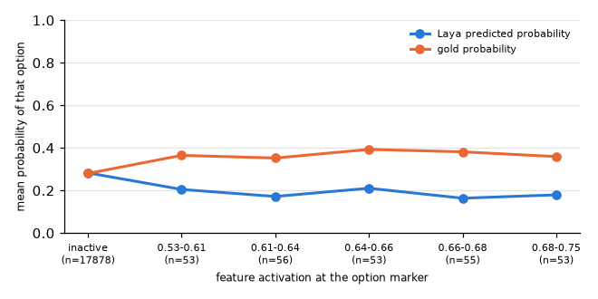

# Feature 1799

Critérios em que aparece: corr_probe_right_laya_wrong_stratified

**Interpretação (preencher):** 

---

## Maiores ativações

**tr_customer_service_000151 / action** (choice, customer_service) | ativação 3.496 em `estado` | opções ['answer_directly', 'close_no_action', 'escalate_to_human', 'execute_refund', 'request_information'] | Laya: **close_no_action** [0.027, 0.958, 0.01, 0.003, 0.002] | gabarito: **escalate_to_human**

```
<bos> choice question: What should the assistant do next with this conversation?<eos>
▸ <mask> answer_directly: The assistant can resolve this itself with information it already has.
▸ <mask> close_no_action: No further action is warranted; the matter is settled.
▸ <mask> escalate_to_human: Hand off to a human agent with the appropriate authority.
▸ <mask> execute_refund: Issue the refund or credit the customer is owed.
▸ <mask> request_information: More detail is needed from the customer before anything can be done.

<eos>

 {"account": {"lifetime_value_usd": 95, "prior_tickets_90d": 0, "seats": 1, "tenure_months": 3, "tier": "enterprise"}, "orders": [{"amount_usd": 299, "date": "2026-02-01", "id": "A-70416", "status": "failed"}, {"amount_usd": 299, "date": "2026-02-15", "id": "A-68913", "status": "pending"}], "thread": [{"role": "customer", "text": "Hello, I’m reaching out because the platform’s performance has been noticeably slow over the past week, and it’s affecting our workflow. We’re on the enterprise plan, paying $299 a month, and we need a stable experience."}, {"role": "agent", "text": "I’m sorry to⟦ hear⟧ about the slowdown. Could you tell me which features or pages are most affected, and any error messages you’ve encountered?"}, {"role": "customer", "text": "The dashboard and reporting modules take up to 45 seconds to load, and occasional time‑outs appear when we try to export data. I need a solution in place by next Friday, or we’ll have to look elsewhere."}, {"role": "agent", "text": "Thanks for the specifics. Do you have any recent logs or screenshots that show the time‑outs? That would help us pinpoint the bottleneck."}, {"role": "customer", "text": "I’ve attached the latest logs from our server and a couple of screenshots of the timeout dialogs. Please let me know what’s causing this lag."}, {"role": "agent", "text": "I appreciate you sending those files. I’ll have our performance team examine them and see what’s triggering the delay. Meanwhile, is there any temporary workaround you’ve tried that offers a bit more speed?"}, {"role": "customer", "text": "We’ve tried clearing caches and using a different browser, but the issue persists. If this isn’t sorted out by next Friday, I’ll have to consider moving to a competitor."}]}<eos>
```

**tr_customer_service_000151 / needs_human** (noul, customer_service) | ativação 3.492 em `estado` | opções ['false', 'true'] | Laya: **false** [0.853, 0.147] | gabarito: **true**

```
<bos> noul question: This conversation requires a human agent rather than automated handling.<eos>
▸ <mask> false: Automation can carry this to resolution.
▸ <mask> true: A human must take over: judgement, authority or empathy is required.

<eos>

 {"account": {"lifetime_value_usd": 95, "prior_tickets_90d": 0, "seats": 1, "tenure_months": 3, "tier": "enterprise"}, "orders": [{"amount_usd": 299, "date": "2026-02-01", "id": "A-70416", "status": "failed"}, {"amount_usd": 299, "date": "2026-02-15", "id": "A-68913", "status": "pending"}], "thread": [{"role": "customer", "text": "Hello, I’m reaching out because the platform’s performance has been noticeably slow over the past week, and it’s affecting our workflow. We’re on the enterprise plan, paying $299 a month, and we need a stable experience."}, {"role": "agent", "text": "I’m sorry to⟦ hear⟧ about the slowdown. Could you tell me which features or pages are most affected, and any error messages you’ve encountered?"}, {"role": "customer", "text": "The dashboard and reporting modules take up to 45 seconds to load, and occasional time‑outs appear when we try to export data. I need a solution in place by next Friday, or we’ll have to look elsewhere."}, {"role": "agent", "text": "Thanks for the specifics. Do you have any recent logs or screenshots that show the time‑outs? That would help us pinpoint the bottleneck."}, {"role": "customer", "text": "I’ve attached the latest logs from our server and a couple of screenshots of the timeout dialogs. Please let me know what’s causing this lag."}, {"role": "agent", "text": "I appreciate you sending those files. I’ll have our performance team examine them and see what’s triggering the delay. Meanwhile, is there any temporary workaround you’ve tried that offers a bit more speed?"}, {"role": "customer", "text": "We’ve tried clearing caches and using a different browser, but the issue persists. If this isn’t sorted out by next Friday, I’ll have to consider moving to a competitor."}]}<eos>
```

**tr_customer_service_000294 / action** (choice, customer_service) | ativação 3.473 em `estado` | opções ['answer_directly', 'close_no_action', 'escalate_to_human', 'execute_refund', 'request_information'] | Laya: **close_no_action** [0.146, 0.678, 0.013, 0.16, 0.003] | gabarito: **escalate_to_human**

```
<bos> choice question: What should the assistant do next with this conversation?<eos>
▸ <mask> answer_directly: The assistant can resolve this itself with information it already has.
▸ <mask> close_no_action: No further action is warranted; the matter is settled.
▸ <mask> escalate_to_human: Hand off to a human agent with the appropriate authority.
▸ <mask> execute_refund: Issue the refund or credit the customer is owed.
▸ <mask> request_information: More detail is needed from the customer before anything can be done.

<eos>

 {"account": {"lifetime_value_usd": 3345, "prior_tickets_90d": 1, "seats": 1, "tenure_months": 41, "tier": "free"}, "orders": [{"amount_usd": 29, "date": "2026-02-13", "id": "A-72288", "status": "settled"}, {"amount_usd": 29, "date": "2026-02-07", "id": "A-13988", "status": "settled"}, {"amount_usd": 29, "date": "2026-03-22", "id": "A-75966", "status": "refunded"}], "thread": [{"role": "customer", "text": "I've had it—cancel my account immediately! I've been on your free plan for 41 months, paid roughly $29 a month, and you still can't sort out the billing mess. Ticket #12345 was only half‑fixed, and now you're making me⟦ think⟧ about leaving for good."}, {"role": "agent", "text": "I’m sorry you’re experiencing this frustration. Could you confirm the email address linked to the account and the exact issue you’d like us to address before we proceed with cancellation?"}, {"role": "customer", "text": "The issue is the same nonsense you tried to ‘partially fix’ before—random charges and a broken dashboard. I don’t want any more half‑measures; I want the account gone right now, or I’m posting a scathing review and moving my business elsewhere."}, {"role": "agent", "text": "I understand how aggravating that must be. To make sure we’re handling the correct profile, could you also let me know if you need a data export before we terminate the service?"}, {"role": "customer", "text": "Forget the export—just delete everything. I don’t care about my data; I just want you to stop billing me and shut the account down this instant."}, {"role": "agent", "text": "Got it, you’d like immediate termination without an export. For security, could you provide the last four digits of the payment method on file so I can verify the request?"}, {"role": "customer", "text": "I’m not giving you any more numbers. Do it now, or I’m taking this to your CEO and the press."}]}<eos>
```

**tr_customer_service_000294 / needs_human** (noul, customer_service) | ativação 3.424 em `estado` | opções ['false', 'true'] | Laya: **true** [0.023, 0.977] | gabarito: **true**

```
<bos> noul question: This conversation requires a human agent rather than automated handling.<eos>
▸ <mask> false: Automation can carry this to resolution.
▸ <mask> true: A human must take over: judgement, authority or empathy is required.

<eos>

 {"account": {"lifetime_value_usd": 3345, "prior_tickets_90d": 1, "seats": 1, "tenure_months": 41, "tier": "free"}, "orders": [{"amount_usd": 29, "date": "2026-02-13", "id": "A-72288", "status": "settled"}, {"amount_usd": 29, "date": "2026-02-07", "id": "A-13988", "status": "settled"}, {"amount_usd": 29, "date": "2026-03-22", "id": "A-75966", "status": "refunded"}], "thread": [{"role": "customer", "text": "I've had it—cancel my account immediately! I've been on your free plan for 41 months, paid roughly $29 a month, and you still can't sort out the billing mess. Ticket #12345 was only half‑fixed, and now you're making me⟦ think⟧ about leaving for good."}, {"role": "agent", "text": "I’m sorry you’re experiencing this frustration. Could you confirm the email address linked to the account and the exact issue you’d like us to address before we proceed with cancellation?"}, {"role": "customer", "text": "The issue is the same nonsense you tried to ‘partially fix’ before—random charges and a broken dashboard. I don’t want any more half‑measures; I want the account gone right now, or I’m posting a scathing review and moving my business elsewhere."}, {"role": "agent", "text": "I understand how aggravating that must be. To make sure we’re handling the correct profile, could you also let me know if you need a data export before we terminate the service?"}, {"role": "customer", "text": "Forget the export—just delete everything. I don’t care about my data; I just want you to stop billing me and shut the account down this instant."}, {"role": "agent", "text": "Got it, you’d like immediate termination without an export. For security, could you provide the last four digits of the payment method on file so I can verify the request?"}, {"role": "customer", "text": "I’m not giving you any more numbers. Do it now, or I’m taking this to your CEO and the press."}]}<eos>
```

**tr_customer_service_000294 / category** (choice, customer_service) | ativação 3.406 em `estado` | opções ['account', 'billing', 'delivery', 'refund', 'technical'] | Laya: **billing** [0.005, 0.778, 0.001, 0.02, 0.196] | gabarito: **account**

```
<bos> choice question: What is this customer conversation primarily about?<eos>
▸ <mask> account: Login, plan changes, profile or access management.
▸ <mask> billing: A charge, invoice, subscription or payment problem.
▸ <mask> delivery: Shipping, fulfilment or delivery of a physical item.
▸ <mask> refund: The customer is explicitly asking for money back.
▸ <mask> technical: The product or service is not working as expected.

<eos>

 {"account": {"lifetime_value_usd": 3345, "prior_tickets_90d": 1, "seats": 1, "tenure_months": 41, "tier": "free"}, "orders": [{"amount_usd": 29, "date": "2026-02-13", "id": "A-72288", "status": "settled"}, {"amount_usd": 29, "date": "2026-02-07", "id": "A-13988", "status": "settled"}, {"amount_usd": 29, "date": "2026-03-22", "id": "A-75966", "status": "refunded"}], "thread": [{"role": "customer", "text": "I've had it—cancel my account immediately! I've been on your free plan for 41 months, paid roughly $29 a month, and you still can't sort out the billing mess. Ticket #12345 was only half‑fixed, and now you're making me⟦ think⟧ about leaving for good."}, {"role": "agent", "text": "I’m sorry you’re experiencing this frustration. Could you confirm the email address linked to the account and the exact issue you’d like us to address before we proceed with cancellation?"}, {"role": "customer", "text": "The issue is the same nonsense you tried to ‘partially fix’ before—random charges and a broken dashboard. I don’t want any more half‑measures; I want the account gone right now, or I’m posting a scathing review and moving my business elsewhere."}, {"role": "agent", "text": "I understand how aggravating that must be. To make sure we’re handling the correct profile, could you also let me know if you need a data export before we terminate the service?"}, {"role": "customer", "text": "Forget the export—just delete everything. I don’t care about my data; I just want you to stop billing me and shut the account down this instant."}, {"role": "agent", "text": "Got it, you’d like immediate termination without an export. For security, could you provide the last four digits of the payment method on file so I can verify the request?"}, {"role": "customer", "text": "I’m not giving you any more numbers. Do it now, or I’m taking this to your CEO and the press."}]}<eos>
```

## Ativações medianas (faixa 40-60%, mediana 0.962)

**tr_customer_service_000023 / category** (choice, customer_service) | ativação 0.991 em `estado` | opções ['account', 'billing', 'delivery', 'refund', 'technical'] | Laya: **technical** [0.012, 0.003, 0.001, 0.001, 0.984] | gabarito: **technical**

```
<bos> choice question: What is this customer conversation primarily about?<eos>
▸ <mask> account: Login, plan changes, profile or access management.
▸ <mask> billing: A charge, invoice, subscription or payment problem.
▸ <mask> delivery: Shipping, fulfilment or delivery of a physical item.
▸ <mask> refund: The customer is explicitly asking for money back.
▸ <mask> technical: The product or service is not working as expected.

<eos>

 {"account": {"lifetime_value_usd": 95, "prior_tickets_90d": 5, "seats": 1, "tenure_months": 5, "tier": "standard"}, "orders": [{"amount_usd": 149, "date": "2026-01-14", "id": "A-64525", "status": "failed"}], "thread": [{"role": "customer", "text": "My dashboard has been sluggish for the past day, and I’m not sure what’s causing it. The pages take forever to load."}, {"role": "agent", "text": "I hear you—that slowdown can be frustrating. When did you first notice the performance drop?"}, {"role": "customer", "text": "It started yesterday after the latest system update. Some screens now⟦ take⟧ about 30 seconds to render."}, {"role": "agent", "text": "Understood. Have you observed any error messages or console warnings while the pages load slowly?"}, {"role": "customer", "text": "No error dialogs, just a blank loading spinner that never disappears. I’d appreciate any insight you can share."}]}<eos>
```

**tr_customer_service_000052 / needs_human** (noul, customer_service) | ativação 0.928 em `opção` | opções ['false', 'true'] | Laya: **true** [0.274, 0.726] | gabarito: **true**

```
<bos> noul question: This conversation requires a human agent rather than automated handling.<eos>
▸ <mask> false: Automation can carry this to resolution.
▸ <mask> true: A human must⟦ take⟧ over: judgement, authority or empathy is required.

<eos>

 {"account": {"lifetime_value_usd": 1015, "prior_tickets_90d": 3, "seats": 1, "tenure_months": 11, "tier": "standard"}, "orders": [{"amount_usd": 149, "date": "2026-01-24", "id": "A-11891", "status": "refunded"}, {"amount_usd": 149, "date": "2026-02-03", "id": "A-76056", "status": "failed"}], "thread": [{"role": "customer", "text": "Hello, I'm having trouble logging into my account. I've been a subscriber for 11 months on the standard plan, paying about $149, and I've already opened three tickets that haven't been resolved. Could you please look into this?"}, {"role": "agent", "text": "I’m sorry you’re still experiencing this. Could you let me know the exact error message you see when you try to sign in, and whether you’ve tried resetting your password?"}, {"role": "customer", "text": "Sure, the page just says 'Invalid credentials' even after I reset the password. I’m using the same email as before."}, {"role": "agent", "text": "Thank you for confirming that. I’ll need to check the status of your account and the recent password reset attempts. May I have the email address associated with the account?"}, {"role": "customer", "text": "The email is john.doe@example.com. Please let me know what you find."}]}<eos>
```

**tr_customer_service_000157 / needs_human** (noul, customer_service) | ativação 0.989 em `opção` | opções ['false', 'true'] | Laya: **true** [0.086, 0.914] | gabarito: **true**

```
<bos> noul question: This conversation requires a human agent rather than automated handling.<eos>
▸ <mask> false: Automation can carry this to resolution.
▸ <mask> true: A human must⟦ take⟧ over: judgement, authority or empathy is required.

<eos>

 {"account": {"lifetime_value_usd": 3086, "prior_tickets_90d": 3, "seats": 1, "tenure_months": 49, "tier": "standard"}, "thread": [{"role": "customer", "text": "I need to get into my account right now – the login page just keeps looping back to the password screen and I can’t access anything."}, {"role": "agent", "text": "I understand the urgency. Could you share the exact error message you’re seeing, or let me know if you’ve tried resetting the password?"}, {"role": "customer", "text": "The message says “authentication failed” after I enter my credentials, and I’ve already tried the password reset twice with no luck."}]}<eos>
```

**tr_customer_service_000014 / category** (choice, customer_service) | ativação 0.965 em `estado` | opções ['account', 'billing', 'delivery', 'refund', 'technical'] | Laya: **account** [0.983, 0.002, 0.0, 0.015, 0.0] | gabarito: **refund**

```
<bos> choice question: What is this customer conversation primarily about?<eos>
▸ <mask> account: Login, plan changes, profile or access management.
▸ <mask> billing: A charge, invoice, subscription or payment problem.
▸ <mask> delivery: Shipping, fulfilment or delivery of a physical item.
▸ <mask> refund: The customer is explicitly asking for money back.
▸ <mask> technical: The product or service is not working as expected.

<eos>

 {"account": {"lifetime_value_usd": 563, "prior_tickets_90d": 0, "seats": 1, "tenure_months": 8, "tier": "free"}, "thread": [{"role": "customer", "text": "I requested a refund two weeks ago and haven’t heard anything; I’ve been on the free plan for eight months, so I’m just waiting now."}, {"role": "agent", "text": "I’m⟦ sorry⟧ for the delay. Could you provide the refund request reference number or the email it was sent from?"}, {"role": "customer", "text": "It was sent from my account@myemail.com, reference #R5678. Please let me know what the next steps are."}]}<eos>
```

**tr_customer_service_000264 / urgency** (score, customer_service) | ativação 0.950 em `estado` | opções ['0', '1', '2', '3'] | Laya: **1** [0.052, 0.427, 0.278, 0.244] | gabarito: **2**

```
<bos> score question: How time-sensitive is this conversation?<eos>
▸ <mask> level 0: No time pressure; can wait indefinitely.
▸ <mask> level 1: Routine; handle within the normal queue.
▸ <mask> level 2: Elevated; should be handled within the same week.
▸ <mask> level 3: Critical; requires action within the same day.

<eos>

 {"account": {"lifetime_value_usd": 166, "prior_tickets_90d": 2, "seats": 1, "tenure_months": 3, "tier": "standard"}, "thread": [{"role": "customer", "text": "I’⟦m⟧ looking at my statement and see I’ve been hit with another duplicate charge for my standard plan. This is the third time now, and those last two tickets I opened resulted in absolutely nothing but empty promises from your team."}, {"role": "agent", "text": "I understand how frustrating it is to see recurring billing issues like this, and I apologize that your previous experience hasn't met expectations. Could you please provide the dates of those specific charges so I can pull up the transaction history?"}, {"role": "customer", "text": "It’s happened on the 15th of each of the last three months. I've already sent these dates in twice before, so I’m really not sure why you need them again."}, {"role": "agent", "text": "Thank you for clarifying that timeline. I am currently cross-referencing your billing records with the account activity; could you confirm if you have received any automated notification emails regarding these specific transaction dates?"}, {"role": "customer", "text": "I haven't seen a single email about these charges, which is exactly why this is so confusing. I’m just trying to get this sorted out once and for all."}]}<eos>
```

## Estatísticas (conjunto de descoberta, dev e teste)

**pred / error**

| split | decisões | ativas | ativas e Laya errou | taxa | lift | q (BH) | OR (CMH) | q (CMH) |
|---|---|---|---|---|---|---|---|---|
| discovery | 5100 | 6 | 4 | 0.667 | 1.04 | nan | nan | nan |
| dev | 900 | 3 | 2 | 0.667 | 0.99 | nan | nan | nan |
| test | 2000 | 5 | 3 | 0.600 | 0.92 | nan | nan | nan |

**corr / error**

| split | decisões | ativas | ativas e Laya errou | taxa | lift | q (BH) | OR (CMH) | q (CMH) |
|---|---|---|---|---|---|---|---|---|
| discovery | 5100 | 121 | 119 | 0.983 | 1.53 | 1.23e-19 | 16.78 | 2.5e-11 |
| dev | 900 | 20 | 19 | 0.950 | 1.41 | 0.0138 | 3.88 | 0.00542 |
| test | 2000 | 25 | 23 | 0.920 | 1.41 | 0.00681 | 7.09 | 0.000543 |

**state / error**

| split | decisões | ativas | ativas e Laya errou | taxa | lift | q (BH) | OR (CMH) | q (CMH) |
|---|---|---|---|---|---|---|---|---|
| discovery | 5100 | 747 | 449 | 0.601 | 0.93 | 0.0343 | 1.19 | 0.505 |
| dev | 900 | 116 | 73 | 0.629 | 0.94 | 0.695 | 1.02 | 0.988 |
| test | 2000 | 323 | 202 | 0.625 | 0.96 | 0.625 | 0.91 | 0.891 |

**pred / probe_right_laya_wrong**

| split | decisões | ativas | ativas e Laya errou | taxa | lift | q (BH) | OR (CMH) | q (CMH) |
|---|---|---|---|---|---|---|---|---|
| discovery | 2819 | 2 | 0 | 0.000 | 0.00 | nan | nan | nan |
| dev | 520 | 1 | 0 | 0.000 | 0.00 | nan | nan | nan |
| test | 1106 | 3 | 1 | 0.333 | 0.53 | nan | nan | nan |

**corr / probe_right_laya_wrong**

| split | decisões | ativas | ativas e Laya errou | taxa | lift | q (BH) | OR (CMH) | q (CMH) |
|---|---|---|---|---|---|---|---|---|
| discovery | 2819 | 98 | 96 | 0.980 | 1.51 | 1.56e-15 | 15.95 | 1.11e-17 |
| dev | 520 | 18 | 17 | 0.944 | 1.40 | nan | nan | nan |
| test | 1106 | 23 | 21 | 0.913 | 1.44 | 0.00811 | 8.00 | 0.00039 |

**state / probe_right_laya_wrong**

| split | decisões | ativas | ativas e Laya errou | taxa | lift | q (BH) | OR (CMH) | q (CMH) |
|---|---|---|---|---|---|---|---|---|
| discovery | 2819 | 428 | 239 | 0.558 | 0.86 | 0.000286 | 1.13 | 0.783 |
| dev | 520 | 63 | 43 | 0.683 | 1.01 | 1 | 2.29 | 0.207 |
| test | 1106 | 190 | 114 | 0.600 | 0.95 | 0.588 | 1.26 | 0.741 |

Confusão mais sobre-representada (pred): `outcome|2>1` (n=3, lift 850.00, p=nan). Formato `pergunta|índice previsto>índice correto`.

Confusão mais sobre-representada (corr): `outcome|0>2` (n=32, lift 42.15, p=0). Formato `pergunta|índice previsto>índice correto`.

Confusão mais sobre-representada (state): `action|1>2` (n=46, lift 4.42, p=3.24e-22). Formato `pergunta|índice previsto>índice correto`.



