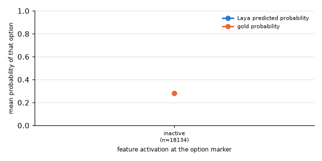

# Feature 1894

Critérios em que aparece: state_error_stratified

**Interpretação (preencher):** 

---

## Maiores ativações

**tr_customer_service_000145 / needs_human** (noul, customer_service) | ativação 5.273 em `estado` | opções ['false', 'true'] | Laya: **false** [0.708, 0.292] | gabarito: **true**

```
<bos> noul question: This conversation requires a human agent rather than automated handling.<eos>
▸ <mask> false: Automation can carry this to resolution.
▸ <mask> true: A human must take over: judgement, authority or empathy is required.

<eos>

 {"account": {"lifetime_value_usd": 1881, "prior_tickets_90d": 1, "seats": 1, "tenure_months": 41, "tier": "free"}, "orders": [{"amount_usd": 29, "date": "2026-03-03", "id": "A-31049", "status": "settled"}, {"amount_usd": 29, "date": "2026-03-09", "id": "A-25889", "status": "settled"}, {"amount_usd": 29, "date": "2026-03-23", "id": "A-16677", "status": "settled"}], "thread": [{"role": "customer", "text": "Hi, I’m writing again because the “Export to CSV” button on my dashboard has been broken for a few days now. I’ve been on the Free plan for 41 months, paying about $29 annually, and I already opened Ticket #2098 which never got resolved.⟦ If⟧ this can’t be fixed soon, I’ll have to look elsewhere."}, {"role": "agent", "text": "I understand how frustrating that must be, especially after waiting on Ticket #2098. Could you tell me exactly what happens when you click the export button—any error messages or just no response?"}, {"role": "customer", "text": "When I click it, the page just spins for a while and then nothing happens. There’s no error pop‑up, just silence."}, {"role": "agent", "text": "Thanks for the detail. Are you seeing this issue on all browsers, or have you tried a different one to see if the behavior changes?"}, {"role": "customer", "text": "I tried Chrome and Firefox, same result on both. I also cleared my cache, but the button still does nothing."}]}<eos>
```

**tr_customer_service_000145 / urgency** (score, customer_service) | ativação 5.258 em `estado` | opções ['0', '1', '2', '3'] | Laya: **1** [0.184, 0.585, 0.148, 0.083] | gabarito: **2**

```
<bos> score question: How time-sensitive is this conversation?<eos>
▸ <mask> level 0: No time pressure; can wait indefinitely.
▸ <mask> level 1: Routine; handle within the normal queue.
▸ <mask> level 2: Elevated; should be handled within the same week.
▸ <mask> level 3: Critical; requires action within the same day.

<eos>

 {"account": {"lifetime_value_usd": 1881, "prior_tickets_90d": 1, "seats": 1, "tenure_months": 41, "tier": "free"}, "orders": [{"amount_usd": 29, "date": "2026-03-03", "id": "A-31049", "status": "settled"}, {"amount_usd": 29, "date": "2026-03-09", "id": "A-25889", "status": "settled"}, {"amount_usd": 29, "date": "2026-03-23", "id": "A-16677", "status": "settled"}], "thread": [{"role": "customer", "text": "Hi, I’m writing again because the “Export to CSV” button on my dashboard has been broken for a few days now. I’ve been on the Free plan for 41 months, paying about $29 annually, and I already opened Ticket #2098 which never got resolved.⟦ If⟧ this can’t be fixed soon, I’ll have to look elsewhere."}, {"role": "agent", "text": "I understand how frustrating that must be, especially after waiting on Ticket #2098. Could you tell me exactly what happens when you click the export button—any error messages or just no response?"}, {"role": "customer", "text": "When I click it, the page just spins for a while and then nothing happens. There’s no error pop‑up, just silence."}, {"role": "agent", "text": "Thanks for the detail. Are you seeing this issue on all browsers, or have you tried a different one to see if the behavior changes?"}, {"role": "customer", "text": "I tried Chrome and Firefox, same result on both. I also cleared my cache, but the button still does nothing."}]}<eos>
```

**tr_customer_service_000145 / category** (choice, customer_service) | ativação 5.191 em `estado` | opções ['account', 'billing', 'delivery', 'refund', 'technical'] | Laya: **technical** [0.298, 0.002, 0.001, 0.001, 0.698] | gabarito: **technical**

```
<bos> choice question: What is this customer conversation primarily about?<eos>
▸ <mask> account: Login, plan changes, profile or access management.
▸ <mask> billing: A charge, invoice, subscription or payment problem.
▸ <mask> delivery: Shipping, fulfilment or delivery of a physical item.
▸ <mask> refund: The customer is explicitly asking for money back.
▸ <mask> technical: The product or service is not working as expected.

<eos>

 {"account": {"lifetime_value_usd": 1881, "prior_tickets_90d": 1, "seats": 1, "tenure_months": 41, "tier": "free"}, "orders": [{"amount_usd": 29, "date": "2026-03-03", "id": "A-31049", "status": "settled"}, {"amount_usd": 29, "date": "2026-03-09", "id": "A-25889", "status": "settled"}, {"amount_usd": 29, "date": "2026-03-23", "id": "A-16677", "status": "settled"}], "thread": [{"role": "customer", "text": "Hi, I’m writing again because the “Export to CSV” button on my dashboard has been broken for a few days now. I’ve been on the Free plan for 41 months, paying about $29 annually, and I already opened Ticket #2098 which never got resolved.⟦ If⟧ this can’t be fixed soon, I’ll have to look elsewhere."}, {"role": "agent", "text": "I understand how frustrating that must be, especially after waiting on Ticket #2098. Could you tell me exactly what happens when you click the export button—any error messages or just no response?"}, {"role": "customer", "text": "When I click it, the page just spins for a while and then nothing happens. There’s no error pop‑up, just silence."}, {"role": "agent", "text": "Thanks for the detail. Are you seeing this issue on all browsers, or have you tried a different one to see if the behavior changes?"}, {"role": "customer", "text": "I tried Chrome and Firefox, same result on both. I also cleared my cache, but the button still does nothing."}]}<eos>
```

**tr_customer_service_000145 / churn_risk** (score, customer_service) | ativação 5.188 em `estado` | opções ['0', '1', '2', '3'] | Laya: **2** [0.047, 0.345, 0.572, 0.035] | gabarito: **3**

```
<bos> score question: How likely is this customer to stop doing business with us because of this interaction?<eos>
▸ <mask> level 0: No sign of dissatisfaction.
▸ <mask> level 1: Mild frustration, but the relationship is intact.
▸ <mask> level 2: Clearly unhappy; repeat problems or explicit complaints.
▸ <mask> level 3: Imminent: threatening to cancel, dispute or leave.

<eos>

 {"account": {"lifetime_value_usd": 1881, "prior_tickets_90d": 1, "seats": 1, "tenure_months": 41, "tier": "free"}, "orders": [{"amount_usd": 29, "date": "2026-03-03", "id": "A-31049", "status": "settled"}, {"amount_usd": 29, "date": "2026-03-09", "id": "A-25889", "status": "settled"}, {"amount_usd": 29, "date": "2026-03-23", "id": "A-16677", "status": "settled"}], "thread": [{"role": "customer", "text": "Hi, I’m writing again because the “Export to CSV” button on my dashboard has been broken for a few days now. I’ve been on the Free plan for 41 months, paying about $29 annually, and I already opened Ticket #2098 which never got resolved.⟦ If⟧ this can’t be fixed soon, I’ll have to look elsewhere."}, {"role": "agent", "text": "I understand how frustrating that must be, especially after waiting on Ticket #2098. Could you tell me exactly what happens when you click the export button—any error messages or just no response?"}, {"role": "customer", "text": "When I click it, the page just spins for a while and then nothing happens. There’s no error pop‑up, just silence."}, {"role": "agent", "text": "Thanks for the detail. Are you seeing this issue on all browsers, or have you tried a different one to see if the behavior changes?"}, {"role": "customer", "text": "I tried Chrome and Firefox, same result on both. I also cleared my cache, but the button still does nothing."}]}<eos>
```

**tr_customer_service_000020 / churn_risk** (score, customer_service) | ativação 5.141 em `estado` | opções ['0', '1', '2', '3'] | Laya: **1** [0.154, 0.666, 0.121, 0.059] | gabarito: **2**

```
<bos> score question: How likely is this customer to stop doing business with us because of this interaction?<eos>
▸ <mask> level 0: No sign of dissatisfaction.
▸ <mask> level 1: Mild frustration, but the relationship is intact.
▸ <mask> level 2: Clearly unhappy; repeat problems or explicit complaints.
▸ <mask> level 3: Imminent: threatening to cancel, dispute or leave.

<eos>

 {"account": {"lifetime_value_usd": 2714, "prior_tickets_90d": 0, "seats": 1, "tenure_months": 49, "tier": "standard"}, "orders": [{"amount_usd": 299, "date": "2026-02-07", "id": "A-58056", "status": "settled"}, {"amount_usd": 299, "date": "2026-02-07", "id": "A-95377", "status": "settled"}, {"amount_usd": 299, "date": "2026-03-25", "id": "A-65291", "status": "settled"}], "thread": [{"role": "customer", "text": "I need the full data export right now—my audit is tomorrow and I can't wait any longer. I've been on the standard plan for 49 months and this is unacceptable."}, {"role": "agent", "text": "I understand the pressure you’re under. Could you tell me exactly which data set you’re looking to export and the date range you need?"}, {"role": "customer", "text": "I need a CSV of every transaction and user action up through June 30th.⟦ If⟧ I don’t have it by end of day, my whole audit falls apart."}, {"role": "agent", "text": "Got it, I’ll look into the export queue for you. Are you seeing any error messages when you try to start the export yourself?"}, {"role": "customer", "text": "No errors, just a perpetual loading spinner. I can’t miss this deadline, so please let me know what’s happening."}]}<eos>
```

## Ativações medianas (faixa 40-60%, mediana 1.418)

**tr_customer_service_000297 / category** (choice, customer_service) | ativação 1.420 em `estado` | opções ['account', 'billing', 'delivery', 'refund', 'technical'] | Laya: **delivery** [0.008, 0.037, 0.947, 0.002, 0.007] | gabarito: **delivery**

```
<bos> choice question: What is this customer conversation primarily about?<eos>
▸ <mask> account: Login, plan changes, profile or access management.
▸ <mask> billing: A charge, invoice, subscription or payment problem.
▸ <mask> delivery: Shipping, fulfilment or delivery of a physical item.
▸ <mask> refund: The customer is explicitly asking for money back.
▸ <mask> technical: The product or service is not working as expected.

<eos>

 {"account": {"lifetime_value_usd": 581, "prior_tickets_90d": 2, "seats": 40, "tenure_months": 11, "tier": "enterprise"}, "orders": [{"amount_usd": 299, "date": "2026-03-03", "id": "A-90996", "status": "settled"}], "thread": [{"role": "customer", "text": "I just opened the box and the hardware is cracked, but I'm not sure⟦ if⟧ this happened during shipping or if it was like this already? I have a hard deadline this Friday and really need this working."}, {"role": "agent", "text": "I'm sorry to hear about the damage. To help me look into this, could you please provide your order number and upload a few photos of the packaging?"}, {"role": "customer", "text": "I think I sent photos in my last two tickets, but I can't remember if they actually saw them. Where do I upload them again?"}]}<eos>
```

**tr_customer_service_000097 / category** (choice, customer_service) | ativação 1.286 em `estado` | opções ['account', 'billing', 'delivery', 'refund', 'technical'] | Laya: **account** [0.85, 0.009, 0.001, 0.003, 0.137] | gabarito: **refund**

```
<bos> choice question: What is this customer conversation primarily about?<eos>
▸ <mask> account: Login, plan changes, profile or access management.
▸ <mask> billing: A charge, invoice, subscription or payment problem.
▸ <mask> delivery: Shipping, fulfilment or delivery of a physical item.
▸ <mask> refund: The customer is explicitly asking for money back.
▸ <mask> technical: The product or service is not working as expected.

<eos>

 {"account": {"lifetime_value_usd": 3319, "prior_tickets_90d": 0, "seats": 1, "tenure_months": 41, "tier": "free"}, "thread": [{"role": "customer", "text": "Hi, I was told a refund was coming my way a while ago, but I don't see anything in my account. I've been using this free plan for years and I'm just not sure where to look for this credit."}, {"role": "agent", "text": "Hello. I would be happy to look into the status of your refund. Could you please provide the reference number for the original refund request you were given?"}, {"role": "customer", "text": "I’m sorry, I don't actually have a reference number. I just had a chat with someone a few weeks back and they said it was processed."}, {"role": "agent", "text": "Thank you for clarifying that. Since I cannot locate the request without a reference number, could you please tell me the approximate date of that previous interaction?"}, {"role": "customer", "text": "It would have been sometime in mid-October, I believe. I'm just confused because I thought it would show up automatically."}, {"role": "agent", "text": "I see. To help me locate that specific conversation, could you confirm the email address associated with your account?"}, {"role": "customer", "text": "It's the same one I'm messaging from now. I just want to know⟦ if⟧ it's still coming or if I need to do something else."}]}<eos>
```

**tr_security_incidents_000159 / severity** (score, security_incidents) | ativação 1.327 em `estado` | opções ['0', '1', '2', '3', '4'] | Laya: **2** [0.131, 0.29, 0.319, 0.116, 0.144] | gabarito: **3**

```
<bos> score question: How severe is the potential impact if this alert is real?<eos>
▸ <mask> level 0: Negligible: no access to anything sensitive.
▸ <mask> level 1: Low: limited access, easily reversed.
▸ <mask> level 2: Moderate: access to internal systems or non-public data.
▸ <mask> level 3: High: access to production, secrets or customer data.
▸ <mask> level 4: Critical: active compromise of crown-jewel systems.

<eos>

 {"alert": {"description": "a first-⟦ever⟧ sign-in from an unfamiliar country", "evidence": "At 2026-09-15 04:32 UTC a service account (svc-data-ingest) authenticated from IP 203.0.113.45, which resolves to Country X— a location not previously associated with this account. This represents the first successful sign‑in from that country and the account’s MFA setting was disabled. The credentials for the account were rotated three days earlier on 2026-09-12.", "rule": "new_country_login"}, "context": {"asset_criticality": "crown_jewel", "change_window_active": false, "source_on_allowlist": false}, "history": {"credential_rotation_days_ago": 3, "distinct_countries_30d": 1, "logins_30d": 1102, "prior_alerts_90d": 8}, "principal": {"mfa_enrolled": false, "name": "usr-analytics-473", "privileges": ["repo:read"], "type": "service_account"}}<eos>
```

**tr_security_incidents_000281 / severity** (score, security_incidents) | ativação 1.433 em `estado` | opções ['0', '1', '2', '3', '4'] | Laya: **1** [0.065, 0.437, 0.374, 0.063, 0.061] | gabarito: **1**

```
<bos> score question: How severe is the potential impact if this alert is real?<eos>
▸ <mask> level 0: Negligible: no access to anything sensitive.
▸ <mask> level 1: Low: limited access, easily reversed.
▸ <mask> level 2: Moderate: access to internal systems or non-public data.
▸ <mask> level 3: High: access to production, secrets or customer data.
▸ <mask> level 4: Critical: active compromise of crown-jewel systems.

<eos>

 {"alert": {"description": "a first-⟦ever⟧ sign-in from an unfamiliar country", "evidence": "A sign‑in for contractor user@example.com occurred at 2026-09-16 08:45 UTC from IP 203.0.113.77, which maps to Country X and has no prior login history for this principal. MFA was successfully completed, and the account's credentials were rotated 14 days earlier; no change window was defined.", "rule": "new_country_login"}, "context": {"asset_criticality": "low", "change_window_active": false, "source_on_allowlist": false}, "history": {"credential_rotation_days_ago": 14, "distinct_countries_30d": 4, "logins_30d": 828, "prior_alerts_90d": 0}, "principal": {"mfa_enrolled": true, "name": "ci-infra-597", "privileges": ["repo:read"], "type": "contractor"}}<eos>
```

**tr_security_incidents_000081 / severity** (score, security_incidents) | ativação 1.506 em `estado` | opções ['0', '1', '2', '3', '4'] | Laya: **2** [0.184, 0.308, 0.334, 0.066, 0.108] | gabarito: **3**

```
<bos> score question: How severe is the potential impact if this alert is real?<eos>
▸ <mask> level 0: Negligible: no access to anything sensitive.
▸ <mask> level 1: Low: limited access, easily reversed.
▸ <mask> level 2: Moderate: access to internal systems or non-public data.
▸ <mask> level 3: High: access to production, secrets or customer data.
▸ <mask> level 4: Critical: active compromise of crown-jewel systems.

<eos>

 {"alert": {"description": "a first-⟦ever⟧ sign-in from an unfamiliar country", "evidence": "At 2026-09-15 03:42:10 UTC, the unprivileged service account \"svc_sync\" logged in from IP 203.0.113.45, which resolves to a country with no prior successful logins for this account. The login occurred during an active change window, the source host was not recognized, and the account's credentials were last rotated 90 days earlier.", "rule": "new_country_login"}, "context": {"asset_criticality": "high", "change_window_active": true, "source_on_allowlist": false}, "history": {"credential_rotation_days_ago": 90, "distinct_countries_30d": 3, "logins_30d": 120, "prior_alerts_90d": 0}, "principal": {"mfa_enrolled": false, "name": "ci-analytics-563", "privileges": ["repo:read"], "type": "service_account"}}<eos>
```

## Estatísticas (conjunto de descoberta, dev e teste)

**pred / error**

| split | decisões | ativas | ativas e Laya errou | taxa | lift | q (BH) | OR (CMH) | q (CMH) |
|---|---|---|---|---|---|---|---|---|
| discovery | 5100 | 4 | 2 | 0.500 | 0.78 | nan | nan | nan |
| dev | 900 | 0 | 0 | nan | nan | nan | nan | nan |
| test | 2000 | 0 | 0 | nan | nan | nan | nan | nan |

**corr / error**

| split | decisões | ativas | ativas e Laya errou | taxa | lift | q (BH) | OR (CMH) | q (CMH) |
|---|---|---|---|---|---|---|---|---|
| discovery | 5100 | 3 | 1 | 0.333 | 0.52 | nan | nan | nan |
| dev | 900 | 0 | 0 | nan | nan | nan | nan | nan |
| test | 2000 | 0 | 0 | nan | nan | nan | nan | nan |

**state / error**

| split | decisões | ativas | ativas e Laya errou | taxa | lift | q (BH) | OR (CMH) | q (CMH) |
|---|---|---|---|---|---|---|---|---|
| discovery | 5100 | 391 | 266 | 0.680 | 1.06 | 0.253 | 1.74 | 0.000184 |
| dev | 900 | 96 | 64 | 0.667 | 0.99 | 1 | 1.53 | 0.464 |
| test | 2000 | 213 | 136 | 0.638 | 0.98 | 0.954 | 1.20 | 0.682 |

**pred / probe_right_laya_wrong**

| split | decisões | ativas | ativas e Laya errou | taxa | lift | q (BH) | OR (CMH) | q (CMH) |
|---|---|---|---|---|---|---|---|---|
| discovery | 2819 | 2 | 0 | 0.000 | 0.00 | nan | nan | nan |
| dev | 520 | 0 | 0 | nan | nan | nan | nan | nan |
| test | 1106 | 0 | 0 | nan | nan | nan | nan | nan |

**corr / probe_right_laya_wrong**

| split | decisões | ativas | ativas e Laya errou | taxa | lift | q (BH) | OR (CMH) | q (CMH) |
|---|---|---|---|---|---|---|---|---|
| discovery | 2819 | 3 | 1 | 0.333 | 0.52 | nan | nan | nan |
| dev | 520 | 0 | 0 | nan | nan | nan | nan | nan |
| test | 1106 | 0 | 0 | nan | nan | nan | nan | nan |

**state / probe_right_laya_wrong**

| split | decisões | ativas | ativas e Laya errou | taxa | lift | q (BH) | OR (CMH) | q (CMH) |
|---|---|---|---|---|---|---|---|---|
| discovery | 2819 | 193 | 128 | 0.663 | 1.02 | 0.81 | 2.37 | 4.75e-05 |
| dev | 520 | 50 | 34 | 0.680 | 1.01 | 1 | 2.25 | 0.199 |
| test | 1106 | 117 | 73 | 0.624 | 0.99 | 1 | 1.69 | 0.234 |

Confusão mais sobre-representada (pred): `needs_review|1>0` (n=1, lift 43.97, p=nan). Formato `pergunta|índice previsto>índice correto`.

Confusão mais sobre-representada (corr): `true_positive|0>1` (n=1, lift 77.27, p=nan). Formato `pergunta|índice previsto>índice correto`.

Confusão mais sobre-representada (state): `churn_risk|1>3` (n=13, lift 8.07, p=3.01e-10). Formato `pergunta|índice previsto>índice correto`.



