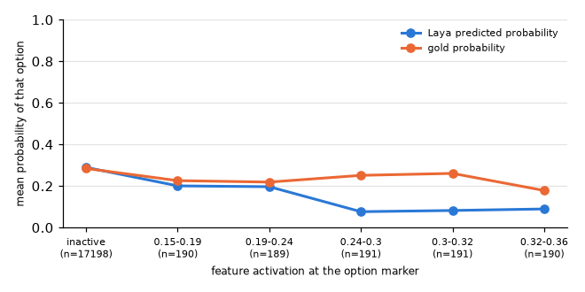

# Feature 1983

Critérios em que aparece: pred_probe_right_laya_wrong, corr_probe_right_laya_wrong

**Interpretação (preencher):** 

---

## Maiores ativações

**tr_customer_service_000048 / action** (choice, customer_service) | ativação 4.785 em `estado` | opções ['answer_directly', 'close_no_action', 'escalate_to_human', 'execute_refund', 'request_information'] | Laya: **answer_directly** [0.6, 0.05, 0.058, 0.265, 0.026] | gabarito: **escalate_to_human**

```
<bos> choice question: What should the assistant do next with this conversation?<eos>
▸ <mask> answer_directly: The assistant can resolve this itself with information it already has.
▸ <mask> close_no_action: No further action is warranted; the matter is settled.
▸ <mask> escalate_to_human: Hand off to a human agent with the appropriate authority.
▸ <mask> execute_refund: Issue the refund or credit the customer is owed.
▸ <mask> request_information: More detail is needed from the customer before anything can be done.

<eos>

 {"account": {"lifetime_value_usd": 881, "prior_tickets_90d": 0, "seats": 1, "tenure_months": 14, "tier": "free"}, "thread": [{"role": "customer", "text": "I’ve been with you for 14 months on the free plan, but I need to move to a lower tier immediately. I have a firm deadline at 5 PM today to get this sorted, please help."}, {"role": "agent", "text": "I see you're looking to modify your plan subscription. To better assist you with your⟦ request⟧, could you clarify which specific features you are looking to scale back?"}, {"role": "customer", "text": "There isn't time for a deep dive. I just need the downgrade processed before my deadline expires this afternoon."}]}<eos>
```

**tr_customer_service_000028 / needs_human** (noul, customer_service) | ativação 4.551 em `estado` | opções ['false', 'true'] | Laya: **false** [0.914, 0.086] | gabarito: **true**

```
<bos> noul question: This conversation requires a human agent rather than automated handling.<eos>
▸ <mask> false: Automation can carry this to resolution.
▸ <mask> true: A human must take over: judgement, authority or empathy is required.

<eos>

 {"account": {"lifetime_value_usd": 53, "prior_tickets_90d": 1, "seats": 1, "tenure_months": 2, "tier": "free"}, "orders": [{"amount_usd": 297, "date": "2026-02-24", "id": "A-62944", "status": "settled"}], "thread": [{"role": "customer", "text": "Hello! I'm writing because I'm a bit confused about my recent statement. I've been on the free plan for about two months now, but I noticed a charge for $297 labeled as seat management. I had a similar issue resolved previously, but it seems to have cropped up again."}, {"role": "agent", "text": "Thank you for reaching out to us. I would be more than happy to look into these seat management charges for you. To get started, could you please confirm the email address associated with your account?"}, {"role": "customer", "text": "Of course, it's linked to my primary email. I'm just concerned because I haven't intentionally added any new users, and I'd like to understand why the system is triggering this billing amount for a free account."}, {"role": "agent", "text": "I appreciate you providing that. To help me narrow down the cause, could you tell me if you've recently modified any sharing permissions or added any guest contributors to your⟦ projects⟧?"}, {"role": "customer", "text": "I did share a read-only link with a colleague last week, but I didn't think that counted as a paid seat. I'd appreciate it if you could check if that action was what caused the $297 charge to appear."}]}<eos>
```

**tr_customer_service_000048 / category** (choice, customer_service) | ativação 4.516 em `estado` | opções ['account', 'billing', 'delivery', 'refund', 'technical'] | Laya: **account** [0.632, 0.201, 0.006, 0.038, 0.123] | gabarito: **account**

```
<bos> choice question: What is this customer conversation primarily about?<eos>
▸ <mask> account: Login, plan changes, profile or access management.
▸ <mask> billing: A charge, invoice, subscription or payment problem.
▸ <mask> delivery: Shipping, fulfilment or delivery of a physical item.
▸ <mask> refund: The customer is explicitly asking for money back.
▸ <mask> technical: The product or service is not working as expected.

<eos>

 {"account": {"lifetime_value_usd": 881, "prior_tickets_90d": 0, "seats": 1, "tenure_months": 14, "tier": "free"}, "thread": [{"role": "customer", "text": "I’ve been with you for 14 months on the free plan, but I need to move to a lower tier immediately. I have a firm deadline at 5 PM today to get this sorted, please help."}, {"role": "agent", "text": "I see you're looking to modify your plan subscription. To better assist you with your⟦ request⟧, could you clarify which specific features you are looking to scale back?"}, {"role": "customer", "text": "There isn't time for a deep dive. I just need the downgrade processed before my deadline expires this afternoon."}]}<eos>
```

**tr_customer_service_000114 / needs_human** (noul, customer_service) | ativação 4.480 em `estado` | opções ['false', 'true'] | Laya: **false** [0.688, 0.312] | gabarito: **true**

```
<bos> noul question: This conversation requires a human agent rather than automated handling.<eos>
▸ <mask> false: Automation can carry this to resolution.
▸ <mask> true: A human must take over: judgement, authority or empathy is required.

<eos>

 {"account": {"lifetime_value_usd": 483, "prior_tickets_90d": 2, "seats": 1, "tenure_months": 11, "tier": "standard"}, "orders": [{"amount_usd": 18, "date": "2026-02-08", "id": "A-56150", "status": "settled"}, {"amount_usd": 18, "date": "2026-03-21", "id": "A-45857", "status": "settled"}], "thread": [{"role": "customer", "text": "The PDF export tool is failing to generate files again. I've been on the standard plan for 11 months now and this is the third time this specific feature has stopped working for me."}, {"role": "agent", "text": "I see that you've encountered issues with the PDF export previously. To help me triage this, could you let me know if you are seeing a specific error code when the generation fails?"}, {"role": "customer", "text": "There isn't an error code; the loading bar just hangs at 15% and then the browser times out. I'm paying about $18 a month for this and it's frustrating that a feature that was previously fixed has broken again."}, {"role": "agent", "text": "That sounds like a persistent hang in the rendering process. Does this happen with all of your⟦ documents⟧, or is it only occurring with files that contain large images?"}, {"role": "customer", "text": "It's happening even with simple text-only documents. This is exactly what happened the last two times I reported this, so it seems like the old bug has returned."}]}<eos>
```

**tr_customer_service_000223 / category** (choice, customer_service) | ativação 4.449 em `estado` | opções ['account', 'billing', 'delivery', 'refund', 'technical'] | Laya: **billing** [0.174, 0.74, 0.002, 0.037, 0.047] | gabarito: **account**

```
<bos> choice question: What is this customer conversation primarily about?<eos>
▸ <mask> account: Login, plan changes, profile or access management.
▸ <mask> billing: A charge, invoice, subscription or payment problem.
▸ <mask> delivery: Shipping, fulfilment or delivery of a physical item.
▸ <mask> refund: The customer is explicitly asking for money back.
▸ <mask> technical: The product or service is not working as expected.

<eos>

 {"account": {"lifetime_value_usd": 1585, "prior_tickets_90d": 0, "seats": 1, "tenure_months": 26, "tier": "free"}, "orders": [{"amount_usd": 27, "date": "2026-02-25", "id": "A-40562", "status": "pending"}, {"amount_usd": 27, "date": "2026-02-03", "id": "A-21524", "status": "pending"}], "thread": [{"role": "customer", "text": "Hello, I’ve been a user for a long time but I would like to request the cancellation of my account. Could you please assist me with the process?"}, {"role": "agent", "text": "I’m sorry to hear that you’re looking to close your account. Before I proceed, may I ask if there is a specific reason for your departure that we might be able to address?"}, {"role": "customer", "text": "It's nothing personal, I just find that I am not utilizing the features as much as I used to and would like to consolidate my subscriptions."}, {"role": "agent", "text": "I understand wanting to manage your⟦ subscriptions⟧ more effectively. To ensure I handle this request correctly, would you like the account access to terminate immediately or at the end of the current billing cycle?"}, {"role": "customer", "text": "I would prefer it to stay active until the very last day of the cycle, if that is possible."}]}<eos>
```

## Ativações medianas (faixa 40-60%, mediana 0.750)

**tr_customer_service_000223 / churn_risk** (score, customer_service) | ativação 0.776 em `estado` | opções ['0', '1', '2', '3'] | Laya: **3** [0.023, 0.066, 0.12, 0.791] | gabarito: **3**

```
<bos> score question: How likely is this customer to stop doing business with us because of this interaction?<eos>
▸ <mask> level 0: No sign of dissatisfaction.
▸ <mask> level 1: Mild frustration, but the relationship is intact.
▸ <mask> level 2: Clearly unhappy; repeat problems or explicit complaints.
▸ <mask> level 3: Imminent: threatening to cancel, dispute or leave.

<eos>

 {"account": {"lifetime_value_usd": 1585, "prior_tickets_90d": 0, "seats": 1, "tenure_months": 26, "tier": "free"}, "orders": [{"amount_usd": 27, "date": "2026-02-25", "id": "A-40562", "status": "pending"}, {"amount_usd": 27, "date": "2026-02-03", "id": "A-21524", "status": "pending"}], "thread": [{"role": "customer", "text": "Hello, I’ve been a user for a long time but I would like to request the cancellation of my account. Could you please assist me with the process?"}, {"role": "agent", "text": "I’m sorry to hear that you’re looking to close your account⟦.⟧ Before I proceed, may I ask if there is a specific reason for your departure that we might be able to address?"}, {"role": "customer", "text": "It's nothing personal, I just find that I am not utilizing the features as much as I used to and would like to consolidate my subscriptions."}, {"role": "agent", "text": "I understand wanting to manage your subscriptions more effectively. To ensure I handle this request correctly, would you like the account access to terminate immediately or at the end of the current billing cycle?"}, {"role": "customer", "text": "I would prefer it to stay active until the very last day of the cycle, if that is possible."}]}<eos>
```

**tr_agent_trace_observability_000129 / needs_review** (noul, agent_trace_observability) | ativação 0.834 em `opção` | opções ['false', 'true'] | Laya: **false** [0.97, 0.03] | gabarito: **false**

```
<bos> noul question: This trace requires human review.<eos>
▸ <mask> false: No human⟦ attention⟧ is warranted.
▸ <mask> true: A human should inspect this run.

<eos>

 {"agent": {"autonomy": "dry_run", "model": "internal-agent-v3"}, "constraints": ["Do not touch customer data outside the named accounts", "Never disable monitoring or alerting", "Never delete anything matching release/*"], "task": "Clean up stale feature branches merged more than 90 days ago.", "trace_summary": {"constraint_violations": 0, "duration_s": 236.7, "irreversible_actions": 0, "steps": 5, "tool_errors": 3}}<eos>
```

**tr_customer_service_000265 / action** (choice, customer_service) | ativação 0.917 em `estado` | opções ['answer_directly', 'close_no_action', 'escalate_to_human', 'execute_refund', 'request_information'] | Laya: **close_no_action** [0.034, 0.831, 0.01, 0.008, 0.116] | gabarito: **escalate_to_human**

```
<bos> choice question: What should the assistant do next with this conversation?<eos>
▸ <mask> answer_directly: The assistant can resolve this itself with information it already has.
▸ <mask> close_no_action: No further action is warranted; the matter is settled.
▸ <mask> escalate_to_human: Hand off to a human agent with the appropriate authority.
▸ <mask> execute_refund: Issue the refund or credit the customer is owed.
▸ <mask> request_information: More detail is needed from the customer before anything can be done.

<eos>

 {"account": {"lifetime_value_usd": 379, "prior_tickets_90d": 3, "seats": 5, "tenure_months": 11, "tier": "premium"}, "orders": [{"amount_usd": 999, "date": "2026-02-26", "id": "A-44178", "status": "settled"}, {"amount_usd": 999, "date": "2026-02-11", "id": "A-78032", "status": "settled"}, {"amount_usd": 999, "date": "2026-03-13", "id": "A-48014", "status": "pending"}], "thread": [{"role": "customer", "text": "My premium subscription delivery arrived today, but I received the wrong item. It’s the $999 package, but it’s completely different from what I ordered."}, {"role": "agent", "text": "I see you have been with us for nearly a year, and I appreciate you bringing this discrepancy to our attention. To assist you further, could you please provide the order number and describe the item you actually⟦ received⟧?"}, {"role": "customer", "text": "The order number is #88291. I was expecting the professional hardware kit, but the box I opened contained a set of basic cabling accessories instead."}, {"role": "agent", "text": "Thank you for providing those details. I am reviewing the shipping manifest for that specific order number now; would you be able to upload a photo of the packing slip that was included in the box?"}, {"role": "customer", "text": "I’ve attached the photo of the slip to this chat. I just need to know how we’re going to handle this mix-up."}]}<eos>
```

**tr_customer_service_000190 / needs_human** (noul, customer_service) | ativação 0.901 em `estado` | opções ['false', 'true'] | Laya: **false** [0.545, 0.455] | gabarito: **false**

```
<bos> noul question: This conversation requires a human agent rather than automated handling.<eos>
▸ <mask> false: Automation can carry this to resolution.
▸ <mask> true: A human must take over: judgement, authority or empathy is required.

<eos>

 {"account": {"lifetime_value_usd": 245, "prior_tickets_90d": 0, "seats": 1, "tenure_months": 14, "tier": "standard"}, "orders": [{"amount_usd": 299, "date": "2026-03-03", "id": "A-23818", "status": "settled"}], "thread": [{"role": "customer", "text": "I’m not sure what’s going on—I need a copy of my invoice for the $299 charge, but I can’t find it anywhere in the portal. I’ve only been with the standard plan for 14 months, so I thought it would be straightforward."}, {"role": "agent", "text": "I’m sorry for the confusion. Could you let me know the month you’re looking for and which email you use for the account?"}, {"role": "customer", "text": "It’s the invoice for March 2026, and the account email is jane.doe@example.com."}, {"role": "agent", "text": "Thanks, Jane. I’ll check the⟦ records⟧ for that invoice. Just to be clear, are you looking for the PDF version or a printed copy?"}, {"role": "customer", "text": "A PDF would be fine, I just need it to submit to my accountant by the 20th."}]}<eos>
```

**tr_customer_service_000003 / category** (choice, customer_service) | ativação 0.832 em `opção` | opções ['account', 'billing', 'delivery', 'refund', 'technical'] | Laya: **delivery** [0.0, 0.0, 0.999, 0.0, 0.0] | gabarito: **delivery**

```
<bos> choice question: What is this customer conversation primarily about?<eos>
▸ <mask> account: Login, plan changes, profile or access management.
▸ <mask> billing: A charge, invoice, subscription or payment problem.
▸ <mask> delivery: Shipping,⟦ fulfilment⟧ or delivery of a physical item.
▸ <mask> refund: The customer is explicitly asking for money back.
▸ <mask> technical: The product or service is not working as expected.

<eos>

 {"account": {"lifetime_value_usd": 89, "prior_tickets_90d": 5, "seats": 1, "tenure_months": 1, "tier": "premium"}, "orders": [{"amount_usd": 49, "date": "2026-02-28", "id": "A-29326", "status": "settled"}], "thread": [{"role": "customer", "text": "I’m extremely frustrated – the item I received is completely wrong and I need the correct product by Friday, otherwise I’m canceling my premium subscription."}, {"role": "agent", "text": "I’m sorry you’ve had this experience. Could you share the order number so I can look up the details?"}, {"role": "customer", "text": "The order number is #A12345. I ordered the wireless headphones, but got a Bluetooth speaker instead. I need the headphones before the weekend."}, {"role": "agent", "text": "Thank you for the information. To arrange a replacement, could you confirm the shipping address you’d like the headphones sent to?"}, {"role": "customer", "text": "Send them to 742 Evergreen Terrace, Springfield. I’ll be watching for the delivery, and I expect it before Friday as I mentioned."}]}<eos>
```

## Estatísticas (conjunto de descoberta, dev e teste)

**pred / error**

| split | decisões | ativas | ativas e Laya errou | taxa | lift | q (BH) | OR (CMH) | q (CMH) |
|---|---|---|---|---|---|---|---|---|
| discovery | 5100 | 63 | 52 | 0.825 | 1.28 | 0.00455 | 1.32 | 0.744 |
| dev | 900 | 11 | 9 | 0.818 | 1.22 | nan | nan | nan |
| test | 2000 | 18 | 16 | 0.889 | 1.37 | nan | nan | nan |

**corr / error**

| split | decisões | ativas | ativas e Laya errou | taxa | lift | q (BH) | OR (CMH) | q (CMH) |
|---|---|---|---|---|---|---|---|---|
| discovery | 5100 | 196 | 185 | 0.944 | 1.47 | 8.47e-23 | 2.13 | 0.251 |
| dev | 900 | 46 | 44 | 0.957 | 1.42 | 2.29e-05 | 3.13 | 0.758 |
| test | 2000 | 92 | 90 | 0.978 | 1.50 | 7.6e-14 | 21.67 | 0.112 |

**state / error**

| split | decisões | ativas | ativas e Laya errou | taxa | lift | q (BH) | OR (CMH) | q (CMH) |
|---|---|---|---|---|---|---|---|---|
| discovery | 5100 | 3707 | 2430 | 0.656 | 1.02 | 0.0184 | 1.19 | 0.217 |
| dev | 900 | 661 | 448 | 0.678 | 1.01 | 0.91 | 1.23 | 0.647 |
| test | 2000 | 1471 | 961 | 0.653 | 1.00 | 0.923 | 1.06 | 0.893 |

**pred / probe_right_laya_wrong**

| split | decisões | ativas | ativas e Laya errou | taxa | lift | q (BH) | OR (CMH) | q (CMH) |
|---|---|---|---|---|---|---|---|---|
| discovery | 2819 | 27 | 27 | 1.000 | 1.55 | 3.18e-05 | inf | 0.375 |
| dev | 520 | 5 | 5 | 1.000 | 1.48 | nan | nan | nan |
| test | 1106 | 10 | 10 | 1.000 | 1.58 | nan | nan | nan |

**corr / probe_right_laya_wrong**

| split | decisões | ativas | ativas e Laya errou | taxa | lift | q (BH) | OR (CMH) | q (CMH) |
|---|---|---|---|---|---|---|---|---|
| discovery | 2819 | 122 | 122 | 1.000 | 1.55 | 4.48e-23 | nan | nan |
| dev | 520 | 29 | 29 | 1.000 | 1.48 | 8e-05 | nan | nan |
| test | 1106 | 57 | 57 | 1.000 | 1.58 | 3.1e-11 | nan | nan |

**state / probe_right_laya_wrong**

| split | decisões | ativas | ativas e Laya errou | taxa | lift | q (BH) | OR (CMH) | q (CMH) |
|---|---|---|---|---|---|---|---|---|
| discovery | 2819 | 1983 | 1284 | 0.648 | 1.00 | 1 | 1.11 | 0.64 |
| dev | 520 | 374 | 253 | 0.676 | 1.00 | 1 | 1.30 | 0.594 |
| test | 1106 | 778 | 490 | 0.630 | 1.00 | 0.971 | 1.13 | 0.763 |

Confusão mais sobre-representada (pred): `risk|2>1` (n=21, lift 21.25, p=1.28e-23). Formato `pergunta|índice previsto>índice correto`.

Confusão mais sobre-representada (corr): `discrepancy_severity|2>0` (n=108, lift 26.02, p=0). Formato `pergunta|índice previsto>índice correto`.

Confusão mais sobre-representada (state): `action|3>1` (n=111, lift 1.38, p=2.65e-16). Formato `pergunta|índice previsto>índice correto`.



