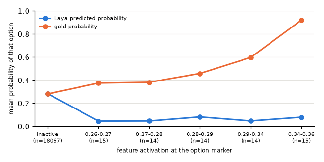

# Feature 1985

Critérios em que aparece: corr_error, corr_probe_right_laya_wrong

**Interpretação (preencher):** 

---

## Maiores ativações

**tr_customer_service_000057 / churn_risk** (score, customer_service) | ativação 2.104 em `estado` | opções ['0', '1', '2', '3'] | Laya: **1** [0.15, 0.541, 0.272, 0.037] | gabarito: **2**

```
<bos> score question: How likely is this customer to stop doing business with us because of this interaction?<eos>
▸ <mask> level 0: No sign of dissatisfaction.
▸ <mask> level 1: Mild frustration, but the relationship is intact.
▸ <mask> level 2: Clearly unhappy; repeat problems or explicit complaints.
▸ <mask> level 3: Imminent: threatening to cancel, dispute or leave.

<eos>

 {"account": {"lifetime_value_usd": 1386, "prior_tickets_90d": 1, "seats": 1, "tenure_months": 72, "tier": "free"}, "thread": [{"role": "customer", "text": "Your service is crawling at a⟦ snail⟧’s pace and I’ve been on the free plan for six years – this is unacceptable."}, {"role": "agent", "text": "I’m sorry you’re experiencing slowness. Could you let me know which device and browser you’re using?"}, {"role": "customer", "text": "Ticket #6789 was supposed to fix this weeks ago, but nothing changed. It’s the same lag every time I log in."}, {"role": "agent", "text": "Got it. When did the slowdown start, and are you seeing any error messages on the screen?"}, {"role": "customer", "text": "It started yesterday, no error messages, just endless loading. My work is getting held up and I need an update."}]}<eos>
```

**tr_customer_service_000057 / urgency** (score, customer_service) | ativação 2.031 em `estado` | opções ['0', '1', '2', '3'] | Laya: **1** [0.242, 0.546, 0.132, 0.08] | gabarito: **3**

```
<bos> score question: How time-sensitive is this conversation?<eos>
▸ <mask> level 0: No time pressure; can wait indefinitely.
▸ <mask> level 1: Routine; handle within the normal queue.
▸ <mask> level 2: Elevated; should be handled within the same week.
▸ <mask> level 3: Critical; requires action within the same day.

<eos>

 {"account": {"lifetime_value_usd": 1386, "prior_tickets_90d": 1, "seats": 1, "tenure_months": 72, "tier": "free"}, "thread": [{"role": "customer", "text": "Your service is crawling at a⟦ snail⟧’s pace and I’ve been on the free plan for six years – this is unacceptable."}, {"role": "agent", "text": "I’m sorry you’re experiencing slowness. Could you let me know which device and browser you’re using?"}, {"role": "customer", "text": "Ticket #6789 was supposed to fix this weeks ago, but nothing changed. It’s the same lag every time I log in."}, {"role": "agent", "text": "Got it. When did the slowdown start, and are you seeing any error messages on the screen?"}, {"role": "customer", "text": "It started yesterday, no error messages, just endless loading. My work is getting held up and I need an update."}]}<eos>
```

**tr_customer_service_000057 / action** (choice, customer_service) | ativação 1.993 em `estado` | opções ['answer_directly', 'close_no_action', 'escalate_to_human', 'execute_refund', 'request_information'] | Laya: **answer_directly** [0.987, 0.005, 0.006, 0.001, 0.001] | gabarito: **escalate_to_human**

```
<bos> choice question: What should the assistant do next with this conversation?<eos>
▸ <mask> answer_directly: The assistant can resolve this itself with information it already has.
▸ <mask> close_no_action: No further action is warranted; the matter is settled.
▸ <mask> escalate_to_human: Hand off to a human agent with the appropriate authority.
▸ <mask> execute_refund: Issue the refund or credit the customer is owed.
▸ <mask> request_information: More detail is needed from the customer before anything can be done.

<eos>

 {"account": {"lifetime_value_usd": 1386, "prior_tickets_90d": 1, "seats": 1, "tenure_months": 72, "tier": "free"}, "thread": [{"role": "customer", "text": "Your service is crawling at a⟦ snail⟧’s pace and I’ve been on the free plan for six years – this is unacceptable."}, {"role": "agent", "text": "I’m sorry you’re experiencing slowness. Could you let me know which device and browser you’re using?"}, {"role": "customer", "text": "Ticket #6789 was supposed to fix this weeks ago, but nothing changed. It’s the same lag every time I log in."}, {"role": "agent", "text": "Got it. When did the slowdown start, and are you seeing any error messages on the screen?"}, {"role": "customer", "text": "It started yesterday, no error messages, just endless loading. My work is getting held up and I need an update."}]}<eos>
```

**tr_customer_service_000057 / category** (choice, customer_service) | ativação 1.976 em `estado` | opções ['account', 'billing', 'delivery', 'refund', 'technical'] | Laya: **technical** [0.028, 0.008, 0.001, 0.001, 0.961] | gabarito: **technical**

```
<bos> choice question: What is this customer conversation primarily about?<eos>
▸ <mask> account: Login, plan changes, profile or access management.
▸ <mask> billing: A charge, invoice, subscription or payment problem.
▸ <mask> delivery: Shipping, fulfilment or delivery of a physical item.
▸ <mask> refund: The customer is explicitly asking for money back.
▸ <mask> technical: The product or service is not working as expected.

<eos>

 {"account": {"lifetime_value_usd": 1386, "prior_tickets_90d": 1, "seats": 1, "tenure_months": 72, "tier": "free"}, "thread": [{"role": "customer", "text": "Your service is crawling at a⟦ snail⟧’s pace and I’ve been on the free plan for six years – this is unacceptable."}, {"role": "agent", "text": "I’m sorry you’re experiencing slowness. Could you let me know which device and browser you’re using?"}, {"role": "customer", "text": "Ticket #6789 was supposed to fix this weeks ago, but nothing changed. It’s the same lag every time I log in."}, {"role": "agent", "text": "Got it. When did the slowdown start, and are you seeing any error messages on the screen?"}, {"role": "customer", "text": "It started yesterday, no error messages, just endless loading. My work is getting held up and I need an update."}]}<eos>
```

**tr_customer_service_000214 / churn_risk** (score, customer_service) | ativação 1.970 em `estado` | opções ['0', '1', '2', '3'] | Laya: **2** [0.076, 0.359, 0.446, 0.119] | gabarito: **2**

```
<bos> score question: How likely is this customer to stop doing business with us because of this interaction?<eos>
▸ <mask> level 0: No sign of dissatisfaction.
▸ <mask> level 1: Mild frustration, but the relationship is intact.
▸ <mask> level 2: Clearly unhappy; repeat problems or explicit complaints.
▸ <mask> level 3: Imminent: threatening to cancel, dispute or leave.

<eos>

 {"account": {"lifetime_value_usd": 820, "prior_tickets_90d": 2, "seats": 1, "tenure_months": 19, "tier": "standard"}, "thread": [{"role": "customer", "text": "The platform has been crawling at a⟦ snail⟧'s pace all day—queries that used to return in seconds now take minutes, and I need this fixed before my deadline tomorrow."}, {"role": "agent", "text": "I understand how critical that is. Can you tell me which specific actions are lagging and if this slowdown is happening across all browsers?"}, {"role": "customer", "text": "Both the search bar and the analytics tab are sluggish, and it’s the same on Chrome and Firefox. I’ve been on the standard plan for 19 months and this is the first time I’ve seen anything this bad."}]}<eos>
```

## Ativações medianas (faixa 40-60%, mediana 0.303)

**tr_invoice_processing_000247 / matches_order** (noul, invoice_processing) | ativação 0.288 em `marcador` | opções ['false', 'true'] | Laya: **true** [0.043, 0.957] | gabarito: **true**

```
<bos> noul question: The invoice reconciles with the purchase order and the recorded delivery.<eos>
▸ ⟦<mask>⟧ false: There is a discrepancy against the order or the delivery.
▸ <mask> true: Line items, quantities and amounts reconcile.

<eos>

 {"delivery": {"condition": "accepted with exceptions", "date": "2026-03-11", "received_qty": 400}, "invoice": {"currency": "USD", "id": "INV-2026-7062", "lines": [{"qty": 400, "sku": "SKU-763", "total_usd": 129912.0, "unit_usd": 324.78}], "total_usd": 129912.0, "vendor": "Vantage Materials"}, "payment": {"days_until_due": -3, "discount_expires_in_days": 7, "early_payment_discount_pct": 2.0, "status": "overdue", "terms": "net 30"}, "purchase_order": {"freight_terms": "freight prepaid by vendor, not separately billable", "id": "PO-9000", "lines": [{"qty": 400, "unit_usd": 324.78}], "total_usd": 129912.0}, "vendor_history": {"disputes_12m": 1, "invoices_12m": 8, "prior_invoice_ids": ["INV-2026-7160", "INV-2026-4762", "INV-2026-1182", "INV-2026-3903"]}}<eos>
```

**tr_invoice_processing_000185 / duplicate** (noul, invoice_processing) | ativação 0.331 em `marcador` | opções ['false', 'true'] | Laya: **true** [0.031, 0.969] | gabarito: **false**

```
<bos> noul question: This invoice appears to duplicate an invoice already submitted.<eos>
▸ ⟦<mask>⟧ false: no, the statement does not hold
▸ <mask> true: yes, the statement holds

<eos>

 {"delivery": {"condition": "accepted", "date": "2026-03-11", "received_qty": 100}, "invoice": {"currency": "USD", "id": "INV-2026-5921", "lines": [{"qty": 100, "sku": "SKU-796", "total_usd": 32023.0, "unit_usd": 320.23}], "total_usd": 32023.0, "vendor": "Acme Fabrication"}, "payment": {"days_until_due": 18, "discount_expires_in_days": 8, "early_payment_discount_pct": 2.0, "status": "scheduled", "terms": "net 30"}, "purchase_order": {"freight_terms": "freight prepaid by vendor, not separately billable", "id": "PO-9122", "lines": [{"qty": 100, "unit_usd": 320.23}], "total_usd": 32023.0}, "vendor_history": {"disputes_12m": 0, "invoices_12m": 31, "prior_invoice_ids": ["INV-2026-2674", "INV-2026-5172"]}}<eos>
```

**tr_invoice_processing_000178 / matches_order** (noul, invoice_processing) | ativação 0.298 em `marcador` | opções ['false', 'true'] | Laya: **true** [0.076, 0.924] | gabarito: **false**

```
<bos> noul question: The invoice reconciles with the purchase order and the recorded delivery.<eos>
▸ ⟦<mask>⟧ false: There is a discrepancy against the order or the delivery.
▸ <mask> true: Line items, quantities and amounts reconcile.

<eos>

 {"delivery": {"condition": "accepted with exceptions", "date": "2026-03-16", "received_qty": 230}, "invoice": {"currency": "USD", "id": "INV-2026-9222", "lines": [{"qty": 230, "sku": "SKU-724", "total_usd": 44150.8, "unit_usd": 191.96}], "total_usd": 44150.8, "vendor": "Kestrel Supply"}, "payment": {"days_until_due": 11, "discount_expires_in_days": 5, "early_payment_discount_pct": 2.0, "status": "scheduled", "terms": "net 15"}, "purchase_order": {"freight_terms": "freight prepaid by vendor, not separately billable", "id": "PO-1262", "lines": [{"qty": 250, "unit_usd": 191.96}], "total_usd": 47990.0}, "vendor_history": {"disputes_12m": 1, "invoices_12m": 26, "prior_invoice_ids": ["INV-2026-2957", "INV-2026-1376"]}}<eos>
```

**tr_invoice_processing_000039 / matches_order** (noul, invoice_processing) | ativação 0.303 em `marcador` | opções ['false', 'true'] | Laya: **true** [0.086, 0.914] | gabarito: **false**

```
<bos> noul question: The invoice reconciles with the purchase order and the recorded delivery.<eos>
▸ ⟦<mask>⟧ false: There is a discrepancy against the order or the delivery.
▸ <mask> true: Line items, quantities and amounts reconcile.

<eos>

 {"delivery": {"condition": "accepted", "date": "2026-03-25", "received_qty": 95}, "invoice": {"currency": "USD", "id": "INV-2026-8564", "lines": [{"qty": 95, "sku": "SKU-371", "total_usd": 16826.4, "unit_usd": 177.12}], "total_usd": 16826.4, "vendor": "Northwind Components"}, "payment": {"days_until_due": -21, "discount_expires_in_days": 6, "early_payment_discount_pct": 2.0, "status": "overdue", "terms": "net 30"}, "purchase_order": {"freight_terms": "freight prepaid by vendor, not separately billable", "id": "PO-5006", "lines": [{"qty": 100, "unit_usd": 177.12}], "total_usd": 17712.0}, "vendor_history": {"disputes_12m": 0, "invoices_12m": 12, "prior_invoice_ids": ["INV-2026-5684", "INV-2026-6924"]}}<eos>
```

**tr_invoice_processing_000207 / duplicate** (noul, invoice_processing) | ativação 0.326 em `marcador` | opções ['false', 'true'] | Laya: **true** [0.006, 0.994] | gabarito: **false**

```
<bos> noul question: This invoice appears to duplicate an invoice already submitted.<eos>
▸ ⟦<mask>⟧ false: no, the statement does not hold
▸ <mask> true: yes, the statement holds

<eos>

 {"delivery": {"condition": "accepted", "date": "2026-03-07", "received_qty": 50}, "invoice": {"currency": "USD", "id": "INV-2026-5896", "lines": [{"qty": 50, "sku": "SKU-476", "total_usd": 15168.0, "unit_usd": 303.36}, {"qty": 1, "sku": "FREIGHT", "total_usd": 536.15, "unit_usd": 536.15}], "total_usd": 15704.15, "vendor": "Orbit Logistics"}, "payment": {"days_until_due": 5, "discount_expires_in_days": 6, "early_payment_discount_pct": 2.0, "status": "scheduled", "terms": "net 45"}, "purchase_order": {"freight_terms": "freight prepaid by vendor, not separately billable", "id": "PO-9119", "lines": [{"qty": 50, "unit_usd": 303.36}], "total_usd": 15168.0}, "vendor_history": {"disputes_12m": 5, "invoices_12m": 7, "prior_invoice_ids": ["INV-2026-2237"]}}<eos>
```

## Estatísticas (conjunto de descoberta, dev e teste)

**pred / error**

| split | decisões | ativas | ativas e Laya errou | taxa | lift | q (BH) | OR (CMH) | q (CMH) |
|---|---|---|---|---|---|---|---|---|
| discovery | 5100 | 2 | 2 | 1.000 | 1.55 | nan | nan | nan |
| dev | 900 | 1 | 0 | 0.000 | 0.00 | nan | nan | nan |
| test | 2000 | 2 | 2 | 1.000 | 1.54 | nan | nan | nan |

**corr / error**

| split | decisões | ativas | ativas e Laya errou | taxa | lift | q (BH) | OR (CMH) | q (CMH) |
|---|---|---|---|---|---|---|---|---|
| discovery | 5100 | 39 | 39 | 1.000 | 1.55 | 1.6e-07 | nan | nan |
| dev | 900 | 13 | 12 | 0.923 | 1.37 | nan | nan | nan |
| test | 2000 | 10 | 10 | 1.000 | 1.54 | nan | nan | nan |

**state / error**

| split | decisões | ativas | ativas e Laya errou | taxa | lift | q (BH) | OR (CMH) | q (CMH) |
|---|---|---|---|---|---|---|---|---|
| discovery | 5100 | 25 | 13 | 0.520 | 0.81 | 0.449 | 0.63 | 0.685 |
| dev | 900 | 4 | 2 | 0.500 | 0.74 | nan | nan | nan |
| test | 2000 | 6 | 4 | 0.667 | 1.02 | nan | nan | nan |

**pred / probe_right_laya_wrong**

| split | decisões | ativas | ativas e Laya errou | taxa | lift | q (BH) | OR (CMH) | q (CMH) |
|---|---|---|---|---|---|---|---|---|
| discovery | 2819 | 2 | 2 | 1.000 | 1.55 | nan | nan | nan |
| dev | 520 | 1 | 0 | 0.000 | 0.00 | nan | nan | nan |
| test | 1106 | 2 | 2 | 1.000 | 1.58 | nan | nan | nan |

**corr / probe_right_laya_wrong**

| split | decisões | ativas | ativas e Laya errou | taxa | lift | q (BH) | OR (CMH) | q (CMH) |
|---|---|---|---|---|---|---|---|---|
| discovery | 2819 | 25 | 25 | 1.000 | 1.55 | 6.01e-05 | nan | nan |
| dev | 520 | 6 | 5 | 0.833 | 1.23 | nan | nan | nan |
| test | 1106 | 7 | 7 | 1.000 | 1.58 | nan | nan | nan |

**state / probe_right_laya_wrong**

| split | decisões | ativas | ativas e Laya errou | taxa | lift | q (BH) | OR (CMH) | q (CMH) |
|---|---|---|---|---|---|---|---|---|
| discovery | 2819 | 17 | 8 | 0.471 | 0.73 | nan | nan | nan |
| dev | 520 | 2 | 0 | 0.000 | 0.00 | nan | nan | nan |
| test | 1106 | 6 | 4 | 0.667 | 1.05 | nan | nan | nan |

Confusão mais sobre-representada (pred): `true_positive|0>1` (n=1, lift 115.91, p=nan). Formato `pergunta|índice previsto>índice correto`.

Confusão mais sobre-representada (corr): `matches_order|1>0` (n=22, lift 24.18, p=6.13e-27). Formato `pergunta|índice previsto>índice correto`.

Confusão mais sobre-representada (state): `action|1>2` (n=3, lift 8.62, p=0.00477). Formato `pergunta|índice previsto>índice correto`.



