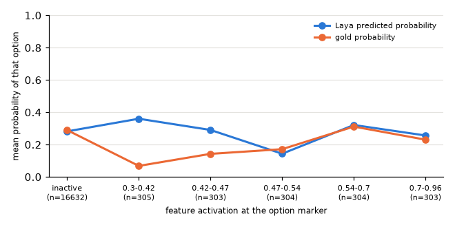

# Feature 2125

Critérios em que aparece: attribution_toward_wrong

**Interpretação (preencher):** 

---

## Maiores ativações

**tr_customer_service_000285 / urgency** (score, customer_service) | ativação 2.381 em `estado` | opções ['0', '1', '2', '3'] | Laya: **0** [0.771, 0.167, 0.042, 0.021] | gabarito: **1**

```
<bos> score question: How time-sensitive is this conversation?<eos>
▸ <mask> level 0: No time pressure; can wait indefinitely.
▸ <mask> level 1: Routine; handle within the normal queue.
▸ <mask> level 2: Elevated; should be handled within the same week.
▸ <mask> level 3: Critical; requires action within the same day.

<eos>

 {"account": {"lifetime_value_usd": 584, "prior_tickets_90d": 0, "seats": 1, "tenure_months": 11, "tier": "premium"}, "thread": [{"role": "customer", "text": "I’ve been on the premium plan for eleven months now, and honestly, I’ve stopped using most of the features. I think it’s time to downgrade, but I’m not sure what the next step is."}, {"role": "agent", "text": "I’m sorry to hear you’re feeling that way. Could you let me know which plan you have⟦ in⟧ mind, or any specific features you’d like to keep?"}, {"role": "customer", "text": "Just the basic coverage would do. I don’t need the extra storage or the priority support any longer."}, {"role": "agent", "text": "Got it. Are you looking to make the change effective immediately, or would you prefer it to start at the next billing cycle?"}, {"role": "customer", "text": "I can wait until the next cycle, but please confirm what steps I need to take on my end."}]}<eos>
```

**tr_customer_service_000123 / churn_risk** (score, customer_service) | ativação 2.344 em `estado` | opções ['0', '1', '2', '3'] | Laya: **2** [0.139, 0.309, 0.43, 0.122] | gabarito: **2**

```
<bos> score question: How likely is this customer to stop doing business with us because of this interaction?<eos>
▸ <mask> level 0: No sign of dissatisfaction.
▸ <mask> level 1: Mild frustration, but the relationship is intact.
▸ <mask> level 2: Clearly unhappy; repeat problems or explicit complaints.
▸ <mask> level 3: Imminent: threatening to cancel, dispute or leave.

<eos>

 {"account": {"lifetime_value_usd": 154, "prior_tickets_90d": 1, "seats": 5, "tenure_months": 2, "tier": "premium"}, "thread": [{"role": "customer", "text": "Hello there. I'm having a bit of a problem logging into my Premium account this morning. It keeps telling me my credentials aren't recognized, even though I haven't changed them."}, {"role": "agent", "text": "I'd be happy to help you with that. Are you seeing a specific error code, or is it just the standard 'invalid password' notification?"}, {"role": "customer", "text": "It says 'User not found.' I had a ticket open last week about account syncing and the agent promised it would be fixed by now, but it seems I'm still locked out."}, {"role": "agent", "text": "I see. Since you mentioned the previous ticket, did you receive a confirmation email or a link to verify your identity after that interaction?"}, {"role": "customer", "text": "No, I never received any follow-up email at all, which is why I'm reaching out again. I've only been using the service for two months and I really like it, but I can't use what I can't access."}, {"role": "agent", "text": "I appreciate your patience while we work through this. Could you please confirm the primary email address associated with your account so I can check the status of your profile?"}, {"role": "customer", "text": "Of course, it's j.smith@example.com. I have a hard deadline for a project presentation at 1:00 PM today that requires the data in that account, so if you could check on that for me, I'⟦d⟧ appreciate it."}]}<eos>
```

**tr_customer_service_000123 / action** (choice, customer_service) | ativação 2.340 em `estado` | opções ['answer_directly', 'close_no_action', 'escalate_to_human', 'execute_refund', 'request_information'] | Laya: **answer_directly** [0.718, 0.173, 0.058, 0.019, 0.032] | gabarito: **escalate_to_human**

```
<bos> choice question: What should the assistant do next with this conversation?<eos>
▸ <mask> answer_directly: The assistant can resolve this itself with information it already has.
▸ <mask> close_no_action: No further action is warranted; the matter is settled.
▸ <mask> escalate_to_human: Hand off to a human agent with the appropriate authority.
▸ <mask> execute_refund: Issue the refund or credit the customer is owed.
▸ <mask> request_information: More detail is needed from the customer before anything can be done.

<eos>

 {"account": {"lifetime_value_usd": 154, "prior_tickets_90d": 1, "seats": 5, "tenure_months": 2, "tier": "premium"}, "thread": [{"role": "customer", "text": "Hello there. I'm having a bit of a problem logging into my Premium account this morning. It keeps telling me my credentials aren't recognized, even though I haven't changed them."}, {"role": "agent", "text": "I'd be happy to help you with that. Are you seeing a specific error code, or is it just the standard 'invalid password' notification?"}, {"role": "customer", "text": "It says 'User not found.' I had a ticket open last week about account syncing and the agent promised it would be fixed by now, but it seems I'm still locked out."}, {"role": "agent", "text": "I see. Since you mentioned the previous ticket, did you receive a confirmation email or a link to verify your identity after that interaction?"}, {"role": "customer", "text": "No, I never received any follow-up email at all, which is why I'm reaching out again. I've only been using the service for two months and I really like it, but I can't use what I can't access."}, {"role": "agent", "text": "I appreciate your patience while we work through this. Could you please confirm the primary email address associated with your account so I can check the status of your profile?"}, {"role": "customer", "text": "Of course, it's j.smith@example.com. I have a hard deadline for a project presentation at 1:00 PM today that requires the data in that account, so if you could check on that for me, I'⟦d⟧ appreciate it."}]}<eos>
```

**tr_customer_service_000285 / churn_risk** (score, customer_service) | ativação 2.322 em `estado` | opções ['0', '1', '2', '3'] | Laya: **1** [0.298, 0.38, 0.186, 0.135] | gabarito: **1**

```
<bos> score question: How likely is this customer to stop doing business with us because of this interaction?<eos>
▸ <mask> level 0: No sign of dissatisfaction.
▸ <mask> level 1: Mild frustration, but the relationship is intact.
▸ <mask> level 2: Clearly unhappy; repeat problems or explicit complaints.
▸ <mask> level 3: Imminent: threatening to cancel, dispute or leave.

<eos>

 {"account": {"lifetime_value_usd": 584, "prior_tickets_90d": 0, "seats": 1, "tenure_months": 11, "tier": "premium"}, "thread": [{"role": "customer", "text": "I’ve been on the premium plan for eleven months now, and honestly, I’ve stopped using most of the features. I think it’s time to downgrade, but I’m not sure what the next step is."}, {"role": "agent", "text": "I’m sorry to hear you’re feeling that way. Could you let me know which plan you have⟦ in⟧ mind, or any specific features you’d like to keep?"}, {"role": "customer", "text": "Just the basic coverage would do. I don’t need the extra storage or the priority support any longer."}, {"role": "agent", "text": "Got it. Are you looking to make the change effective immediately, or would you prefer it to start at the next billing cycle?"}, {"role": "customer", "text": "I can wait until the next cycle, but please confirm what steps I need to take on my end."}]}<eos>
```

**tr_customer_service_000285 / needs_human** (noul, customer_service) | ativação 2.322 em `estado` | opções ['false', 'true'] | Laya: **false** [0.76, 0.24] | gabarito: **false**

```
<bos> noul question: This conversation requires a human agent rather than automated handling.<eos>
▸ <mask> false: Automation can carry this to resolution.
▸ <mask> true: A human must take over: judgement, authority or empathy is required.

<eos>

 {"account": {"lifetime_value_usd": 584, "prior_tickets_90d": 0, "seats": 1, "tenure_months": 11, "tier": "premium"}, "thread": [{"role": "customer", "text": "I’ve been on the premium plan for eleven months now, and honestly, I’ve stopped using most of the features. I think it’s time to downgrade, but I’m not sure what the next step is."}, {"role": "agent", "text": "I’m sorry to hear you’re feeling that way. Could you let me know which plan you have⟦ in⟧ mind, or any specific features you’d like to keep?"}, {"role": "customer", "text": "Just the basic coverage would do. I don’t need the extra storage or the priority support any longer."}, {"role": "agent", "text": "Got it. Are you looking to make the change effective immediately, or would you prefer it to start at the next billing cycle?"}, {"role": "customer", "text": "I can wait until the next cycle, but please confirm what steps I need to take on my end."}]}<eos>
```

## Ativações medianas (faixa 40-60%, mediana 0.666)

**tr_security_incidents_000256 / disposition** (choice, security_incidents) | ativação 0.713 em `marcador` | opções ['close_benign', 'contain', 'investigate', 'monitor'] | Laya: **investigate** [0.052, 0.158, 0.441, 0.349] | gabarito: **close_benign**

```
<bos> choice question: How should this security alert be dispositioned?<eos>
▸ <mask> close_benign: Expected, explainable activity; close without analyst time.
▸ ⟦<mask>⟧ contain: Contain the host or account immediately; do not wait for triage.
▸ <mask> investigate: Warrants an analyst opening an investigation.
▸ <mask> monitor: Not clearly malicious, but worth watching for recurrence.

<eos>

 {"alert": {"description": "a security group was opened to the public internet", "evidence": "A privileged contractor account modified security group 'sg-0a1b2c3d' to allow inbound traffic from 0.0.0.0/0 during an active maintenance window. The configuration change originated from an allowlisted source address using credentials that were last updated 90 days ago.", "rule": "config_drift"}, "context": {"asset_criticality": "medium", "change_window_active": true, "source_on_allowlist": true}, "history": {"credential_rotation_days_ago": 90, "distinct_countries_30d": 2, "logins_30d": 972, "prior_alerts_90d": 1}, "principal": {"mfa_enrolled": true, "name": "svc-deploy-743", "privileges": ["deploy:production", "secrets:read"], "type": "contractor"}}<eos>
```

**tr_customer_service_000268 / category** (choice, customer_service) | ativação 0.641 em `estado` | opções ['account', 'billing', 'delivery', 'refund', 'technical'] | Laya: **billing** [0.0, 0.999, 0.0, 0.0, 0.001] | gabarito: **billing**

```
<bos> choice question: What is this customer conversation primarily about?<eos>
▸ <mask> account: Login, plan changes, profile or access management.
▸ <mask> billing: A charge, invoice, subscription or payment problem.
▸ <mask> delivery: Shipping, fulfilment or delivery of a physical item.
▸ <mask> refund: The customer is explicitly asking for money back.
▸ <mask> technical: The product or service is not working as expected.

<eos>

 {"account": {"lifetime_value_usd": 549, "prior_tickets_90d": 3, "seats": 1, "tenure_months": 8, "tier":⟦ "⟧standard"}, "orders": [{"amount_usd": 99, "date": "2026-01-21", "id": "A-65314", "status": "refunded"}, {"amount_usd": 99, "date": "2026-02-28", "id": "A-55952", "status": "failed"}, {"amount_usd": 99, "date": "2026-02-26", "id": "A-57626", "status": "failed"}], "thread": [{"role": "customer", "text": "I’ve been double‑charged $99 for the same month and I need this fixed by tomorrow or I won’t be able to pay my rent."}, {"role": "agent", "text": "I understand how important this is. Could you tell me the date of the two transactions and the payment method you used, so I can locate them?"}, {"role": "customer", "text": "Both charges show up on my statement for the 5th of this month, using the same Visa card that ends in 1234."}]}<eos>
```

**tr_invoice_processing_000231 / disposition** (choice, invoice_processing) | ativação 0.694 em `marcador` | opções ['approve', 'hold', 'manual_review', 'reject'] | Laya: **approve** [0.604, 0.148, 0.016, 0.232] | gabarito: **approve**

```
<bos> choice question: How should this vendor invoice be dispositioned?<eos>
▸ ⟦<mask>⟧ approve: Matches the order and delivery; approve for payment.
▸ <mask> hold: Something needs confirming before payment; hold pending clarification.
▸ <mask> manual_review: A human in finance must review the discrepancy.
▸ <mask> reject: Should not be paid: duplicate, unauthorised or materially wrong.

<eos>

 {"delivery": {"condition": "accepted", "date": "2026-03-09", "received_qty": 1000}, "invoice": {"currency": "USD", "id": "INV-2026-9015", "lines": [{"qty": 1000, "sku": "SKU-432", "total_usd": 32720.0, "unit_usd": 32.72}], "total_usd": 32720.0, "vendor": "Acme Fabrication"}, "payment": {"days_until_due": 5, "discount_expires_in_days": null, "early_payment_discount_pct": null, "status": "scheduled", "terms": "net 30"}, "purchase_order": {"freight_terms": "freight prepaid by vendor, not separately billable", "id": "PO-9916", "lines": [{"qty": 1000, "unit_usd": 32.72}], "total_usd": 32720.0}, "vendor_history": {"disputes_12m": 0, "invoices_12m": 11, "prior_invoice_ids": ["INV-2026-5519", "INV-2026-4133", "INV-2026-6013", "INV-2026-5468"]}}<eos>
```

**tr_invoice_processing_000025 / disposition** (choice, invoice_processing) | ativação 0.690 em `marcador` | opções ['approve', 'hold', 'manual_review', 'reject'] | Laya: **hold** [0.315, 0.366, 0.041, 0.278] | gabarito: **reject**

```
<bos> choice question: How should this vendor invoice be dispositioned?<eos>
▸ ⟦<mask>⟧ approve: Matches the order and delivery; approve for payment.
▸ <mask> hold: Something needs confirming before payment; hold pending clarification.
▸ <mask> manual_review: A human in finance must review the discrepancy.
▸ <mask> reject: Should not be paid: duplicate, unauthorised or materially wrong.

<eos>

 {"delivery": {"condition": "accepted with exceptions", "date": "2026-03-21", "received_qty": 100}, "invoice": {"currency": "USD", "id": "INV-2026-4404", "lines": [{"qty": 100, "sku": "SKU-745", "total_usd": 29286.0, "unit_usd": 292.86}], "total_usd": 29286.0, "vendor": "Orbit Logistics"}, "payment": {"days_until_due": 18, "discount_expires_in_days": null, "early_payment_discount_pct": null, "status": "scheduled", "terms": "net 15"}, "purchase_order": {"freight_terms": "freight prepaid by vendor, not separately billable", "id": "PO-4009", "lines": [{"qty": 100, "unit_usd": 292.86}], "total_usd": 29286.0}, "vendor_history": {"disputes_12m": 2, "invoices_12m": 1, "prior_invoice_ids": ["INV-2026-4404"]}}<eos>
```

**tr_security_incidents_000273 / severity** (score, security_incidents) | ativação 0.583 em `opção` | opções ['0', '1', '2', '3', '4'] | Laya: **1** [0.126, 0.352, 0.262, 0.172, 0.089] | gabarito: **3**

```
<bos> score question: How severe is the potential impact if this alert is real?<eos>
▸ <mask> level 0: Negligible: no access to anything sensitive.
▸ <mask> level 1: Low: limited access, easily reversed.
▸ <mask> level 2: Moderate: access to internal systems or non-public data.
▸ <mask> level 3: High: access to production, secrets or customer data.
▸ <mask> level 4: Critical: active compromise⟦ of⟧ crown-jewel systems.

<eos>

 {"alert": {"description": "an endpoint agent matched a known signature", "evidence": "Endpoint sensor on workstation WKS-07 detected a file named 'svchost64.dll' in C:\\Users\\temp that matched the known malware signature 'Trojan:Win32/Emotet.A' at 2026-09-15 08:17:02 UTC. The detection was generated by an unregistered source. The associated admin account, which has MFA enabled and was last rotated 14 days prior, was not in a scheduled change window.", "rule": "malware_signature"}, "context": {"asset_criticality": "medium", "change_window_active": false, "source_on_allowlist": false}, "history": {"credential_rotation_days_ago": 14, "distinct_countries_30d": 2, "logins_30d": 1414, "prior_alerts_90d": 0}, "principal": {"mfa_enrolled": true, "name": "adm-infra-828", "privileges": ["deploy:production", "secrets:read"], "type": "admin"}}<eos>
```

## Estatísticas (conjunto de descoberta, dev e teste)

**pred / error**

| split | decisões | ativas | ativas e Laya errou | taxa | lift | q (BH) | OR (CMH) | q (CMH) |
|---|---|---|---|---|---|---|---|---|
| discovery | 5100 | 452 | 349 | 0.772 | 1.20 | 4.58e-09 | 0.63 | 0.615 |
| dev | 900 | 91 | 74 | 0.813 | 1.21 | 0.00905 | 1.56 | 0.834 |
| test | 2000 | 190 | 147 | 0.774 | 1.19 | 0.000531 | 1.38 | 0.725 |

**corr / error**

| split | decisões | ativas | ativas e Laya errou | taxa | lift | q (BH) | OR (CMH) | q (CMH) |
|---|---|---|---|---|---|---|---|---|
| discovery | 5100 | 240 | 137 | 0.571 | 0.89 | 0.0271 | 0.27 | 0.0292 |
| dev | 900 | 37 | 20 | 0.541 | 0.80 | 0.187 | inf | 0.836 |
| test | 2000 | 92 | 49 | 0.533 | 0.82 | 0.0328 | 0.68 | 0.885 |

**state / error**

| split | decisões | ativas | ativas e Laya errou | taxa | lift | q (BH) | OR (CMH) | q (CMH) |
|---|---|---|---|---|---|---|---|---|
| discovery | 5100 | 3942 | 2459 | 0.624 | 0.97 | 5.23e-07 | 0.81 | 0.177 |
| dev | 900 | 719 | 472 | 0.656 | 0.98 | 0.29 | 0.64 | 0.365 |
| test | 2000 | 1612 | 1028 | 0.638 | 0.98 | 0.112 | 0.82 | 0.564 |

**pred / probe_right_laya_wrong**

| split | decisões | ativas | ativas e Laya errou | taxa | lift | q (BH) | OR (CMH) | q (CMH) |
|---|---|---|---|---|---|---|---|---|
| discovery | 2819 | 289 | 222 | 0.768 | 1.19 | 9.07e-06 | nan | nan |
| dev | 520 | 57 | 43 | 0.754 | 1.12 | 0.343 | nan | nan |
| test | 1106 | 125 | 92 | 0.736 | 1.16 | 0.0218 | 0.00 | 0.694 |

**corr / probe_right_laya_wrong**

| split | decisões | ativas | ativas e Laya errou | taxa | lift | q (BH) | OR (CMH) | q (CMH) |
|---|---|---|---|---|---|---|---|---|
| discovery | 2819 | 81 | 14 | 0.173 | 0.27 | 9.51e-18 | nan | nan |
| dev | 520 | 18 | 4 | 0.222 | 0.33 | nan | nan | nan |
| test | 1106 | 40 | 7 | 0.175 | 0.28 | 1.93e-08 | nan | nan |

**state / probe_right_laya_wrong**

| split | decisões | ativas | ativas e Laya errou | taxa | lift | q (BH) | OR (CMH) | q (CMH) |
|---|---|---|---|---|---|---|---|---|
| discovery | 2819 | 2269 | 1424 | 0.628 | 0.97 | 7.26e-05 | 0.78 | 0.263 |
| dev | 520 | 423 | 275 | 0.650 | 0.96 | 0.137 | 0.46 | 0.121 |
| test | 1106 | 931 | 574 | 0.617 | 0.97 | 0.0536 | 0.79 | 0.605 |

Confusão mais sobre-representada (pred): `action|1>2` (n=67, lift 10.65, p=0). Formato `pergunta|índice previsto>índice correto`.

Confusão mais sobre-representada (corr): `disposition|3>0` (n=36, lift 21.25, p=0). Formato `pergunta|índice previsto>índice correto`.

Confusão mais sobre-representada (state): `duplicate|1>0` (n=217, lift 1.29, p=1.32e-25). Formato `pergunta|índice previsto>índice correto`.



