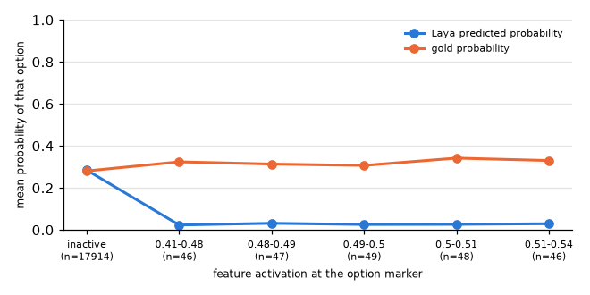

# Feature 2126

Critérios em que aparece: corr_error, corr_probe_right_laya_wrong

**Interpretação (preencher):** 

---

## Maiores ativações

**tr_customer_service_000287 / needs_human** (noul, customer_service) | ativação 4.156 em `estado` | opções ['false', 'true'] | Laya: **true** [0.122, 0.878] | gabarito: **true**

```
<bos> noul question: This conversation requires a human agent rather than automated handling.<eos>
▸ <mask> false: Automation can carry this to resolution.
▸ <mask> true: A human must take over: judgement, authority or empathy is required.

<eos>

 {"account": {"lifetime_value_usd": 400, "prior_tickets_90d": 0, "seats": 40, "tenure_months": 5, "tier": "premium"}, "thread": [{"role": "customer", "text": "I’m⟦ fed⟧ up with this service. I want my account closed right now—no more emails, no more charges."}, {"role": "agent", "text": "I understand your frustration. Could you please confirm the email address associated with the account so I can locate it?"}, {"role": "customer", "text": "It’s the same one you have on file, but I’m telling you outright: terminate everything immediately."}, {"role": "agent", "text": "Thanks for confirming. To proceed, could you also provide the last four digits of the payment method on record?"}, {"role": "customer", "text": "Fine—4112. I expect this to be done without any more back‑and‑forth."}]}<eos>
```

**tr_customer_service_000287 / churn_risk** (score, customer_service) | ativação 4.102 em `estado` | opções ['0', '1', '2', '3'] | Laya: **3** [0.007, 0.067, 0.024, 0.902] | gabarito: **3**

```
<bos> score question: How likely is this customer to stop doing business with us because of this interaction?<eos>
▸ <mask> level 0: No sign of dissatisfaction.
▸ <mask> level 1: Mild frustration, but the relationship is intact.
▸ <mask> level 2: Clearly unhappy; repeat problems or explicit complaints.
▸ <mask> level 3: Imminent: threatening to cancel, dispute or leave.

<eos>

 {"account": {"lifetime_value_usd": 400, "prior_tickets_90d": 0, "seats": 40, "tenure_months": 5, "tier": "premium"}, "thread": [{"role": "customer", "text": "I’m⟦ fed⟧ up with this service. I want my account closed right now—no more emails, no more charges."}, {"role": "agent", "text": "I understand your frustration. Could you please confirm the email address associated with the account so I can locate it?"}, {"role": "customer", "text": "It’s the same one you have on file, but I’m telling you outright: terminate everything immediately."}, {"role": "agent", "text": "Thanks for confirming. To proceed, could you also provide the last four digits of the payment method on record?"}, {"role": "customer", "text": "Fine—4112. I expect this to be done without any more back‑and‑forth."}]}<eos>
```

**tr_customer_service_000287 / urgency** (score, customer_service) | ativação 4.012 em `estado` | opções ['0', '1', '2', '3'] | Laya: **3** [0.083, 0.113, 0.322, 0.483] | gabarito: **3**

```
<bos> score question: How time-sensitive is this conversation?<eos>
▸ <mask> level 0: No time pressure; can wait indefinitely.
▸ <mask> level 1: Routine; handle within the normal queue.
▸ <mask> level 2: Elevated; should be handled within the same week.
▸ <mask> level 3: Critical; requires action within the same day.

<eos>

 {"account": {"lifetime_value_usd": 400, "prior_tickets_90d": 0, "seats": 40, "tenure_months": 5, "tier": "premium"}, "thread": [{"role": "customer", "text": "I’m⟦ fed⟧ up with this service. I want my account closed right now—no more emails, no more charges."}, {"role": "agent", "text": "I understand your frustration. Could you please confirm the email address associated with the account so I can locate it?"}, {"role": "customer", "text": "It’s the same one you have on file, but I’m telling you outright: terminate everything immediately."}, {"role": "agent", "text": "Thanks for confirming. To proceed, could you also provide the last four digits of the payment method on record?"}, {"role": "customer", "text": "Fine—4112. I expect this to be done without any more back‑and‑forth."}]}<eos>
```

**tr_customer_service_000287 / category** (choice, customer_service) | ativação 3.998 em `estado` | opções ['account', 'billing', 'delivery', 'refund', 'technical'] | Laya: **refund** [0.309, 0.024, 0.002, 0.577, 0.088] | gabarito: **account**

```
<bos> choice question: What is this customer conversation primarily about?<eos>
▸ <mask> account: Login, plan changes, profile or access management.
▸ <mask> billing: A charge, invoice, subscription or payment problem.
▸ <mask> delivery: Shipping, fulfilment or delivery of a physical item.
▸ <mask> refund: The customer is explicitly asking for money back.
▸ <mask> technical: The product or service is not working as expected.

<eos>

 {"account": {"lifetime_value_usd": 400, "prior_tickets_90d": 0, "seats": 40, "tenure_months": 5, "tier": "premium"}, "thread": [{"role": "customer", "text": "I’m⟦ fed⟧ up with this service. I want my account closed right now—no more emails, no more charges."}, {"role": "agent", "text": "I understand your frustration. Could you please confirm the email address associated with the account so I can locate it?"}, {"role": "customer", "text": "It’s the same one you have on file, but I’m telling you outright: terminate everything immediately."}, {"role": "agent", "text": "Thanks for confirming. To proceed, could you also provide the last four digits of the payment method on record?"}, {"role": "customer", "text": "Fine—4112. I expect this to be done without any more back‑and‑forth."}]}<eos>
```

**tr_customer_service_000287 / action** (choice, customer_service) | ativação 3.967 em `estado` | opções ['answer_directly', 'close_no_action', 'escalate_to_human', 'execute_refund', 'request_information'] | Laya: **close_no_action** [0.095, 0.859, 0.006, 0.039, 0.002] | gabarito: **escalate_to_human**

```
<bos> choice question: What should the assistant do next with this conversation?<eos>
▸ <mask> answer_directly: The assistant can resolve this itself with information it already has.
▸ <mask> close_no_action: No further action is warranted; the matter is settled.
▸ <mask> escalate_to_human: Hand off to a human agent with the appropriate authority.
▸ <mask> execute_refund: Issue the refund or credit the customer is owed.
▸ <mask> request_information: More detail is needed from the customer before anything can be done.

<eos>

 {"account": {"lifetime_value_usd": 400, "prior_tickets_90d": 0, "seats": 40, "tenure_months": 5, "tier": "premium"}, "thread": [{"role": "customer", "text": "I’m⟦ fed⟧ up with this service. I want my account closed right now—no more emails, no more charges."}, {"role": "agent", "text": "I understand your frustration. Could you please confirm the email address associated with the account so I can locate it?"}, {"role": "customer", "text": "It’s the same one you have on file, but I’m telling you outright: terminate everything immediately."}, {"role": "agent", "text": "Thanks for confirming. To proceed, could you also provide the last four digits of the payment method on record?"}, {"role": "customer", "text": "Fine—4112. I expect this to be done without any more back‑and‑forth."}]}<eos>
```

## Ativações medianas (faixa 40-60%, mediana 0.536)

**tr_invoice_processing_000281 / disposition** (choice, invoice_processing) | ativação 0.511 em `marcador` | opções ['approve', 'hold', 'manual_review', 'reject'] | Laya: **hold** [0.339, 0.342, 0.049, 0.27] | gabarito: **hold**

```
<bos> choice question: How should this vendor invoice be dispositioned?<eos>
▸ <mask> approve: Matches the order and delivery; approve for payment.
▸ <mask> hold: Something needs confirming before payment; hold pending clarification.
▸ ⟦<mask>⟧ manual_review: A human in finance must review the discrepancy.
▸ <mask> reject: Should not be paid: duplicate, unauthorised or materially wrong.

<eos>

 {"delivery": {"condition": "accepted", "date": null, "received_qty": 0}, "invoice": {"currency": "USD", "id": "INV-2026-1417", "lines": [{"qty": 50, "sku": "SKU-310", "total_usd": 11531.0, "unit_usd": 230.62}], "total_usd": 11531.0, "vendor": "Orbit Logistics"}, "payment": {"days_until_due": 18, "discount_expires_in_days": null, "early_payment_discount_pct": null, "status": "scheduled", "terms": "net 30"}, "purchase_order": {"freight_terms": "freight prepaid by vendor, not separately billable", "id": "PO-4042", "lines": [{"qty": 50, "unit_usd": 230.62}], "total_usd": 11531.0}, "vendor_history": {"disputes_12m": 1, "invoices_12m": 20, "prior_invoice_ids": ["INV-2026-3644"]}}<eos>
```

**tr_invoice_processing_000214 / disposition** (choice, invoice_processing) | ativação 0.519 em `marcador` | opções ['approve', 'hold', 'manual_review', 'reject'] | Laya: **approve** [0.566, 0.12, 0.029, 0.285] | gabarito: **approve**

```
<bos> choice question: How should this vendor invoice be dispositioned?<eos>
▸ <mask> approve: Matches the order and delivery; approve for payment.
▸ <mask> hold: Something needs confirming before payment; hold pending clarification.
▸ ⟦<mask>⟧ manual_review: A human in finance must review the discrepancy.
▸ <mask> reject: Should not be paid: duplicate, unauthorised or materially wrong.

<eos>

 {"delivery": {"condition": "accepted", "date": "2026-03-07", "received_qty": 100}, "invoice": {"currency": "USD", "id": "INV-2026-1869", "lines": [{"qty": 100, "sku": "SKU-904", "total_usd": 19005.0, "unit_usd": 190.05}], "total_usd": 19005.0, "vendor": "Vantage Materials"}, "payment": {"days_until_due": 44, "discount_expires_in_days": 6, "early_payment_discount_pct": 2.0, "status": "scheduled", "terms": "net 15"}, "purchase_order": {"freight_terms": "freight prepaid by vendor, not separately billable", "id": "PO-8011", "lines": [{"qty": 100, "unit_usd": 190.05}], "total_usd": 19005.0}, "vendor_history": {"disputes_12m": 1, "invoices_12m": 54, "prior_invoice_ids": ["INV-2026-3002", "INV-2026-1460", "INV-2026-8867", "INV-2026-8047"]}}<eos>
```

**tr_invoice_processing_000286 / disposition** (choice, invoice_processing) | ativação 0.510 em `marcador` | opções ['approve', 'hold', 'manual_review', 'reject'] | Laya: **approve** [0.625, 0.087, 0.021, 0.266] | gabarito: **manual_review**

```
<bos> choice question: How should this vendor invoice be dispositioned?<eos>
▸ <mask> approve: Matches the order and delivery; approve for payment.
▸ <mask> hold: Something needs confirming before payment; hold pending clarification.
▸ ⟦<mask>⟧ manual_review: A human in finance must review the discrepancy.
▸ <mask> reject: Should not be paid: duplicate, unauthorised or materially wrong.

<eos>

 {"delivery": {"condition": "accepted", "date": "2026-03-01", "received_qty": 250}, "invoice": {"currency": "USD", "id": "INV-2026-8786", "lines": [{"qty": 250, "sku": "SKU-448", "total_usd": 7165.0, "unit_usd": 28.66}, {"qty": 1, "sku": "FREIGHT", "total_usd": 401.46, "unit_usd": 401.46}], "total_usd": 7566.46, "vendor": "Northwind Components"}, "payment": {"days_until_due": 2, "discount_expires_in_days": 1, "early_payment_discount_pct": 2.0, "status": "scheduled", "terms": "net 60"}, "purchase_order": {"freight_terms": "freight prepaid by vendor, not separately billable", "id": "PO-7457", "lines": [{"qty": 250, "unit_usd": 28.66}], "total_usd": 7165.0}, "vendor_history": {"disputes_12m": 0, "invoices_12m": 13, "prior_invoice_ids": ["INV-2026-4234", "INV-2026-5783", "INV-2026-1864"]}}<eos>
```

**tr_invoice_processing_000016 / disposition** (choice, invoice_processing) | ativação 0.521 em `marcador` | opções ['approve', 'hold', 'manual_review', 'reject'] | Laya: **reject** [0.427, 0.07, 0.022, 0.48] | gabarito: **approve**

```
<bos> choice question: How should this vendor invoice be dispositioned?<eos>
▸ <mask> approve: Matches the order and delivery; approve for payment.
▸ <mask> hold: Something needs confirming before payment; hold pending clarification.
▸ ⟦<mask>⟧ manual_review: A human in finance must review the discrepancy.
▸ <mask> reject: Should not be paid: duplicate, unauthorised or materially wrong.

<eos>

 {"delivery": {"condition": "accepted with exceptions", "date": "2026-03-28", "received_qty": 1000}, "invoice": {"currency": "USD", "id": "INV-2026-8778", "lines": [{"qty": 1000, "sku": "SKU-775", "total_usd": 127100.0, "unit_usd": 127.1}], "total_usd": 127100.0, "vendor": "Orbit Logistics"}, "payment": {"days_until_due": -3, "discount_expires_in_days": 7, "early_payment_discount_pct": 2.0, "status": "overdue", "terms": "net 45"}, "purchase_order": {"freight_terms": "freight prepaid by vendor, not separately billable", "id": "PO-6321", "lines": [{"qty": 1000, "unit_usd": 127.1}], "total_usd": 127100.0}, "vendor_history": {"disputes_12m": 1, "invoices_12m": 42, "prior_invoice_ids": ["INV-2026-3448", "INV-2026-4066", "INV-2026-6920", "INV-2026-6288"]}}<eos>
```

**tr_invoice_processing_000219 / disposition** (choice, invoice_processing) | ativação 0.512 em `marcador` | opções ['approve', 'hold', 'manual_review', 'reject'] | Laya: **approve** [0.561, 0.191, 0.031, 0.218] | gabarito: **approve**

```
<bos> choice question: How should this vendor invoice be dispositioned?<eos>
▸ <mask> approve: Matches the order and delivery; approve for payment.
▸ <mask> hold: Something needs confirming before payment; hold pending clarification.
▸ ⟦<mask>⟧ manual_review: A human in finance must review the discrepancy.
▸ <mask> reject: Should not be paid: duplicate, unauthorised or materially wrong.

<eos>

 {"delivery": {"condition": "accepted", "date": "2026-03-15", "received_qty": 25}, "invoice": {"currency": "USD", "id": "INV-2026-4321", "lines": [{"qty": 25, "sku": "SKU-749", "total_usd": 10465.25, "unit_usd": 418.61}], "total_usd": 10465.25, "vendor": "Orbit Logistics"}, "payment": {"days_until_due": 2, "discount_expires_in_days": 7, "early_payment_discount_pct": 2.0, "status": "scheduled", "terms": "net 15"}, "purchase_order": {"freight_terms": "freight prepaid by vendor, not separately billable", "id": "PO-7678", "lines": [{"qty": 25, "unit_usd": 418.61}], "total_usd": 10465.25}, "vendor_history": {"disputes_12m": 0, "invoices_12m": 26, "prior_invoice_ids": ["INV-2026-4321", "INV-2026-7478", "INV-2026-8769", "INV-2026-2219"]}}<eos>
```

## Estatísticas (conjunto de descoberta, dev e teste)

**pred / error**

| split | decisões | ativas | ativas e Laya errou | taxa | lift | q (BH) | OR (CMH) | q (CMH) |
|---|---|---|---|---|---|---|---|---|
| discovery | 5100 | 0 | 0 | nan | nan | nan | nan | nan |
| dev | 900 | 0 | 0 | nan | nan | nan | nan | nan |
| test | 2000 | 2 | 1 | 0.500 | 0.77 | nan | nan | nan |

**corr / error**

| split | decisões | ativas | ativas e Laya errou | taxa | lift | q (BH) | OR (CMH) | q (CMH) |
|---|---|---|---|---|---|---|---|---|
| discovery | 5100 | 80 | 80 | 1.000 | 1.55 | 3.2e-15 | inf | 0.0483 |
| dev | 900 | 23 | 23 | 1.000 | 1.49 | 0.000578 | inf | 0.778 |
| test | 2000 | 38 | 37 | 0.974 | 1.50 | 8.85e-06 | 3.87 | 0.503 |

**state / error**

| split | decisões | ativas | ativas e Laya errou | taxa | lift | q (BH) | OR (CMH) | q (CMH) |
|---|---|---|---|---|---|---|---|---|
| discovery | 5100 | 255 | 152 | 0.596 | 0.93 | 0.242 | 1.15 | 0.683 |
| dev | 900 | 56 | 35 | 0.625 | 0.93 | 0.85 | 1.30 | 0.777 |
| test | 2000 | 131 | 77 | 0.588 | 0.90 | 0.394 | 0.95 | 0.948 |

**pred / probe_right_laya_wrong**

| split | decisões | ativas | ativas e Laya errou | taxa | lift | q (BH) | OR (CMH) | q (CMH) |
|---|---|---|---|---|---|---|---|---|
| discovery | 2819 | 0 | 0 | nan | nan | nan | nan | nan |
| dev | 520 | 0 | 0 | nan | nan | nan | nan | nan |
| test | 1106 | 1 | 0 | 0.000 | 0.00 | nan | nan | nan |

**corr / probe_right_laya_wrong**

| split | decisões | ativas | ativas e Laya errou | taxa | lift | q (BH) | OR (CMH) | q (CMH) |
|---|---|---|---|---|---|---|---|---|
| discovery | 2819 | 34 | 34 | 1.000 | 1.55 | 1.38e-06 | inf | 0.333 |
| dev | 520 | 10 | 10 | 1.000 | 1.48 | nan | nan | nan |
| test | 1106 | 20 | 19 | 0.950 | 1.50 | 0.00447 | 2.08 | 0.774 |

**state / probe_right_laya_wrong**

| split | decisões | ativas | ativas e Laya errou | taxa | lift | q (BH) | OR (CMH) | q (CMH) |
|---|---|---|---|---|---|---|---|---|
| discovery | 2819 | 159 | 84 | 0.528 | 0.82 | 0.00714 | 0.90 | 0.787 |
| dev | 520 | 31 | 20 | 0.645 | 0.96 | 1 | 1.68 | 0.576 |
| test | 1106 | 81 | 42 | 0.519 | 0.82 | 0.135 | 0.67 | 0.402 |

Confusão mais sobre-representada (corr): `disposition|0>2` (n=45, lift 49.46, p=0). Formato `pergunta|índice previsto>índice correto`.

Confusão mais sobre-representada (state): `category|4>0` (n=4, lift 8.00, p=0.00101). Formato `pergunta|índice previsto>índice correto`.



