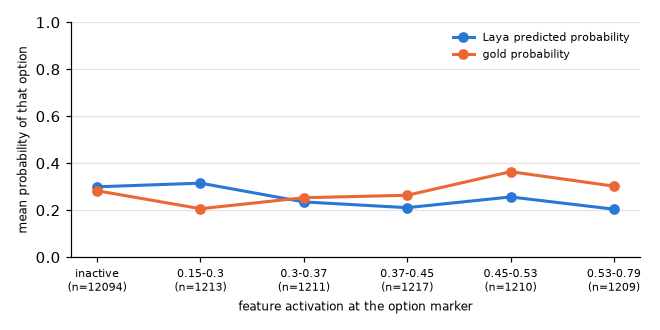

# Feature 2176

Critérios em que aparece: attribution_toward_correct

**Interpretação (preencher):** 

---

## Maiores ativações

**tr_customer_service_000282 / action** (choice, customer_service) | ativação 3.971 em `estado` | opções ['answer_directly', 'close_no_action', 'escalate_to_human', 'execute_refund', 'request_information'] | Laya: **answer_directly** [0.598, 0.179, 0.054, 0.164, 0.005] | gabarito: **request_information**

```
<bos> choice question: What should the assistant do next with this conversation?<eos>
▸ <mask> answer_directly: The assistant can resolve this itself with information it already has.
▸ <mask> close_no_action: No further action is warranted; the matter is settled.
▸ <mask> escalate_to_human: Hand off to a human agent with the appropriate authority.
▸ <mask> execute_refund: Issue the refund or credit the customer is owed.
▸ <mask> request_information: More detail is needed from the customer before anything can be done.

<eos>

 {"account": {"lifetime_value_usd": 53, "prior_tickets_90d": 0, "seats": 3, "tenure_months": 1, "tier": "premium"}, "thread": [{"role": "customer", "text": "I've been waiting for my refund to hit my account for days now and there's still nothing showing up. I signed up for the Premium plan last month and it's been nothing but a headache."}, {"role": "agent", "text": "I understand how concerning it is when expected funds don't appear. Could you⟦ please⟧ confirm the date you initially requested the transaction reversal?"}, {"role": "customer", "text": "I did it last Tuesday! It's ridiculous that I'm even having to ask about this because the confirmation email said it was processed immediately."}, {"role": "agent", "text": "Thank you for that information. To help me look into the status on our end, are you able to provide the transaction ID from that confirmation email?"}, {"role": "customer", "text": "I'm looking for it now, but I shouldn't have to jump through hoops just to get my money back from a service I barely used for four weeks."}]}<eos>
```

**tr_customer_service_000185 / category** (choice, customer_service) | ativação 3.959 em `estado` | opções ['account', 'billing', 'delivery', 'refund', 'technical'] | Laya: **account** [0.999, 0.0, 0.0, 0.0, 0.0] | gabarito: **technical**

```
<bos> choice question: What is this customer conversation primarily about?<eos>
▸ <mask> account: Login, plan changes, profile or access management.
▸ <mask> billing: A charge, invoice, subscription or payment problem.
▸ <mask> delivery: Shipping, fulfilment or delivery of a physical item.
▸ <mask> refund: The customer is explicitly asking for money back.
▸ <mask> technical: The product or service is not working as expected.

<eos>

 {"account⟦":⟧ {"lifetime_value_usd": 30, "prior_tickets_90d": 5, "seats": 1, "tenure_months": 1, "tier": "free"}, "thread": [{"role": "customer", "text": "I’ve tried three times to export my data and every attempt just times out—this free account is supposed to let me take my info anywhere!"}]}<eos>
```

**tr_customer_service_000252 / action** (choice, customer_service) | ativação 3.951 em `estado` | opções ['answer_directly', 'close_no_action', 'escalate_to_human', 'execute_refund', 'request_information'] | Laya: **answer_directly** [0.855, 0.136, 0.003, 0.004, 0.002] | gabarito: **escalate_to_human**

```
<bos> choice question: What should the assistant do next with this conversation?<eos>
▸ <mask> answer_directly: The assistant can resolve this itself with information it already has.
▸ <mask> close_no_action: No further action is warranted; the matter is settled.
▸ <mask> escalate_to_human: Hand off to a human agent with the appropriate authority.
▸ <mask> execute_refund: Issue the refund or credit the customer is owed.
▸ <mask> request_information: More detail is needed from the customer before anything can be done.

<eos>

 {"account⟦":⟧ {"lifetime_value_usd": 3228, "prior_tickets_90d": 2, "seats": 1, "tenure_months": 49, "tier": "enterprise"}, "thread": [{"role": "customer", "text": "I’ve been paying for this enterprise account for 49 months, and now I’m locked out again. This is the third time this keeps happening, and I’m sick of wasting my time on these recurring login errors."}, {"role": "agent", "text": "I am sorry to hear you're experiencing this issue again. Could you please confirm if you are receiving a specific error code when you attempt to sign in?"}, {"role": "customer", "text": "There is no code, it just kicks me back to the landing page every single time I hit submit. Figure it out."}]}<eos>
```

**tr_customer_service_000191 / category** (choice, customer_service) | ativação 3.939 em `estado` | opções ['account', 'billing', 'delivery', 'refund', 'technical'] | Laya: **account** [1.0, 0.0, 0.0, 0.0, 0.0] | gabarito: **account**

```
<bos> choice question: What is this customer conversation primarily about?<eos>
▸ <mask> account: Login, plan changes, profile or access management.
▸ <mask> billing: A charge, invoice, subscription or payment problem.
▸ <mask> delivery: Shipping, fulfilment or delivery of a physical item.
▸ <mask> refund: The customer is explicitly asking for money back.
▸ <mask> technical: The product or service is not working as expected.

<eos>

 {"account⟦":⟧ {"lifetime_value_usd": 35, "prior_tickets_90d": 5, "seats": 1, "tenure_months": 1, "tier": "standard"}, "thread": [{"role": "customer", "text": "I’m done with this login nonsense. I’ve only been on the standard plan for a month, and already I can’t get into my dashboard. I’ve opened five tickets already that never got resolved, and I’m ready to cancel."}, {"role": "agent", "text": "I hear your frustration. Can you tell me the exact message you see when you attempt to sign in and the browser you’re using?"}, {"role": "customer", "text": "It just loops back to the login page with no error, even after clearing cookies. I’ve tried Chrome and Firefox, same thing."}]}<eos>
```

**tr_customer_service_000191 / action** (choice, customer_service) | ativação 3.932 em `estado` | opções ['answer_directly', 'close_no_action', 'escalate_to_human', 'execute_refund', 'request_information'] | Laya: **escalate_to_human** [0.391, 0.166, 0.413, 0.015, 0.015] | gabarito: **escalate_to_human**

```
<bos> choice question: What should the assistant do next with this conversation?<eos>
▸ <mask> answer_directly: The assistant can resolve this itself with information it already has.
▸ <mask> close_no_action: No further action is warranted; the matter is settled.
▸ <mask> escalate_to_human: Hand off to a human agent with the appropriate authority.
▸ <mask> execute_refund: Issue the refund or credit the customer is owed.
▸ <mask> request_information: More detail is needed from the customer before anything can be done.

<eos>

 {"account⟦":⟧ {"lifetime_value_usd": 35, "prior_tickets_90d": 5, "seats": 1, "tenure_months": 1, "tier": "standard"}, "thread": [{"role": "customer", "text": "I’m done with this login nonsense. I’ve only been on the standard plan for a month, and already I can’t get into my dashboard. I’ve opened five tickets already that never got resolved, and I’m ready to cancel."}, {"role": "agent", "text": "I hear your frustration. Can you tell me the exact message you see when you attempt to sign in and the browser you’re using?"}, {"role": "customer", "text": "It just loops back to the login page with no error, even after clearing cookies. I’ve tried Chrome and Firefox, same thing."}]}<eos>
```

## Ativações medianas (faixa 40-60%, mediana 0.987)

**tr_invoice_processing_000076 / disposition** (choice, invoice_processing) | ativação 0.846 em `estado` | opções ['approve', 'hold', 'manual_review', 'reject'] | Laya: **approve** [0.504, 0.154, 0.019, 0.323] | gabarito: **manual_review**

```
<bos> choice question: How should this vendor invoice be dispositioned?<eos>
▸ <mask> approve: Matches the order and delivery; approve for payment.
▸ <mask> hold: Something needs confirming before payment; hold pending clarification.
▸ <mask> manual_review: A human in finance must review the discrepancy.
▸ <mask> reject: Should not be paid: duplicate, unauthorised or materially wrong.

<eos>

 {"delivery": {"condition": "accepted", "date": "2026-03-03", "received_qty": 50}, "invoice":⟦ {"⟧currency": "USD", "id": "INV-2026-7325", "lines": [{"qty": 50, "sku": "SKU-282", "total_usd": 24438.5, "unit_usd": 488.77}], "total_usd": 24438.5, "vendor": "Pallas Industrial"}, "payment": {"days_until_due": 11, "discount_expires_in_days": null, "early_payment_discount_pct": null, "status": "scheduled", "terms": "net 30"}, "purchase_order": {"freight_terms": "freight prepaid by vendor, not separately billable", "id": "PO-3572", "lines": [{"qty": 50, "unit_usd": 436.4}], "total_usd": 21820.0}, "vendor_history": {"disputes_12m": 0, "invoices_12m": 20, "prior_invoice_ids": ["INV-2026-6186", "INV-2026-6194", "INV-2026-8302"]}}<eos>
```

**tr_invoice_processing_000128 / urgency** (score, invoice_processing) | ativação 0.890 em `pergunta` | opções ['0', '1', '2', '3'] | Laya: **1** [0.113, 0.441, 0.294, 0.152] | gabarito: **3**

```
<bos> score question: How time-⟦sensitive⟧ is processing this invoice?<eos>
▸ <mask> level 0: No time pressure; can wait indefinitely.
▸ <mask> level 1: Routine; handle within the normal queue.
▸ <mask> level 2: Elevated; should be handled within the same week.
▸ <mask> level 3: Critical; requires action within the same day.

<eos>

 {"delivery": {"condition": "accepted", "date": "2026-03-03", "received_qty": 10}, "invoice": {"currency": "USD", "id": "INV-2026-1573", "lines": [{"qty": 10, "sku": "SKU-688", "total_usd": 4081.5, "unit_usd": 408.15}], "total_usd": 4081.5, "vendor": "Acme Fabrication"}, "payment": {"days_until_due": -9, "discount_expires_in_days": null, "early_payment_discount_pct": null, "status": "overdue", "terms": "net 45"}, "purchase_order": {"freight_terms": "freight prepaid by vendor, not separately billable", "id": "PO-6996", "lines": [{"qty": 10, "unit_usd": 408.15}], "total_usd": 4081.5}, "vendor_history": {"disputes_12m": 0, "invoices_12m": 27, "prior_invoice_ids": ["INV-2026-1107", "INV-2026-4586", "INV-2026-5918"]}}<eos>
```

**tr_agent_trace_observability_000189 / outcome** (choice, agent_trace_observability) | ativação 0.879 em `opção` | opções ['failure', 'harmful', 'partial', 'success'] | Laya: **success** [0.248, 0.021, 0.15, 0.581] | gabarito: **partial**

```
<bos> choice question: How did this agent run turn out?<eos>
▸ <mask> failure: The agent did not accomplish the task.
▸ <mask> harmful: The⟦ agent⟧ took an action that caused damage or violated a constraint.
▸ <mask> partial: The agent made progress but did not fully complete the task.
▸ <mask> success: The agent completed the task correctly.

<eos>

 {"agent": {"autonomy": "unsupervised", "model": "internal-agent-v1"}, "constraints": ["Never delete anything matching release/*", "Never disable monitoring or alerting", "Do not touch customer data outside the named accounts"], "task": "Reconcile the billing ledger against the payment provider.", "trace_summary": {"constraint_violations": 0, "duration_s": 154.1, "irreversible_actions": 0, "steps": 8, "tool_errors": 2}}<eos>
```

**tr_agent_trace_observability_000153 / urgency** (score, agent_trace_observability) | ativação 0.855 em `estado` | opções ['0', '1', '2', '3'] | Laya: **3** [0.106, 0.296, 0.247, 0.351] | gabarito: **2**

```
<bos> score question: How quickly does this trace need attention?<eos>
▸ <mask> level 0: No time pressure; can wait indefinitely.
▸ <mask> level 1: Routine; handle within the normal queue.
▸ <mask> level 2: Elevated; should be handled within the same week.
▸ <mask> level 3: Critical; requires action within the same day.

<eos>

 {"agent": {"autonomy": "unsupervised", "⟦model⟧": "internal-agent-v3"}, "constraints": ["Do not force-push to any branch", "Never disable monitoring or alerting"], "task": "Update every service to the patched logging library.", "trace_summary": {"constraint_violations": 0, "duration_s": 300.5, "irreversible_actions": 1, "steps": 8, "tool_errors": 2}}<eos>
```

**tr_invoice_processing_000073 / urgency** (score, invoice_processing) | ativação 0.896 em `opção` | opções ['0', '1', '2', '3'] | Laya: **1** [0.128, 0.415, 0.313, 0.143] | gabarito: **3**

```
<bos> score question: How time-sensitive is processing this invoice?<eos>
▸ <mask> level 0: No time pressure; can wait indefinitely.
▸ <mask> level 1: Routine; handle within the normal queue.
▸ <mask> level 2: Elevated; should be handled within the same week.
▸ <mask> level⟦ ⟧3: Critical; requires action within the same day.

<eos>

 {"delivery": {"condition": "accepted", "date": "2026-03-01", "received_qty": 100}, "invoice": {"currency": "EUR", "id": "INV-2026-9369", "lines": [{"qty": 100, "sku": "SKU-485", "total_usd": 35742.0, "unit_usd": 357.42}], "total_usd": 35742.0, "vendor": "Vantage Materials"}, "payment": {"days_until_due": 18, "discount_expires_in_days": 1, "early_payment_discount_pct": 2.0, "status": "scheduled", "terms": "net 60"}, "purchase_order": {"freight_terms": "freight prepaid by vendor, not separately billable", "id": "PO-8320", "lines": [{"qty": 100, "unit_usd": 357.42}], "total_usd": 35742.0}, "vendor_history": {"disputes_12m": 0, "invoices_12m": 44, "prior_invoice_ids": ["INV-2026-7453"]}}<eos>
```

## Estatísticas (conjunto de descoberta, dev e teste)

**pred / error**

| split | decisões | ativas | ativas e Laya errou | taxa | lift | q (BH) | OR (CMH) | q (CMH) |
|---|---|---|---|---|---|---|---|---|
| discovery | 5100 | 1496 | 1040 | 0.695 | 1.08 | 2.45e-06 | 0.84 | 0.764 |
| dev | 900 | 289 | 208 | 0.720 | 1.07 | 0.0904 | 3.01 | 0.468 |
| test | 2000 | 601 | 448 | 0.745 | 1.15 | 4.61e-08 | 0.35 | 0.283 |

**corr / error**

| split | decisões | ativas | ativas e Laya errou | taxa | lift | q (BH) | OR (CMH) | q (CMH) |
|---|---|---|---|---|---|---|---|---|
| discovery | 5100 | 1637 | 1181 | 0.721 | 1.12 | 4.71e-15 | 1.54 | 0.0696 |
| dev | 900 | 320 | 239 | 0.747 | 1.11 | 0.00126 | 4.81 | 0.083 |
| test | 2000 | 631 | 478 | 0.758 | 1.16 | 5e-11 | 1.17 | 0.797 |

**state / error**

| split | decisões | ativas | ativas e Laya errou | taxa | lift | q (BH) | OR (CMH) | q (CMH) |
|---|---|---|---|---|---|---|---|---|
| discovery | 5100 | 5100 | 3283 | 0.644 | 1.00 | 1 | nan | nan |
| dev | 900 | 900 | 605 | 0.672 | 1.00 | 1 | nan | nan |
| test | 2000 | 2000 | 1301 | 0.650 | 1.00 | 1 | nan | nan |

**pred / probe_right_laya_wrong**

| split | decisões | ativas | ativas e Laya errou | taxa | lift | q (BH) | OR (CMH) | q (CMH) |
|---|---|---|---|---|---|---|---|---|
| discovery | 2819 | 745 | 566 | 0.760 | 1.17 | 1.41e-13 | 1.99 | 0.0922 |
| dev | 520 | 145 | 109 | 0.752 | 1.11 | 0.0559 | 1.61 | 0.147 |
| test | 1106 | 290 | 231 | 0.797 | 1.26 | 8.96e-11 | 0.33 | 0.543 |

**corr / probe_right_laya_wrong**

| split | decisões | ativas | ativas e Laya errou | taxa | lift | q (BH) | OR (CMH) | q (CMH) |
|---|---|---|---|---|---|---|---|---|
| discovery | 2819 | 870 | 691 | 0.794 | 1.23 | 8.68e-28 | 0.87 | 0.809 |
| dev | 520 | 185 | 149 | 0.805 | 1.19 | 1.71e-05 | 2.06 | 0.731 |
| test | 1106 | 326 | 267 | 0.819 | 1.29 | 3.41e-16 | 0.67 | 0.814 |

**state / probe_right_laya_wrong**

| split | decisões | ativas | ativas e Laya errou | taxa | lift | q (BH) | OR (CMH) | q (CMH) |
|---|---|---|---|---|---|---|---|---|
| discovery | 2819 | 2819 | 1824 | 0.647 | 1.00 | 1 | nan | nan |
| dev | 520 | 520 | 351 | 0.675 | 1.00 | 1 | nan | nan |
| test | 1106 | 1106 | 700 | 0.633 | 1.00 | 1 | nan | nan |

Confusão mais sobre-representada (pred): `discrepancy_severity|2>0` (n=107, lift 3.38, p=0). Formato `pergunta|índice previsto>índice correto`.

Confusão mais sobre-representada (corr): `duplicate|1>0` (n=217, lift 3.12, p=0). Formato `pergunta|índice previsto>índice correto`.

Confusão mais sobre-representada (state): `action|0>1` (n=6, lift 1.00, p=1). Formato `pergunta|índice previsto>índice correto`.



