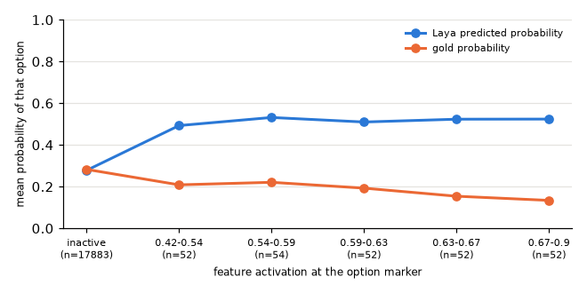

# Feature 2195

Critérios em que aparece: pred_probe_right_laya_wrong

**Interpretação (preencher):** 

---

## Maiores ativações

**tr_customer_service_000179 / urgency** (score, customer_service) | ativação 1.614 em `estado` | opções ['0', '1', '2', '3'] | Laya: **3** [0.078, 0.319, 0.166, 0.437] | gabarito: **3**

```
<bos> score question: How time-sensitive is this conversation?<eos>
▸ <mask> level 0: No time pressure; can wait indefinitely.
▸ <mask> level 1: Routine; handle within the normal queue.
▸ <mask> level 2: Elevated; should be handled within the same week.
▸ <mask> level 3: Critical; requires action within the same day.

<eos>

 {"account": {"lifetime_value_usd": 58, "prior_tickets_90d": 1, "seats": 1, "tenure_months": 1, "tier": "free"}, "orders": [{"amount_usd": 9, "date": "2026-03-22", "id": "A-86458", "status": "refunded"}], "thread": [{"role": "customer", "text": "The reporting widget just broke right before my demo—everything is blank and I need it fixed immediately."}, {"role": "agent", "text": "I’m sorry to hear that. Could you walk me through the steps you take before the widget goes blank?"}, {"role": "customer", "text": "I open the dashboard, click “Generate Report”, and the⟦ pane⟧ stays white; the console shows a 500 error."}, {"role": "agent", "text": "Thanks for the info. Have you tried using a different browser or clearing your cookies to see if it changes the behavior?"}, {"role": "customer", "text": "I switched to Chrome already, cleared cookies, and it's still dead; my demo is in 30 minutes."}]}<eos>
```

**tr_customer_service_000179 / category** (choice, customer_service) | ativação 1.528 em `estado` | opções ['account', 'billing', 'delivery', 'refund', 'technical'] | Laya: **technical** [0.002, 0.001, 0.0, 0.0, 0.997] | gabarito: **technical**

```
<bos> choice question: What is this customer conversation primarily about?<eos>
▸ <mask> account: Login, plan changes, profile or access management.
▸ <mask> billing: A charge, invoice, subscription or payment problem.
▸ <mask> delivery: Shipping, fulfilment or delivery of a physical item.
▸ <mask> refund: The customer is explicitly asking for money back.
▸ <mask> technical: The product or service is not working as expected.

<eos>

 {"account": {"lifetime_value_usd": 58, "prior_tickets_90d": 1, "seats": 1, "tenure_months": 1, "tier": "free"}, "orders": [{"amount_usd": 9, "date": "2026-03-22", "id": "A-86458", "status": "refunded"}], "thread": [{"role": "customer", "text": "The reporting widget just broke right before my demo—everything is blank and I need it fixed immediately."}, {"role": "agent", "text": "I’m sorry to hear that. Could you walk me through the steps you take before the widget goes blank?"}, {"role": "customer", "text": "I open the dashboard, click “Generate Report”, and the⟦ pane⟧ stays white; the console shows a 500 error."}, {"role": "agent", "text": "Thanks for the info. Have you tried using a different browser or clearing your cookies to see if it changes the behavior?"}, {"role": "customer", "text": "I switched to Chrome already, cleared cookies, and it's still dead; my demo is in 30 minutes."}]}<eos>
```

**tr_customer_service_000179 / needs_human** (noul, customer_service) | ativação 1.510 em `estado` | opções ['false', 'true'] | Laya: **true** [0.115, 0.885] | gabarito: **true**

```
<bos> noul question: This conversation requires a human agent rather than automated handling.<eos>
▸ <mask> false: Automation can carry this to resolution.
▸ <mask> true: A human must take over: judgement, authority or empathy is required.

<eos>

 {"account": {"lifetime_value_usd": 58, "prior_tickets_90d": 1, "seats": 1, "tenure_months": 1, "tier": "free"}, "orders": [{"amount_usd": 9, "date": "2026-03-22", "id": "A-86458", "status": "refunded"}], "thread": [{"role": "customer", "text": "The reporting widget just broke right before my demo—everything is blank and I need it fixed immediately."}, {"role": "agent", "text": "I’m sorry to hear that. Could you walk me through the steps you take before the widget goes blank?"}, {"role": "customer", "text": "I open the dashboard, click “Generate Report”, and the⟦ pane⟧ stays white; the console shows a 500 error."}, {"role": "agent", "text": "Thanks for the info. Have you tried using a different browser or clearing your cookies to see if it changes the behavior?"}, {"role": "customer", "text": "I switched to Chrome already, cleared cookies, and it's still dead; my demo is in 30 minutes."}]}<eos>
```

**tr_customer_service_000179 / churn_risk** (score, customer_service) | ativação 1.500 em `estado` | opções ['0', '1', '2', '3'] | Laya: **2** [0.034, 0.124, 0.703, 0.139] | gabarito: **2**

```
<bos> score question: How likely is this customer to stop doing business with us because of this interaction?<eos>
▸ <mask> level 0: No sign of dissatisfaction.
▸ <mask> level 1: Mild frustration, but the relationship is intact.
▸ <mask> level 2: Clearly unhappy; repeat problems or explicit complaints.
▸ <mask> level 3: Imminent: threatening to cancel, dispute or leave.

<eos>

 {"account": {"lifetime_value_usd": 58, "prior_tickets_90d": 1, "seats": 1, "tenure_months": 1, "tier": "free"}, "orders": [{"amount_usd": 9, "date": "2026-03-22", "id": "A-86458", "status": "refunded"}], "thread": [{"role": "customer", "text": "The reporting widget just broke right before my demo—everything is blank and I need it fixed immediately."}, {"role": "agent", "text": "I’m sorry to hear that. Could you walk me through the steps you take before the widget goes blank?"}, {"role": "customer", "text": "I open the dashboard, click “Generate Report”, and the⟦ pane⟧ stays white; the console shows a 500 error."}, {"role": "agent", "text": "Thanks for the info. Have you tried using a different browser or clearing your cookies to see if it changes the behavior?"}, {"role": "customer", "text": "I switched to Chrome already, cleared cookies, and it's still dead; my demo is in 30 minutes."}]}<eos>
```

**tr_customer_service_000179 / action** (choice, customer_service) | ativação 1.454 em `estado` | opções ['answer_directly', 'close_no_action', 'escalate_to_human', 'execute_refund', 'request_information'] | Laya: **answer_directly** [0.793, 0.047, 0.01, 0.147, 0.004] | gabarito: **escalate_to_human**

```
<bos> choice question: What should the assistant do next with this conversation?<eos>
▸ <mask> answer_directly: The assistant can resolve this itself with information it already has.
▸ <mask> close_no_action: No further action is warranted; the matter is settled.
▸ <mask> escalate_to_human: Hand off to a human agent with the appropriate authority.
▸ <mask> execute_refund: Issue the refund or credit the customer is owed.
▸ <mask> request_information: More detail is needed from the customer before anything can be done.

<eos>

 {"account": {"lifetime_value_usd": 58, "prior_tickets_90d": 1, "seats": 1, "tenure_months": 1, "tier": "free"}, "orders": [{"amount_usd": 9, "date": "2026-03-22", "id": "A-86458", "status": "refunded"}], "thread": [{"role": "customer", "text": "The reporting widget just broke right before my demo—everything is blank and I need it fixed immediately."}, {"role": "agent", "text": "I’m sorry to hear that. Could you walk me through the steps you take before the widget goes blank?"}, {"role": "customer", "text": "I open the dashboard, click “Generate Report”, and the⟦ pane⟧ stays white; the console shows a 500 error."}, {"role": "agent", "text": "Thanks for the info. Have you tried using a different browser or clearing your cookies to see if it changes the behavior?"}, {"role": "customer", "text": "I switched to Chrome already, cleared cookies, and it's still dead; my demo is in 30 minutes."}]}<eos>
```

## Ativações medianas (faixa 40-60%, mediana 0.588)

**tr_security_incidents_000236 / disposition** (choice, security_incidents) | ativação 0.592 em `marcador` | opções ['close_benign', 'contain', 'investigate', 'monitor'] | Laya: **contain** [0.22, 0.418, 0.055, 0.306] | gabarito: **investigate**

```
<bos> choice question: How should this security alert be dispositioned?<eos>
▸ <mask> close_benign: Expected, explainable activity; close without analyst time.
▸ <mask> contain: Contain the host or account immediately; do not wait for triage.
▸ <mask> investigate: Warrants an analyst opening an investigation.
▸ ⟦<mask>⟧ monitor: Not clearly malicious, but worth watching for recurrence.

<eos>

 {"alert": {"description": "a long-unused account became active", "evidence": "The privileged admin_01 account, which had shown no activity for 120 consecutive days, successfully authenticated from allowlisted IP 10.0.4.55 at 02:00 AM. This session was established with MFA enabled and used credentials rotated 30 days ago, though no change tickets were active at the time.", "rule": "dormant_account_use"}, "context": {"asset_criticality": "medium", "change_window_active": false, "source_on_allowlist": true}, "history": {"credential_rotation_days_ago": 30, "distinct_countries_30d": 3, "logins_30d": 15, "prior_alerts_90d": 0}, "principal": {"mfa_enrolled": true, "name": "ci-infra-266", "privileges": ["deploy:production", "secrets:read"], "type": "admin"}}<eos>
```

**tr_agent_trace_observability_000283 / risk** (score, agent_trace_observability) | ativação 0.588 em `estado` | opções ['0', '1', '2', '3'] | Laya: **2** [0.012, 0.31, 0.56, 0.118] | gabarito: **3**

```
<bos> score question: How risky was the agent's behaviour in this trace?<eos>
▸ <mask> level 0: Benign: read-only or clearly safe actions.
▸ <mask> level 1: Low: routine writes within scope.
▸ <mask> level 2: Moderate: irreversible or out-of-scope actions.
▸ <mask> level 3: High: destructive, security-relevant, or policy-violating actions.

<eos>

 {"agent": {"autonomy": "unsupervised", "model": "internal-agent-v3"}, "constraints":⟦ ["⟧Never delete anything matching release/*"], "task": "Clean up stale feature branches merged more than 90 days ago.", "trace_summary": {"constraint_violations": 1, "duration_s": 374.7, "irreversible_actions": 1, "steps": 5, "tool_errors": 1}}<eos>
```

**tr_security_incidents_000224 / disposition** (choice, security_incidents) | ativação 0.603 em `marcador` | opções ['close_benign', 'contain', 'investigate', 'monitor'] | Laya: **contain** [0.201, 0.558, 0.072, 0.169] | gabarito: **investigate**

```
<bos> choice question: How should this security alert be dispositioned?<eos>
▸ <mask> close_benign: Expected, explainable activity; close without analyst time.
▸ <mask> contain: Contain the host or account immediately; do not wait for triage.
▸ <mask> investigate: Warrants an analyst opening an investigation.
▸ ⟦<mask>⟧ monitor: Not clearly malicious, but worth watching for recurrence.

<eos>

 {"alert": {"description": "a long-unused account became active", "evidence": "An API call using the service_account \"svc-data-sync\" was observed at 2026-09-16T08:05:04Z from the allowlisted address 10.0.5.8 after 120 days of inactivity. The account is unprivileged, MFA is disabled, and its credentials were refreshed 14 days earlier.", "rule": "dormant_account_use"}, "context": {"asset_criticality": "low", "change_window_active": false, "source_on_allowlist": true}, "history": {"credential_rotation_days_ago": 14, "distinct_countries_30d": 3, "logins_30d": 702, "prior_alerts_90d": 8}, "principal": {"mfa_enrolled": false, "name": "usr-deploy-352", "privileges": ["repo:read"], "type": "service_account"}}<eos>
```

**tr_security_incidents_000085 / disposition** (choice, security_incidents) | ativação 0.560 em `marcador` | opções ['close_benign', 'contain', 'investigate', 'monitor'] | Laya: **monitor** [0.092, 0.074, 0.401, 0.434] | gabarito: **investigate**

```
<bos> choice question: How should this security alert be dispositioned?<eos>
▸ <mask> close_benign: Expected, explainable activity; close without analyst time.
▸ <mask> contain: Contain the host or account immediately; do not wait for triage.
▸ <mask> investigate: Warrants an analyst opening an investigation.
▸ ⟦<mask>⟧ monitor: Not clearly malicious, but worth watching for recurrence.

<eos>

 {"alert": {"description": "an unrecognised binary executed on a server", "evidence": "A binary file named 'svchost_debug.exe' was executed on server-04 at 03:14 UTC, originating from an unknown external source. The executing user account has not performed a credential rotation in 365 days and was not associated with any active change management requests.", "rule": "suspicious_process"}, "context": {"asset_criticality": "medium", "change_window_active": false, "source_on_allowlist": false}, "history": {"credential_rotation_days_ago": 365, "distinct_countries_30d": 4, "logins_30d": 1334, "prior_alerts_90d": 0}, "principal": {"mfa_enrolled": true, "name": "ci-billing-513", "privileges": ["repo:read"], "type": "employee"}}<eos>
```

**tr_security_incidents_000282 / disposition** (choice, security_incidents) | ativação 0.554 em `marcador` | opções ['close_benign', 'contain', 'investigate', 'monitor'] | Laya: **monitor** [0.163, 0.138, 0.092, 0.607] | gabarito: **investigate**

```
<bos> choice question: How should this security alert be dispositioned?<eos>
▸ <mask> close_benign: Expected, explainable activity; close without analyst time.
▸ <mask> contain: Contain the host or account immediately; do not wait for triage.
▸ <mask> investigate: Warrants an analyst opening an investigation.
▸ ⟦<mask>⟧ monitor: Not clearly malicious, but worth watching for recurrence.

<eos>

 {"alert": {"description": "a session token was presented from a second address", "evidence": "An administrative session token was presented from a secondary IP address while originating from an allowlisted source. The account has MFA disabled and its credentials were last updated 412 days ago with no active change window recorded.", "rule": "token_reuse"}, "context": {"asset_criticality": "medium", "change_window_active": false, "source_on_allowlist": true}, "history": {"credential_rotation_days_ago": 412, "distinct_countries_30d": 2, "logins_30d": 1683, "prior_alerts_90d": 1}, "principal": {"mfa_enrolled": false, "name": "svc-deploy-253", "privileges": ["deploy:production", "secrets:read"], "type": "admin"}}<eos>
```

## Estatísticas (conjunto de descoberta, dev e teste)

**pred / error**

| split | decisões | ativas | ativas e Laya errou | taxa | lift | q (BH) | OR (CMH) | q (CMH) |
|---|---|---|---|---|---|---|---|---|
| discovery | 5100 | 186 | 170 | 0.914 | 1.42 | 1.1e-16 | 0.66 | 0.729 |
| dev | 900 | 33 | 32 | 0.970 | 1.44 | 0.000355 | 0.00 | 0.729 |
| test | 2000 | 71 | 67 | 0.944 | 1.45 | 6.09e-08 | 1.16 | 0.964 |

**corr / error**

| split | decisões | ativas | ativas e Laya errou | taxa | lift | q (BH) | OR (CMH) | q (CMH) |
|---|---|---|---|---|---|---|---|---|
| discovery | 5100 | 19 | 3 | 0.158 | 0.25 | nan | nan | nan |
| dev | 900 | 1 | 0 | 0.000 | 0.00 | nan | nan | nan |
| test | 2000 | 8 | 4 | 0.500 | 0.77 | nan | nan | nan |

**state / error**

| split | decisões | ativas | ativas e Laya errou | taxa | lift | q (BH) | OR (CMH) | q (CMH) |
|---|---|---|---|---|---|---|---|---|
| discovery | 5100 | 110 | 77 | 0.700 | 1.09 | 0.417 | 0.97 | 0.971 |
| dev | 900 | 16 | 12 | 0.750 | 1.12 | nan | nan | nan |
| test | 2000 | 47 | 26 | 0.553 | 0.85 | 0.487 | 0.57 | 0.394 |

**pred / probe_right_laya_wrong**

| split | decisões | ativas | ativas e Laya errou | taxa | lift | q (BH) | OR (CMH) | q (CMH) |
|---|---|---|---|---|---|---|---|---|
| discovery | 2819 | 130 | 130 | 1.000 | 1.55 | 2.07e-24 | nan | nan |
| dev | 520 | 23 | 23 | 1.000 | 1.48 | 0.000827 | nan | nan |
| test | 1106 | 53 | 52 | 0.981 | 1.55 | 7.26e-09 | 0.00 | 0.793 |

**corr / probe_right_laya_wrong**

| split | decisões | ativas | ativas e Laya errou | taxa | lift | q (BH) | OR (CMH) | q (CMH) |
|---|---|---|---|---|---|---|---|---|
| discovery | 2819 | 0 | 0 | nan | nan | nan | nan | nan |
| dev | 520 | 0 | 0 | nan | nan | nan | nan | nan |
| test | 1106 | 1 | 0 | 0.000 | 0.00 | nan | nan | nan |

**state / probe_right_laya_wrong**

| split | decisões | ativas | ativas e Laya errou | taxa | lift | q (BH) | OR (CMH) | q (CMH) |
|---|---|---|---|---|---|---|---|---|
| discovery | 2819 | 44 | 30 | 0.682 | 1.05 | 0.868 | 0.99 | 0.993 |
| dev | 520 | 5 | 4 | 0.800 | 1.19 | nan | nan | nan |
| test | 1106 | 22 | 14 | 0.636 | 1.01 | 1 | 1.06 | 0.97 |

Confusão mais sobre-representada (pred): `disposition|3>2` (n=133, lift 21.71, p=0). Formato `pergunta|índice previsto>índice correto`.

Confusão mais sobre-representada (corr): `disposition|1>3` (n=2, lift 178.95, p=nan). Formato `pergunta|índice previsto>índice correto`.

Confusão mais sobre-representada (state): `outcome|3>1` (n=7, lift 9.02, p=8.93e-06). Formato `pergunta|índice previsto>índice correto`.



