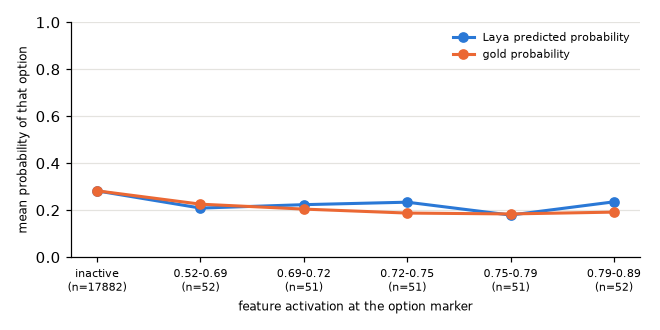

# Feature 2453

Critérios em que aparece: pred_probe_right_laya_wrong

**Interpretação (preencher):** 

---

## Maiores ativações

**tr_security_incidents_000186 / disposition** (choice, security_incidents) | ativação 2.137 em `estado` | opções ['close_benign', 'contain', 'investigate', 'monitor'] | Laya: **monitor** [0.112, 0.184, 0.068, 0.637] | gabarito: **investigate**

```
<bos> choice question: How should this security alert be dispositioned?<eos>
▸ <mask> close_benign: Expected, explainable activity; close without analyst time.
▸ <mask> contain: Contain the host or account immediately; do not wait for triage.
▸ <mask> investigate: Warrants an analyst opening an investigation.
▸ <mask> monitor: Not clearly malicious, but worth watching for recurrence.

<eos>

 {"alert": {"description": "an account granted itself or received elevated permissions", "evidence": "On 2026-09-15 at 02:48:37 UTC, employee account \"asmith\" was added to the \"Domain Admins\" group on server 10.2.5.17 via a PowerShell command \"Add-⟦AD⟧GroupMember\" executed from an unrecognized source IP 203.0.113.45. The action occurred while the scheduled change window was active and the account's password had not been rotated in the past 365 days.", "rule": "privilege_escalation"}, "context": {"asset_criticality": "high", "change_window_active": true, "source_on_allowlist": false}, "history": {"credential_rotation_days_ago": 365, "distinct_countries_30d": 2, "logins_30d": 308, "prior_alerts_90d": 3}, "principal": {"mfa_enrolled": true, "name": "svc-analytics-581", "privileges": ["repo:read"], "type": "employee"}}<eos>
```

**tr_security_incidents_000168 / disposition** (choice, security_incidents) | ativação 2.129 em `estado` | opções ['close_benign', 'contain', 'investigate', 'monitor'] | Laya: **monitor** [0.186, 0.102, 0.074, 0.638] | gabarito: **close_benign**

```
<bos> choice question: How should this security alert be dispositioned?<eos>
▸ <mask> close_benign: Expected, explainable activity; close without analyst time.
▸ <mask> contain: Contain the host or account immediately; do not wait for triage.
▸ <mask> investigate: Warrants an analyst opening an investigation.
▸ <mask> monitor: Not clearly malicious, but worth watching for recurrence.

<eos>

 {"alert": {"description": "an account granted itself or received elevated permissions", "evidence": "At 2026-09-15 14:23 UTC, employee account jdoe@example.com was added to the privileged Domain Admins group via the AzureAD PowerShell cmdlet Add-⟦AD⟧GroupMember. The operation originated from internal IP 10.2.5.12, which is listed in the allowlist, and occurred within the scheduled change window (14:00‑16:00 UTC). Credential rotation for the account was logged three days earlier.", "rule": "privilege_escalation"}, "context": {"asset_criticality": "medium", "change_window_active": true, "source_on_allowlist": true}, "history": {"credential_rotation_days_ago": 3, "distinct_countries_30d": 3, "logins_30d": 80, "prior_alerts_90d": 0}, "principal": {"mfa_enrolled": true, "name": "adm-infra-497", "privileges": ["deploy:production", "secrets:read"], "type": "employee"}}<eos>
```

**tr_security_incidents_000186 / credential_compromise** (noul, security_incidents) | ativação 2.100 em `estado` | opções ['false', 'true'] | Laya: **true** [0.089, 0.912] | gabarito: **true**

```
<bos> noul question: The evidence indicates a credential or account has been compromised.<eos>
▸ <mask> false: no, the statement does not hold
▸ <mask> true: yes, the statement holds

<eos>

 {"alert": {"description": "an account granted itself or received elevated permissions", "evidence": "On 2026-09-15 at 02:48:37 UTC, employee account \"asmith\" was added to the \"Domain Admins\" group on server 10.2.5.17 via a PowerShell command \"Add-⟦AD⟧GroupMember\" executed from an unrecognized source IP 203.0.113.45. The action occurred while the scheduled change window was active and the account's password had not been rotated in the past 365 days.", "rule": "privilege_escalation"}, "context": {"asset_criticality": "high", "change_window_active": true, "source_on_allowlist": false}, "history": {"credential_rotation_days_ago": 365, "distinct_countries_30d": 2, "logins_30d": 308, "prior_alerts_90d": 3}, "principal": {"mfa_enrolled": true, "name": "svc-analytics-581", "privileges": ["repo:read"], "type": "employee"}}<eos>
```

**tr_security_incidents_000186 / severity** (score, security_incidents) | ativação 2.092 em `estado` | opções ['0', '1', '2', '3', '4'] | Laya: **1** [0.077, 0.467, 0.316, 0.088, 0.052] | gabarito: **4**

```
<bos> score question: How severe is the potential impact if this alert is real?<eos>
▸ <mask> level 0: Negligible: no access to anything sensitive.
▸ <mask> level 1: Low: limited access, easily reversed.
▸ <mask> level 2: Moderate: access to internal systems or non-public data.
▸ <mask> level 3: High: access to production, secrets or customer data.
▸ <mask> level 4: Critical: active compromise of crown-jewel systems.

<eos>

 {"alert": {"description": "an account granted itself or received elevated permissions", "evidence": "On 2026-09-15 at 02:48:37 UTC, employee account \"asmith\" was added to the \"Domain Admins\" group on server 10.2.5.17 via a PowerShell command \"Add-⟦AD⟧GroupMember\" executed from an unrecognized source IP 203.0.113.45. The action occurred while the scheduled change window was active and the account's password had not been rotated in the past 365 days.", "rule": "privilege_escalation"}, "context": {"asset_criticality": "high", "change_window_active": true, "source_on_allowlist": false}, "history": {"credential_rotation_days_ago": 365, "distinct_countries_30d": 2, "logins_30d": 308, "prior_alerts_90d": 3}, "principal": {"mfa_enrolled": true, "name": "svc-analytics-581", "privileges": ["repo:read"], "type": "employee"}}<eos>
```

**tr_security_incidents_000168 / urgency** (score, security_incidents) | ativação 2.084 em `estado` | opções ['0', '1', '2', '3'] | Laya: **2** [0.106, 0.175, 0.447, 0.271] | gabarito: **1**

```
<bos> score question: How quickly must a responder act on this alert?<eos>
▸ <mask> level 0: No time pressure; can wait indefinitely.
▸ <mask> level 1: Routine; handle within the normal queue.
▸ <mask> level 2: Elevated; should be handled within the same week.
▸ <mask> level 3: Critical; requires action within the same day.

<eos>

 {"alert": {"description": "an account granted itself or received elevated permissions", "evidence": "At 2026-09-15 14:23 UTC, employee account jdoe@example.com was added to the privileged Domain Admins group via the AzureAD PowerShell cmdlet Add-⟦AD⟧GroupMember. The operation originated from internal IP 10.2.5.12, which is listed in the allowlist, and occurred within the scheduled change window (14:00‑16:00 UTC). Credential rotation for the account was logged three days earlier.", "rule": "privilege_escalation"}, "context": {"asset_criticality": "medium", "change_window_active": true, "source_on_allowlist": true}, "history": {"credential_rotation_days_ago": 3, "distinct_countries_30d": 3, "logins_30d": 80, "prior_alerts_90d": 0}, "principal": {"mfa_enrolled": true, "name": "adm-infra-497", "privileges": ["deploy:production", "secrets:read"], "type": "employee"}}<eos>
```

## Ativações medianas (faixa 40-60%, mediana 0.742)

**tr_security_incidents_000086 / disposition** (choice, security_incidents) | ativação 0.749 em `marcador` | opções ['close_benign', 'contain', 'investigate', 'monitor'] | Laya: **contain** [0.061, 0.758, 0.051, 0.13] | gabarito: **investigate**

```
<bos> choice question: How should this security alert be dispositioned?<eos>
▸ <mask> close_benign: Expected, explainable activity; close without analyst time.
▸ ⟦<mask>⟧ contain: Contain the host or account immediately; do not wait for triage.
▸ <mask> investigate: Warrants an analyst opening an investigation.
▸ <mask> monitor: Not clearly malicious, but worth watching for recurrence.

<eos>

 {"alert": {"description": "a large transfer to an external destination", "evidence": "The privileged shared mailbox account initiated a data transfer of 4.2GB to an external destination at 14:22 UTC. Although the source IP is present on the internal allowlist, this egress volume exceeds the daily baseline for this account, which last rotated its credentials 90 days ago.", "rule": "data_egress"}, "context": {"asset_criticality": "high", "change_window_active": false, "source_on_allowlist": true}, "history": {"credential_rotation_days_ago": 90, "distinct_countries_30d": 1, "logins_30d": 1156, "prior_alerts_90d": 8}, "principal": {"mfa_enrolled": true, "name": "ci-billing-330", "privileges": ["deploy:production", "secrets:read"], "type": "shared_mailbox"}}<eos>
```

**tr_security_incidents_000028 / disposition** (choice, security_incidents) | ativação 0.738 em `marcador` | opções ['close_benign', 'contain', 'investigate', 'monitor'] | Laya: **monitor** [0.197, 0.041, 0.075, 0.687] | gabarito: **investigate**

```
<bos> choice question: How should this security alert be dispositioned?<eos>
▸ <mask> close_benign: Expected, explainable activity; close without analyst time.
▸ ⟦<mask>⟧ contain: Contain the host or account immediately; do not wait for triage.
▸ <mask> investigate: Warrants an analyst opening an investigation.
▸ <mask> monitor: Not clearly malicious, but worth watching for recurrence.

<eos>

 {"alert": {"description": "a security group was opened to the public internet", "evidence": "On 2026-09-14 17:08 UTC, administrator \"admin_jdoe\" (privileged, MFA enabled) altered security group SG-9F2C to add an inbound rule allowing 0.0.0.0/0 on TCP port 22, thereby exposing the group to the public internet. The modification was made during an open change window, the initiating IP 198.51.100.23 is not recognized, and the account’s credentials were rotated 14 days earlier.", "rule": "config_drift"}, "context": {"asset_criticality": "medium", "change_window_active": true, "source_on_allowlist": false}, "history": {"credential_rotation_days_ago": 14, "distinct_countries_30d": 3, "logins_30d": 58, "prior_alerts_90d": 1}, "principal": {"mfa_enrolled": true, "name": "ci-support-253", "privileges": ["deploy:production", "secrets:read"], "type": "admin"}}<eos>
```

**tr_security_incidents_000132 / disposition** (choice, security_incidents) | ativação 0.742 em `marcador` | opções ['close_benign', 'contain', 'investigate', 'monitor'] | Laya: **investigate** [0.237, 0.014, 0.472, 0.277] | gabarito: **investigate**

```
<bos> choice question: How should this security alert be dispositioned?<eos>
▸ <mask> close_benign: Expected, explainable activity; close without analyst time.
▸ ⟦<mask>⟧ contain: Contain the host or account immediately; do not wait for triage.
▸ <mask> investigate: Warrants an analyst opening an investigation.
▸ <mask> monitor: Not clearly malicious, but worth watching for recurrence.

<eos>

 {"alert": {"description": "a security group was opened to the public internet", "evidence": "At 2026-09-15 03:12 UTC, security group sg-0a1b2c3d4e was altered to include an inbound rule allowing 0.0.0.0/0 on TCP port 22. The change was performed by employee jdoe@example.com, a privileged account with MFA enabled, during an open change window. The source IP (203.0.113.45) is not on the trusted list and the account's credentials were last rotated 14 days prior.", "rule": "config_drift"}, "context": {"asset_criticality": "low", "change_window_active": true, "source_on_allowlist": false}, "history": {"credential_rotation_days_ago": 14, "distinct_countries_30d": 3, "logins_30d": 1115, "prior_alerts_90d": 0}, "principal": {"mfa_enrolled": true, "name": "usr-analytics-746", "privileges": ["deploy:production", "secrets:read"], "type": "employee"}}<eos>
```

**tr_security_incidents_000206 / disposition** (choice, security_incidents) | ativação 0.757 em `marcador` | opções ['close_benign', 'contain', 'investigate', 'monitor'] | Laya: **monitor** [0.192, 0.274, 0.075, 0.459] | gabarito: **monitor**

```
<bos> choice question: How should this security alert be dispositioned?<eos>
▸ <mask> close_benign: Expected, explainable activity; close without analyst time.
▸ ⟦<mask>⟧ contain: Contain the host or account immediately; do not wait for triage.
▸ <mask> investigate: Warrants an analyst opening an investigation.
▸ <mask> monitor: Not clearly malicious, but worth watching for recurrence.

<eos>

 {"alert": {"description": "a large transfer to an external destination", "evidence": "A data transfer of 4.8 TB was observed at 2026-09-16 08:15:02 UTC from the internal server DB‑APP-01 to external IP 52.23.45.67, which is on the allow‑list for outbound connections. The operation was initiated by an admin account (privileged) that successfully completed MFA and whose password was rotated on 2026-09-13. No change window was specified for this activity.", "rule": "data_egress"}, "context": {"asset_criticality": "low", "change_window_active": false, "source_on_allowlist": true}, "history": {"credential_rotation_days_ago": 3, "distinct_countries_30d": 1, "logins_30d": 722, "prior_alerts_90d": 0}, "principal": {"mfa_enrolled": true, "name": "svc-support-965", "privileges": ["deploy:production", "secrets:read"], "type": "admin"}}<eos>
```

**tr_security_incidents_000002 / disposition** (choice, security_incidents) | ativação 0.757 em `marcador` | opções ['close_benign', 'contain', 'investigate', 'monitor'] | Laya: **monitor** [0.038, 0.184, 0.039, 0.738] | gabarito: **investigate**

```
<bos> choice question: How should this security alert be dispositioned?<eos>
▸ <mask> close_benign: Expected, explainable activity; close without analyst time.
▸ ⟦<mask>⟧ contain: Contain the host or account immediately; do not wait for triage.
▸ <mask> investigate: Warrants an analyst opening an investigation.
▸ <mask> monitor: Not clearly malicious, but worth watching for recurrence.

<eos>

 {"alert": {"description": "many failed authentications followed by a success", "evidence": "A sequence of 95 failed login attempts followed by a single successful authentication was recorded for the privileged `admin-shared-inbox` from an unknown source. The successful access utilized MFA-protected credentials that were last rotated 14 days prior to the event.", "rule": "brute_force"}, "context": {"asset_criticality": "medium", "change_window_active": false, "source_on_allowlist": false}, "history": {"credential_rotation_days_ago": 14, "distinct_countries_30d": 4, "logins_30d": 581, "prior_alerts_90d": 1}, "principal": {"mfa_enrolled": true, "name": "usr-support-225", "privileges": ["deploy:production", "secrets:read"], "type": "shared_mailbox"}}<eos>
```

## Estatísticas (conjunto de descoberta, dev e teste)

**pred / error**

| split | decisões | ativas | ativas e Laya errou | taxa | lift | q (BH) | OR (CMH) | q (CMH) |
|---|---|---|---|---|---|---|---|---|
| discovery | 5100 | 36 | 30 | 0.833 | 1.29 | 0.0328 | 10.00 | 0.0944 |
| dev | 900 | 5 | 5 | 1.000 | 1.49 | nan | nan | nan |
| test | 2000 | 15 | 13 | 0.867 | 1.33 | nan | nan | nan |

**corr / error**

| split | decisões | ativas | ativas e Laya errou | taxa | lift | q (BH) | OR (CMH) | q (CMH) |
|---|---|---|---|---|---|---|---|---|
| discovery | 5100 | 32 | 26 | 0.812 | 1.26 | 0.0778 | 0.40 | 0.346 |
| dev | 900 | 3 | 3 | 1.000 | 1.49 | nan | nan | nan |
| test | 2000 | 15 | 13 | 0.867 | 1.33 | nan | nan | nan |

**state / error**

| split | decisões | ativas | ativas e Laya errou | taxa | lift | q (BH) | OR (CMH) | q (CMH) |
|---|---|---|---|---|---|---|---|---|
| discovery | 5100 | 42 | 27 | 0.643 | 1.00 | 1 | 1.02 | 0.987 |
| dev | 900 | 16 | 8 | 0.500 | 0.74 | nan | nan | nan |
| test | 2000 | 17 | 12 | 0.706 | 1.09 | nan | nan | nan |

**pred / probe_right_laya_wrong**

| split | decisões | ativas | ativas e Laya errou | taxa | lift | q (BH) | OR (CMH) | q (CMH) |
|---|---|---|---|---|---|---|---|---|
| discovery | 2819 | 23 | 23 | 1.000 | 1.55 | 0.00016 | nan | nan |
| dev | 520 | 4 | 4 | 1.000 | 1.48 | nan | nan | nan |
| test | 1106 | 10 | 10 | 1.000 | 1.58 | nan | nan | nan |

**corr / probe_right_laya_wrong**

| split | decisões | ativas | ativas e Laya errou | taxa | lift | q (BH) | OR (CMH) | q (CMH) |
|---|---|---|---|---|---|---|---|---|
| discovery | 2819 | 0 | 0 | nan | nan | nan | nan | nan |
| dev | 520 | 0 | 0 | nan | nan | nan | nan | nan |
| test | 1106 | 0 | 0 | nan | nan | nan | nan | nan |

**state / probe_right_laya_wrong**

| split | decisões | ativas | ativas e Laya errou | taxa | lift | q (BH) | OR (CMH) | q (CMH) |
|---|---|---|---|---|---|---|---|---|
| discovery | 2819 | 20 | 11 | 0.550 | 0.85 | 0.631 | 1.10 | 0.948 |
| dev | 520 | 10 | 5 | 0.500 | 0.74 | nan | nan | nan |
| test | 1106 | 8 | 5 | 0.625 | 0.99 | nan | nan | nan |

Confusão mais sobre-representada (pred): `disposition|1>2` (n=23, lift 135.76, p=0). Formato `pergunta|índice previsto>índice correto`.

Confusão mais sobre-representada (corr): `disposition|3>1` (n=20, lift 67.82, p=3.7e-35). Formato `pergunta|índice previsto>índice correto`.

Confusão mais sobre-representada (state): `severity|2>4` (n=1, lift 20.24, p=0.0484). Formato `pergunta|índice previsto>índice correto`.



