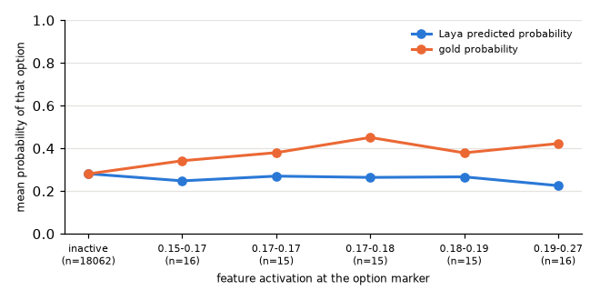

# Feature 2457

Critérios em que aparece: corr_error

**Interpretação (preencher):** 

---

## Maiores ativações

**tr_customer_service_000298 / needs_human** (noul, customer_service) | ativação 1.044 em `estado` | opções ['false', 'true'] | Laya: **true** [0.04, 0.96] | gabarito: **false**

```
<bos> noul question: This conversation requires a human agent rather than automated handling.<eos>
▸ <mask> false: Automation can carry this to resolution.
▸ <mask> true: A human must take over: judgement, authority or empathy is required.

<eos>

 {"account": {"lifetime_value_usd": 58, "prior_tickets_90d": 0, "seats": 1, "tenure_months": 1, "tier": "enterprise"}, "thread": [{"role": "customer", "text": "The item arrived but it looks broken? I don't understand why it's shaped like this."}, {"role": "agent", "text": "I apologize⟦ for⟧ the confusion. Could you describe which specific part of the item appears to be damaged?"}, {"role": "customer", "text": "It's the main plastic casing, it's just kind of smashed in."}]}<eos>
```

**tr_customer_service_000029 / churn_risk** (score, customer_service) | ativação 1.005 em `estado` | opções ['0', '1', '2', '3'] | Laya: **2** [0.028, 0.172, 0.745, 0.055] | gabarito: **2**

```
<bos> score question: How likely is this customer to stop doing business with us because of this interaction?<eos>
▸ <mask> level 0: No sign of dissatisfaction.
▸ <mask> level 1: Mild frustration, but the relationship is intact.
▸ <mask> level 2: Clearly unhappy; repeat problems or explicit complaints.
▸ <mask> level 3: Imminent: threatening to cancel, dispute or leave.

<eos>

 {"account": {"lifetime_value_usd": 5176, "prior_tickets_90d": 1, "seats": 1, "tenure_months": 72, "tier": "standard"}, "thread": [{"role": "customer", "text": "I am beyond frustrated right now. I've been a loyal customer for six years and I requested a downgrade from the Standard plan weeks ago. I was told it was taken care of, but I just got hit with another full-price bill."}, {"role": "agent", "text": "I am very sorry to hear that the downgrade wasn't processed as expected, especially given your long history with us. I can certainly understand why seeing that charge is upsetting."}, {"role": "customer", "text": "This is the second time I've had to open a ticket for this exact same issue. The last agent promised me it was resolved, yet here I am again wasting my time because your system won't update my status."}, {"role": "agent", "text": "I see your previous interaction in our logs. To assist me in investigating why the change didn't take effect, could you let me know if you received a confirmation email after your last conversation regarding the plan change?"}, {"role": "customer", "text": "I never received any confirmation, which is why I'm so annoyed. I shouldn't have to keep chasing you⟦ guys⟧ down to stop charging me for features I am no longer using."}]}<eos>
```

**tr_security_incidents_000172 / urgency** (score, security_incidents) | ativação 0.996 em `estado` | opções ['0', '1', '2', '3'] | Laya: **3** [0.08, 0.177, 0.156, 0.588] | gabarito: **3**

```
<bos> score question: How quickly must a responder act on this alert?<eos>
▸ <mask> level 0: No time pressure; can wait indefinitely.
▸ <mask> level 1: Routine; handle within the normal queue.
▸ <mask> level 2: Elevated; should be handled within the same week.
▸ <mask> level 3: Critical; requires action within the same day.

<eos>

 {"alert": {"description": "an unusual volume of files read in a short window", "evidence": "The privileged service_account performed 12,4⟦0⟧0 file read operations from a known allowlisted IP within a five-minute interval. This activity occurred without a corresponding change window using credentials that have not been rotated in 412 days.", "rule": "mass_download"}, "context": {"asset_criticality": "medium", "change_window_active": false, "source_on_allowlist": true}, "history": {"credential_rotation_days_ago": 412, "distinct_countries_30d": 1, "logins_30d": 18, "prior_alerts_90d": 1}, "principal": {"mfa_enrolled": false, "name": "ci-support-249", "privileges": ["deploy:production", "secrets:read"], "type": "service_account"}}<eos>
```

**tr_customer_service_000029 / action** (choice, customer_service) | ativação 0.985 em `estado` | opções ['answer_directly', 'close_no_action', 'escalate_to_human', 'execute_refund', 'request_information'] | Laya: **answer_directly** [0.364, 0.235, 0.349, 0.044, 0.007] | gabarito: **escalate_to_human**

```
<bos> choice question: What should the assistant do next with this conversation?<eos>
▸ <mask> answer_directly: The assistant can resolve this itself with information it already has.
▸ <mask> close_no_action: No further action is warranted; the matter is settled.
▸ <mask> escalate_to_human: Hand off to a human agent with the appropriate authority.
▸ <mask> execute_refund: Issue the refund or credit the customer is owed.
▸ <mask> request_information: More detail is needed from the customer before anything can be done.

<eos>

 {"account": {"lifetime_value_usd": 5176, "prior_tickets_90d": 1, "seats": 1, "tenure_months": 72, "tier": "standard"}, "thread": [{"role": "customer", "text": "I am beyond frustrated right now. I've been a loyal customer for six years and I requested a downgrade from the Standard plan weeks ago. I was told it was taken care of, but I just got hit with another full-price bill."}, {"role": "agent", "text": "I am very sorry to hear that the downgrade wasn't processed as expected, especially given your long history with us. I can certainly understand why seeing that charge is upsetting."}, {"role": "customer", "text": "This is the second time I've had to open a ticket for this exact same issue. The last agent promised me it was resolved, yet here I am again wasting my time because your system won't update my status."}, {"role": "agent", "text": "I see your previous interaction in our logs. To assist me in investigating why the change didn't take effect, could you let me know if you received a confirmation email after your last conversation regarding the plan change?"}, {"role": "customer", "text": "I never received any confirmation, which is why I'm so annoyed. I shouldn't have to keep chasing you⟦ guys⟧ down to stop charging me for features I am no longer using."}]}<eos>
```

**tr_customer_service_000029 / needs_human** (noul, customer_service) | ativação 0.973 em `estado` | opções ['false', 'true'] | Laya: **true** [0.277, 0.722] | gabarito: **true**

```
<bos> noul question: This conversation requires a human agent rather than automated handling.<eos>
▸ <mask> false: Automation can carry this to resolution.
▸ <mask> true: A human must take over: judgement, authority or empathy is required.

<eos>

 {"account": {"lifetime_value_usd": 5176, "prior_tickets_90d": 1, "seats": 1, "tenure_months": 72, "tier": "standard"}, "thread": [{"role": "customer", "text": "I am beyond frustrated right now. I've been a loyal customer for six years and I requested a downgrade from the Standard plan weeks ago. I was told it was taken care of, but I just got hit with another full-price bill."}, {"role": "agent", "text": "I am very sorry to hear that the downgrade wasn't processed as expected, especially given your long history with us. I can certainly understand why seeing that charge is upsetting."}, {"role": "customer", "text": "This is the second time I've had to open a ticket for this exact same issue. The last agent promised me it was resolved, yet here I am again wasting my time because your system won't update my status."}, {"role": "agent", "text": "I see your previous interaction in our logs. To assist me in investigating why the change didn't take effect, could you let me know if you received a confirmation email after your last conversation regarding the plan change?"}, {"role": "customer", "text": "I never received any confirmation, which is why I'm so annoyed. I shouldn't have to keep chasing you⟦ guys⟧ down to stop charging me for features I am no longer using."}]}<eos>
```

## Ativações medianas (faixa 40-60%, mediana 0.448)

**tr_customer_service_000220 / category** (choice, customer_service) | ativação 0.384 em `estado` | opções ['account', 'billing', 'delivery', 'refund', 'technical'] | Laya: **technical** [0.077, 0.003, 0.0, 0.002, 0.918] | gabarito: **account**

```
<bos> choice question: What is this customer conversation primarily about?<eos>
▸ <mask> account: Login, plan changes, profile or access management.
▸ <mask> billing: A charge, invoice, subscription or payment problem.
▸ <mask> delivery: Shipping, fulfilment or delivery of a physical item.
▸ <mask> refund: The customer is explicitly asking for money back.
▸ <mask> technical: The product or service is not working as expected.

<eos>

 {"account": {"lifetime_value_usd": 94, "prior_tickets_90d": 0, "seats": 1, "tenure_months": 1, "tier": "standard"}, "orders": [{"amount_usd": 9, "date": "2026-01-18", "id": "A-69685", "status": "settled"}, {"amount_usd": 9, "date": "2026-03-15", "id": "A-58214", "status": "settled"}, {"amount_usd": 9, "date": "2026-02-06", "id": "A-56446", "status": "failed"}], "thread": [{"role": "customer", "text": "I’ve been trying to log into my account for the past hour and it keeps throwing an error. I have a major presentation due in two hours and this is beyond frustrating. Why is this happening?"}, {"role": "agent", "text": "I’m sorry to hear you're experiencing trouble accessing your account right before your deadline. Could you please provide the specific error message or code you are seeing on your screen?"}, {"role": "customer", "text": "It just says 'Authentication Failed' no matter how many times I reset my password. I don't have time for this nonsense, I need access now."}, {"role": "agent", "text": "Thank you for that information. To help me investigate further, are you attempting to log in via a web browser or our mobile application?"}, {"role": "customer", "text": "I am using Chrome on my laptop, just like I do every single day⟦.⟧ Just fix it, I have people waiting on these files."}]}<eos>
```

**tr_customer_service_000108 / action** (choice, customer_service) | ativação 0.385 em `estado` | opções ['answer_directly', 'close_no_action', 'escalate_to_human', 'execute_refund', 'request_information'] | Laya: **answer_directly** [0.522, 0.327, 0.047, 0.082, 0.022] | gabarito: **answer_directly**

```
<bos> choice question: What should the assistant do next with this conversation?<eos>
▸ <mask> answer_directly: The assistant can resolve this itself with information it already has.
▸ <mask> close_no_action: No further action is warranted; the matter is settled.
▸ <mask> escalate_to_human: Hand off to a human agent with the appropriate authority.
▸ <mask> execute_refund: Issue the refund or credit the customer is owed.
▸ <mask> request_information: More detail is needed from the customer before anything can be done.

<eos>

 {"account": {"lifetime_value_usd": 212, "prior_tickets_90d": 0, "seats": 1, "tenure_months": 5, "tier": "standard"}, "orders": [{"amount_usd": 198, "date": "2026-01-14", "id": "A-21848", "status": "refunded"}], "thread": [{"role": "customer", "text": "I've been trying to log in for a while now, but the page just keeps bringing me back to the sign‑in screen⟦.⟧ I guess there's not much I can do."}]}<eos>
```

**tr_invoice_processing_000040 / urgency** (score, invoice_processing) | ativação 0.423 em `opção` | opções ['0', '1', '2', '3'] | Laya: **1** [0.112, 0.485, 0.256, 0.148] | gabarito: **2**

```
<bos> score question: How time-sensitive is processing this invoice?<eos>
▸ <mask> level 0: No time pressure; can wait indefinitely.
▸ <mask> level 1: Routine; handle within the normal queue.
▸ <mask> level 2: Elevated; should be handled within the same week.
▸ <mask> level 3: Critical⟦;⟧ requires action within the same day.

<eos>

 {"delivery": {"condition": "accepted", "date": null, "received_qty": 0}, "invoice": {"currency": "USD", "id": "INV-2026-1284", "lines": [{"qty": 1000, "sku": "SKU-548", "total_usd": 285120.0, "unit_usd": 285.12}], "total_usd": 285120.0, "vendor": "Northwind Components"}, "payment": {"days_until_due": 27, "discount_expires_in_days": 3, "early_payment_discount_pct": 2.0, "status": "scheduled", "terms": "net 15"}, "purchase_order": {"freight_terms": "freight prepaid by vendor, not separately billable", "id": "PO-4387", "lines": [{"qty": 1000, "unit_usd": 285.12}], "total_usd": 285120.0}, "vendor_history": {"disputes_12m": 1, "invoices_12m": 9, "prior_invoice_ids": ["INV-2026-8643"]}}<eos>
```

**tr_customer_service_000094 / category** (choice, customer_service) | ativação 0.348 em `estado` | opções ['account', 'billing', 'delivery', 'refund', 'technical'] | Laya: **billing** [0.0, 1.0, 0.0, 0.0, 0.0] | gabarito: **billing**

```
<bos> choice question: What is this customer conversation primarily about?<eos>
▸ <mask> account: Login, plan changes, profile or access management.
▸ <mask> billing: A charge, invoice, subscription or payment problem.
▸ <mask> delivery: Shipping, fulfilment or delivery of a physical item.
▸ <mask> refund: The customer is explicitly asking for money back.
▸ <mask> technical: The product or service is not working as expected.

<eos>

 {"account": {"lifetime_value_usd": 979, "prior_tickets_90d": 1, "seats": 1, "tenure_months": 11, "tier": "premium"}, "thread": [{"role": "customer", "text": "I’m looking at my billing statement and I don't understand why the premium plan charges are still hitting my card when I thought I processed a downgrade last week. Can you explain what’s going on?"}, {"role": "agent", "text": "I understand your concern regarding the recent charges. To help me investigate this for you, could you provide the reference number or date from the request you submitted?"}, {"role": "customer", "text": "I don't have a reference number, but it was just a few days ago. Why is this so difficult to track down when I've been with you for 11 months?"}, {"role": "agent", "text": "Thank you for that information. I see you have an open ticket regarding your account status; could you clarify if you received a confirmation email after attempting the downgrade?"}, {"role": "customer", "text": "I might have deleted it, but the site said it was done⟦.⟧ It feels like I'm running in circles here with no real answers."}]}<eos>
```

**tr_customer_service_000171 / churn_risk** (score, customer_service) | ativação 0.437 em `estado` | opções ['0', '1', '2', '3'] | Laya: **2** [0.049, 0.404, 0.47, 0.077] | gabarito: **2**

```
<bos> score question: How likely is this customer to stop doing business with us because of this interaction?<eos>
▸ <mask> level 0: No sign of dissatisfaction.
▸ <mask> level 1: Mild frustration, but the relationship is intact.
▸ <mask> level 2: Clearly unhappy; repeat problems or explicit complaints.
▸ <mask> level 3: Imminent: threatening to cancel, dispute or leave.

<eos>

 {"account": {"lifetime_value_usd": 2300, "prior_tickets_90d": 0, "seats": 1, "tenure_months": 26, "tier": "standard"}, "orders": [{"amount_usd": 49, "date": "2026-02-14", "id": "A-88180", "status": "refunded"}, {"amount_usd": 49, "date": "2026-02-22", "id": "A-79800", "status": "settled"}, {"amount_usd": 49, "date": "2026-02-08", "id": "A-91927", "status": "refunded"}], "thread": [{"role": "customer", "text": "The service is painfully slow right now—I'm on a deadline and can't get anything done."}, {"role": "agent", "text": "I hear the urgency. Can you tell me which device and operating system you’re using?"}, {"role": "customer", "text": "It’s a Windows 10 desktop, and the slowdown started after the latest update."}, {"role": "agent", "text": "Thanks for the details. Have you tried clearing the application cache or restarting the app?"}, {"role": "customer", "text": "Yes, I cleared everything and rebooted, but it’s still crawling⟦.⟧ I need this resolved quickly."}]}<eos>
```

## Estatísticas (conjunto de descoberta, dev e teste)

**pred / error**

| split | decisões | ativas | ativas e Laya errou | taxa | lift | q (BH) | OR (CMH) | q (CMH) |
|---|---|---|---|---|---|---|---|---|
| discovery | 5100 | 2 | 2 | 1.000 | 1.55 | nan | nan | nan |
| dev | 900 | 2 | 1 | 0.500 | 0.74 | nan | nan | nan |
| test | 2000 | 2 | 1 | 0.500 | 0.77 | nan | nan | nan |

**corr / error**

| split | decisões | ativas | ativas e Laya errou | taxa | lift | q (BH) | OR (CMH) | q (CMH) |
|---|---|---|---|---|---|---|---|---|
| discovery | 5100 | 35 | 35 | 1.000 | 1.55 | 8.75e-07 | inf | 0.161 |
| dev | 900 | 9 | 8 | 0.889 | 1.32 | nan | nan | nan |
| test | 2000 | 18 | 17 | 0.944 | 1.45 | nan | nan | nan |

**state / error**

| split | decisões | ativas | ativas e Laya errou | taxa | lift | q (BH) | OR (CMH) | q (CMH) |
|---|---|---|---|---|---|---|---|---|
| discovery | 5100 | 94 | 54 | 0.574 | 0.89 | 0.345 | 0.78 | 0.636 |
| dev | 900 | 18 | 14 | 0.778 | 1.16 | nan | nan | nan |
| test | 2000 | 29 | 21 | 0.724 | 1.11 | 0.803 | 1.05 | 0.982 |

**pred / probe_right_laya_wrong**

| split | decisões | ativas | ativas e Laya errou | taxa | lift | q (BH) | OR (CMH) | q (CMH) |
|---|---|---|---|---|---|---|---|---|
| discovery | 2819 | 0 | 0 | nan | nan | nan | nan | nan |
| dev | 520 | 0 | 0 | nan | nan | nan | nan | nan |
| test | 1106 | 2 | 1 | 0.500 | 0.79 | nan | nan | nan |

**corr / probe_right_laya_wrong**

| split | decisões | ativas | ativas e Laya errou | taxa | lift | q (BH) | OR (CMH) | q (CMH) |
|---|---|---|---|---|---|---|---|---|
| discovery | 2819 | 15 | 15 | 1.000 | 1.55 | nan | nan | nan |
| dev | 520 | 6 | 6 | 1.000 | 1.48 | nan | nan | nan |
| test | 1106 | 9 | 8 | 0.889 | 1.40 | nan | nan | nan |

**state / probe_right_laya_wrong**

| split | decisões | ativas | ativas e Laya errou | taxa | lift | q (BH) | OR (CMH) | q (CMH) |
|---|---|---|---|---|---|---|---|---|
| discovery | 2819 | 46 | 24 | 0.522 | 0.81 | 0.191 | 0.71 | 0.596 |
| dev | 520 | 11 | 8 | 0.727 | 1.08 | nan | nan | nan |
| test | 1106 | 17 | 12 | 0.706 | 1.12 | nan | nan | nan |

Confusão mais sobre-representada (pred): `urgency|2>1` (n=1, lift 70.83, p=nan). Formato `pergunta|índice previsto>índice correto`.

Confusão mais sobre-representada (corr): `urgency|1>2` (n=33, lift 23.01, p=7.01e-45). Formato `pergunta|índice previsto>índice correto`.

Confusão mais sobre-representada (state): `action|1>4` (n=3, lift 8.57, p=0.00474). Formato `pergunta|índice previsto>índice correto`.



