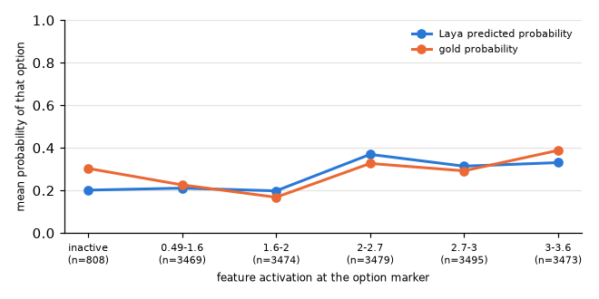

# Feature 2474

Critérios em que aparece: corr_error_stratified, attribution_toward_correct

**Interpretação (preencher):** 

---

## Maiores ativações

**tr_customer_service_000149 / category** (choice, customer_service) | ativação 3.551 em `marcador` | opções ['account', 'billing', 'delivery', 'refund', 'technical'] | Laya: **account** [0.983, 0.001, 0.006, 0.001, 0.01] | gabarito: **delivery**

```
<bos> choice question: What is this customer conversation primarily about?<eos>
▸ <mask> account: Login, plan changes, profile or access management.
▸ <mask> billing: A charge, invoice, subscription or payment problem.
▸ ⟦<mask>⟧ delivery: Shipping, fulfilment or delivery of a physical item.
▸ <mask> refund: The customer is explicitly asking for money back.
▸ <mask> technical: The product or service is not working as expected.

<eos>

 {"account": {"lifetime_value_usd": 2114, "prior_tickets_90d": 2, "seats": 1, "tenure_months": 41, "tier": "enterprise"}, "thread": [{"role": "customer", "text": "After 41 months with the enterprise plan, I'm still getting the wrong product in my shipments, even though the last two tickets promised a fix that never arrived."}]}<eos>
```

**tr_customer_service_000155 / category** (choice, customer_service) | ativação 3.480 em `marcador` | opções ['account', 'billing', 'delivery', 'refund', 'technical'] | Laya: **account** [0.757, 0.016, 0.021, 0.004, 0.202] | gabarito: **technical**

```
<bos> choice question: What is this customer conversation primarily about?<eos>
▸ <mask> account: Login, plan changes, profile or access management.
▸ <mask> billing: A charge, invoice, subscription or payment problem.
▸ ⟦<mask>⟧ delivery: Shipping, fulfilment or delivery of a physical item.
▸ <mask> refund: The customer is explicitly asking for money back.
▸ <mask> technical: The product or service is not working as expected.

<eos>

 {"account": {"lifetime_value_usd": 351, "prior_tickets_90d": 1, "seats": 1, "tenure_months": 8, "tier": "standard"}, "thread": [{"role": "customer", "text": "I need the CSV export of last month's transaction data right now; the system is still processing and it's holding up my audit."}, {"role": "agent", "text": "I understand the urgency. Could you tell me which account ID you’re exporting from?"}, {"role": "customer", "text": "It's account 45219; please expedite the export."}]}<eos>
```

**tr_customer_service_000107 / category** (choice, customer_service) | ativação 3.479 em `marcador` | opções ['account', 'billing', 'delivery', 'refund', 'technical'] | Laya: **account** [0.836, 0.003, 0.109, 0.05, 0.002] | gabarito: **delivery**

```
<bos> choice question: What is this customer conversation primarily about?<eos>
▸ <mask> account: Login, plan changes, profile or access management.
▸ <mask> billing: A charge, invoice, subscription or payment problem.
▸ ⟦<mask>⟧ delivery: Shipping, fulfilment or delivery of a physical item.
▸ <mask> refund: The customer is explicitly asking for money back.
▸ <mask> technical: The product or service is not working as expected.

<eos>

 {"account": {"lifetime_value_usd": 224, "prior_tickets_90d": 0, "seats": 1, "tenure_months": 8, "tier": "premium"}, "thread": [{"role": "customer", "text": "I received the item yesterday and it was damaged. After eight months on the premium plan, this is the last thing I need!"}]}<eos>
```

**tr_customer_service_000184 / category** (choice, customer_service) | ativação 3.475 em `marcador` | opções ['account', 'billing', 'delivery', 'refund', 'technical'] | Laya: **delivery** [0.001, 0.001, 0.994, 0.0, 0.004] | gabarito: **delivery**

```
<bos> choice question: What is this customer conversation primarily about?<eos>
▸ <mask> account: Login, plan changes, profile or access management.
▸ <mask> billing: A charge, invoice, subscription or payment problem.
▸ ⟦<mask>⟧ delivery: Shipping, fulfilment or delivery of a physical item.
▸ <mask> refund: The customer is explicitly asking for money back.
▸ <mask> technical: The product or service is not working as expected.

<eos>

 {"account": {"lifetime_value_usd": 1921, "prior_tickets_90d": 2, "seats": 1, "tenure_months": 49, "tier": "standard"}, "thread": [{"role": "customer", "text": "I've been waiting forever for my order—your delivery promise was two weeks ago and nothing has shown up! This is unacceptable for someone who's been with you for over four years."}, {"role": "agent", "text": "I’m sorry to hear the shipment hasn’t arrived yet. Let me pull up the tracking details—could you confirm the order number you received in the confirmation email?"}, {"role": "customer", "text": "The number is 112938‑BZ, and if this isn’t fixed soon I’m done with your service; I’ve already opened tickets that never got solved."}]}<eos>
```

**tr_customer_service_000083 / category** (choice, customer_service) | ativação 3.473 em `marcador` | opções ['account', 'billing', 'delivery', 'refund', 'technical'] | Laya: **account** [0.82, 0.001, 0.001, 0.129, 0.05] | gabarito: **delivery**

```
<bos> choice question: What is this customer conversation primarily about?<eos>
▸ <mask> account: Login, plan changes, profile or access management.
▸ <mask> billing: A charge, invoice, subscription or payment problem.
▸ ⟦<mask>⟧ delivery: Shipping, fulfilment or delivery of a physical item.
▸ <mask> refund: The customer is explicitly asking for money back.
▸ <mask> technical: The product or service is not working as expected.

<eos>

 {"account": {"lifetime_value_usd": 275, "prior_tickets_90d": 2, "seats": 1, "tenure_months": 5, "tier": "standard"}, "thread": [{"role": "customer", "text": "I’m confused – I ordered the blue wireless mouse but received a black wired one, and I need the correct item by Friday for my project."}]}<eos>
```

## Ativações medianas (faixa 40-60%, mediana 1.799)

**tr_security_incidents_000288 / disposition** (choice, security_incidents) | ativação 1.820 em `marcador` | opções ['close_benign', 'contain', 'investigate', 'monitor'] | Laya: **investigate** [0.016, 0.038, 0.538, 0.409] | gabarito: **monitor**

```
<bos> choice question: How should this security alert be dispositioned?<eos>
▸ <mask> close_benign: Expected, explainable activity; close without analyst time.
▸ ⟦<mask>⟧ contain: Contain the host or account immediately; do not wait for triage.
▸ <mask> investigate: Warrants an analyst opening an investigation.
▸ <mask> monitor: Not clearly malicious, but worth watching for recurrence.

<eos>

 {"alert": {"description": "a first-ever sign-in from an unfamiliar country", "evidence": "At 2026-09-15 02:13:47 UTC a sign‑in originated from IP 203.0.113.45 (detected as Brazil), which is the first login for the ci_runner_42 principal from that country. The account is unprivileged, has MFA enabled, and the credentials were last rotated on 2026-09-01; the sign‑in occurred while a change window was active and the source was not on the allowlist.", "rule": "new_country_login"}, "context": {"asset_criticality": "low", "change_window_active": true, "source_on_allowlist": false}, "history": {"credential_rotation_days_ago": 14, "distinct_countries_30d": 1, "logins_30d": 454, "prior_alerts_90d": 0}, "principal": {"mfa_enrolled": true, "name": "svc-billing-208", "privileges": ["repo:read"], "type": "ci_runner"}}<eos>
```

**tr_agent_trace_observability_000207 / urgency** (score, agent_trace_observability) | ativação 1.707 em `marcador` | opções ['0', '1', '2', '3'] | Laya: **2** [0.196, 0.226, 0.384, 0.193] | gabarito: **1**

```
<bos> score question: How quickly does this trace need attention?<eos>
▸ ⟦<mask>⟧ level 0: No time pressure; can wait indefinitely.
▸ <mask> level 1: Routine; handle within the normal queue.
▸ <mask> level 2: Elevated; should be handled within the same week.
▸ <mask> level 3: Critical; requires action within the same day.

<eos>

 {"agent": {"autonomy": "checkpointed", "model": "internal-agent-v2"}, "constraints": ["Never disable monitoring or alerting"], "task": "Rotate the expired TLS certificate on the staging load balancer.", "trace_summary": {"constraint_violations": 0, "duration_s": 283.6, "irreversible_actions": 0, "steps": 4, "tool_errors": 2}}<eos>
```

**tr_customer_service_000031 / urgency** (score, customer_service) | ativação 1.741 em `marcador` | opções ['0', '1', '2', '3'] | Laya: **1** [0.109, 0.678, 0.181, 0.031] | gabarito: **1**

```
<bos> score question: How time-sensitive is this conversation?<eos>
▸ ⟦<mask>⟧ level 0: No time pressure; can wait indefinitely.
▸ <mask> level 1: Routine; handle within the normal queue.
▸ <mask> level 2: Elevated; should be handled within the same week.
▸ <mask> level 3: Critical; requires action within the same day.

<eos>

 {"account": {"lifetime_value_usd": 581, "prior_tickets_90d": 0, "seats": 3, "tenure_months": 14, "tier": "enterprise"}, "thread": [{"role": "customer", "text": "I noticed two identical charges on my bank statement for this month's enterprise subscription. I suppose I'm not surprised, but I'd like to know why this happened."}, {"role": "agent", "text": "I am sorry to hear that you are seeing duplicate charges. To help me investigate this further, could you please share the transaction IDs associated with those charges?"}, {"role": "customer", "text": "I'm not sure where to find those IDs. I just see the two lines on my dashboard history that match the ones on my bank app."}, {"role": "agent", "text": "No problem at all. If you could send over a screenshot of your billing history page or the exact timestamps listed for those two transactions, I can start looking into the account logs."}, {"role": "customer", "text": "Here is the screenshot. It’s the same amount charged twice on the same day, which seems like a bit of a mess."}, {"role": "agent", "text": "Thank you for attaching that file. I’ve received the document, and I’m going to begin reviewing our payment processing records to see how these entries were generated."}, {"role": "customer", "text": "Alright, let me know what you find whenever you get around to it, I guess."}]}<eos>
```

**tr_customer_service_000240 / action** (choice, customer_service) | ativação 1.864 em `SEP-cabeça` | opções ['answer_directly', 'close_no_action', 'escalate_to_human', 'execute_refund', 'request_information'] | Laya: **close_no_action** [0.146, 0.837, 0.004, 0.006, 0.007] | gabarito: **answer_directly**

```
<bos> choice question: What should the assistant do next with this conversation?<eos>
▸ <mask> answer_directly: The assistant can resolve this itself with information it already has.
▸ <mask> close_no_action: No further action is warranted; the matter is settled.
▸ <mask> escalate_to_human: Hand off to a human agent with the appropriate authority.
▸ <mask> execute_refund: Issue the refund or credit the customer is owed.
▸ <mask> request_information: More detail is needed from the customer before anything can be done.

⟦<eos>⟧

 {"account": {"lifetime_value_usd": 363, "prior_tickets_90d": 0, "seats": 1, "tenure_months": 5, "tier": "standard"}, "thread": [{"role": "customer", "text": "I’d like to move my account from the Premium tier to the Standard tier, effective as of the 15th of next month."}, {"role": "agent", "text": "I understand you want to downgrade to Standard on that date. Could you confirm the email associated with the account so we can pull up the details?"}, {"role": "customer", "text": "The email is jane.doe@example.com, and I’ve been on the Premium plan for the past five months."}, {"role": "agent", "text": "Got it, Jane. Just to be clear, are there any additional services or add‑ons you’d like to keep after the downgrade?"}, {"role": "customer", "text": "No, I only need the core features that come with Standard. I also need to make sure my billing reflects the change by the deadline."}, {"role": "agent", "text": "Understood. To proceed, could you let me know if there are any outstanding invoices or credit balances we should account for before the switch?"}, {"role": "customer", "text": "There are no pending invoices; the last payment was processed last week. Please confirm the downgrade will be in place by the 15th."}]}<eos>
```

**tr_customer_service_000258 / category** (choice, customer_service) | ativação 1.728 em `SEP-cabeça` | opções ['account', 'billing', 'delivery', 'refund', 'technical'] | Laya: **delivery** [0.0, 0.0, 0.999, 0.0, 0.0] | gabarito: **delivery**

```
<bos> choice question: What is this customer conversation primarily about?<eos>
▸ <mask> account: Login, plan changes, profile or access management.
▸ <mask> billing: A charge, invoice, subscription or payment problem.
▸ <mask> delivery: Shipping, fulfilment or delivery of a physical item.
▸ <mask> refund: The customer is explicitly asking for money back.
▸ <mask> technical: The product or service is not working as expected.

⟦<eos>⟧

 {"account": {"lifetime_value_usd": 48, "prior_tickets_90d": 0, "seats": 1, "tenure_months": 1, "tier": "free"}, "thread": [{"role": "customer", "text": "I ordered the deluxe starter kit and you sent me the basic one instead—this is unacceptable, and I need it fixed before Friday or I'm cancelling my subscription."}, {"role": "agent", "text": "I’m sorry to hear you received the wrong kit. Could you share the order number so I can pull up the details?"}, {"role": "customer", "text": "The order number is 8742‑19. I’ve already waited a week, and if I don’t have the correct item by Friday I’m done with your service."}, {"role": "agent", "text": "Thank you for the number. I’ll check the shipment records and see what went wrong. May I also get the email address linked to the account?"}, {"role": "customer", "text": "It’s john.doe@example.com. I expect you to have a solution in place before the deadline—I’m not willing to wait any longer."}]}<eos>
```

## Estatísticas (conjunto de descoberta, dev e teste)

**pred / error**

| split | decisões | ativas | ativas e Laya errou | taxa | lift | q (BH) | OR (CMH) | q (CMH) |
|---|---|---|---|---|---|---|---|---|
| discovery | 5100 | 4960 | 3190 | 0.643 | 1.00 | 0.725 | 1.41 | 0.639 |
| dev | 900 | 889 | 597 | 0.672 | 1.00 | 1 | 0.56 | 0.834 |
| test | 2000 | 1950 | 1265 | 0.649 | 1.00 | 0.452 | 0.41 | 0.877 |

**corr / error**

| split | decisões | ativas | ativas e Laya errou | taxa | lift | q (BH) | OR (CMH) | q (CMH) |
|---|---|---|---|---|---|---|---|---|
| discovery | 5100 | 4813 | 3043 | 0.632 | 0.98 | 7.88e-13 | 8.10 | 0.000347 |
| dev | 900 | 851 | 559 | 0.657 | 0.98 | 6.15e-05 | 0.46 | 0.982 |
| test | 2000 | 1888 | 1203 | 0.637 | 0.98 | 2.65e-07 | 3.11 | 0.112 |

**state / error**

| split | decisões | ativas | ativas e Laya errou | taxa | lift | q (BH) | OR (CMH) | q (CMH) |
|---|---|---|---|---|---|---|---|---|
| discovery | 5100 | 213 | 146 | 0.685 | 1.06 | 0.378 | 1.35 | 0.333 |
| dev | 900 | 44 | 34 | 0.773 | 1.15 | 0.511 | 2.05 | 0.365 |
| test | 2000 | 53 | 33 | 0.623 | 0.96 | 0.963 | 1.02 | 0.992 |

**pred / probe_right_laya_wrong**

| split | decisões | ativas | ativas e Laya errou | taxa | lift | q (BH) | OR (CMH) | q (CMH) |
|---|---|---|---|---|---|---|---|---|
| discovery | 2819 | 2756 | 1781 | 0.646 | 1.00 | 0.689 | 0.50 | 0.955 |
| dev | 520 | 514 | 346 | 0.673 | 1.00 | 0.869 | 0.00 | 0.523 |
| test | 1106 | 1081 | 685 | 0.634 | 1.00 | 0.949 | 0.21 | 0.796 |

**corr / probe_right_laya_wrong**

| split | decisões | ativas | ativas e Laya errou | taxa | lift | q (BH) | OR (CMH) | q (CMH) |
|---|---|---|---|---|---|---|---|---|
| discovery | 2819 | 2633 | 1658 | 0.630 | 0.97 | 2.32e-14 | 7.13 | 0.311 |
| dev | 520 | 487 | 319 | 0.655 | 0.97 | 0.000234 | 0.13 | 0.753 |
| test | 1106 | 1032 | 636 | 0.616 | 0.97 | 2.28e-05 | 5.12 | 0.385 |

**state / probe_right_laya_wrong**

| split | decisões | ativas | ativas e Laya errou | taxa | lift | q (BH) | OR (CMH) | q (CMH) |
|---|---|---|---|---|---|---|---|---|
| discovery | 2819 | 132 | 89 | 0.674 | 1.04 | 0.706 | 1.26 | 0.598 |
| dev | 520 | 24 | 19 | 0.792 | 1.17 | 0.631 | 3.69 | 0.137 |
| test | 1106 | 30 | 18 | 0.600 | 0.95 | 0.994 | 1.32 | 0.804 |

Confusão mais sobre-representada (pred): `duplicate|1>0` (n=217, lift 1.03, p=0.00208). Formato `pergunta|índice previsto>índice correto`.

Confusão mais sobre-representada (corr): `duplicate|1>0` (n=217, lift 1.06, p=2.62e-06). Formato `pergunta|índice previsto>índice correto`.

Confusão mais sobre-representada (state): `disposition|3>2` (n=23, lift 3.28, p=3.39e-07). Formato `pergunta|índice previsto>índice correto`.



