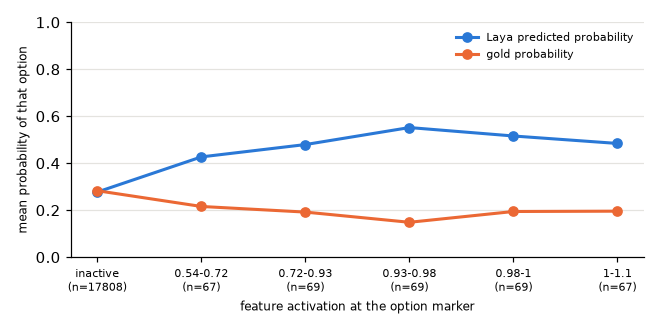

# Feature 2492

Critérios em que aparece: pred_probe_right_laya_wrong

**Interpretação (preencher):** 

---

## Maiores ativações

**tr_customer_service_000013 / action** (choice, customer_service) | ativação 9.406 em `estado` | opções ['answer_directly', 'close_no_action', 'escalate_to_human', 'execute_refund', 'request_information'] | Laya: **close_no_action** [0.088, 0.889, 0.006, 0.006, 0.013] | gabarito: **request_information**

```
<bos> choice question: What should the assistant do next with this conversation?<eos>
▸ <mask> answer_directly: The assistant can resolve this itself with information it already has.
▸ <mask> close_no_action: No further action is warranted; the matter is settled.
▸ <mask> escalate_to_human: Hand off to a human agent with the appropriate authority.
▸ <mask> execute_refund: Issue the refund or credit the customer is owed.
▸ <mask> request_information: More detail is needed from the customer before anything can be done.

<eos>

 {"account": {"lifetime_value_usd": 148, "prior_tickets_90d": 0, "seats": 40, "tenure_months": 3, "tier": "enterprise"}, "orders": [{"amount_usd": 198, "date": "2026-03-15", "id": "A-40361", "status": "failed"}, {"amount_usd": 198, "date": "2026-01-06", "id": "A-31584", "status": "settled"}, {"amount_usd": 198, "date": "2026-03-27", "id": "A-12899", "status": "pending"}], "thread": [{"role": "customer", "text": "Our latest invoice shows $198 for the enterprise plan, but my contract says $149. This discrepancy needs fixing, or I’ll have to look elsewhere; I need this resolved by the 15th."}, {"role": "agent", "text": "I understand the pricing concern. Can you confirm the billing period the invoice covers and attach the invoice file?"}, {"role": "customer", "text": "It covers March to May, and I’ve attached the PDF. I’m also considering canceling if we can’t sort it out quickly."}, {"role": "agent", "text": "Thanks for the details. Do you have a copy of the original agreement or any previous invoices for comparison?"}, {"role": "customer", "text": "Yes, the original agreement is in the email from January; I’ll forward it. I need a clear answer before the 15th deadline we discussed."}, {"role": "agent", "text": "Got it. I’ll review the documents. In the meantime,⟦ could⟧ you tell me if any discounts were applied that you’re aware of?"}, {"role": "customer", "text": "No discounts that I know of. I’m waiting for your clarification so I can decide whether to stay or move on."}]}<eos>
```

**tr_customer_service_000225 / action** (choice, customer_service) | ativação 9.398 em `estado` | opções ['answer_directly', 'close_no_action', 'escalate_to_human', 'execute_refund', 'request_information'] | Laya: **close_no_action** [0.095, 0.85, 0.008, 0.02, 0.028] | gabarito: **request_information**

```
<bos> choice question: What should the assistant do next with this conversation?<eos>
▸ <mask> answer_directly: The assistant can resolve this itself with information it already has.
▸ <mask> close_no_action: No further action is warranted; the matter is settled.
▸ <mask> escalate_to_human: Hand off to a human agent with the appropriate authority.
▸ <mask> execute_refund: Issue the refund or credit the customer is owed.
▸ <mask> request_information: More detail is needed from the customer before anything can be done.

<eos>

 {"account": {"lifetime_value_usd": 419, "prior_tickets_90d": 1, "seats": 1, "tenure_months": 5, "tier": "standard"}, "orders": [{"amount_usd": 99, "date": "2026-01-07", "id": "A-67520", "status": "settled"}, {"amount_usd": 99, "date": "2026-03-11", "id": "A-78780", "status": "settled"}, {"amount_usd": 99, "date": "2026-02-08", "id": "A-39325", "status": "settled"}], "thread": [{"role": "customer", "text": "Hello, I’m writing because I accidentally dropped the $99 device I bought five months ago, and the screen is now completely cracked."}, {"role": "agent", "text": "I’m sorry to hear that your device was damaged. Could you please provide your order number and a brief description of the current display functionality?"}, {"role": "customer", "text": "The order number is #88291, and while the touch screen is unresponsive, the device still powers on."}, {"role": "agent", "text": "Thank you for providing those details. Just to ensure I have the full picture,⟦ could⟧ you tell me if there is any visible damage to the charging port or the frame?"}, {"role": "customer", "text": "No, the frame and charging port look perfectly fine, it is just the screen."}]}<eos>
```

**tr_customer_service_000240 / action** (choice, customer_service) | ativação 9.320 em `estado` | opções ['answer_directly', 'close_no_action', 'escalate_to_human', 'execute_refund', 'request_information'] | Laya: **close_no_action** [0.146, 0.837, 0.004, 0.006, 0.007] | gabarito: **answer_directly**

```
<bos> choice question: What should the assistant do next with this conversation?<eos>
▸ <mask> answer_directly: The assistant can resolve this itself with information it already has.
▸ <mask> close_no_action: No further action is warranted; the matter is settled.
▸ <mask> escalate_to_human: Hand off to a human agent with the appropriate authority.
▸ <mask> execute_refund: Issue the refund or credit the customer is owed.
▸ <mask> request_information: More detail is needed from the customer before anything can be done.

<eos>

 {"account": {"lifetime_value_usd": 363, "prior_tickets_90d": 0, "seats": 1, "tenure_months": 5, "tier": "standard"}, "thread": [{"role": "customer", "text": "I’d like to move my account from the Premium tier to the Standard tier, effective as of the 15th of next month."}, {"role": "agent", "text": "I understand you want to downgrade to Standard on that date. Could you confirm the email associated with the account so we can pull up the details?"}, {"role": "customer", "text": "The email is jane.doe@example.com, and I’ve been on the Premium plan for the past five months."}, {"role": "agent", "text": "Got it, Jane. Just to be clear, are there any additional services or add‑ons you’d like to keep after the downgrade?"}, {"role": "customer", "text": "No, I only need the core features that come with Standard. I also need to make sure my billing reflects the change by the deadline."}, {"role": "agent", "text": "Understood. To proceed,⟦ could⟧ you let me know if there are any outstanding invoices or credit balances we should account for before the switch?"}, {"role": "customer", "text": "There are no pending invoices; the last payment was processed last week. Please confirm the downgrade will be in place by the 15th."}]}<eos>
```

**tr_customer_service_000098 / action** (choice, customer_service) | ativação 9.312 em `estado` | opções ['answer_directly', 'close_no_action', 'escalate_to_human', 'execute_refund', 'request_information'] | Laya: **close_no_action** [0.068, 0.615, 0.021, 0.292, 0.004] | gabarito: **escalate_to_human**

```
<bos> choice question: What should the assistant do next with this conversation?<eos>
▸ <mask> answer_directly: The assistant can resolve this itself with information it already has.
▸ <mask> close_no_action: No further action is warranted; the matter is settled.
▸ <mask> escalate_to_human: Hand off to a human agent with the appropriate authority.
▸ <mask> execute_refund: Issue the refund or credit the customer is owed.
▸ <mask> request_information: More detail is needed from the customer before anything can be done.

<eos>

 {"account": {"lifetime_value_usd": 1673, "prior_tickets_90d": 1, "seats": 1, "tenure_months": 19, "tier": "free"}, "orders": [{"amount_usd": 29, "date": "2026-01-08", "id": "A-60719", "status": "settled"}, {"amount_usd": 29, "date": "2026-02-01", "id": "A-84709", "status": "pending"}], "thread": [{"role": "customer", "text": "I am beyond annoyed. I’ve been trying to downgrade my plan for weeks, yet you’re still charging me $29. I have an unresolved ticket sitting there and now you’re taking more money out of my account."}, {"role": "agent", "text": "I sincerely apologize for the frustration this billing issue has caused you. To help me pull up your account and review the status of your previous request,⟦ could⟧ you please share your account ID?"}, {"role": "customer", "text": "It’s 88392-AX. This has been going on for way too long and I’m tired of waiting for someone to actually help me with this."}]}<eos>
```

**tr_customer_service_000013 / category** (choice, customer_service) | ativação 9.266 em `estado` | opções ['account', 'billing', 'delivery', 'refund', 'technical'] | Laya: **billing** [0.0, 1.0, 0.0, 0.0, 0.0] | gabarito: **billing**

```
<bos> choice question: What is this customer conversation primarily about?<eos>
▸ <mask> account: Login, plan changes, profile or access management.
▸ <mask> billing: A charge, invoice, subscription or payment problem.
▸ <mask> delivery: Shipping, fulfilment or delivery of a physical item.
▸ <mask> refund: The customer is explicitly asking for money back.
▸ <mask> technical: The product or service is not working as expected.

<eos>

 {"account": {"lifetime_value_usd": 148, "prior_tickets_90d": 0, "seats": 40, "tenure_months": 3, "tier": "enterprise"}, "orders": [{"amount_usd": 198, "date": "2026-03-15", "id": "A-40361", "status": "failed"}, {"amount_usd": 198, "date": "2026-01-06", "id": "A-31584", "status": "settled"}, {"amount_usd": 198, "date": "2026-03-27", "id": "A-12899", "status": "pending"}], "thread": [{"role": "customer", "text": "Our latest invoice shows $198 for the enterprise plan, but my contract says $149. This discrepancy needs fixing, or I’ll have to look elsewhere; I need this resolved by the 15th."}, {"role": "agent", "text": "I understand the pricing concern. Can you confirm the billing period the invoice covers and attach the invoice file?"}, {"role": "customer", "text": "It covers March to May, and I’ve attached the PDF. I’m also considering canceling if we can’t sort it out quickly."}, {"role": "agent", "text": "Thanks for the details. Do you have a copy of the original agreement or any previous invoices for comparison?"}, {"role": "customer", "text": "Yes, the original agreement is in the email from January; I’ll forward it. I need a clear answer before the 15th deadline we discussed."}, {"role": "agent", "text": "Got it. I’ll review the documents. In the meantime,⟦ could⟧ you tell me if any discounts were applied that you’re aware of?"}, {"role": "customer", "text": "No discounts that I know of. I’m waiting for your clarification so I can decide whether to stay or move on."}]}<eos>
```

## Ativações medianas (faixa 40-60%, mediana 5.281)

**tr_customer_service_000254 / category** (choice, customer_service) | ativação 5.207 em `estado` | opções ['account', 'billing', 'delivery', 'refund', 'technical'] | Laya: **technical** [0.016, 0.001, 0.0, 0.001, 0.982] | gabarito: **technical**

```
<bos> choice question: What is this customer conversation primarily about?<eos>
▸ <mask> account: Login, plan changes, profile or access management.
▸ <mask> billing: A charge, invoice, subscription or payment problem.
▸ <mask> delivery: Shipping, fulfilment or delivery of a physical item.
▸ <mask> refund: The customer is explicitly asking for money back.
▸ <mask> technical: The product or service is not working as expected.

<eos>

 {"account": {"lifetime_value_usd": 3273, "prior_tickets_90d": 0, "seats": 1, "tenure_months": 49, "tier": "free"}, "thread": [{"role": "customer", "text": "The export tool is completely broken and I have a hard deadline tonight. I’ve been using this free plan for 49 months and never seen it this bad."}, {"role": "agent", "text": "I am sorry to hear you are having trouble with the export tool.⟦ Could⟧ you please describe what happens exactly when you click the export button?"}, {"role": "customer", "text": "It just hangs indefinitely. I click it, the wheel spins, and nothing ever downloads."}, {"role": "agent", "text": "Thank you for clarifying. Are you seeing any notifications or pop-ups appear in the corner of your browser when the process stalls?"}, {"role": "customer", "text": "No, it’s just dead silence. Nothing happens at all, and I'm losing time."}, {"role": "agent", "text": "I appreciate you checking that. Which browser and version are you currently using to access the site?"}, {"role": "customer", "text": "I'm on Chrome, version 124. Get this moving, please."}]}<eos>
```

**tr_customer_service_000220 / category** (choice, customer_service) | ativação 5.281 em `estado` | opções ['account', 'billing', 'delivery', 'refund', 'technical'] | Laya: **technical** [0.077, 0.003, 0.0, 0.002, 0.918] | gabarito: **account**

```
<bos> choice question: What is this customer conversation primarily about?<eos>
▸ <mask> account: Login, plan changes, profile or access management.
▸ <mask> billing: A charge, invoice, subscription or payment problem.
▸ <mask> delivery: Shipping, fulfilment or delivery of a physical item.
▸ <mask> refund: The customer is explicitly asking for money back.
▸ <mask> technical: The product or service is not working as expected.

<eos>

 {"account": {"lifetime_value_usd": 94, "prior_tickets_90d": 0, "seats": 1, "tenure_months": 1, "tier": "standard"}, "orders": [{"amount_usd": 9, "date": "2026-01-18", "id": "A-69685", "status": "settled"}, {"amount_usd": 9, "date": "2026-03-15", "id": "A-58214", "status": "settled"}, {"amount_usd": 9, "date": "2026-02-06", "id": "A-56446", "status": "failed"}], "thread": [{"role": "customer", "text": "I’ve been trying to log into my account for the past hour and it keeps throwing an error. I have a major presentation due in two hours and this is beyond frustrating. Why is this happening?"}, {"role": "agent", "text": "I’m sorry to hear you're experiencing trouble accessing your account right before your deadline.⟦ Could⟧ you please provide the specific error message or code you are seeing on your screen?"}, {"role": "customer", "text": "It just says 'Authentication Failed' no matter how many times I reset my password. I don't have time for this nonsense, I need access now."}, {"role": "agent", "text": "Thank you for that information. To help me investigate further, are you attempting to log in via a web browser or our mobile application?"}, {"role": "customer", "text": "I am using Chrome on my laptop, just like I do every single day. Just fix it, I have people waiting on these files."}]}<eos>
```

**tr_customer_service_000165 / action** (choice, customer_service) | ativação 5.438 em `estado` | opções ['answer_directly', 'close_no_action', 'escalate_to_human', 'execute_refund', 'request_information'] | Laya: **answer_directly** [0.471, 0.346, 0.043, 0.125, 0.015] | gabarito: **escalate_to_human**

```
<bos> choice question: What should the assistant do next with this conversation?<eos>
▸ <mask> answer_directly: The assistant can resolve this itself with information it already has.
▸ <mask> close_no_action: No further action is warranted; the matter is settled.
▸ <mask> escalate_to_human: Hand off to a human agent with the appropriate authority.
▸ <mask> execute_refund: Issue the refund or credit the customer is owed.
▸ <mask> request_information: More detail is needed from the customer before anything can be done.

<eos>

 {"account": {"lifetime_value_usd": 4890, "prior_tickets_90d": 3, "seats": 1, "tenure_months": 60, "tier": "premium"}, "orders": [{"amount_usd": 19, "date": "2026-01-24", "id": "A-27992", "status": "settled"}, {"amount_usd": 19, "date": "2026-02-04", "id": "A-63170", "status": "settled"}, {"amount_usd": 19, "date": "2026-02-15", "id": "A-75660", "status": "settled"}], "thread": [{"role": "customer", "text": "Hi, I was checking my bank statement and noticed two charges from you guys for the same $19 amount. I'm really confused—am I getting billed twice for the same premium subscription?"}, {"role": "agent", "text": "Hello, thank you for reaching out to us. I would be happy to look into these charges for you.⟦ Could⟧ you please confirm the dates of the transactions you are seeing?"}, {"role": "customer", "text": "They both hit on the 12th. I've been with you for five years now and I've had three previous tickets where things were promised but never actually followed through on, so I'm hoping this one is different."}, {"role": "agent", "text": "I appreciate your long-term membership and I sincerely apologize for any previous lapses in service. I am checking your billing ledger now; could you verify the email address associated with the account?"}, {"role": "customer", "text": "It’s under j.doe@email.com. I really just want to understand why my account would show two charges when I’ve only ever had one plan."}, {"role": "agent", "text": "Thank you for that information. I am currently reviewing your billing cycle. To ensure I'm looking at the right data, could you clarify if you recently made any changes to your payment method?"}, {"role": "customer", "text": "No, I haven't touched my settings in years. I’m just trying to make sense of why my balance is off."}]}<eos>
```

**tr_customer_service_000145 / churn_risk** (score, customer_service) | ativação 5.145 em `estado` | opções ['0', '1', '2', '3'] | Laya: **2** [0.047, 0.345, 0.572, 0.035] | gabarito: **3**

```
<bos> score question: How likely is this customer to stop doing business with us because of this interaction?<eos>
▸ <mask> level 0: No sign of dissatisfaction.
▸ <mask> level 1: Mild frustration, but the relationship is intact.
▸ <mask> level 2: Clearly unhappy; repeat problems or explicit complaints.
▸ <mask> level 3: Imminent: threatening to cancel, dispute or leave.

<eos>

 {"account": {"lifetime_value_usd": 1881, "prior_tickets_90d": 1, "seats": 1, "tenure_months": 41, "tier": "free"}, "orders": [{"amount_usd": 29, "date": "2026-03-03", "id": "A-31049", "status": "settled"}, {"amount_usd": 29, "date": "2026-03-09", "id": "A-25889", "status": "settled"}, {"amount_usd": 29, "date": "2026-03-23", "id": "A-16677", "status": "settled"}], "thread": [{"role": "customer", "text": "Hi, I’m writing again because the “Export to CSV” button on my dashboard has been broken for a few days now. I’ve been on the Free plan for 41 months, paying about $29 annually, and I already opened Ticket #2098 which never got resolved. If this can’t be fixed soon, I’ll have to look elsewhere."}, {"role": "agent", "text": "I understand how frustrating that must be, especially after waiting on Ticket #2098.⟦ Could⟧ you tell me exactly what happens when you click the export button—any error messages or just no response?"}, {"role": "customer", "text": "When I click it, the page just spins for a while and then nothing happens. There’s no error pop‑up, just silence."}, {"role": "agent", "text": "Thanks for the detail. Are you seeing this issue on all browsers, or have you tried a different one to see if the behavior changes?"}, {"role": "customer", "text": "I tried Chrome and Firefox, same result on both. I also cleared my cache, but the button still does nothing."}]}<eos>
```

**tr_customer_service_000248 / action** (choice, customer_service) | ativação 5.195 em `estado` | opções ['answer_directly', 'close_no_action', 'escalate_to_human', 'execute_refund', 'request_information'] | Laya: **close_no_action** [0.144, 0.749, 0.004, 0.098, 0.006] | gabarito: **escalate_to_human**

```
<bos> choice question: What should the assistant do next with this conversation?<eos>
▸ <mask> answer_directly: The assistant can resolve this itself with information it already has.
▸ <mask> close_no_action: No further action is warranted; the matter is settled.
▸ <mask> escalate_to_human: Hand off to a human agent with the appropriate authority.
▸ <mask> execute_refund: Issue the refund or credit the customer is owed.
▸ <mask> request_information: More detail is needed from the customer before anything can be done.

<eos>

 {"account": {"lifetime_value_usd": 5956, "prior_tickets_90d": 0, "seats": 1, "tenure_months": 72, "tier": "standard"}, "orders": [{"amount_usd": 19, "date": "2026-02-20", "id": "A-97410", "status": "pending"}], "thread": [{"role": "customer", "text": "I just opened my package and I'm quite puzzled, I ordered the matte black frame but the one in the box is a very bright glossy silver."}, {"role": "agent", "text": "I appreciate you reaching out about this discrepancy.⟦ Could⟧ you let me know if the SKU number printed on the external packaging matches your order confirmation?"}, {"role": "customer", "text": "Let's see... the box says SKU-992, but I'm looking at the email I got when I ordered it and that says I should have received SKU-995."}, {"role": "agent", "text": "Thank you for checking that. Besides the color being incorrect, does the frame appear to be the correct size that you requested, or is that different as well?"}, {"role": "customer", "text": "The size seems to be the 11x14 I wanted, it's just the finish that's totally wrong and won't work for where I wanted to hang it."}, {"role": "agent", "text": "I understand. To help me document this correctly for our warehouse team, could you describe any other labels or markings you see on the inner protective wrapping?"}, {"role": "customer", "text": "There aren't really any other labels on the inside, just the clear plastic sleeve, so I'm still trying to figure out how I ended up with silver instead of black."}]}<eos>
```

## Estatísticas (conjunto de descoberta, dev e teste)

**pred / error**

| split | decisões | ativas | ativas e Laya errou | taxa | lift | q (BH) | OR (CMH) | q (CMH) |
|---|---|---|---|---|---|---|---|---|
| discovery | 5100 | 220 | 195 | 0.886 | 1.38 | 1.43e-15 | 0.87 | 0.896 |
| dev | 900 | 36 | 33 | 0.917 | 1.36 | 0.00423 | 0.11 | 0.511 |
| test | 2000 | 73 | 69 | 0.945 | 1.45 | 3.26e-08 | 1.47 | 0.909 |

**corr / error**

| split | decisões | ativas | ativas e Laya errou | taxa | lift | q (BH) | OR (CMH) | q (CMH) |
|---|---|---|---|---|---|---|---|---|
| discovery | 5100 | 31 | 6 | 0.194 | 0.30 | 1.55e-06 | 0.16 | 0.00363 |
| dev | 900 | 6 | 3 | 0.500 | 0.74 | nan | nan | nan |
| test | 2000 | 9 | 5 | 0.556 | 0.85 | nan | nan | nan |

**state / error**

| split | decisões | ativas | ativas e Laya errou | taxa | lift | q (BH) | OR (CMH) | q (CMH) |
|---|---|---|---|---|---|---|---|---|
| discovery | 5100 | 1075 | 605 | 0.563 | 0.87 | 1.63e-08 | 0.94 | 0.859 |
| dev | 900 | 150 | 91 | 0.607 | 0.90 | 0.323 | 1.12 | 0.893 |
| test | 2000 | 390 | 223 | 0.572 | 0.88 | 0.0122 | 0.71 | 0.344 |

**pred / probe_right_laya_wrong**

| split | decisões | ativas | ativas e Laya errou | taxa | lift | q (BH) | OR (CMH) | q (CMH) |
|---|---|---|---|---|---|---|---|---|
| discovery | 2819 | 140 | 140 | 1.000 | 1.55 | 2.47e-26 | inf | 0.367 |
| dev | 520 | 23 | 23 | 1.000 | 1.48 | 0.000827 | nan | nan |
| test | 1106 | 54 | 53 | 0.981 | 1.55 | 4.93e-09 | 0.50 | 0.913 |

**corr / probe_right_laya_wrong**

| split | decisões | ativas | ativas e Laya errou | taxa | lift | q (BH) | OR (CMH) | q (CMH) |
|---|---|---|---|---|---|---|---|---|
| discovery | 2819 | 1 | 1 | 1.000 | 1.55 | nan | nan | nan |
| dev | 520 | 0 | 0 | nan | nan | nan | nan | nan |
| test | 1106 | 1 | 0 | 0.000 | 0.00 | nan | nan | nan |

**state / probe_right_laya_wrong**

| split | decisões | ativas | ativas e Laya errou | taxa | lift | q (BH) | OR (CMH) | q (CMH) |
|---|---|---|---|---|---|---|---|---|
| discovery | 2819 | 589 | 302 | 0.513 | 0.79 | 1.48e-12 | 1.08 | 0.828 |
| dev | 520 | 81 | 46 | 0.568 | 0.84 | 0.23 | 1.45 | 0.642 |
| test | 1106 | 225 | 120 | 0.533 | 0.84 | 0.00937 | 1.73 | 0.258 |

Confusão mais sobre-representada (pred): `disposition|3>2` (n=133, lift 18.35, p=0). Formato `pergunta|índice previsto>índice correto`.

Confusão mais sobre-representada (corr): `disposition|1>3` (n=2, lift 109.68, p=0.000107). Formato `pergunta|índice previsto>índice correto`.

Confusão mais sobre-representada (state): `action|1>2` (n=65, lift 4.34, p=8.95e-38). Formato `pergunta|índice previsto>índice correto`.



